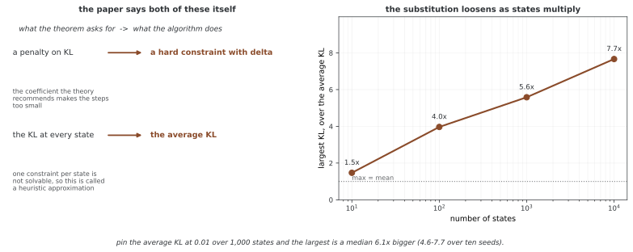

# 34.3.1 신뢰 영역 폴리시 최적화(TRPO)

TRPO(슐먼 외, 2015)는 폴리시 경사 방법의 근본 어려움, 곧 갱신 스텝을 얼마나 크게 잡아야 하는가를 다룬다. 스텝이 너무 크면 폴리시가 파국적으로 무너지고, 너무 작으면 계산을 낭비한다. TRPO는 폴리시 최적화를 쿨백-라이블러 발산 신뢰 영역으로 갱신을 제한하는 제약 최적화 문제로 세워 이를 푼다.

---

## 1. 동기

일반 폴리시 경사 갱신 $\theta \leftarrow \theta + \alpha \nabla_\theta J(\theta)$은 폴리시가 얼마나 바뀌는지에 아무 보장이 없다. 파라미터 $\theta$의 작은 바뀜이, 특히 민감한 영역에서는 폴리시 $\pi_\theta$의 큰 바뀜을 낳을 수 있다.

TRPO는 갱신마다 폴리시 분포가 얼마나 바뀔 수 있는지를 제한해 단조로운 개선을 보장한다.

---

## 2. 이론적 기초

### 대리 목표

TRPO는 실제 개선의 하한이 되는 대리 목표를 최대화한다.

$$L_{\pi_{\theta_\text{옛}}}(\theta) = \mathbb{E}_{s \sim d^{\pi_{\theta_\text{옛}}}, a \sim \pi_{\theta_\text{옛}}}\left[\frac{\pi_\theta(a|s)}{\pi_{\theta_\text{옛}}(a|s)} A^{\pi_{\theta_\text{옛}}}(s, a)\right]$$

중요도 샘플링을 쓰는 이 목표는 옛 폴리시 $\pi_{\theta_\text{옛}}$의 데이터로 새 폴리시 $\pi_\theta$을 평가할 수 있게 한다.

### 단조로운 개선 정리

카케이드와 랭퍼드(2002)는 실제 성능 개선이 다음을 만족함을 보였다.

$$J(\pi_\theta) \geq L_{\pi_{\theta_\text{옛}}}(\theta) - C \cdot D_\text{KL}^{\max}(\pi_{\theta_\text{옛}} \| \pi_\theta)$$

여기서 $C = \frac{2\gamma \epsilon}{(1-\gamma)^2}$이고 $\epsilon = \max_s |A^{\pi}(s, a)|$이다.

### TRPO 최적화 문제

TRPO는 벌점을 하드 제약으로 대체한다.

$$\max_\theta \quad L_{\pi_{\theta_\text{옛}}}(\theta)$$

$$\text{단} \quad \bar{D}_\text{KL}(\pi_{\theta_\text{옛}} \| \pi_\theta) \leq \delta$$

여기서 $\bar{D}_\text{KL}$은 상태에 걸친 평균 쿨백-라이블러 발산이고 $\delta$은 신뢰 영역 반지름(흔히 $0.01$)이다.

<div class="storybox" markdown>

**그림으로 보는 AI 1.** 정리에서 알고리즘으로 가는 길에 난 두 자리

위 두 절을 나란히 읽으면 조용히 바뀐 데가 둘이다. 정리는 **벌점**으로 적혀 있는데 알고리즘은 **하드 제약**을 쓰고, 정리는 **모든 상태에서의 최대** KL을 말하는데 알고리즘은 **평균** KL을 쓴다. 눈여겨볼 것은 이 바꿔 쓰기를 뒷사람이 지적한 것이 아니라 **TRPO 논문이 스스로 적어 두었다**는 점이다.

첫째에 대해 — "In practice, if we used the penalty coefficient $C$ recommended by the theory above, the step sizes would be **very small**." 그래서 계수를 줄이고 싶은데 "it is hard to robustly choose the penalty coefficient, so we use a hard constraint instead of a penalty, with parameter $\delta$." 이론이 준 $C$ 를 그대로 쓰면 걸음이 너무 작아 쓸 수 없더라는 것이다.

둘째에 대해 — 상태마다 제약을 하나씩 두는 문제는 "impractical to solve due to the large number of constraints"이고, 그래서 평균을 쓰는 것을 논문은 **"a heuristic approximation"** 이라고 부른다. 어림이라고 제 입으로 적은 것이다.



둘째 바꿔 쓰기가 얼마나 느슨한지는 재어 볼 수 있다. 상태마다 폴리시를 한 스텝 바꿔 놓고 **가장 큰 KL**을 **평균 KL**로 나눠 보면, 상태가 열 개일 때 1.5배인 것이 만 개가 되면 **7.7배**가 된다. 평균 KL을 흔히 쓰는 $\delta = 0.01$ 에 맞춰 놓아도 어떤 상태에서는 그보다 **여섯 배 넘게** 큰 변화가 일어난다 — 상태 천 개에서 시드 열 개를 돌려 중앙값 6.1배였다.

**그리고 벌어지는 방향이 하필 나쁜 쪽이다.** 상태가 많을수록 차이가 커지는데, 신뢰 영역이 필요한 문제가 바로 상태가 많은 문제다. 작은 문제에서 "평균이나 최대나 비슷하다"고 확인하고 큰 문제로 옮기면, 확인한 성질이 함께 따라오지 않는다.

**그렇다고 TRPO가 틀린 것은 아니다.** 논문은 최대 KL 버전을 따로 돌려 보고 "the average KL divergence constraint has a similar effect as the theoretically justified maximum KL divergence"라고 적어 두었다 — 다만 그 확인은 카트폴에서만 할 수 있었다고 함께 밝힌다. 요점은 이것이다. 아래 3절부터 보게 될 켤레 그래디언트도 백트래킹 선 탐색도 **정리가 보증한 그 문제를 푸는 것이 아니라, 두 번 갈아 끼운 뒤의 문제를 푼다.** 단조로운 개선이 수학으로 보장된다고 읽으면 안 되는 까닭이 그것이다.

_확인한 곳 — J. Schulman, S. Levine, P. Moritz, M. Jordan, P. Abbeel, "Trust Region Policy Optimization", ICML 2015 (arXiv:1502.05477). 벌점 계수를 쓰면 걸음이 너무 작다는 말과 하드 제약으로 바꾼다는 말은 4절과 5절의 요약, 평균 KL을 "heuristic approximation"이라 부른 것은 4절, 최대 KL 에피소드와 비슷하더라는 실험은 8절이다. 단조로운 개선 경계 자체는 S. Kakade, J. Langford, "Approximately Optimal Approximate Reinforcement Learning" (2002) 에서 온다. 오른쪽 그림의 수는 그림을 그리는 코드가 시드를 박고 직접 재어 얻는다._

</div>

---

## 3. 알고리즘

### 켤레 그래디언트 방법

TRPO는 켤레 그래디언트 알고리즘으로 다음을 추정하여 푼다.

$$\theta_{k+1} = \theta_k + \alpha \hat{F}^{-1} \hat{g}$$

여기서:

- $\hat{g} = \nabla_\theta L(\theta)|_{\theta_k}$은 폴리시 경사다
- $\hat{F}$은 피셔 정보 행렬(쿨백-라이블러 발산의 헤세 행렬)이다
- $\alpha$은 쿨백-라이블러 제약을 채우도록 백트래킹 선 탐색으로 정한다

### 피셔-벡터 곱

$\hat{F}^{-1} g$을 직접 계산하는 일은 큰 네트워크에서 다룰 수 없다. 그 대신 켤레 그래디언트 방법은 피셔-벡터 곱 $\hat{F}v$만을 필요로 하며 이는 다음으로 값싸게 계산한다.

$$\hat{F}v = \nabla_\theta \left[(\nabla_\theta \bar{D}_\text{KL})^\top v\right]$$

이는 역전파 두 번이면 되므로 행렬을 명시적으로 만들지 않아도 된다.

### 백트래킹 선 탐색

탐색 방향 $s = \hat{F}^{-1}g$을 계산한 뒤 TRPO는 스텝 크기를 정한다.

1. 가장 큰 스텝을 계산한다: $\alpha_\text{최대} = \sqrt{\frac{2\delta}{s^\top \hat{F} s}}$
2. $k = 0, 1, 2, \ldots$에 대해 $\alpha = \alpha_\text{최대} \cdot \beta^k$을 시도한다
3. (a) 쿨백-라이블러 제약과 (b) 대리 목표의 나아짐을 함께 채우는 첫 $\alpha$을 받아들인다

---

## 4. TRPO 의사코드

```
되풀이마다:
    π_θ으로 자취를 모은다
    이점을 셈한다(GAE)

    폴리시 그래디언트 g = ∇_θ L(θ)을 셈한다
    켤레 그래디언트로 찾는 쪽 s = F⁻¹g을 셈한다
    가장 큰 스텝 크기를 셈한다: α_최대 = sqrt(2δ / s^T F s)

    되짚어 가는 줄 찾기:
        for k = 0, 1, 2, ..., K:
            θ_새 = θ + α_최대 · β^k · s
            if KL(π_옛 || π_새) ≤ δ and L(θ_새) > L(θ):
                θ_새를 받아들인다
                멈춘다

    값 함수를 고친다(따로 둔 가장 좋게 하는 개)
```

---

## 5. 성질

### 장점
- (정확히 최적화할 때) 단조로운 개선이 보장된다
- 파라미터 선택에 강건하다
- 여러 둘레에 걸쳐 학습이 강건하다
- 러닝레이트를 튜닝할 필요가 없다

### 단점
- 구현이 복잡하다(켤레 그래디언트, 선 탐색)
- 되풀이마다 계산이 비싸다
- 아주 큰 네트워크에서는 잘 확장되지 않는다
- 이차 계산의 오버헤드가 있다

---

## 6. 파라미터

| 파라미터 | 흔한 값 | 뜻 |
|-----------|--------------|-------------|
| $\delta$ | 0.01 | 쿨백-라이블러 제약(신뢰 영역 크기) |
| 켤레 그래디언트 반복 | 10 | 켤레 그래디언트 스텝 |
| 켤레 그래디언트 감쇠 | 0.1 | 피셔 행렬 감쇠(damping) |
| 선 탐색 스텝 | 10 | 백트래킹 시도 |
| 백트래킹 비율 $\beta$ | 0.5 | 스텝 크기 감쇠 |

---

## 연습문제

<div class="drillbox" markdown>

**연습문제 1.** <span class="diff hard" title="어려움"></span>
이 절에서 다룬 방법의 폴리시 경사를 유도하라. 어느 항이 추정해야 하는 것이고 어느 항이 정확히 계산할 수 있는 것인지 분명히 밝혀라.

</div>

??? success "풀이"
    폴리시 경사는 $\nabla_\theta J(\theta) = \mathbb{E}_{\tau \sim \pi_\theta}[\sum_t \nabla_\theta \log \pi_\theta(a_t | s_t) \cdot \hat{A}_t]$ 형태이며, 여기서 $\hat{A}_t$은 어드밴티지 추정값이다. 로그 확률 그래디언트 $\nabla_\theta \log \pi_\theta$은 자동 미분으로 정확히 계산할 수 있다. 어드밴티지 $\hat{A}_t$은 샘플링한 궤적에서 추정해야 하므로 분산이 들어온다. 기댓값은 궤적 배치에 걸친 평균으로 추정한다. 베이스라인으로 분산을 줄이면 불편성을 지키면서 추정 잡음을 줄인다. $\square$

---

<div class="drillbox" markdown>

**연습문제 2.** <span class="diff med" title="중간"></span>
연속 제어 과제에서 이 방법의 샘플 효율을 밸류 기반 방법(예를 들어 DQN)과 비교하여라. 관찰되는 차이의 이론적 까닭을 설명하라.

</div>

??? success "풀이"
    폴리시 기반 방법은 온폴리시 데이터를 쓰므로(궤적마다 한 번씩 쓴다) 밸류 기반 방법보다 샘플 효율이 대체로 낮다. DQN은 경험 리플레이로 데이터를 재사용해서 더 나은 샘플 효율을 얻는다. 그러나 폴리시 방법은 연속 액션을 자연스럽게 다루고(액션 공간에 대한 argmax가 필요 없다), 최적 폴리시가 확률적 폴리시일 때 그리로 수렴하며, 신뢰 영역 아래에서 단조로운 개선을 보장한다. 오프폴리시 Actor-Critic 방법(DDPG, SAC)은 폴리시 최적화와 경험 리플레이를 엮어 이 간극을 메운다. $\square$

---

<div class="drillbox" markdown>

**연습문제 3.** <span class="diff med" title="중간"></span>
간단한 연속 제어 과제(예를 들어 Pendulum-v1)에 이 방법을 구현하라. 러닝레이트와 이 방법 고유의 중요한 하이퍼파라미터에 대해 얼마나 민감한지 보고하라.

</div>

??? success "풀이"
    가우스 폴리시를 쓰는 Pendulum-v1에서 전형적인 결과는 이렇다. 러닝레이트 $3 \times 10^{-4}$이면 약 500 에피소드에 수렴하고, $10^{-3}$이면 진동하며, $10^{-5}$이면 너무 더디게 수렴한다. 이 방법 고유의 하이퍼파라미터(예를 들어 PPO의 클리핑 범위, TRPO의 쿨백-라이블러 제약)는 갱신의 공격성과 안정성 사이의 트레이드오프를 조절한다. 너무 공격적이면 성능이 무너지고 너무 보수적이면 샘플을 낭비한다. 최적 지점은 이 둘의 균형을 맞추는 곳이며 흔히 좁은 범위에서 격자 탐색으로 찾는다. $\square$

---

<div class="drillbox" markdown>

**연습문제 4.** <span class="diff med" title="중간"></span>
액션 공간이 단체(합이 1인 자본 웨이트)이고 리워드가 위험 조정 리턴인 포트폴리오 배분 최적화에 이 방법을 어떻게 쓸 수 있을지 논하라.

</div>

??? success "풀이"
    액션 공간은 $(n-1)$차원 단체 $\Delta^{n-1} = \{w \in \mathbb{R}^n : w_i \geq 0, \sum_i w_i = 1\}$이다. 폴리시는 디리클레 분포나 소프트맥스로 변환한 가우스 분포를 쓸 수 있다. 리워드는 그 포트폴리오 배분의 샤프 비율이나 미분 샤프 비율이다. 어려움으로는 고차원 액션 공간(자산이 많다), 잦은 리밸런싱에 벌점을 주는 거래 비용, 시장 리턴의 비정상성이 있다. 이 절의 방법은 폴리시를 안정적으로 갱신하는 자체 장치로 이를 다룬다. $\square$

## 정리하며

TRPO는 제약된 갱신으로 강건한 폴리시 최적화에 이론적 근거가 있는 길을 준다. 단조로운 개선을 이론적으로 보장하고 파라미터에 강건한 덕분에 큰 스텝을 내디뎠다. 구현이 더 쉬운 PPO가 실제로는 TRPO를 거의 대체했으나, TRPO의 이론적 틀은 여전히 기반으로 자리한다.
