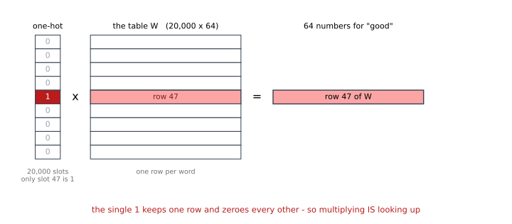
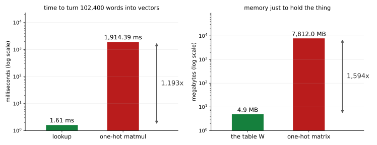

# 단어는 수가 아니다 — 조회가 곧 행렬 곱이다

<div class="leadbox" markdown>

**들어가는 이야기** — 좋음 더하기 나쁨은 「off」다

앞의 세 장은 그림을 다루었다. 그림은 **처음부터 수였다** — 화소 하나가 0에서 255 사이의 수이고, 784개를 늘어놓으면 그대로 벡터다. 더하고 빼고 평균 낼 수 있었다.

낱말은 그렇지 않다. `cat`은 수가 아니다.

가장 쉬운 수법은 번호를 매기는 것이다. 영화평 2만 5천 편에 나오는 낱말을 흔한 순서로 줄 세우면 `good`이 **47번**, `bad`가 **73번**이 된다. 그러면 물어보자 — **47 더하기 73은 무엇인가?**

120번이고, 거기 있는 낱말은 **`off`**다. 좋음과 나쁨을 더했더니 「꺼짐」이 나왔다. 아무 뜻이 없다.

번호가 이웃인 것도 뜻이 없다.

```
 2340  relatively      2343  danger
 2341  teenagers       2344  walks
 2342  haunted         2345  creatures
```

**여섯이 모두 213번씩 나온 낱말들**이다. 같은 횟수라 순서를 매길 근거가 없어 아무렇게나 줄 세운 것뿐이다. 번호는 **이름**이지 크기가 아니다.

그래서 이 장은 낱말마다 **수를 여럿** 준다. 그것이 임베딩이고, 이 쪽은 그 첫걸음이 사실 **아주 익숙한 것**임을 보인다 — 조회는 곱셈이다.

</div>

---

## 1. 코드

```python
"""단어는 수가 아니다 — 조회가 곧 행렬 곱이다.

그림은 처음부터 수였다. 화소 하나가 0에서 255 사이의 수이고 784개를
늘어놓으면 벡터다. 낱말은 그렇지 않다.

사전 순서대로 번호를 매기면 cat 이 2,341번이 되는데 그 수로 무엇을 할
수 있는가. 2,341 과 2,342 를 더하거나 빼는 것에 뜻이 있는가. 이 쪽은
그것을 자료로 보이고, 임베딩이 그 문제를 어떻게 비켜 가는지 보인다.

핵심은 하나다 — 「임베딩 조회는 원핫 벡터에 행렬을 곱한 것과 같다.」
같다면 왜 굳이 조회로 하는가. 재어 보면 답이 나온다.

자료는 7장과 같은 IMDB 영화평이다.
실행: 이 쪽의 코드를 파일로 갈무리해 저장소 뿌리에서 돌린다.
"""
import re
import time
from collections import Counter
from pathlib import Path

import torch
import torch.nn as nn

SEED, VOCAB, DIM = 42, 20000, 64
ROOT = Path("./data/aclImdb")
TOKEN = re.compile(r"[a-z']+")
torch.manual_seed(SEED)


def tokenize(text):
    return TOKEN.findall(text.replace("<br />", " ").lower())


def build_vocab():
    c = Counter()
    for name in ("pos", "neg"):
        for f in sorted((ROOT / "train" / name).glob("*.txt")):
            c.update(tokenize(f.read_text(encoding="utf-8")))
    return [w for w, _ in c.most_common(VOCAB)], c


if __name__ == "__main__":
    words, counts = build_vocab()
    stoi = {w: i for i, w in enumerate(words)}
    print(f"  영화평 25,000편에서 낱말 {len(counts):,}가지, 그 가운데 흔한 "
          f"{VOCAB:,}개를 쓴다\n")

    # === 1. 번호는 이름일 뿐이다 ===========================================
    print("  번호가 이웃이라고 뜻이 이웃인 것은 아니다")
    for i in range(2340, 2346):
        print(f"    {i:5d}  {words[i]:<14s} ({counts[words[i]]:,}번 나옴)")
    a, b = stoi["good"], stoi["bad"]
    print(f"\n    good 은 {a}번, bad 는 {b}번이다. 둘을 더하면 {a + b}번인데")
    print(f"    거기 있는 낱말은 '{words[(a + b) % VOCAB]}' 이다 — 아무 뜻이 없다")

    # === 2. 조회는 원핫에 행렬을 곱한 것과 같다 =============================
    emb = nn.Embedding(VOCAB, DIM)
    W = emb.weight.detach()
    idx = torch.tensor([stoi[w] for w in ("good", "bad", "movie", "the")])
    onehot = torch.zeros(len(idx), VOCAB)
    onehot[torch.arange(len(idx)), idx] = 1.0
    with torch.no_grad():
        by_lookup = emb(idx)
        by_matmul = onehot @ W
    print(f"\n  조회한 것과 원핫에 곱한 것의 최대 차이 "
          f"{float((by_lookup - by_matmul).abs().max()):.2e}")

    # === 3. 같다면 왜 조회로 하는가 ========================================
    big = torch.randint(0, VOCAB, (256, 400))          # 평 256편, 길이 400
    flat = big.reshape(-1)
    oh = torch.zeros(flat.numel(), VOCAB)
    oh[torch.arange(flat.numel()), flat] = 1.0

    def clock(fn, n=20):
        fn(); t = time.perf_counter()
        for _ in range(n): fn()
        return (time.perf_counter() - t) / n * 1000

    with torch.no_grad():
        t_lookup = clock(lambda: emb(big))
        t_matmul = clock(lambda: oh @ W)
    print(f"\n  평 256편(낱말 {flat.numel():,}개)을 벡터로 바꾸는 데")
    print(f"    조회      {t_lookup:8.2f} ms")
    print(f"    원핫 곱   {t_matmul:8.2f} ms   ({t_matmul / t_lookup:.0f}배)")
    mb = lambda t: t.numel() * 4 / 1024 ** 2
    print(f"    원핫 행렬을 들고 있는 데만 {mb(oh):,.0f} MB 가 든다 "
          f"(임베딩 행렬은 {mb(W):.1f} MB)")

    # === 4. 수를 몇 개 줄 것인가 ==========================================
    print(f"\n  낱말 하나에 수를 d 개 주면 — 어휘 {VOCAB:,}개 기준")
    print(f"    {'d':>5}{'파라메터':>12}{'원핫이라면':>14}")
    for d in (1, 8, 64, 300):
        print(f"    {d:5d}{VOCAB * d:12,}{VOCAB * VOCAB:14,}")
    print(f"    원핫은 d 를 무엇으로 두든 {VOCAB:,} 칸짜리 벡터이고,")
    print(f"    서로 다른 두 낱말의 닮음이 언제나 0 이다")
```

**출력:**

```
  영화평 25,000편에서 낱말 85,680가지, 그 가운데 흔한 20,000개를 쓴다

  번호가 이웃이라고 뜻이 이웃인 것은 아니다
     2340  relatively     (213번 나옴)
     2341  teenagers      (213번 나옴)
     2342  haunted        (213번 나옴)
     2343  danger         (213번 나옴)
     2344  walks          (213번 나옴)
     2345  creatures      (213번 나옴)

    good 은 47번, bad 는 73번이다. 둘을 더하면 120번인데
    거기 있는 낱말은 'off' 이다 — 아무 뜻이 없다

  조회한 것과 원핫에 곱한 것의 최대 차이 0.00e+00

  평 256편(낱말 102,400개)을 벡터로 바꾸는 데
    조회          1.61 ms
    원핫 곱    1914.39 ms   (1193배)
    원핫 행렬을 들고 있는 데만 7,812 MB 가 든다 (임베딩 행렬은 4.9 MB)

  낱말 하나에 수를 d 개 주면 — 어휘 20,000개 기준
        d        파라메터         원핫이라면
        1      20,000   400,000,000
        8     160,000   400,000,000
       64   1,280,000   400,000,000
      300   6,000,000   400,000,000
    원핫은 d 를 무엇으로 두든 20,000 칸짜리 벡터이고,
    서로 다른 두 낱말의 닮음이 언제나 0 이다
```

---

## 2. 조회는 원핫에 행렬을 곱한 것이다

낱말에 수를 여럿 주는 가장 곧은 길은 이렇다. 어휘가 2만 개이고 낱말마다 수를 64개 줄 것이라면, **2만 × 64짜리 표**를 하나 만들어 두고 낱말 번호로 그 줄을 꺼낸다. PyTorch의 `nn.Embedding`이 하는 일이 그것이다.

그런데 같은 일을 다르게 적을 수도 있다. 낱말을 **원핫 벡터**로 — 제 번호 자리만 1이고 나머지가 0인 2만 칸짜리 벡터로 — 적은 뒤, 그 표를 곱한다.

$$
\underbrace{[0, \dots, 0, 1, 0, \dots, 0]}_{\text{2만 칸, 47번만 1}}
\;\times\;
\underbrace{W}_{\text{2만} \times \text{64}}
\;=\;
\underbrace{W_{47}}_{\text{47번째 줄}}
$$



**둘은 같은 것이다.** 1인 칸 하나만 살아남으므로 곱셈의 결과가 곧 그 줄이다. 그림에서 보듯 **나머지 19,999개 줄은 0이 곱해져 사라진다.** 출력이 그것을 확인한다.

```
조회한 것과 원핫에 곱한 것의 최대 차이 0.00e+00
```

**0이다.** 비슷한 것이 아니라 글자 그대로 같다.

이것이 중요한 까닭은 **학습할 수 있는 것이 되기 때문**이다. 「표에서 꺼내 온다」는 미분할 수 있는 연산처럼 보이지 않지만, 「행렬을 곱한다」는 3장부터 줄곧 해 온 일이다. 임베딩 표는 **웨이트**이고, 다른 웨이트와 똑같이 경사 하강법으로 배운다.

---

## 3. 같다면 왜 굳이 조회로 하는가

식이 같으니 아무 쪽이나 써도 될 것 같다. 재어 보면 아니다.



**시간이 1,193배, 자리가 1,594배다.** 특히 오른쪽이 무섭다 — 7.8 기가바이트는 **노트북에서 아예 돌아가지 않는다.**

까닭은 단순하다. 원핫 행렬은 102,400 × 20,000 칸인데 **그 가운데 102,400개만 1이고 나머지는 전부 0**이다. 0을 곱하는 데 시간과 자리를 쓰는 것이다. 조회는 그 0들을 아예 만들지 않는다.

!!! note "두 수는 기계마다 다르다"
    1.61 ms와 1,914.39 ms는 이 글을 쓴 모델에서 잰 값이라 다른 모델에서는 달라진다. **읽을 것은 두 수 자체가 아니라 비(1,193배)**이고, 그 비조차 CPU와 메모리에 따라 움직인다.

    7,812 MB는 그렇지 않다 — $102{,}400 \times 20{,}000 \times 4$바이트라 모델과 무관하다.

---

## 4. 수를 몇 개 줄 것인가

낱말 하나에 수를 $d$개 주기로 하면 표가 $20{,}000 \times d$가 된다.

| $d$ | 파라메터 | 원핫이라면 |
|---|---|---|
| 1 | 20,000 | 400,000,000 |
| 8 | 160,000 | 400,000,000 |
| 64 | **1,280,000** | 400,000,000 |
| 300 | 6,000,000 | 400,000,000 |

오른쪽 칸이 왜 고정인가. 원핫에는 **고를 것이 없기 때문**이다. 어휘가 2만이면 벡터가 2만 칸이고, 그게 전부다.

그리고 원핫에는 더 깊은 문제가 있다. **서로 다른 두 낱말의 닮음이 언제나 0이다.** 두 벡터가 얼마나 닮았는지는 보통 **내적**으로 잰다 — 같은 자리끼리 곱해서 모두 더하는 것이다. 그런데 원핫은 1이 선 자리가 낱말마다 달라서, 한쪽이 1이면 다른 쪽은 반드시 0이다. 곱이 전부 0이니 합도 0이다. `good`과 `great`도, `good`과 `aardvark`도 똑같이 0이다. **원핫은 「같다/다르다」만 말할 수 있고 「얼마나 닮았다」를 말할 수 없다.**

$d$를 몇으로 둘지는 이 쪽이 정하지 않는다. [7.3절](../imdb/03_embedding.md)이 IMDB 분류에서 그것을 재는데, 1에서 4로 갈 때 8.89%포인트를 벌고 16에서 64로 갈 때 2.40%포인트를 번다. **앞쪽에서 거의 다 번다.**

---

## 5. 그런데 아직 아무것도 배우지 않았다

지금까지 만든 것은 **아무 수나 들어 있는 표**다. `nn.Embedding`을 만들면 난수로 채워지고, 그 상태에서 `good`과 `great`의 닮음을 재면 아무 뜻이 없다.

표를 뜻있게 만들려면 **무엇을 기준으로 배울지**를 정해야 한다. 다음 쪽이 그 기준 하나를 내놓는다 — **둘레에 같이 나오는 낱말끼리 가깝게.**

---

## 연습문제

<div class="drillbox" markdown>

**연습문제 1.** <span class="diff easy" title="쉬움"></span> 어휘 2만, $d = 64$일 때 원핫 행렬이 7,812 MB인 까닭을 셈으로 보이라. 평 256편에 낱말 400개씩이다.

</div>

??? success "풀이"

    낱말이 모두 $256 \times 400 = 102{,}400$개이고, 낱말마다 어휘 크기만 한 2만 칸짜리 벡터를 둔다. 칸 하나가 `float32`라 4바이트다.

    $$
    102{,}400 \times 20{,}000 \times 4 \;=\; 8{,}192{,}000{,}000 \text{ 바이트}
    $$

    $1\,\text{MB} = 1024^2$바이트로 나누면 **7,812.5 MB**다.

    임베딩 표는 $20{,}000 \times 64 \times 4 = 5{,}120{,}000$바이트로 **4.88 MB**다. **1,600배** 차이다.

<div class="drillbox" markdown>

**연습문제 2.** <span class="diff med" title="중간"></span> 들머리는 `good`(47번)과 `bad`(73번)를 더해 `off`(120번)가 나오는 것을 보였다. 번호에 뜻이 없다는 것을 보이는 **다른 방법**을 하나 더 설계하라.

</div>

??? success "풀이"

    몇 가지가 있다.

    **(가) 번호를 섞어 본다.** 어휘의 번호를 무작위로 다시 매기고 [7.3절](../imdb/03_embedding.md)의 모델을 다시 학습한다. 정확도가 그대로면 번호 자체에 정보가 없다는 뜻이다. (그대로일 것이다 — 임베딩 표의 줄 순서가 바뀔 뿐이다.)

    **(나) 번호를 그대로 입력에 넣어 본다.** 낱말마다 수를 하나만 주되 그 수를 **배우지 말고 번호를 그대로** 쓴다. 평의 평균 번호로 분류하면 어떤 정확도가 나오는가. 우연(50%)에 가까울 것이다.

    **(다) 이웃을 세어 본다.** 번호가 1 차이 나는 낱말 쌍을 많이 뽑아, 그 쌍이 실제로 뜻이 닮았는지 사람이 세어 본다. 출력의 여섯 낱말(relatively·teenagers·haunted·danger·walks·creatures)이 그 표본이다.

    (나)가 가장 싸고 결정적이다. 학습이 거의 없고, 「번호에 크기의 뜻이 있다면 적어도 우연보다는 나아야 한다」는 분명한 판정 기준이 있다.

<div class="drillbox" markdown>

**연습문제 3.** <span class="diff hard" title="어려움"></span> 2절은 조회와 원핫 곱이 **같다**고 했다. 그런데 **역전파**에서도 같은가. 두 길에서 $W$가 받는 그래디언트를 각각 따져 보고, 같다면 왜 조회 쪽이 싼지 설명하라.

</div>

??? success "풀이"

    **값은 같다.** 원핫 곱 $y = x^{\top} W$에서 $\partial L / \partial W = x \,(\partial L / \partial y)^{\top}$인데, $x$가 47번만 1인 원핫이므로 이 바깥곱은 **47번째 줄만 $\partial L/\partial y$이고 나머지는 전부 0**인 $20{,}000 \times 64$ 행렬이다.

    조회 쪽도 같은 것을 준다. `nn.Embedding`의 역전파는 꺼내 쓴 줄에만 그래디언트를 쌓는다(같은 낱말이 여러 번 나오면 더한다).

    **다른 것은 그 0들을 만드는지 여부다.** 원핫 길은 $20{,}000 \times 64$짜리 그래디언트 행렬을 통째로 만들었다가 거의 다 0인 채로 더한다. 조회 길은 **나온 낱말의 줄에만** 손을 댄다. 평 256편이면 많아야 102,400줄이고 서로 겹치니 실제로는 훨씬 적다.

    그래서 PyTorch에는 `sparse=True` 옵션이 있다. 그래디언트를 성긴 형태로 두어 옵티마이저도 건드린 줄만 갱신하게 한다. 어휘가 수십만으로 커지면 그 차이가 커지지만, 모든 옵티마이저가 성긴 그래디언트를 받지는 않으므로 쓰기 전에 확인해야 한다.
