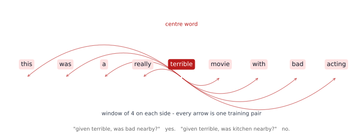
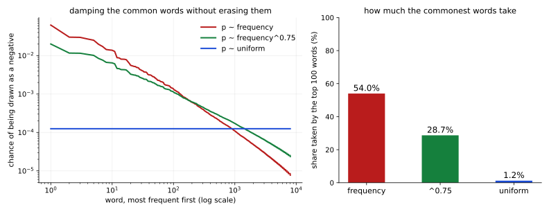
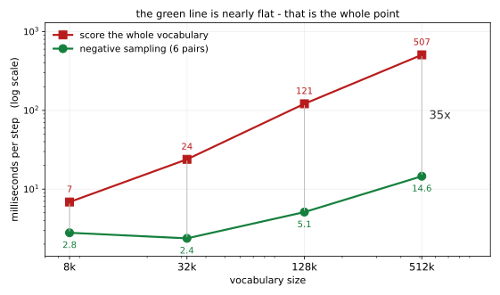

# 주위 단어가 뜻을 만든다 — Skip-gram 과 네거티브 샘플링

<div class="leadbox" markdown>

**들어가는 이야기** — 사전을 한 번도 안 보고 뜻을 배운다

[앞 쪽](01_not_a_number.md)이 만든 표에는 **아무 수나** 들어 있었다. 그 상태에서 `terrible`과 가까운 낱말을 뽑으면 이렇다.

```
terrible    queen, massive, max, almighty, article, boy's
```

아무 뜻이 없다. 표를 뜻있게 만들려면 **무엇을 기준으로 고칠지** 정해야 한다.

이 쪽이 쓰는 기준은 하나뿐이고, 놀랍도록 단순하다 — 「둘레에 같이 나오는 낱말끼리 가깝게.」 사전도, 품사도, 정답표도 쓰지 않는다. 가진 것은 영화평뿐이고 거기서 「어떤 낱말들이 서로 가까이 나오는가」만 센다.

그것만으로 배운 뒤 같은 낱말을 다시 뽑으면 이렇다.

```
terrible    awful, bad, horrible, pitiful, chuckle, laughable
good        decent, great, solid, fine, nice, classical
movie       film, drivel, thing, btw, preposterous, stinker
she         her, she's, husband, he, phillip, marie
```

**사전을 한 번도 보지 않고 「끔찍한」의 동의어들이 모였다.** 이것이 분포 가설 — 낱말의 뜻은 그 낱말이 **어울려 다니는 무리**에 있다는 생각 — 이 실제로 통한다는 증거다.

그런데 셋째 줄을 보라. `movie`의 이웃에 `drivel`(쓰레기 같은 글)과 `stinker`(망작)가 있다. 영화평에서는 **영화를 욕하는 말이 영화라는 말 곁에 자주 나오기** 때문이다. 배운 것은 「뜻」이 아니라 **「이 말뭉치에서 어울려 다니는 것」**이다.

</div>

---

## 1. 코드

```python
"""주위 단어가 뜻을 만든다 — Skip-gram 과 네거티브 샘플링.

앞 쪽이 만든 표에는 아무 수나 들어 있었다. 뜻있게 만들려면 기준이 있어야
한다. 이 쪽이 쓰는 기준은 하나다 — 「둘레에 같이 나오는 낱말끼리 가깝게.」

낱말의 뜻을 사전에서 가져오지 않는다. 정답표도 없다. 가진 것은 영화평
2만 5천 편뿐이고, 거기서 「어떤 낱말들이 서로 가까이 나오는가」만 센다.

두 가지를 잰다.
  (가) 그 기준 하나로 배운 벡터가 정말 뜻을 담는가 — 이웃 낱말을 뽑아 본다
  (나) 네거티브 샘플링이 왜 필요한가 — 전부 세는 길과 시간을 견준다

자료는 7장과 같은 IMDB 영화평이다.
실행: 이 쪽의 코드를 파일로 갈무리해 저장소 뿌리에서 돌린다.
"""
import math
import random
import re
import time
from collections import Counter
from pathlib import Path

import torch
import torch.nn as nn
import torch.nn.functional as F

SEED, VOCAB, DIM, WINDOW = 42, 8000, 64, 4
STEPS, BATCH, NEG, LR = 6000, 1024, 5, 3e-3
ROOT = Path("./data/aclImdb")
TOKEN = re.compile(r"[a-z']+")
device = torch.device("mps" if torch.backends.mps.is_available() else "cpu")


def sync():
    """MPS 는 비동기다. 동기화하지 않으면 큐에 넣는 시간만 재게 된다."""
    if device.type == "mps":
        torch.mps.synchronize()


def load_tokens(n_docs=6000):
    out = []
    for name in ("pos", "neg"):
        for f in sorted((ROOT / "train" / name).glob("*.txt"))[: n_docs // 2]:
            out += TOKEN.findall(f.read_text(encoding="utf-8")
                                 .replace("<br />", " ").lower())
    return out


toks = load_tokens()
counts = Counter(toks)
words = [w for w, _ in counts.most_common(VOCAB)]
stoi = {w: i for i, w in enumerate(words)}
ids = torch.tensor([stoi[w] for w in toks if w in stoi], dtype=torch.long)

# 네거티브를 뽑는 분포 — 빈도의 0.75 제곱. 흔한 낱말을 조금 눌러 준다
freq = torch.tensor([counts[w] for w in words], dtype=torch.float)
neg_p = (freq ** 0.75)
neg_p /= neg_p.sum()
# NCE 가 로짓에서 빼는 항. 네거티브 샘플링은 이것을 지운 것이다
LOGKP = (math.log(NEG) + neg_p.log()).to(device)


def pairs(g):
    """가운데 낱말과 그 둘레 낱말 한 쌍씩."""
    c = torch.randint(WINDOW, len(ids) - WINDOW, (BATCH,), generator=g)
    off = torch.randint(1, WINDOW + 1, (BATCH,), generator=g)
    off *= torch.where(torch.rand(BATCH, generator=g) < 0.5, -1, 1)
    return ids[c].to(device), ids[c + off].to(device)


class SkipGram(nn.Module):
    """가운데 낱말로 둘레 낱말을 맞힌다. 표를 둘 둔다 — 가운데용과 둘레용."""

    def __init__(self, v, d):
        super().__init__()
        self.mid = nn.Embedding(v, d)
        self.ctx = nn.Embedding(v, d)
        nn.init.normal_(self.mid.weight, std=0.1)
        nn.init.zeros_(self.ctx.weight)

    def full_loss(self, c, o):
        """어휘 전부를 놓고 소프트맥스 — 바른 길이지만 비싸다."""
        return F.cross_entropy(self.mid(c) @ self.ctx.weight.T, o)

    def nce_loss(self, c, o, g):
        """NCE — 네거티브 샘플링과 로짓 하나만 다르다. log k·P_n(w) 를 뺀다."""
        v = self.mid(c)
        pos = (v * self.ctx(o)).sum(-1) - LOGKP[o]
        ni = torch.multinomial(neg_p, c.size(0) * NEG, True,
                               generator=g).to(device)
        neg = torch.bmm(self.ctx(ni).view(c.size(0), NEG, -1),
                        v.unsqueeze(-1)).squeeze(-1) - LOGKP[ni].view(-1, NEG)
        return -(F.logsigmoid(pos).mean() + F.logsigmoid(-neg).sum(1).mean())

    def neg_loss(self, c, o, g):
        """맞는 짝 하나와 틀린 짝 NEG 개만 본다 — 네거티브 샘플링."""
        v = self.mid(c)                                   # (B, d)
        pos = (v * self.ctx(o)).sum(-1)                   # (B,)
        neg_ids = torch.multinomial(neg_p, c.size(0) * NEG, True,
                                    generator=g).to(device)
        neg = torch.bmm(self.ctx(neg_ids).view(c.size(0), NEG, -1),
                        v.unsqueeze(-1)).squeeze(-1)      # (B, NEG)
        return -(F.logsigmoid(pos).mean() + F.logsigmoid(-neg).sum(1).mean())


def train(kind):
    torch.manual_seed(SEED)
    m = SkipGram(VOCAB, DIM).to(device)
    opt = torch.optim.Adam(m.parameters(), lr=LR)
    g = torch.Generator().manual_seed(SEED)
    sync(); t0 = time.perf_counter()
    for _ in range(STEPS):
        c, o = pairs(g)
        loss = (m.full_loss(c, o) if kind == "full" else
                m.nce_loss(c, o, g) if kind == "nce" else m.neg_loss(c, o, g))
        opt.zero_grad(); loss.backward(); opt.step()
    sync()
    return m.eval(), (time.perf_counter() - t0) / STEPS * 1000


@torch.no_grad()
def neighbours(m, w, k=6):
    W = F.normalize(m.mid.weight, dim=1)
    s = W @ W[stoi[w]]
    s[stoi[w]] = -2
    return [words[i] for i in s.topk(k).indices.tolist()]


if __name__ == "__main__":
    print(f"  영화평 6,000편에서 낱말 {len(ids):,}개, 어휘 {VOCAB:,}개")
    print(f"  창 크기 {WINDOW}, 차원 {DIM}, {STEPS:,}스텝\n")

    probe = ["good", "terrible", "movie", "she", "funny"]

    torch.manual_seed(SEED)
    raw = SkipGram(VOCAB, DIM)
    print("  배우기 전 — 아무 수나 들어 있는 표")
    for w in probe[:3]:
        print(f"    {w:<10s} {', '.join(neighbours(raw, w))}")

    m_neg, t_neg = train("neg")
    print("\n  배운 뒤 — 네거티브 샘플링")
    for w in probe:
        print(f"    {w:<10s} {', '.join(neighbours(m_neg, w))}")

    m_full, t_full = train("full")
    print("\n  배운 뒤 — 어휘 전부를 놓고 소프트맥스")
    for w in probe:
        print(f"    {w:<10s} {', '.join(neighbours(m_full, w))}")

    print(f"\n  한 스텝에 드는 시간")
    print(f"    네거티브 {NEG}개   {t_neg:7.2f} ms")
    print(f"    어휘 전부    {t_full:7.2f} ms   ({t_full / t_neg:.1f}배)")
    print(f"    한 스텝에 점수를 매기는 짝의 수 — "
          f"{BATCH * (1 + NEG):,} 대 {BATCH * VOCAB:,}")

    # === 틀린 짝이 정말 틀렸는가 =========================================
    # 뽑은 네거티브를 말뭉치의 참 동시출현과 대조한다. 알고리즘은 이 대조를
    # 하지 않는다 — 하지 않는 것이 값싼 까닭이자, 배우는 것을 정하는 까닭이다.
    arr = ids.tolist()
    co = Counter()
    nb = [set() for _ in range(VOCAB)]
    for i, w in enumerate(arr):
        for d in range(1, WINDOW + 1):
            if i - d >= 0:
                co[(w, arr[i - d])] += 1
                nb[w].add(arr[i - d])
            if i + d < len(arr):
                co[(w, arr[i + d])] += 1
                nb[w].add(arr[i + d])

    gg = torch.Generator().manual_seed(SEED)
    seen = any_nb = in_win = 0
    for _ in range(200):
        c = torch.randint(WINDOW, len(ids) - WINDOW, (BATCH,), generator=gg)
        ni = torch.multinomial(neg_p, BATCH * NEG, True,
                               generator=gg).view(BATCH, NEG)
        for b in range(BATCH):
            mid_w = arr[c[b]]
            win = {arr[c[b] + d] for d in range(-WINDOW, WINDOW + 1) if d}
            for n in ni[b].tolist():
                seen += 1
                any_nb += n in nb[mid_w]
                in_win += n in win
    print(f"\n  뽑은 틀린 짝 {seen:,}개 가운데")
    print(f"    말뭉치 어딘가에서 실제로 이웃인 것 : "
          f"{any_nb:,} ({any_nb / seen * 100:.1f}%)")
    print(f"    바로 그 자리의 창 안에 있던 것     : "
          f"{in_win:,} ({in_win / seen * 100:.2f}%)")
    print(f"    한 낱말의 참 이웃 가짓수 중앙값    : "
          f"{sorted(len(s) for s in nb)[VOCAB // 2]}")

    # === 지운 항 하나가 최적점을 어디로 옮기나 ===========================
    # NCE 의 로짓은  u·v - log k·P_n(w)  다. 네거티브 샘플링은 뒤 항을 지운
    # 것이고, 그래서 그 항만큼을 내적이 떠안는다 — 그 자리가 PMI 다.
    ctx_tot = Counter()
    for (w, _), n in co.items():
        ctx_tot[w] += n
    sel = [q for q, n in co.items() if n >= 30][:4000]
    log_p = torch.tensor([math.log(co[q] / ctx_tot[q[0]]) for q in sel])
    pmi_k = torch.tensor([math.log(co[q] / ctx_tot[q[0]]
                                   / neg_p[q[1]].item()) - math.log(NEG)
                          for q in sel])

    def fit(y, x):
        xc, yc = x - x.mean(), y - y.mean()
        r = (xc * yc).mean() / (x.std(unbiased=False) * y.std(unbiased=False))
        return r.item(), ((xc * yc).sum() / (xc ** 2).sum()).item()

    @torch.no_grad()
    def dots(m):
        return torch.tensor([(m.mid.weight[a].cpu() * m.ctx.weight[b].cpu())
                             .sum().item() for a, b in sel])

    m_nce, _ = train("nce")
    print(f"\n  배운 내적이 무엇을 좇는가 ({len(sel):,}짝, k={NEG})")
    print(f"    {'':28s}{'PMI - log k':>22s}{'log p(o|c)':>22s}")
    for tag, mm in (("네거티브 샘플링 (항 지움)", m_neg), ("NCE (항 있음)", m_nce)):
        d = dots(mm)
        r1, s1 = fit(d, pmi_k); r2, s2 = fit(d, log_p)
        print(f"    {tag:24s}  r={r1:+.4f} 기울기={s1:5.3f}"
              f"   r={r2:+.4f} 기울기={s2:5.3f}")
    print("    저마다 제 예측을 좇는다 — 기울기가 1에 가까운 칸이 그것이다")

    # === 어휘를 키우면 언제부터 벌어지는가 ================================
    # 학습은 하지 않고 로스 한 번의 앞·뒤 계산만 잰다.
    # 「뽑는 일은 시간 재기 밖에 둔다」 — torch.multinomial 은 어휘 크기에
    # 비례해 비싸서, 그대로 두면 「점수 매기는 비용」이 아니라 「뽑는 비용」
    # 을 재게 된다. 실제 구현은 별칭 표(alias table)로 O(1) 에 뽑는다.
    print(f"\n  어휘를 키우면 (점수 매기는 비용만. 뽑는 일은 뺐다)")
    print(f"    {'어휘':>9}{'네거티브':>11}{'전부':>10}{'몇 배':>9}")
    for v in (8_000, 32_000, 128_000, 512_000):
        torch.manual_seed(SEED)
        mm = SkipGram(v, DIM).to(device)
        pp = torch.ones(v) / v
        c = torch.randint(0, v, (BATCH,), generator=torch.Generator()
                          .manual_seed(SEED)).to(device)
        o = torch.randint(0, v, (BATCH,), generator=torch.Generator()
                          .manual_seed(SEED + 1)).to(device)
        gg = torch.Generator().manual_seed(SEED)
        ni = torch.multinomial(pp, BATCH * NEG, True,
                               generator=gg).to(device)   # 미리 뽑아 둔다

        def step(full):
            mm.zero_grad()
            if full:
                loss = mm.full_loss(c, o)
            else:
                vv = mm.mid(c)
                pos = (vv * mm.ctx(o)).sum(-1)
                ng = torch.bmm(mm.ctx(ni).view(BATCH, NEG, -1),
                               vv.unsqueeze(-1)).squeeze(-1)
                loss = -(F.logsigmoid(pos).mean()
                         + F.logsigmoid(-ng).sum(1).mean())
            loss.backward()

        def clock(full, n=10):
            step(full); sync(); t = time.perf_counter()
            for _ in range(n): step(full)
            sync()
            return (time.perf_counter() - t) / n * 1000

        a, b = clock(False), clock(True)
        print(f"    {v:9,}{a:10.2f}ms{b:9.2f}ms{b / a:8.1f}배")
```

**출력:**

```
  영화평 6,000편에서 낱말 1,294,455개, 어휘 8,000개
  창 크기 4, 차원 64, 6,000스텝

  배우기 전 — 아무 수나 들어 있는 표
    good       relentlessly, done, shadow, hear, jo, taboo
    terrible   queen, massive, max, almighty, article, boy's
    movie      chikatilo, inventive, seas, repeatedly, pad, griffith

  배운 뒤 — 네거티브 샘플링
    good       decent, great, solid, fine, nice, classical
    terrible   awful, bad, horrible, pitiful, chuckle, laughable
    movie      film, drivel, thing, btw, preposterous, stinker
    she        her, she's, husband, he, phillip, marie
    funny      kinda, scary, quite, amusing, damn, appealing

  배운 뒤 — 어휘 전부를 놓고 소프트맥스
    good       decent, great, darn, nice, smart, passable
    terrible   lousy, horrible, amateurish, inept, passable, unfunny
    movie      film, turd, flick, misfire, otherwise, stinker
    she        her, she's, patty, he, rejects, sanjay
    funny      scary, childish, darn, quite, preachy, paced

  한 스텝에 드는 시간
    네거티브 5개      6.93 ms
    어휘 전부      12.37 ms   (1.8배)
    한 스텝에 점수를 매기는 짝의 수 — 6,144 대 8,192,000


  뽑은 틀린 짝 1,024,000개 가운데
    말뭉치 어딘가에서 실제로 이웃인 것 : 697,026 (68.1%)
    바로 그 자리의 창 안에 있던 것     : 30,048 (2.93%)
    한 낱말의 참 이웃 가짓수 중앙값    : 130

  배운 내적이 무엇을 좇는가 (4,000짝, k=5)
                                           PMI - log k            log p(o|c)
    네거티브 샘플링 (항 지움)           r=+0.8983 기울기=0.811   r=+0.7710 기울기=0.280
    NCE (항 있음)                r=+0.6195 기울기=1.558   r=+0.9752 기울기=0.986
    저마다 제 예측을 좇는다 — 기울기가 1에 가까운 칸이 그것이다

  어휘를 키우면 (점수 매기는 비용만. 뽑는 일은 뺐다)
           어휘       네거티브        전부      몇 배
        8,000      2.79ms     6.86ms     2.5배
       32,000      2.37ms    23.90ms    10.1배
      128,000      5.11ms   121.27ms    23.7배
      512,000     14.58ms   507.30ms    34.8배
```

---

## 2. 하는 일은 「다음 낱말 맞히기」가 아니다

이 쪽의 모델이 푸는 문제를 정확히 적으면 이렇다 — **가운데 낱말을 주고 그 둘레에 무엇이 있는지 맞혀라.**

```
… the acting was  [terrible]  and the plot made no sense …
                   가운데        둘레 ←→ 둘레
```

창 크기가 4이니 `terrible` 앞뒤 네 칸 안에서 아무거나 하나를 뽑아 짝으로 삼는다. 이 짝 맞히기를 **백만 번 넘게** 되풀이한다.



**화살표 하나가 학습 짝 하나다.** 가운데 낱말은 그대로 두고 둘레에서 하나씩 바꿔 가며 「이 둘이 가까이 나왔는가」를 묻는다.

맞히는 데 쓰는 것은 두 표다. 가운데용 $\mathbf{v}$와 둘레용 $\mathbf{u}$를 따로 두고, 둘의 내적이 클수록 「같이 나올 법하다」로 읽는다. 표를 둘 두는 까닭은 **낱말이 제 자신의 둘레에 잘 나오지 않기** 때문이다 — 하나로 두면 모든 낱말이 자기와 가까워지려는 압력을 받는다.

!!! note "이 쪽이 쓰는 것은 Skip-gram 이다"
    가운데로 둘레를 맞히는 쪽을 **Skip-gram**, 둘레로 가운데를 맞히는 쪽을 **CBOW**라 한다. 둘은 같은 생각을 방향만 바꾼 것이다.

    CBOW는 둘레 여럿을 평균 내 가운데 하나를 맞히므로 **흔한 낱말에 유리**하고 빠르다. Skip-gram은 짝마다 따로 맞히므로 **드문 낱말에 유리**하고 느리다. 이 쪽이 Skip-gram을 쓴 것은 드문 낱말의 이웃까지 보고 싶어서다.

---

## 3. 배운 것과 배우지 않은 것

| 낱말 | 이웃 여섯 |
|---|---|
| `good` | decent, great, solid, fine, nice, classical |
| `terrible` | awful, bad, horrible, pitiful, chuckle, laughable |
| `movie` | film, drivel, thing, btw, preposterous, stinker |
| `she` | her, she's, husband, he, phillip, marie |
| `funny` | kinda, scary, quite, amusing, damn, appealing |

**첫 두 줄은 거의 동의어다.** 사전 없이 얻은 것치고 놀랍다.

**그런데 넷째 줄과 다섯째 줄을 조심해서 읽어야 한다.**

`she`의 이웃에 **`he`**가 있다. 뜻으로는 반대인데 왜 가까운가 — **같은 자리에 들어가기 때문**이다. 「\_\_\_ said」, 「\_\_\_ was」의 빈칸에 둘 다 들어간다. 분포 가설이 재는 것은 **뜻의 같음이 아니라 쓰임의 같음**이고, 둘은 자주 겹치지만 늘 그렇지는 않다.

`funny`의 이웃에 **`scary`**가 있는 것도 같은 까닭이다. 「a funny movie」와 「a scary movie」는 같은 자리에 같은 형태로 들어간다.

그러니 이 벡터로 **반의어를 가려낼 수 없다.** 좋고 나쁨을 가르는 일([7장](../imdb/index.md))에 이 표를 그냥 얹으면 `good`과 `bad`가 가까이 놓여 있을 수 있다. 그것이 [7.3절](../imdb/03_embedding.md)이 임베딩을 **과제에 맞춰 다시 배우는** 까닭이다.

---

## 4. 네거티브 샘플링 — 틀린 짝 몇 개만 본다

짝 맞히기를 바르게 풀려면 어휘 전부를 놓고 소프트맥스를 걸어야 한다. 「이 가운데 둘레 낱말일 확률」을 8,000개 모두에 매기는 것이다. **배치 하나에 점수를 8,192,000번 매긴다.**

네거티브 샘플링은 그 문제를 바꾼다. 어휘 전부 대신 **맞는 짝 하나와 틀린 짝 다섯 개**만 놓고 「맞는가 아닌가」를 묻는다. 배치 하나에 **6,144번**이다. 1,333분의 1이다.

$$
-\log \sigma(\mathbf{u}_o^{\top}\mathbf{v}_c)
\;-\; \sum_{i=1}^{5} \log \sigma(-\mathbf{u}_{n_i}^{\top}\mathbf{v}_c)
$$

!!! note "이 식은 이진 교차 엔트로피다"
    새 로스처럼 보이지만 [3.2절](../ch03/linear_softmax/04_cross_entropy.md)에서 이미 본 것이다. $\sigma$는 시그모이드이고 $-\log \sigma(z)$는 **정답이 1일 때의 이진 교차 엔트로피**, $-\log \sigma(-z)$는 **정답이 0일 때의 그것**이다.

    $\sigma(\mathbf{u}^{\top}\mathbf{v})$를 **「이 짝이 맞다」는 확률**로 읽으면 둘째 항의 마이너스가 어디서 오는지 보인다. 틀린 짝에서 커야 하는 것은 그 확률이 아니라 **「아니다」의 확률** $1 - \sigma(z)$인데, 시그모이드는

    $$
    \sigma(-z) \;=\; 1 - \sigma(z)
    $$

    를 만족한다. 그러니 $-\log \sigma(-z)$는 $-\log\bigl(1 - \sigma(z)\bigr)$를 짧게 적은 것일 뿐이고, **두 항 모두 「그 짝에 매긴 옳은 쪽 확률의 $-\log$」**다.

    **부호를 괄호 안에 넣지 않고 $+\sum \log \sigma(z)$로 적으면 안 된다.** 밀어 주는 방향은 같아 보이지만 로스가 **아래로 막혀 있지 않다.**

    | $z$ | $-\log \sigma(-z)$ | $+\log \sigma(z)$ |
    |---|---|---|
    | $0$ | 0.693 | $-0.693$ |
    | $-5$ | 0.007 | $-5.007$ |
    | $-20$ | 0.000 | $-20.000$ |

    왼쪽은 틀린 짝을 충분히 부정하고 나면 **0에 닿아 할 일이 끝난다.** 오른쪽은 끝이 없어서, 옵티마이저가 맞는 짝을 배우는 대신 $\mathbf{u}_{n}^{\top}\mathbf{v}_c$를 $-\infty$로 밀기만 해도 로스가 계속 내려간다.

    곧 네거티브 샘플링이 한 일은 로스를 새로 지은 것이 아니라 **문제를 바꾼 것**이다.

    | | 묻는 것 | 답의 가짓수 |
    |---|---|---|
    | 어휘 전부 | 「둘레 낱말은 8,000개 가운데 **어느 것**인가」 | 8,000 |
    | 네거티브 샘플링 | 「이 짝은 **맞는가 아닌가**」 ×6 | 2 |

    **여럿 가운데 고르기를 예/아니오 여섯 번으로 바꾼 것**이고, 그래서 소프트맥스가 사라졌다. 분모에 어휘 전부를 더하는 일이 없어지니 비용이 어휘와 무관해진다 — 아래 표가 그것을 수로 보인다.

틀린 짝은 아무렇게나 뽑지 않고 **빈도의 0.75 제곱**에 비례해 뽑는다. 그냥 빈도대로 뽑으면 `the`만 계속 나오고, 고르게 뽑으면 아무도 안 쓰는 낱말만 나온다. 0.75는 그 사이를 노린 값이다.

「그 사이」가 어느 만큼인지 재어 보면 이렇다.



**가장 흔한 100낱말이 가져가는 몫**으로 보면 분명하다. 빈도 그대로면 그 100개가 **54.0%**를 먹는다 — 틀린 짝의 절반이 `the`·`a`·`of` 같은 것이 된다. 고르게 뽑으면 **1.2%**로 떨어지는데, 이번에는 아무도 안 쓰는 낱말만 나와 배울 것이 없다. 0.75 제곱은 **28.7%**로 그 사이에 앉는다.

### 틀린 짝이 정말 틀렸는가

뽑은 낱말이 **사실은 그 가운데 낱말의 참 이웃**일 수 있다. 알고리즘은 그것을
확인하지 않는다. 얼마나 자주 일어나는지 재면 이렇다.

```
뽑은 틀린 짝 1,024,000개 가운데
  말뭉치 어딘가에서 실제로 이웃인 것 : 697,026 (68.1%)
  바로 그 자리의 창 안에 있던 것     : 30,048 (2.93%)
  한 낱말의 참 이웃 가짓수 중앙값    : 130
```

**열에 일곱**이 말뭉치 어딘가에서는 진짜로 곁에 나오는 낱말이고, **백에 셋**은
바로 그 자리의 창 안에 있던 낱말이다. 같은 배치에서 맞는 짝으로 뽑혔을 수도
있는 낱말에 「아니다」를 가르치고 있는 것이다.

고치지 않는 까닭이 둘이다. 하나는 값이고, **다른 하나가 더 중요하다.**

**값 — 고치면 싼 까닭이 사라진다.** 확인하려면 가운데 낱말마다 참 이웃 집합을
들고 조회해야 하는데, 그 집합이 이 말뭉치에서 중앙값 130개이고 흔한 낱말은
수천이다. 네거티브 샘플링이 번 것은 「분모에 어휘 전부를 더하지 않는 것」인데,
그 조회가 바로 그 비용을 도로 불러들인다.

**더 중요한 것 — 그 「틀림」이 배우는 것을 정한다.** 어떤 짝에 걸리는 힘을
둘로 나누어 보라.

| | 세기 |
|---|---|
| **당기는** 힘 (맞는 짝으로 뽑힐 때) | 그 짝이 **실제로 함께 나온 횟수** |
| **미는** 힘 (틀린 짝으로 뽑힐 때) | $k \times$ 그 낱말이 **그냥 흔한 정도** |

둘이 비기는 자리는 두 세기의 **비**, 곧 **「같이 나온 정도 ÷ 우연히 같이 나올
정도」**다. 그것이 PMI다. 그러니 `the`가 틀린 짝으로 자꾸 뽑히는 것은 흠이
아니라, **`the`가 모두와 붙어 다닌다는 사실을 상쇄하는 장치**다.

### 어디서 온 식인가 — NCE 와의 관계

지금까지는 균형점을 힘으로 말했다. 식으로 적으면 **어디서 왔는지**와 **무엇을
버렸는지**가 같이 보인다.

바탕에 있는 것은 **NCE**(잡음 대조 추정)다. 「이 표본이 자료에서 왔는가 잡음에서
왔는가」를 가르는 분류기이고, 그 사후 확률은 이렇게 적힌다.

$$
P(\text{자료} \mid w, c)
= \frac{p(w \mid c)}{p(w \mid c) + k\,P_n(w)}
= \sigma\!\Bigl(\log p(w \mid c) - \log k P_n(w)\Bigr)
$$

그러니 **NCE 의 로짓에는 $-\log k P_n(w)$ 가 들어 있어야 한다.** 네거티브
샘플링은 그 항을 **지운 것**이고, 둘의 차이는 거기서 끝이다.

| | 로짓 | 내적이 닿는 곳 |
|---|---|---|
| **NCE** | $\mathbf{u}^{\top}\mathbf{v} - \log k P_n(w)$ | $\log p(w \mid c)$ — **소프트맥스 그대로** |
| **네거티브 샘플링** | $\mathbf{u}^{\top}\mathbf{v}$ | $\log \dfrac{p(w \mid c)}{P_n(w)} - \log k$ = **PMI** $- \log k$ |

둘 다 **최적 로짓은 같다** — $\log p(w\mid c) - \log k P_n(w)$ 다. 다른 것은 그
가운데 얼마를 $\mathbf{u}^{\top}\mathbf{v}$ 가 떠안느냐뿐이다. NCE 는 $\log k P_n$
을 로짓이 직접 들고 있으니 내적에는 $\log p(w\mid c)$ 만 남고, 네거티브 샘플링은
그 항을 지웠으니 **내적이 그것까지 떠안아** PMI $-\log k$ 가 된다.

로짓 한 항만 바꾸어 둘을 다 학습해 보면 그대로 갈린다.

```
배운 내적이 무엇을 좇는가 (4,000짝, k=5)
                                         PMI - log k            log p(o|c)
  네거티브 샘플링 (항 지움)           r=+0.8983 기울기=0.811   r=+0.7710 기울기=0.280
  NCE (항 있음)                r=+0.6195 기울기=1.558   r=+0.9752 기울기=0.986
  저마다 제 예측을 좇는다 — 기울기가 1에 가까운 칸이 그것이다
```

**저마다 제 예측을 좇는다.** 기울기가 1에 가까운 칸을 보라 — 네거티브 샘플링은
PMI $-\log k$ 쪽에서 0.811이고 $\log p(o\mid c)$ 쪽에서는 0.280이다. NCE 는 거꾸로
$\log p(o\mid c)$ 쪽에서 0.986이다.

이 관계 하나가 세 가지를 한꺼번에 설명한다.

**왜 싼가.** 지운 항에 들어 있는 것이 $P_n(w)$ 의 **확률값**이다. 그래서 네거티브
샘플링은 잡음 분포에서 **뽑기만** 하면 되고 확률을 셈할 일이 없다. NCE 는 표본과
확률값을 둘 다 쓴다.

**왜 소프트맥스의 근사가 아닌가.** 지운 그 항이 **소프트맥스로 수렴하게 해 주던
항**이다. 논문도 NCE 는 소프트맥스의 로그 확률을 근사하지만 네거티브 샘플링은
그 성질을 버렸다고 적고, **벡터만 좋으면 되니 중요하지 않다**고 넘어간다. 그러니
「네거티브를 늘리면 소프트맥스에 다가간다」는 생각은 NCE 에서는 맞고 여기서는
**틀리다.** 이 쪽의 출력에서 두 길이 비슷하되 **같지 않은** 이웃을 내놓는 것도
그 때문이다.

**PMI 행렬를 만들지 않았는데 그것을 분해한 셈이다.** [다음 쪽](03_counting.md)은 같은
표를 **손으로 만들어** 분해한다 — 세고, PPMI로 고치고, 특잇값 분해로 줄인다. 두 길이
같은 데 닿는 까닭이 여기 있다. 하나는 암묵적이고 하나는 명시적인 **같은
분해**다.

**왜 $P_n$ 이 목적에 남는가.** 지운 항이 $\log P_n(w)$ 이므로 **$P_n$ 을 무엇으로
두느냐가 최적점에 그대로 남는다.** 그래서 0.75 제곱은 취향이 아니라 **무엇을
「우연」으로 칠 것인가**를 정한다. 지수 1이면 완전한 PMI, 0이면 우연 보정이 아예
없다. 0.75는 그 사이의 한 점이다.

!!! note "$k$ 와 0.75 는 유도된 수가 아니다"
    둘 다 **해 보고 고른 수**다. 논문은 $k$ 를 작은 자료에 5~20, 큰 자료에 2~5가
    쓸 만하다고 적고, 0.75 에 대해서는 여러 후보를 해 보니 빈도 그대로나 균등보다
    눈에 띄게 나았다고만 적는다. 어느 쪽도 증명이 아니다.

    그런데 위 표가 **그 탐색이 무엇을 뒤지고 있었는지**는 알려 준다. $k$ 는
    최적점을 $-\log k$ 만큼 통째로 내리고, 지수는 무엇을 우연으로 칠지를 정한다.
    그러니 둘은 **빠르기 손잡이가 아니라 목적 손잡이**이고, 경험으로 고른 값이라는
    사실이 오히려 그 점을 분명히 한다 — 고를 수 있다는 것은 바뀐다는 뜻이다.

    _확인한 곳 — T. Mikolov 외, *NIPS 2013* (arXiv:1310.4546) 4절·2.2절;
    O. Levy, Y. Goldberg, "Neural Word Embedding as Implicit Matrix
    Factorization", *NIPS 2014*_

### 그런데 어휘 8,000에서는 1.8배뿐이다

| 한 스텝 | 시간 |
|---|---|
| 네거티브 5개 | 6.93 ms |
| 어휘 전부 | 12.37 ms (**1.8배**) |

**짝은 1,333배 적게 세는데 시간은 1.8배밖에 안 줄었다.** 기대와 다르다.

까닭은 요즘 모델이 **큰 행렬 곱을 아주 잘하기 때문**이다. $1024 \times 64$와 $64 \times 8000$을 곱하는 일은 GPU에게 한입거리다. 반면 네거티브 쪽은 뽑고 모으고 다시 묶는 잔일이 많다.

그러면 네거티브 샘플링은 쓸모가 없는가. 어휘를 키워 보면 답이 나온다.

| 어휘 | 네거티브 | 어휘 전부 | 몇 배 |
|---|---|---|---|
| 8,000 | 2.79 ms | 6.86 ms | 2.5배 |
| 32,000 | 2.37 ms | 23.90 ms | 10.1배 |
| 128,000 | 5.11 ms | 121.27 ms | 23.7배 |
| 512,000 | **14.58 ms** | **507.30 ms** | **34.8배** |



**초록 선이 거의 평평하다.** 어휘가 64배 커지는 동안 2.79에서 14.58로 다섯 배 남짓 늘었을 뿐이다. 네거티브 샘플링의 비용은 **어휘 크기와 거의 무관**하다 — 언제나 여섯 짝만 보기 때문이다.

오른쪽 칸은 어휘를 따라 곧게 늘어 507 ms에 이른다. **그것이 이 수법이 있는 까닭이고**, 이 쪽의 어휘 8,000에서는 그 값어치가 아직 작게 보일 뿐이다.

!!! warning "이 시간을 재면서 두 번 틀렸다"
    처음에는 뽑는 일을 시간 재기 **안에** 두었다. `torch.multinomial`은 어휘 크기에 비례해 비싸서, 「점수 매기는 비용」이 아니라 「뽑는 비용」을 재고 있었다. 그 탓에 어휘 128,000까지 네거티브 쪽이 **지는** 표가 나왔다. 뽑는 일을 밖으로 빼서 고쳤다(실제 구현은 별칭 표로 $O(1)$에 뽑는다).

    그다음에는 **MPS가 비동기**라는 것을 잊었다. 동기화하지 않고 `perf_counter`로 재면 **큐에 넣는 시간만** 재게 된다. 그러면 어휘 512,000의 소프트맥스가 1 ms 남짓으로 보인다. `torch.mps.synchronize()`를 넣어 고쳤고, 코드의 `sync()`가 그것이다.

    시간을 재는 일은 정확도를 재는 일보다 틀리기 쉽다. **자릿수가 이상하면 자를 먼저 의심할 것.**

_확인한 곳 — T. Mikolov, I. Sutskever, K. Chen, G. Corrado, J. Dean, "Distributed Representations of Words and Phrases and their Compositionality", *NIPS 2013* (arXiv:1310.4546). 네거티브 개수는 그 글이 「작은 자료에서는 5~20, 큰 자료에서는 2~5」라 적었고, 0.75 제곱은 「여러 선택을 살펴본 결과 단순 빈도와 균등분포보다 뚜렷이 나았다」는 경험적 선택이다. 본문에서 「둘레」라 푼 것은 context, 「가운데」는 center word 다._

---

## 연습문제

<div class="drillbox" markdown>

**연습문제 1.** <span class="diff easy" title="쉬움"></span> 3절은 `she`의 이웃에 `he`가 있는 것을 「쓰임이 같아서」로 설명했다. 같은 설명이 들어맞는 쌍을 출력에서 둘 더 찾으라.

</div>

??? success "풀이"

    **`funny` → `scary`** 가 가장 또렷하다. 뜻은 반대에 가깝지만 「a \_\_\_ movie」, 「really \_\_\_」처럼 같은 자리에 들어간다.

    **`good` → `classical`** 도 그렇다. 동의어가 아니라 「\_\_\_ music」, 「a \_\_\_ piece」 같은 자리를 나눠 쓰는 꾸밈말이다.

    어휘 전부로 배운 쪽에서는 **`terrible` → `passable`**이 눈에 띈다. passable 은 「그럭저럭 봐 줄 만한」이라 terrible 의 반대쪽인데, 영화평에서 둘 다 평가를 내리는 자리에 선다.

<div class="drillbox" markdown>

**연습문제 2.** <span class="diff med" title="중간"></span> 창 크기를 4에서 1이나 10으로 바꾸면 이웃 목록이 어떻게 달라질지 예상하고, 확인하는 실험을 설계하라.

</div>

??? success "풀이"

    **예상** — 창이 좁으면(1) 바로 옆에 붙는 낱말만 보므로 **문법적으로 바꿔 쓸 수 있는** 낱말이 모인다(`she`·`he`, `good`·`great` 같은 같은 품사·같은 자리). 창이 넓으면(10) 같은 **이야깃거리**에 나오는 낱말이 모인다(`terrible`·`refund`·`walked out` 같은 주제 묶음).

    **설계** — `WINDOW`만 1, 4, 10으로 바꾸어 세 벌 학습하고 같은 다섯 낱말의 이웃을 나란히 적는다. 다른 것은 모두 고정한다.

    **읽는 법** — 「어느 쪽이 좋은가」를 묻지 않는 것이 중요하다. 좋고 나쁨은 **쓸 곳**이 정한다. 품사 태깅이라면 좁은 창이, 문서 주제 분류라면 넓은 창이 알맞다. [7.3절](../imdb/03_embedding.md)처럼 감정을 가르는 일이라면 둘 다 재어 보아야 안다.

<div class="drillbox" markdown>

**연습문제 3.** <span class="diff hard" title="어려움"></span> 4절의 표에서 네거티브 쪽 시간이 2.79 → 2.37 → 5.11 → 14.58로 **단조 증가가 아니다.** 어휘가 8,000에서 32,000으로 커졌는데 시간이 줄었다. 왜 그럴 수 있는지 셋을 들고, 가리는 방법을 적으라.

</div>

??? success "풀이"

    **(가) 잰 횟수가 적다.** 열 번 돌린 평균이고 스프레드를 재지 않았다. 0.4 ms 차이는 그 흔들림 안일 수 있다. [7장](../imdb/04_lstm.md)이 거듭 말하는 그것이다.

    **(나) 첫 번째가 손해를 본다.** 표의 첫 줄(8,000)이 프로그램에서 가장 먼저 도는 설정이라, 메모리 할당자가 데워지지 않았고 커널도 처음 올라간다. `step(full)`을 한 번 돌려 두기는 했지만 한 번으로는 모자랄 수 있다.

    **(다) 네거티브 쪽 비용이 어휘와 무관하다.** 이것이 요점이다. 보는 짝의 수가 $1024 \times 6$으로 고정이므로 어휘가 커져도 **늘 까닭이 없다.** 그러니 8,000과 32,000의 차이는 신호가 아니라 잡음으로 보는 것이 맞다.

    **가리는 법** — 각 어휘에서 열 번이 아니라 쉰 번 재고 **최솟값**을 적는다(시간 재기에서는 평균보다 최솟값이 잡음에 강하다). 그리고 어휘 순서를 뒤집어 한 번 더 돌려, 첫 줄이 여전히 느리면 (나)가 맞는 것이다.
