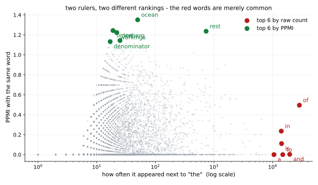

# 같이 나온 횟수가 뜻을 만든다 — 동시 출현 · PPMI · SVD

<div class="leadbox" markdown>

**들어가는 이야기** — 사전을 한 번도 안 보고 뜻을 얻는다: 유유상종

[조회 쪽](01_not_a_number.md)이 만든 표에는 **아무 수나** 들어 있었다. 표를 뜻있게 만들려면 **무엇을 기준으로 채울지** 정해야 한다.

이 장이 쓰는 기준은 하나뿐이고, 놀랍도록 단순하다 — 「주위에 같이 나오는 단어끼리 가깝게.」 사전도, 품사도, 정답표도 쓰지 않는다. 가진 것은 영화평뿐이다.

그 기준을 따르는 가장 곧은 길은 **세는 것**이다. 어느 단어가 어느 단어 곁에 몇 번 나왔는지를 표에 적고, 그 표를 줄인다. [앞 쪽](02_svd_lsa.md)의 LSA 도 세었지만 「같은 영화평 안」을 세어서 `funny` 곁에 `laugh, comedy` 같은 **같은 화제의 말**이 모였다. 이 쪽은 **앞뒤 네 칸 안**만 센다. 경사 하강법도 로스도 없고 **몇 초**면 끝난다. 그렇게 얻은 벡터로 가까운 단어를 뽑으면 이렇다.

```
terrible    awful, acting, horrible, bad, laughable, inept
funny       hilarious, amusing, comedy, scary, entertaining, it's
```

**사전을 한 번도 보지 않고 「끔찍한」의 동의어들이 모였다.** 이것이 분포 가설 — 단어의 뜻은 그 단어가 **어울려 다니는 무리**에 있다는 생각 — 이 실제로 통한다는 증거다. 옛말로는 유유상종이다. 다만 끼리끼리 모이는 기준이 정말 「뜻」인지는 [다음 쪽](03_context.md)에서 따진다.

그런데 곧이곧대로 세면 안 된다. 횟수 그대로 쓰면 `the`의 이웃이 `of, and, to, is, in, a` 가 된다 — 흔한 단어끼리 붙을 뿐이다. 이 쪽이 그것을 걷어 내는 법을 보고, 끝에 물음 하나를 남긴다 — **이 표를 만들지 않고도 같은 데 닿을 수 있는가.**

</div>

---

## 1. 코드

```python
"""같이 나온 횟수가 뜻을 만든다 — 세기만 해도 단어 벡터가 나온다.

조회 쪽이 만든 표에는 아무 수나 들어 있었다. 뜻있게 채우려면 기준이 있어야
하고, 이 장의 기준은 하나다 — 「주위에 같이 나오는 단어끼리 가깝게.」
그 기준을 따르는 가장 곧은 길이 같이 나온 횟수를 세는 것이다.

  (가) 같이 나온 횟수를 센다            -> 단어 동시 출현 행렬 (V x V)
  (나) 흔한 단어 탓을 걷어 낸다          -> PPMI
  (다) 그 표를 낮은 차원으로 줄인다       -> SVD (5.1절의 PCA 와 같은 수법)

그리고 다음 쪽이 지을 배우는 길(Skip-gram + 네거티브 샘플링)을 미리 줄여
돌려 「같은 자로」 견준다 — 같은 단어의 이웃 목록이 얼마나 겹치는가.
두 길은 뿌리가 같다 — 둘 다 같은 단어 동시 출현 행렬을 본다.

자료는 IMDB 영화평 6,000편이고 어휘는 8,000이다. 다음 쪽도 같은 것을 쓴다.
실행: 이 쪽의 코드를 파일로 갈무리해 저장소 뿌리에서 돌린다.
"""
import math
import random
import re
import time
from collections import Counter
from pathlib import Path

import numpy as np
import scipy.sparse as sp
import scipy.sparse.linalg as sla
import torch
import torch.nn as nn
import torch.nn.functional as F

SEED, VOCAB, DIM, WINDOW = 42, 8000, 64, 4
STEPS, BATCH, NEG, LR = 6000, 1024, 5, 3e-3
ROOT = Path("./data/aclImdb")
TOKEN = re.compile(r"[a-z']+")
# 「CPU 로 돌린다.」 이 쪽은 두 길의 이웃 목록이 얼마나 겹치는지를 세는데,
# MPS 는 비트 단위로 되풀이되지 않아 그 수가 돌릴 때마다 달라진다. 모델이
# 작아 CPU 로도 몇 분이면 끝나므로, 되풀이되는 쪽을 골랐다.
device = torch.device("cpu")
torch.set_num_threads(4)


def load_tokens(n_docs=6000):
    out = []
    for name in ("pos", "neg"):
        for f in sorted((ROOT / "train" / name).glob("*.txt"))[: n_docs // 2]:
            out += TOKEN.findall(f.read_text(encoding="utf-8")
                                 .replace("<br />", " ").lower())
    return out


toks = load_tokens()
counts = Counter(toks)
words = [w for w, _ in counts.most_common(VOCAB)]
stoi = {w: i for i, w in enumerate(words)}
ids = torch.tensor([stoi[w] for w in toks if w in stoi], dtype=torch.long)


# === 세는 길 ===============================================================
def cooccurrence():
    """윈도 안에 같이 나온 횟수를 V x V 표에 쌓는다."""
    C = torch.zeros(VOCAB, VOCAB)
    for off in range(1, WINDOW + 1):
        a, b = ids[:-off], ids[off:]
        C.index_put_((a, b), torch.ones(len(a)), accumulate=True)
        C.index_put_((b, a), torch.ones(len(a)), accumulate=True)
    return C


def ppmi(C):
    """PPMI = max(0, log( P(a,b) / (P(a) P(b)) )).

    같이 나온 횟수를 그대로 쓰면 the 가 모든 단어와 가까워진다. 각자가
    혼자 나오는 빈도로 나누어, 「혼자 흔한 탓」을 걷어 낸 몫만 남긴다.
    """
    total = C.sum()
    pa = C.sum(1, keepdim=True) / total
    pb = C.sum(0, keepdim=True) / total
    pab = C / total
    return (pab / (pa * pb + 1e-12) + 1e-12).log().clamp_min(0)


def pmi(C):
    """자르지 않은 PMI. 한 번도 같이 안 나온 칸은 log 0 이라 아주 큰 음수가 된다."""
    total = C.sum()
    pa = C.sum(1, keepdim=True) / total
    pb = C.sum(0, keepdim=True) / total
    return (C / total / (pa * pb + 1e-12) + 1e-12).log()


def factor(M):
    """M 의 위에서 DIM 개 특잇값만 구해 단어 벡터 U * sqrt(S) 를 만든다.

    M 은 대부분이 0 이라 희소 행렬로 넘긴다. svds 는 Lanczos 반복이다 —
    행렬을 분해하지 않고 행렬-벡터 곱만 되풀이해 크릴로프 부분공간을 키운다.
    곱하는 일만 하므로 희소성이 그대로 속도가 된다. 수렴하면 답이 정확하므로
    시작 벡터(random_state)에 기대지 않는다.

    다른 길 둘 (4절의 표가 견준다):
      (가) 직접 분해 — torch.linalg.eigh(M) 로 8,000개를 다 구해 앞 DIM 개를
           자른다. 정확하지만 n^3 이라 40초 남짓 걸리고, 행렬이 밀집으로
           메모리에 올라가야 한다. 어휘가 커지면 가장 먼저 무너진다.
      (나) 무작위 부분공간 반복 — torch.svd_lowrank(M, q, niter).
           난수 q 열을 A·Aᵀ 로 niter 번 곱하는 거듭제곱법이다. 이 행렬은
           64·65번째 특잇값이 0.2% 차이라 q=DIM 으로는 수렴이 아주 느리다.
           q 를 DIM 보다 넉넉히(오버샘플링) 잡고 앞 DIM 열만 쓴다:
               U, S, _ = torch.svd_lowrank(M, q=2 * DIM, niter=20)
               W = U[:, :DIM] * S[:DIM].sqrt()
           행렬을 훑는 횟수가 적어, 디스크·여러 기계에 나뉜 큰 행렬에 맞다.
    """
    A = sp.csr_matrix(M.numpy().astype(np.float64))
    U, S, _ = sla.svds(A, k=DIM, random_state=SEED)
    order = np.argsort(-S)                       # svds 는 작은 것부터 돌려준다
    return torch.from_numpy(U[:, order] * np.sqrt(S[order])).float()


def spectrum(X):
    """위에서 DIM 개의 특이벡터 U, 특잇값 S, 특이벡터 V 를 큰 것부터 돌려준다."""
    U, S, Vt = sla.svds(sp.csr_matrix(X.numpy().astype(np.float64)),
                        k=DIM, random_state=SEED)
    order = np.argsort(-S)
    return U[:, order], S[order], Vt[order].T


# === 배우는 길 (다음 쪽의 것을 미리 줄여 옮겼다) ===========================
class SkipGram(nn.Module):
    def __init__(self, v, d):
        super().__init__()
        self.mid, self.ctx = nn.Embedding(v, d), nn.Embedding(v, d)
        nn.init.normal_(self.mid.weight, std=0.1)
        nn.init.zeros_(self.ctx.weight)


def train_skipgram():
    freq = torch.tensor([counts[w] for w in words], dtype=torch.float)
    p = freq ** 0.75; p /= p.sum()
    torch.manual_seed(SEED)
    m = SkipGram(VOCAB, DIM).to(device)
    opt = torch.optim.Adam(m.parameters(), lr=LR)
    g = torch.Generator().manual_seed(SEED)
    for _ in range(STEPS):
        c = torch.randint(WINDOW, len(ids) - WINDOW, (BATCH,), generator=g)
        off = torch.randint(1, WINDOW + 1, (BATCH,), generator=g)
        off *= torch.where(torch.rand(BATCH, generator=g) < 0.5, -1, 1)
        cc, oo = ids[c].to(device), ids[c + off].to(device)
        v = m.mid(cc)
        pos = (v * m.ctx(oo)).sum(-1)
        ni = torch.multinomial(p, BATCH * NEG, True, generator=g).to(device)
        ng = torch.bmm(m.ctx(ni).view(BATCH, NEG, -1), v.unsqueeze(-1)).squeeze(-1)
        loss = -(F.logsigmoid(pos).mean() + F.logsigmoid(-ng).sum(1).mean())
        opt.zero_grad(); loss.backward(); opt.step()
    return m.mid.weight.detach().cpu()


def neighbours(W, w, k=6):
    Wn = F.normalize(W, dim=1)
    s = Wn @ Wn[stoi[w]]
    s[stoi[w]] = -2
    return [words[i] for i in s.topk(k).indices.tolist()]


if __name__ == "__main__":
    probe = ["good", "terrible", "movie", "she", "funny"]

    t = time.perf_counter()
    C = cooccurrence()
    M = ppmi(C)
    W_count = factor(M)
    t_count = time.perf_counter() - t

    nz = (C > 0).float().mean()
    print(f"  단어 동시 출현 행렬 {VOCAB}x{VOCAB} = {VOCAB * VOCAB:,}칸 — "
          f"0 이 아닌 칸이 {nz * 100:.1f}%, 0 인 칸이 {(1 - nz) * 100:.1f}%")
    print(f"  the 와 가장 많이 같이 나온 단어 (횟수 그대로):")
    row = C[stoi["the"]].clone(); row[stoi["the"]] = -1
    print("    " + ", ".join(words[i] for i in row.topk(6).indices.tolist()))
    print(f"  the 와 가장 많이 같이 나온 단어 (PPMI 로 고친 뒤):")
    row = M[stoi["the"]].clone(); row[stoi["the"]] = -1
    print("    " + ", ".join(words[i] for i in row.topk(6).indices.tolist()))

    # PMI 를 동시 출현 확률로 무게를 주어 더하면 상호정보량이 된다.
    # PPMI 행렬의 칸 하나하나가 그 합의 낱낱 항이다
    total = C.sum()
    pab = C / total
    pmi_full = (pab / ((C.sum(1, keepdim=True) / total)
                       * (C.sum(0, keepdim=True) / total) + 1e-12) + 1e-12).log()
    mi = float((pab * pmi_full).sum())
    print(f"\n  상호정보량 I = sum_ab P(a,b) PMI(a,b) = {mi:.4f} nat")
    print(f"    (PPMI 는 그 합의 낱낱 항 가운데 양수만 남긴 것이다)")
    print(f"    비교 기준: 단어 하나의 엔트로피 H = "
          f"{float(-(lambda q: (q * (q + 1e-12).log()).sum())(C.sum(1) / total)):.4f} nat")

    # 같은 합은 KL( P(a,b) || P(a)P(b) ) 이다 — 독립인 세상에서 얼마나 먼가.
    # 합은 0 이상이지만 낱낱 항은 음수일 수 있다
    term = pab * pmi_full
    pos, neg = pmi_full > 0, (pmi_full < 0) & (C > 0)
    print(f"    = KL( P(a,b) || P(a)P(b) ) — 양수 칸의 몫 {float(term[pos].sum()):.4f}"
          f" + 음수 칸의 몫 {float(term[neg].sum()):.4f}")
    print(f"    동시 출현 확률의 {float(pab[neg].sum()) * 100:.0f}% 가 PMI 가 음수인 칸에 있다"
          f" — PPMI 는 그 칸을 0 으로 자른다")

    t = time.perf_counter()
    W_learn = train_skipgram()
    t_learn = time.perf_counter() - t

    print(f"\n  {'단어':<10s}{'세어서 만든 것':<46s}{'배워서 만든 것'}")
    agree = []
    for w in probe:
        a, b = neighbours(W_count, w), neighbours(W_learn, w)
        agree.append(len(set(a) & set(b)))
        print(f"  {w:<10s}{', '.join(a):<46s}{', '.join(b)}")

    print(f"\n  이웃 여섯 가운데 두 길이 함께 고른 수")
    for w, n in zip(probe, agree):
        print(f"    {w:<10s} {n}/6")
    print(f"    평균 {sum(agree) / len(agree):.1f}/6 — "
          f"우연이라면 {6 * 6 / VOCAB:.4f}/6 이다")

    # === 세는 쪽도 PMI - log k 로 맞추면 가까워지는가 =======================
    # 다음 쪽의 Skip-gram 은 내적이 PMI - log k 에 앉는다(k 는 틀린 짝의 개수,
    # 여기서는 NEG = 5). 세는 쪽의 행렬만 그쪽으로 옮겨 보고, 배운 벡터와
    # 이웃이 더 겹치는지 잰다. 배우는 쪽은 그대로 둔다.
    P, seen = pmi(C), C > 0
    zero = torch.zeros(())
    variants = [
        ("PPMI = max(0, PMI)  (위의 것)", P.clamp_min(0)),
        ("SPPMI = max(0, PMI - log k)", (P - math.log(NEG)).clamp_min(0)),
        ("PMI, 본 칸만 (음수 둠)", torch.where(seen, P, zero)),
        ("PMI - log k, 본 칸만", torch.where(seen, P - math.log(NEG), zero)),
    ]
    common = random.Random(SEED).sample(words[:1000], 300)   # 흔한 1,000 가운데 300

    def overlap(W, ws):
        return sum(len(set(neighbours(W, w)) & set(neighbours(W_learn, w)))
                   for w in ws) / len(ws)

    print(f"\n  세는 쪽의 행렬을 바꾸면 — 배운 것과 함께 고른 이웃 (k={NEG})")
    print(f"    {'행렬':<30s}{'다섯 단어':>8s}{'흔한 300':>10s}{'0 이 아닌 칸':>12s}")
    for name, Mv in variants:
        Wv = factor(Mv)
        print(f"    {name:<30s}{overlap(Wv, probe):7.1f}/6{overlap(Wv, common):9.2f}/6"
              f"{float((Mv != 0).float().mean()) * 100:10.2f}%")
    print(f"    본 칸 가운데 PMI < 0 : {float((P[seen] < 0).float().mean()) * 100:.1f}%,"
          f"  PMI < log k : {float((P[seen] < math.log(NEG)).float().mean()) * 100:.1f}%")

    # === 왜 P(a,b) 를 그대로 분해하지 않는가 ===============================
    # 같이 나온 비율 P(a,b) 는 「각자 흔한 정도」 P(a)P(b) 와 「서로 끌리는
    # 정도」의 곱이다. the 의 두 짝으로 그 둘을 갈라 본다
    Pab = (C / total).double()
    pa = Pab.sum(1)
    indep = pa[:, None] * pa[None, :]
    ratio = Pab / indep
    print(f"\n  P(a,b) 를 둘로 가른다 — 독립이라면 P(a)P(b)")
    for w in ("of", "iceberg"):
        i, j = stoi["the"], stoi[w]
        print(f"    the-{w:<8s} 횟수 {int(C[i, j]):6,d}  P(a,b) {float(Pab[i, j]):.2e}"
              f"  P(a)P(b) {float(indep[i, j]):.2e}  비 {float(ratio[i, j]):.2f}"
              f"  PMI {float(ratio[i, j].log()):.2f}")
    r, top = ratio[seen], int(ratio.argmax())
    print(f"    같이 나온 칸의 비: 최소 {float(r.min()):.2f}, 중앙값 {float(r.median()):.1f},"
          f" 최대 {float(r.max()):,.0f} ({words[top // VOCAB]}-{words[top % VOCAB]},"
          f" {int(C.view(-1)[top])}번 같이 나왔다)")

    # P(a,b) 와 PPMI 를 같은 svds 로 분해해, 첫 방향이 빈도인지와 행렬의
    # 제곱합이 어디에 몰려 있는지를 잰다
    print(f"\n  P(a,b) 와 PPMI 를 같은 svds 로 분해하면")
    print(f"    {'행렬':<8s}{'첫 특이벡터·빈도 코사인':>14s}{'첫 방향의 제곱합':>12s}"
          f"{'흔한 100단어 열의 제곱합':>16s}")
    p = pa.numpy()
    for name, X in (("P(a,b)", Pab), ("PPMI", M.double())):
        U, S, V = spectrum(X)
        sq = (X ** 2).sum(0)
        print(f"    {name:<8s}{abs(U[:, 0] @ p) / np.linalg.norm(p):14.3f}"
              f"{S[0] ** 2 / float(sq.sum()) * 100:11.1f}%"
              f"{float(sq[:100].sum() / sq.sum()) * 100:15.1f}%")
    flipped = int(((U * V).sum(0) < 0).sum())
    print(f"    PPMI 의 {DIM}개 방향 가운데 V 의 열이 U 의 열과 부호가 반대인 것: {flipped}개")

    # 세 행렬 P · PMI · PPMI 를 각각 분해해 이웃 여섯이 서로 얼마나 겹치는지 센다
    W_p, W_pmi = factor(Pab), factor(torch.where(seen, P, zero))
    print(f"\n  {'단어':<10s}P(a,b) 를 분해한 것의 이웃")
    for w in ("good", "terrible", "funny", "she"):
        print(f"  {w:<10s}{', '.join(neighbours(W_p, w))}")

    rng = random.Random(SEED)
    groups = [("무작위 500", rng.sample(words, 500)), ("흔한 300", common),
              ("드문 300", rng.sample(words[5000:], 300))]

    def shared(Wa, Wb, ws):
        return sum(len(set(neighbours(Wa, w)) & set(neighbours(Wb, w)))
                   for w in ws) / len(ws)

    print(f"\n  세 행렬의 이웃 여섯이 서로 겹치는 수")
    print(f"    {'견준 둘':<14s}" + "".join(f"{g:>10s}" for g, _ in groups))
    for name, Wa, Wb in (("PMI 와 PPMI", W_pmi, W_count), ("P 와 PPMI", W_p, W_count),
                         ("P 와 PMI", W_p, W_pmi)):
        print(f"    {name:<14s}"
              + "".join(f"{shared(Wa, Wb, ws):8.2f}/6" for _, ws in groups))

    # 같은 PPMI 벡터로 두 가지를 잰다 — 같이 나오는 세기(PPMI)와 닮음(코사인)
    Wn = F.normalize(W_count, dim=1)
    print(f"\n  같이 나오는 세기와 닮음은 다른 자다 (PPMI 를 분해한 벡터)")
    for a, b in (("good", "great"), ("terrible", "awful"), ("good", "pretty"),
                 ("good", "bad")):
        i, j = stoi[a], stoi[b]
        s = Wn @ Wn[i]; s[i] = -2
        print(f"    {a + '-' + b:<15s} 횟수 {int(C[i, j]):4d}  PPMI {float(M[i, j]):.2f}"
              f"  코사인 {float(s[j]):.2f}  {a} 의 이웃 {int((s > s[j]).sum()) + 1}위")
    s = Wn @ Wn[stoi["good"]]
    print(f"    good 과 코사인이 가장 낮은 단어: "
          f"{', '.join(words[i] for i in (-s).topk(3).indices.tolist())}"
          f" ({float(s.min()):.2f})")

    print(f"\n  드는 시간")
    print(f"    세기  {t_count:7.1f}초   (한 번 세고 한 번 쪼갠다)")
    print(f"    배우기 {t_learn:7.1f}초   ({STEPS:,}스텝)")
```

**출력:**

```
  단어 동시 출현 행렬 8000x8000 = 64,000,000칸 — 0 이 아닌 칸이 3.5%, 0 인 칸이 96.5%
  the 와 가장 많이 같이 나온 단어 (횟수 그대로):
    of, and, to, is, in, a
  the 와 가장 많이 같이 나온 단어 (PPMI 로 고친 뒤):
    ocean, omen, rest, workings, iceberg, denominator

  상호정보량 I = sum_ab P(a,b) PMI(a,b) = 0.6449 nat
    (PPMI 는 그 합의 낱낱 항 가운데 양수만 남긴 것이다)
    비교 기준: 단어 하나의 엔트로피 H = 6.5549 nat
    = KL( P(a,b) || P(a)P(b) ) — 양수 칸의 몫 0.7437 + 음수 칸의 몫 -0.0988
    동시 출현 확률의 32% 가 PMI 가 음수인 칸에 있다 — PPMI 는 그 칸을 0 으로 자른다

  단어        세어서 만든 것                                      배워서 만든 것
  good      great, also, very, pretty, really, but        decent, great, solid, fine, nice, classical
  terrible  awful, acting, horrible, bad, laughable, ineptawful, bad, horrible, pitiful, chuckle, laughable
  movie     this, it, thing, film, really, if             film, drivel, thing, btw, preposterous, stinker
  she       her, he, when, him, she's, herself            her, she's, husband, he, phillip, marie
  funny     hilarious, amusing, comedy, scary, entertaining, it'skinda, scary, quite, amusing, damn, appealing

  이웃 여섯 가운데 두 길이 함께 고른 수
    good       1/6
    terrible   4/6
    movie      2/6
    she        3/6
    funny      2/6
    평균 2.4/6 — 우연이라면 0.0045/6 이다

  세는 쪽의 행렬을 바꾸면 — 배운 것과 함께 고른 이웃 (k=5)
    행렬                               다섯 단어    흔한 300    0 이 아닌 칸
    PPMI = max(0, PMI)  (위의 것)        2.4/6     0.63/6      2.91%
    SPPMI = max(0, PMI - log k)       0.8/6     0.39/6      1.53%
    PMI, 본 칸만 (음수 둠)                  2.0/6     0.66/6      3.52%
    PMI - log k, 본 칸만                 1.2/6     0.35/6      3.52%
    본 칸 가운데 PMI < 0 : 17.4%,  PMI < log k : 56.7%

  P(a,b) 를 둘로 가른다 — 독립이라면 P(a)P(b)
    the-of       횟수 28,578  P(a,b) 2.76e-03  P(a)P(b) 1.68e-03  비 1.64  PMI 0.50
    the-iceberg  횟수     25  P(a,b) 2.41e-06  P(a)P(b) 7.70e-07  비 3.14  PMI 1.14
    같이 나온 칸의 비: 최소 0.04, 중앙값 3.6, 최대 12,258 (teri-hatcher, 10번 같이 나왔다)

  P(a,b) 와 PPMI 를 같은 svds 로 분해하면
    행렬       첫 특이벡터·빈도 코사인   첫 방향의 제곱합 흔한 100단어 열의 제곱합
    P(a,b)           0.995       91.6%           97.8%
    PPMI             0.204        3.7%            1.7%
    PPMI 의 64개 방향 가운데 V 의 열이 U 의 열과 부호가 반대인 것: 2개

  단어        P(a,b) 를 분해한 것의 이웃
  good      nice, great, decent, fine, simple, pleasant
  terrible  horrible, dreadful, lame, awful, bad, lousy
  funny     disturbing, shocking, slow, boring, engaging, entertaining
  she       husband, her, boyfriend, she's, towel, dress

  세 행렬의 이웃 여섯이 서로 겹치는 수
    견준 둘             무작위 500    흔한 300    드문 300
    PMI 와 PPMI        4.21/6    4.16/6    4.00/6
    P 와 PPMI          0.23/6    0.57/6    0.08/6
    P 와 PMI           0.21/6    0.59/6    0.09/6

  같이 나오는 세기와 닮음은 다른 자다 (PPMI 를 분해한 벡터)
    good-great      횟수   59  PPMI 0.15  코사인 0.72  good 의 이웃 1위
    terrible-awful  횟수    4  PPMI 1.22  코사인 0.83  terrible 의 이웃 1위
    good-pretty     횟수  157  PPMI 2.05  코사인 0.69  good 의 이웃 4위
    good-bad        횟수  117  PPMI 0.84  코사인 0.63  good 의 이웃 13위
    good 과 코사인이 가장 낮은 단어: wagner, marriage, humans (-0.19)

  드는 시간
    세기      2.8초   (한 번 세고 한 번 쪼갠다)
    배우기    10.0초   (6,000스텝)
```

---

## 2. 그냥 세면 `the`가 모든 것과 가까워진다

세는 길의 첫걸음은 **단어 동시 출현 행렬**이다 — 단어-단어 크기의 표이고, 칸 하나가 「이 둘이 몇 번 같이 나왔는가」다. 어휘가 8,000이니 $8{,}000 \times 8{,}000$짜리로 만든다. 「같이 나왔다」는 **윈도** 안에 들었다는 뜻이다 — 어느 단어의 앞뒤 네 칸이고, 코드의 `WINDOW = 4` 가 그 윈도 크기다. 윈도 안에 든 쌍마다 1을 더한다. 영화평 6,000편으로 채우면 **0이 아닌 칸이 3.5%**다.

어휘 8,000은 **빈도로** 고른다 — 영화평 6,000편에 나온 단어 43,508가지를 많이 나온 순서로 세워 앞의 8,000개를 쓴다(코드의 `counts.most_common(VOCAB)`). 그 8,000개가 전체 토큰의 **93.6%**를 덮는다. 나머지 35,000여 가지는 다 합쳐도 6.4%이고, 그 가운데 17,920가지는 딱 한 번 나온 단어다. 한 번 나온 단어는 같이 나온 횟수도 한두 번뿐이라 표의 칸을 믿을 만하게 채우지 못한다. 그래서 흔한 단어만 남긴다. 다만 문턱이 **10번** 근처에 걸려 있다는 점은 알아 둘 것. 8,000번째 단어 `pocket`이 10번 나왔는데, 10번 나온 단어가 544개이고 그 가운데 27개만 어휘에 들었다. 같은 횟수끼리는 **먼저 나온 단어가** 들어간다 — `Counter.most_common` 이 동점을 처음 본 순서대로 세우기 때문이다.

??? note "「앞뒤 네 칸」을 정확히 말하면 — 두 가지가 다르다"

    **하나 — 윈도가 영화평 경계를 넘는다.** 코드는 영화평 6,000편의 토큰을 **한 줄로 이어 붙인 뒤** 윈도를 댄다. 그래서 어느 영화평의 끝 단어가 다음 영화평의 첫 단어와 쌍이 된다. 경계 하나에 그런 쌍이 많아야 10개($4+3+2+1$)이고, 같은 자료로 따로 세면 쌍 517만 8천 개 가운데 **5만 9,990개, 1.2%**다.

    이것을 **정칙화**처럼 읽고 싶어질 수 있다. 서로 상관없는 두 영화평에서 온 쌍은 독립에 가깝고, 독립인 쌍의 PMI 는 0이니, 섞으면 PPMI 가 0 쪽으로 당겨지지 않겠느냐는 것이다. 재어 보면 **반만 맞다.** 원래 0이 아니던 칸에서는 PPMI 가 평균 0.0066 내려간다 — 0 쪽으로 당겨지기는 한다. 그런데 경계 쌍이 **새로 채운 칸이 22,749개**이고, 그 칸들의 PPMI 평균은 **1.86**으로 나머지 칸의 평균(1.73)보다 높다. 대부분 한 번뿐인 우연한 쌍인데, 드문 단어끼리 한 번 만나면 $P(a)P(b)$ 가 작아 PMI 가 크게 나오기 때문이다. 고르게 당기는 정칙화가 아니라 **잡음이 섞인 것**에 가깝다.

    그래도 결과에는 거의 안 닿는다. 경계 쌍을 빼고 다시 세어 같은 수법으로 줄이면 `terrible` 의 이웃 여섯은 그대로이며, 어휘에서 무작위로 고른 500단어의 이웃 여섯 가운데 평균 **4.95개**가 겹친다. 바로잡으려면 영화평마다 따로 윈도를 대면 된다.

    **둘 — 「네 칸」은 원문이 아니라 어휘 안에서 센다.** 코드는 어휘 밖 단어를 윈도를 대기 **전에** 지운다(`if w in stoi`). 그러면 원문에서 다섯 칸 넘게 떨어진 두 단어도 그 사이의 드문 단어가 빠지면 윈도 안에 든다. 같은 영화평 안의 쌍 가운데 **6.1%**가 그렇고, 가장 먼 것은 원문에서 19칸 떨어져 있었다. 윈도가 희귀어를 건너뛰어 조금 넓어지는 셈이다.

그 표를 그대로 쓰면 어떻게 되는가. `the`와 가장 많이 같이 나온 단어를 뽑아 보면

```
of, and, to, is, in, a
```

**전부 기능어다.** `the`가 `of`와 자주 나온 것이 둘 사이에 무슨 관계가 있어서가 아니라, **둘 다 그냥 아주 흔하기 때문**이다. 횟수는 「같이 나왔다」와 「각자 흔하다」를 구분하지 못한다.



**두 자가 서로 다른 줄을 세운다.** 붉은 점들은 오른쪽 끝에 있는데 세로로는 바닥에 깔려 있다 — **수만 번 같이 나왔지만 기대보다 자주 붙은 것은 아니다.** 초록 점들은 그 반대다. `iceberg`는 `the` 옆에 겨우 스물몇 번 나왔는데도, **나올 때마다 `the`를 달고 나오기 때문에** PPMI 가 1을 넘는다.

### PPMI — 혼자 흔한 탓을 걷어 낸다

고치는 법은 **각자 혼자 나오는 빈도로 나누는 것**이다. 그 자가 **PPMI** 다 —
Positive Pointwise Mutual Information, 곧 양의 점별 상호정보량의 줄임말이다.
뒤에서부터 읽으면 이름이 그대로 식이 된다.

| | 뜻 | 식에서 |
|---|---|---|
| Mutual Information | 두 단어가 서로에 대해 알려 주는 정도 | $\log \dfrac{P(a,b)}{P(a)\,P(b)}$ |
| Pointwise | 모든 쌍에 걸친 평균이 아니라 **쌍 $(a, b)$ 하나**의 값 | 합 $\sum_{a,b}$ 이 없다 |
| Positive | 음수를 0으로 자른다 | $\max(0, \cdot)$ |

맨 앞의 Positive 를 뗀 것이 **PMI** 다 — Pointwise Mutual Information, 점별 상호정보량.

$$
\mathrm{PMI}(a, b) \;=\; \log \frac{P(a, b)}{P(a)\,P(b)},
\qquad
\mathrm{PPMI}(a, b) \;=\; \max\bigl(0,\; \mathrm{PMI}(a, b)\bigr)
$$

세 확률은 모두 단어 동시 출현 행렬에서 센다. $(a, b)$ 칸의 횟수를 $n(a, b)$ 라 하면

$$
P(a, b) = \frac{n(a, b)}{\sum_{a', b'} n(a', b')},
\qquad
P(a) = \sum_{b'} P(a, b'),
\qquad
P(b) = \sum_{a'} P(a', b)
$$

이다. 이렇게 센 비율로 적은 $P(a, b)$ 를 **경험적 결합 분포**(empirical joint distribution)라 한다. 「결합」은 두 단어를 한꺼번에 본 확률이라는 뜻이고, 「경험적」은 참 분포를 모르니 말뭉치에서 센 비율로 대신했다는 뜻이다. $P(a)$ 와 $P(b)$ 는 그 행렬의 행과 열을 더한 것이라 따로 셀 필요가 없다.

분자는 「실제로 같이 나온 비율」, 분모는 「서로 상관없다면 같이 나왔을 비율」이다. 둘의 비가 1보다 크면 **기대보다 자주 붙어 다닌다**는 뜻이고, 로그를 씌워 그 몫만 남긴다. 음수를 0으로 자르는 것이 앞의 **P**(positive)다.

같은 `the`를 PPMI로 다시 뽑으면

```
ocean, omen, rest, workings, iceberg, denominator
```

**완전히 달라졌다.** `the ocean`, `the rest`, `the iceberg` — **거의 언제나 `the`를 달고 나오는 단어들**이다. `of`는 흔해서 높았을 뿐이고, `iceberg`는 드문데도 나올 때마다 `the`와 함께 나온다.

### 왜 동시 출현 확률을 그대로 분해하지 않는가

식의 뜻은 알겠는데 **왜 굳이 그 식인가**가 남는다. 횟수를 전체 쌍의 수로 나눈 $P(a,b) = n(a,b)/N$ 도 어엿한 확률이고 대칭 행렬이다. 그것을 그대로 분해하면 안 되는가.

먼저 하나를 치워 둔다. **$N$ 으로 나누는 것은 아무것도 바꾸지 않는다.** 모든 칸을 같은 수로 나누면 특잇값만 그만큼 줄고 특이벡터는 횟수 행렬의 것 그대로다. 그러니 물음은 「횟수 행렬을 그대로 분해하면 안 되는가」와 같다.

**$P(a,b)$ 에는 두 가지가 곱해져 있다.** 식을 한 번 고쳐 적으면 보인다.

$$
P(a, b) \;=\; \underbrace{P(a)\,P(b)}_{\text{각자 흔한 정도}} \;\times\; \underbrace{\frac{P(a, b)}{P(a)\,P(b)}}_{\text{서로 끌리는 정도}}
$$

앞의 것은 두 단어가 서로 상관없이 나와도 생기는 몫이고, 뒤의 것만이 둘 사이의 일이다. `the` 의 두 짝으로 재면 이렇다.

| 짝 | 같이 나온 횟수 | $P(a,b)$ | 독립이라면 $P(a)P(b)$ | 비 | PMI |
|---|---|---|---|---|---|
| `the` – `of` | 28,578 | $2.76\times10^{-3}$ | $1.68\times10^{-3}$ | 1.64 | 0.50 |
| `the` – `iceberg` | 25 | $2.41\times10^{-6}$ | $7.70\times10^{-7}$ | 3.14 | 1.14 |

$P(a,b)$ 로는 `of` 가 천 배 넘게 크다. 그런데 그 크기의 대부분은 독립이어도 나왔을 몫이다 — 실제로 보탠 것은 1.64배뿐이다. `iceberg` 는 기대의 3.14배다. **나누기는 앞의 몫을 걷어 내고 뒤의 몫만 남기는 일**이다.

**독립인 세상을 떠올리면 분해가 무엇을 찾을지 보인다.** 단어들이 서로 아무 상관 없이 나온다면 $P(a,b) = P(a)P(b)$, 곧 행렬이 벡터 하나의 곱 $\mathbf{p}\mathbf{p}^{\top}$ 이다. 뜻은 하나도 없는데 랭크 1짜리 구조가 뚜렷이 서 있고, 특잇값 분해는 그것을 첫 방향으로 찾아낸다. 같은 세상에서 PMI 행렬은 **모든 칸이 0**이다. 찾을 것이 없다고 정확히 말한다.

실제 말뭉치도 그 세상에서 멀지 않다. 이 쪽의 말뭉치·어휘 8,000으로 $P$ 와 PPMI 를 각각 같은 `svds` 로 분해해 재었다.

| | $P(a,b)$ 그대로 | PPMI |
|---|---|---|
| 첫 특이벡터와 빈도 벡터 $\mathbf{p}$ 의 코사인 | **0.995** | 0.20 |
| 첫 방향이 담는 제곱합 | **91.6%** | 3.7% |
| 가장 흔한 100단어의 열이 담는 제곱합 | **97.8%** | 1.7% |

$P$ 를 분해하면 첫 방향이 곧 **빈도**이고 그것이 행렬의 91.6%다. 더 눈여겨볼 것은 셋째 줄이다. 행렬의 97.8%가 `the, and, a, of, to, is` 같은 흔한 100단어의 열에 있다. 특잇값 분해는 제곱 오차를 줄이므로, **단어 벡터가 거의 그 100개의 열만 보고 정해진다.** 나머지 7,900개의 문맥은 있으나 마나다.

**그렇다고 이웃이 엉망이 되지는 않는다.** 재어 보기 전에는 `the` 의 이웃처럼 흔한 단어만 모일 줄 알았는데 그렇지 않았다.

| 단어 | $P(a,b)$ 를 분해한 것 | PPMI 를 분해한 것 (이 쪽) |
|---|---|---|
| `good` | nice, great, decent, fine, simple, pleasant | great, also, very, pretty, really, but |
| `terrible` | horrible, dreadful, lame, awful, bad, lousy | awful, acting, horrible, bad, laughable, inept |
| `funny` | disturbing, shocking, slow, boring, engaging, entertaining | hilarious, amusing, comedy, scary, entertaining, it's |
| `she` | husband, her, boyfriend, she's, towel, dress | her, he, when, him, she's, herself |

까닭은 코사인이다. 코사인은 벡터의 길이를 버리고 방향만 보므로 「얼마나 흔한가」가 이웃을 정하지 못한다. 남는 것은 **흔한 100단어 곁에 어떤 비율로 서는가**인데, 그것은 그 단어가 문장에서 **어느 자리에 들어가는가**를 말해 준다. `funny` 줄이 그것을 보인다. $P$ 쪽의 `disturbing, shocking, slow, boring` 은 `funny` 와 뜻이 닮은 말이 아니라 **같은 자리에 들어가는 형용사**다 — `it is so ___`, `a very ___ film`. PPMI 쪽은 `hilarious, amusing, comedy` 를 골랐다. 그 단어들은 `laugh` 나 `jokes` 같은 **드문 문맥**을 `funny` 와 나누어 갖는데, 그런 문맥은 $P$ 에서는 무게가 없다.

단어 넷으로는 모자라니 **세어서** 본다. 행렬 셋 — $P$, PMI, PPMI — 을 각각 같은 `svds` 로 64차원으로 줄이고, 같은 단어의 코사인 이웃 여섯이 서로 몇 개 겹치는지 센다. PMI 는 같이 나온 칸만 채우고 빈칸은 0으로 둔 것이다(빈칸의 참값은 $-\infty$ 라 분해할 수 없다). 단어는 세 묶음으로 뽑았다 — 어휘 전체에서 무작위 500, 가장 흔한 1,000에서 300(위의 「흔한 300」과 같은 단어들), 5,000위 밖의 드문 단어에서 300.

| 견준 둘 | 무작위 500 | 흔한 300 | 드문 300 |
|---|---|---|---|
| PMI 와 PPMI | **4.21/6** | 4.16/6 | 4.00/6 |
| $P$ 와 PPMI | 0.23/6 | 0.57/6 | 0.08/6 |
| $P$ 와 PMI | 0.21/6 | 0.59/6 | 0.09/6 |

**PMI 와 PPMI 는 거의 같은 임베딩이고, $P$ 는 그 둘과 다른 임베딩이다.** 음수를 자르느냐 두느냐는 이웃 여섯 가운데 둘을 바꿀 뿐이다 — 같이 나온 칸 가운데 PMI 가 음수인 것이 17.4%뿐이기 때문이다. 반면 $P$ 는 여섯 가운데 0.2개만 겹치고, 드문 단어에서는 0.08개다. 우연(0.0045개)보다는 많으니 같은 것을 보기는 하지만, 사실상 다른 표다. 세 행렬을 가르는 것은 **자르기가 아니라 나누기**다.

그러니 나누기가 바꾸는 것은 「되느냐 안 되느냐」가 아니라 **어느 문맥이 증거로 쳐지느냐**다. $P$ 는 흔한 문맥에 무게를 다 주고, PMI 는 문맥마다 제 바탕 빈도에 견준 몫을 주어 드문 문맥도 말을 하게 한다. 다만 겹치는 수는 「같은가」만 재고 「어느 쪽이 나은가」는 재지 못한다 — `good` 줄은 오히려 $P$ 쪽이 깔끔해 보인다. 3절이 적듯 제대로 가리려면 쓸 곳에서 재야 한다.

**로그는 왜 씌우는가.** 비 $P(a,b)/(P(a)P(b))$ 까지만 가도 빈도는 걷힌다. 그런데 비는 범위가 너무 넓다. 같이 나온 칸만 보아도 가장 작은 것이 0.04, 가운데 값이 3.6, 가장 큰 것이 **12,258**이다(배우 이름 `teri` – `hatcher`, 같이 나온 것은 열 번뿐이다). 제곱 오차로 맞추는 분해에 그대로 넣으면 그런 칸 몇 개가 전부를 가져간다. 로그는 그 범위를 누르고, 곱을 더하기로 바꾼다 — 기대의 열 배면 $+\log 10$, 십분의 일이면 $-\log 10$, 독립이면 0이다. **0이 「아무 관계 없음」이 되는 눈금**이라 빈칸을 0으로 둔 희소 행렬과도 말이 맞는다.

!!! note "공분산과 닮았다 — 그리고 고윳값 분해로도 된다"
    「독립일 때의 값에서 얼마나 벗어났는가」를 재는 양이 하나 더 있다. 쌍 하나를 뽑았을 때 가운데 단어가 $a$ 이면 1인 변수 $X_a$ 와 주위 단어가 $b$ 이면 1인 변수 $Y_b$ 를 두면

    $$
    \operatorname{Cov}(X_a, Y_b) \;=\; P(a, b) - P(a)\,P(b),
    \qquad
    \mathrm{PMI}(a, b) \;=\; \log\left(1 + \frac{\operatorname{Cov}(X_a, Y_b)}{P(a)\,P(b)}\right)
    $$

    이다. 공분산은 독립인 몫을 **빼고**, PMI 는 **나눈** 뒤 로그를 씌운다. 독립이면 둘 다 0이다. 곧 PMI 행렬은 공분산 행렬을 칸마다 빈도로 고르고 눈금을 바꾼 것이다.

    그러면 PCA 처럼 **고윳값 분해**를 써도 되는가. 된다. 이 쪽은 윈도의 앞뒤를 함께 세므로 $P(a,b) = P(b,a)$ 이고 PPMI 행렬도 대칭이다. 대칭 행렬 $M = Q\Lambda Q^{\top}$ 의 특잇값은 $|\lambda_i|$ 이므로, 고유벡터를 **절댓값이 큰 고윳값 순서로** 고르면 특잇값 분해와 같은 방향이 나온다. 조심할 것은 그 「절댓값」이다. 공분산 행렬은 고윳값이 모두 0 이상이지만 PPMI 행렬은 칸이 모두 0 이상이어도 **음수 고윳값을 가진다.** 이 행렬에서 절댓값이 큰 64개 가운데 2개가 음수다. 큰 것부터 64개를 그냥 자르면 그 둘을 놓친다. 4절의 표가 `torch.linalg.eigh` 로 그 길을 재고, 아래 「세 가지 덧붙임」이 그 두 방향을 다시 짚는다.

    윈도를 한쪽만 세면 — 「바로 오른쪽 단어」처럼 — 이야기가 달라진다. 식 $\log\frac{P(a,b)}{P(a)P(b)}$ 는 여전히 두 사건을 맞바꾸어도 같지만, 행렬의 $(a, b)$ 칸과 $(b, a)$ 칸은 **다른 사건**을 센다(`new york` 과 `york new`). 그때는 행렬이 대칭이 아니어서 특잇값 분해를 써야 한다.

!!! note "PMI 는 상호정보량의 낱낱 항이다"
    PPMI 의 **P** 를 떼고 보면 PMI 이고, 그것을 동시 출현 확률로 무게를 주어 모두 더하면 **상호정보량**이 된다.

    $$
    I(A; B) \;=\; \sum_{a, b} P(a, b)\, \underbrace{\log \frac{P(a,b)}{P(a)P(b)}}_{\mathrm{PMI}(a,b)}
    $$

    곧 **PPMI 행렬의 칸 하나하나가 그 합의 항**이고, 우리는 그 가운데 양수만 남겨 표로 쓰는 것이다. 재어 보면 이 말뭉치에서 $I = 0.6449$ nat 이다. 단어 하나의 엔트로피가 6.5549 nat 이니, **주위 단어 하나를 알면 가운데 단어의 불확실함이 10% 가까이 줄어든다**는 뜻이다.

    식을 다시 보면 이것은 **KL 발산**이다 — 두 분포가 얼마나 다른지를 재는 양이다.

    $$
    I(A; B) \;=\; D_{\mathrm{KL}}\big(\, P(a, b) \;\|\; P(a)\,P(b) \,\big)
    $$

    오른쪽의 $P(a)P(b)$ 는 **두 단어가 서로 상관없이 나온다면** 보였을 동시 출현 확률이다. 그러니 상호정보량은 「실제 단어 동시 출현 행렬이 독립인 세상의 행렬에서 얼마나 멀리 있는가」이고, PMI 는 그 거리를 칸마다 쪼갠 것이다. KL 은 0 이상이므로 $I \ge 0$ 이고, 두 단어가 정말 독립일 때만 0이 된다.

    다만 **칸 하나하나는 음수일 수 있다.** 합이 0 이상일 뿐이다. 이 말뭉치에서 PMI 가 양수인 칸들의 몫을 더하면 0.7437 nat, 음수인 칸들의 몫이 $-0.0988$ nat 이고 둘을 합친 것이 위의 0.6449 다. 동시 출현 확률의 **32%**가 음수 칸에 있다. PPMI 의 **P** 는 그 음수 칸을 0으로 자르는 것이므로, PPMI 행렬은 KL 의 낱낱 항을 그대로 담은 것이 아니라 **양수 쪽만** 담은 것이다 — 왜 자르는지는 연습문제 1이 다룬다.

    적어 보이지만 그 10%가 이 장이 가진 전부다. 임베딩이 담는 것은 **단어 사이에 흐르는 그 정보**다.

    같은 양이 [5.2절](../ch05/latent_generative/index.md)에도 나온다. 거기서 VAE 의 KL 항을 쪼개면 $I_q(X; Z)$ 가 나오는데, **잠재 표현이 입력 정보를 얼마나 싣는지**를 재는 바로 이 상호정보량이다. 여기서는 그것을 **재료로 쓰고**, 거기서는 **값으로 치른다.**

### 다음 쪽은 거의 같은 행렬을 만들지 않고 분해한다

이 쪽은 PMI 행렬을 — 정확히는 그 음수를 0으로 자른 **PPMI** 행렬을 — **손으로 만들어**
분해할 참이다. 분해는 큰 행렬 하나를 작은 행렬 둘의 곱으로 적는 일이고, 이 쪽이 쓰는 분해는
**특잇값 분해**(SVD)다. 특잇값 분해는 본디 행렬 셋의 곱을 내놓는데 그것이 어떻게 둘의 곱이
되는지는 아래 「그다음은 5.1절과 같은 수법이다」가 적는다.
[다음 쪽](03_context.md)의 Skip-gram 과 네거티브 샘플링은 **그 표를 만들지 않고도**
가까운 자리에 닿는다. 그 쪽이 재어 보이는데, 경사 하강법으로 배운 내적이
$\mathrm{PMI} - \log k$ 에 앉는다. $k$ 는 그 쪽이 맞는 짝 하나마다 뽑는 틀린 짝의 개수(5)이고, 왜 $\log k$ 만큼 밀리는지는 [다음 쪽](03_context.md)의 「비기는 자리를 식으로 적으면」이 미분 한 번으로 한 걸음씩 유도한다.

둘 다 PMI 에서 나왔지만 **글자 그대로 같은 행렬은 아니다.**

| | 분해하는 행렬 | 행렬을 | 분해하는 법 |
|---|---|---|---|
| 이 쪽 — PPMI + SVD | $\max(0,\ \mathrm{PMI})$ — 음수를 0으로 자른다 | **만들어서 들고 있는다** | 특잇값 분해로 명시적으로 |
| [다음 쪽](03_context.md) — Skip-gram + 네거티브 샘플링 | $\mathrm{PMI} - \log k$ — 음수가 그대로 있다 | **만들지 않는다** | 경사 하강법이 암묵적으로 |

이 쪽이 PMI 를 그대로 분해하지 못하는 까닭은 0인 칸이다. 한 번도 같이 안 나온 쌍은
$P(a,b) = 0$ 이라 PMI 가 $\log 0 = -\infty$ 인데, 단어 동시 출현 행렬의 96.5%가 그런
칸이다. 무한대가 든 행렬은 분해할 수 없고, 유한한 값으로 바꿔 넣어도 그 칸들이 표를
꽉 채운다. PPMI 는 그 칸들과 음수 칸을 한꺼번에 0으로 둔다. 그래서 값이 모두 유한하고,
표가 다시 **희소**해져 4절의 희소 분해를 쓸 수 있다. 대신 잃는 것도 있다 — 위 상자에서
본 대로 동시 출현 확률의 32%가 PMI 가 음수인 칸에 있었는데, 그 정보가 모두 0이 된다.
다음 쪽의 Skip-gram 은 행렬을 만들지 않으므로 이 문제를 처음부터 겪지 않는다.
한 번도 같이 안 나온 쌍은 틀린 짝으로 뽑힐 때만 로스에 들어온다.

#### 그러면 세는 쪽도 PMI − log k 로 맞추면 두 길이 가까워지는가

두 길이 서로 다른 행렬을 분해한다면, 세는 쪽의 행렬을 배우는 쪽의 표적으로 옮겨 주면
두 길의 이웃이 더 많이 겹쳐야 할 것 같다. 위 프로그램의 마지막 부분이 그것을 잰다.
배우는 쪽($k = 5$ 로 트레인한 Skip-gram)은 그대로 두고, 세는 쪽의 행렬만 넷으로 바꿔
각각 같은 희소 분해로 줄인 뒤, 배운 벡터와 이웃 여섯이 몇 개 겹치는지 센다.
자는 둘이다 — 본문이 써 온 다섯 단어, 그리고 가장 흔한 1,000단어에서 무작위로 고른
300단어다. 다섯 단어는 너무 적고, 드문 단어는 6,000스텝 트레인으로는 제자리를 잘 못
잡아서 흔한 단어로 잰다.

| 세는 쪽의 행렬 | 다섯 단어 | 흔한 300단어 | 0 이 아닌 칸 |
|---|---|---|---|
| PPMI $= \max(0, \mathrm{PMI})$ — 지금 쓰는 것 | **2.4/6** | **0.63/6** | 2.91% |
| SPPMI $= \max(0, \mathrm{PMI} - \log k)$ | 0.8/6 | 0.39/6 | 1.53% |
| PMI, 같이 나온 칸만 (음수를 둔다) | 2.0/6 | 0.66/6 | 3.52% |
| $\mathrm{PMI} - \log k$, 같이 나온 칸만 | 1.2/6 | 0.35/6 | 3.52% |

**거꾸로 나왔다.** 배우는 쪽의 표적인 $\mathrm{PMI} - \log k$ 로 옮긴 두 줄(둘째·넷째)이
가장 **덜** 겹친다. 흔한 300단어로 0.63 이 0.35~0.39 로 떨어진다. 이 차이가 우연인지
보려고 Skip-gram 을 시드만 바꿔 세 번 더 트레인해 같은 자로 쟀다. 지금 행렬은
0.56~0.63, $\log k$ 로 옮긴 두 행렬은 0.33~0.39 를 오갔다. 두 묶음이 겹치지 않으니
흔들림보다 큰 차이다. 반대로 첫째 줄과 셋째 줄 — 음수를 자르느냐 두느냐 — 은 시드마다 셋째 줄이 0.01~0.06
높았지만, 그 폭이 시드 사이의 흔들림(0.07)보다 작아 **이 자로는 가를 수 없다.**

까닭은 셋이다. 하나씩 본다.

**하나 — 「0」의 뜻이 바뀐다.** 세는 쪽 행렬에서 한 번도 같이 안 나온 96.5%의 칸은 0이다.
PPMI 에서 0은 「PMI 가 0 이하」, 곧 **「끌림이 없다」**를 뜻하므로 그 칸들과 말이 맞는다.
그런데 $\log k$ 를 빼고 나면 0은 「PMI 가 $\log 5$」, 곧 **「우연보다 다섯 배 자주 같이
나온다」**를 뜻한다. 같은 0을 그대로 두었으니, 96.5%의 빈칸이 갑자기 「꽤 끌린다」고
주장하는 셈이 된다. 배우는 쪽에서는 이런 일이 없다 — 빈칸이 처음부터 표에 없다.
그래서 **내적 전체를 $\log k$ 만큼 내리는 것은 배우는 쪽에는 판을 통째로 옮기는 일이지만,
빈칸을 0으로 채운 행렬에는 판의 모양을 바꾸는 일이다.**

**둘 — SPPMI 는 너무 많이 자른다.** 같이 나온 칸 가운데 PMI 가 0보다 작은 것은 17.4%뿐인데
$\log 5$ 보다 작은 것은 **56.7%**다. 문턱을 0에서 $\log 5$ 로 올리면 「조금 끌리는」 칸이
모두 0이 되어, 0이 아닌 칸이 2.91%에서 1.53%로 거의 반이 된다. `good` 의 이웃이
`quite, pretty, fun, makes, rather, than` 으로 바뀌는데, 정말 강하게 붙는 짝만 남아 뜻보다
**연어**(collocation) — `pretty good` 처럼 굳어져 붙어 다니는 단어 짝 — 를 잡는다.

**셋 — 진짜 차이는 표적이 아니라 무게다.** 세는 쪽의 특잇값 분해는 모든 칸을 **같은
무게로** 맞춘다. 배우는 쪽은 [다음 쪽](03_context.md)의 유도에서 보듯 칸 $(w, c)$ 를 그 칸이 로스에 나타나는
횟수 — 당기는 횟수와 미는 횟수의 합 — 만큼의 무게로 맞춘다. 흔한 쌍이 수천 배 무겁다.
위 표는 표적만 맞추고 무게는 그대로 둔 것이라, 둘 사이의 거리 가운데 **작은 쪽**만
건드렸다. 무게까지 맞추려면 칸마다 무게를 준 분해를 해야 하는데, 특잇값 분해로는
닫힌 답이 안 나오고 경사 하강법으로 풀어야 한다 — 그것이 바로 [GloVe](04_glove.md)가
하는 일이다.

그러니 이 쪽이 PPMI 를 쓰는 것은 「배우는 쪽의 표적을 몰라서」가 아니다. 빈칸을 0으로
채운 행렬에서는 **PPMI 가 그 0과 말이 맞는 표적**이고, 재어 보면 실제로도 가장 가깝다.

> 이 측정에도 한계가 있다. 배우는 쪽이 6,000스텝만 트레인해 흔한 단어끼리도 이웃이 여섯
> 가운데 하나 남짓밖에 안 겹친다. 트레인을 훨씬 길게 하면 넷의 순서가 그대로일지는 이 쪽이
> 재지 않았다.

그러니 둘은 **더 나은 것과 덜한 것이 아니라 같은 목표의 두 길**이다. 뒤에 오는
[GloVe](04_glove.md)는 **표는 만들고 분해는 경사 하강법으로** 하여 그 사이에 앉고, [fastText](06_fasttext.md)는 아예
다른 축이다 — 목적은 그대로 두고 **무엇이 벡터를 받는가**만 바꾼다.

### 그다음은 5.1절과 같은 수법이다

PPMI 행렬은 여전히 $8{,}000 \times 8{,}000$이다. 단어 하나에 수 8,000개를 주는 셈이라 너무 크다. **낮은 차원으로 줄여야 한다.**

줄이는 수법은 [앞 쪽](02_svd_lsa.md)이 세운 특잇값 분해다. [5.1절의 PCA](../ch05/dimreduction/01_pca.md)가 784차원 그림을 64차원으로 줄인 것도 같은 일이다 — 거기서는 공분산을 고윳값 분해했는데, 그것이 중심화한 데이터의 특잇값 분해와 같은 답을 준다는 것을 [앞 쪽](02_svd_lsa.md) 2절이 보였다. 여기서는 8,000차원 줄을 64차원으로 줄인다.

앞 쪽에서 본 대로 **특잇값 분해(SVD)** 는 어떤 행렬이든 행렬 셋의 곱으로 적는다. PPMI 행렬을 $M$ 이라 하면

$$
M \;=\; U\,\Sigma\,V^{\top}
$$

이다. $U$ 와 $V$ 는 열끼리 서로 수직인 길이 1짜리 벡터를 늘어놓은 $8{,}000 \times 8{,}000$ 행렬이고, $\Sigma$ 는 대각선에만 0 이상의 수가 큰 것부터 놓인 행렬이다. 그 대각선의 수를 **특잇값**이라 한다 — 그 방향이 행렬에서 얼마나 큰 몫을 차지하는지를 재는 수다.

줄이는 일은 **큰 특잇값 64개만 남기고 나머지를 버리는 것**이다. 그러면 $U$ 와 $V$ 도 앞 64열만 남는다.

$$
M \;\approx\; U_{64}\,\Sigma_{64}\,V_{64}^{\top}
\qquad
(8{,}000 \times 64)\,(64 \times 64)\,(64 \times 8{,}000)
$$

셋을 **둘로** 만드는 것은 가운데 $\Sigma_{64}$ 를 반씩 나누어 양쪽에 붙이는 일이다. $\Sigma_{64}$ 는 대각 행렬이라 제곱근을 칸마다 따로 씌우면 되고, $\Sigma_{64} = \Sigma_{64}^{1/2}\,\Sigma_{64}^{1/2}$ 이다.

$$
M \;\approx\; \underbrace{U_{64}\,\Sigma_{64}^{1/2}}_{W}\;\underbrace{\bigl(V_{64}\,\Sigma_{64}^{1/2}\bigr)^{\top}}_{\tilde W^{\top}}
\;=\; W\,\tilde W^{\top}
$$

$W$ 가 **단어 벡터**이고 코드의 `U * sqrt(S)` 가 그것이다. 그 $i$ 번째 행이 $i$ 번째 단어의 64차원 벡터다. 그러면 칸 하나는 두 벡터의 내적이 된다 — $M_{ab} \approx \mathbf{w}_a \cdot \tilde{\mathbf{w}}_b$. [다음 쪽](03_context.md)의 Skip-gram 이 가운데 단어 벡터와 주위 단어 벡터의 내적으로 짝을 매기는 것과 같은 형태이고, 그래서 두 길을 「같은 행렬의 분해」로 견줄 수 있다.

이 내적을 확률로 되읽으면 **단어 벡터가 무엇을 모형화하는지**가 나온다. $\mathrm{PMI}(a,b) = \log \dfrac{P(b \mid a)}{P(b)}$ 이므로, PMI 를 내적으로 근사한다는 것은

$$
\log \frac{P(a, b)}{P(a)\,P(b)} \;\approx\; \mathbf{w}_a \cdot \tilde{\mathbf{w}}_b
\qquad\Longleftrightarrow\qquad
P(b \mid a) \;\approx\; P(b)\, \exp\bigl(\mathbf{w}_a \cdot \tilde{\mathbf{w}}_b\bigr)
$$

라고 두는 것이다. $P(b)$ 는 단어 $b$ 가 아무 데서나 나오는 바탕 빈도이고, 내적은 **곁에 $a$ 가 있을 때 그 빈도가 몇 배가 되는가**의 로그다. 내적이 $\log 3$ 이면 「$b$ 가 $a$ 곁에서는 평소의 세 배로 나온다」, 0이면 「$a$ 가 있든 없든 같다」이다. $P(a,b)$ 를 그대로 분해했다면 내적은 바탕 빈도까지 떠맡아야 했을 것이다.

두 가지를 덧붙인다. 이 쪽이 분해하는 것은 PMI 가 아니라 음수를 0으로 자른 PPMI 이므로, 위 읽기는 **끌리는 칸**에서만 그대로 통하고 서로 피하는 짝은 「평소와 같다」로 뭉개진다. 그리고 특잇값 분해는 오른쪽을 $b$ 에 대해 더했을 때 1이 되도록 맞추지 않는다 — 진짜 조건부 분포로 쓰려면 따로 정규화해야 한다.

#### 단어마다 벡터가 둘이다 — 단어 임베딩과 문맥 임베딩

$W$ 와 $\tilde W$ 는 맡은 일이 다르다. 행렬의 행은 **가운데 단어**이고 열은 **그 주위에 나온 단어**이므로, 분해하면 역할마다 벡터가 하나씩 생긴다.

| | 어디서 | 무엇의 벡터인가 | 이름 |
|---|---|---|---|
| $\mathbf{w}_a$ | $W = U_{64}\Sigma_{64}^{1/2}$ 의 $a$ 행 | 단어 $a$ 가 가운데 섰을 때 | **단어 임베딩** |
| $\tilde{\mathbf{w}}_b$ | $\tilde W = V_{64}\Sigma_{64}^{1/2}$ 의 $b$ 행 | 단어 $b$ 가 주위에 섰을 때 | **문맥 임베딩** |

임베딩은 특이벡터 $\mathbf{u}_i$ 가 아니라 **$U$ 를 가로로 자른 것**이라는 점을 짚어 둔다. 분해를 합으로 적으면 보인다.

$$
M \;=\; \sum_i \sigma_i\, \mathbf{u}_i \mathbf{v}_i^{\top}
\qquad\Longrightarrow\qquad
M_{ab} \;=\; \sum_i \bigl(\sqrt{\sigma_i}\,u_i[a]\bigr)\bigl(\sqrt{\sigma_i}\,v_i[b]\bigr)
$$

$\mathbf{u}_i$ 는 길이 8,000짜리 열이고 $u_i[a]$ 는 그 열에서 단어 $a$ 의 칸이다. 그 칸을 $i$ 에 걸쳐 64개 모은 것이 $\mathbf{w}_a$ 다. 합의 항 하나는 「$a$ 가 $i$ 번째 방향을 얼마나 찾는가 × $b$ 가 그 방향을 얼마나 가졌는가」로 읽을 수 있다. 다만 그 방향에 사람이 이름을 붙일 수 있다는 보장은 없다.

**자가 둘이라는 것이 여기서 나온다.** 같은 벡터로 서로 다른 두 가지를 잰다.

| 재는 것 | 식 | 뜻 |
|---|---|---|
| 같이 나오는 세기 | $\mathbf{w}_a \cdot \tilde{\mathbf{w}}_b$ | $a$ 곁에 $b$ 가 기대보다 얼마나 자주 오는가 (PPMI) |
| 닮음 | $\mathbf{w}_a$ 와 $\mathbf{w}_{a'}$ 의 코사인 | $a$ 와 $a'$ 이 **같은 단어들을 곁에 두는가** |

이 쪽의 이웃 목록은 모두 둘째 자로 뽑은 것이다. 두 자는 서로 다른 줄을 세운다. 이 쪽의 행렬과 벡터로 재면 이렇다.

| 짝 | 같이 나온 횟수 | PPMI | 코사인 | `good`·`terrible` 의 이웃 순위 |
|---|---|---|---|---|
| `good` – `great` | 59 | **0.15** | 0.72 | **1위** |
| `terrible` – `awful` | 4 | 1.22 | 0.83 | **1위** |
| `good` – `pretty` | 157 | **2.05** | 0.69 | 4위 |
| `good` – `bad` | 117 | 0.84 | 0.63 | 13위 |

`good` 과 `great` 은 **거의 기대만큼만** 같이 나오는데(PPMI 0.15) 가장 가까운 이웃이다. `terrible` 과 `awful` 은 영화평 6,000편에서 네 번 만났을 뿐이다. 서로 곁에 서지 않아도 **같은 단어들을 곁에 두면** 벡터가 닮는다 — 한 문장에서 둘 가운데 하나만 쓰면 되므로 오히려 같이 나올 까닭이 적다. 거꾸로 `pretty good` 은 붙어 다니는 짝이라 PPMI 가 높다.

마지막 줄도 볼 만하다. **반대말은 멀리 가지 않는다.** `bad` 는 `good` 에게 7,999단어 가운데 13번째로 가깝다. 뜻은 반대지만 둘 다 `movie`, `acting`, `really` 곁에 서기 때문이다. `good` 과 코사인이 가장 낮은 단어를 뽑으면 `wagner, marriage, humans` 가 나온다($-0.19$) — 반대말이 아니라 그냥 상관없는 말이다. 이 공간에서 가깝다는 것은 「뜻이 같다」가 아니라 **「같은 문맥에 선다」**이고, 벡터의 반대 방향은 뜻의 반대를 가리키지 않는다.

**이 장의 방법들은 모두 같은 틀이다.** 동시 출현을 재는 표를 하나 정하고, 그것을 $W\tilde W^{\top}$ 로 근사한 뒤, $W$ 를 단어 임베딩으로 쓴다. 갈리는 자리는 어느 표를 고르는가와 어떻게 근사하는가 둘뿐이다.

| 방법 | $\mathbf{w}_a \cdot \tilde{\mathbf{w}}_b$ 가 근사하는 것 | 근사하는 법 | $\tilde W$ 는 |
|---|---|---|---|
| $P(a,b)$ 를 그대로 분해 | 같이 나온 비율 — 빈도가 섞여 있다 | 특잇값 분해 | 버린다 |
| 이 쪽 — PPMI + SVD | $\max(0, \mathrm{PMI})$ | 특잇값 분해 | 버린다 ($W$ 와 거의 같다) |
| [Skip-gram + 네거티브 샘플링](03_context.md) | $\mathrm{PMI} - \log k$ | 경사 하강법 | 버린다 |
| [GloVe](04_glove.md) | 같이 나온 횟수의 로그에서 편향을 뺀 몫 | 무게를 준 경사 하강법 | $W$ 에 더한다 |

표가 닮았다고 임베딩이 닮지는 않는다 — 위에서 잰 대로 $P$ 는 PPMI 와 이웃 여섯 가운데 0.2개만 겹친다.

!!! note "도서관에 견주면 — 그리고 어텐션의 쿼리·키·밸류"
    단어를 도서관의 책이라 하자. 책마다 두 가지가 붙어 있다.

    | | 도서관에서 | 하는 말 |
    |---|---|---|
    | $\mathbf{w}_a$ — 단어 임베딩 | 책에 끼워 둔 **추천 요청서** | 「나와 함께 읽을 책은 이런 책이다」 |
    | $\tilde{\mathbf{w}}_b$ — 문맥 임베딩 | 책등에 붙은 **분류 라벨** | 「나는 이런 책이다」 |

    요청서와 라벨을 대 본 점수 $\mathbf{w}_a\cdot\tilde{\mathbf{w}}_b$ 가 「두 책이 기대보다 얼마나 자주 같이 대출되는가」다. 베스트셀러는 아무 책과나 같이 대출되므로 횟수로는 궁합을 알 수 없고, 각자의 인기로 나누어야 한다 — `the` 를 걷어 낸 일이다. 그리고 두 책이 닮았는지는 **요청서끼리** 견준다. 같은 소설의 두 번역판은 한 사람이 같이 빌리는 일이 드물지만 같은 책들과 함께 대출되므로 요청서가 같아진다. `terrible` 과 `awful` 이 그렇다.

    이 틀은 뒤에 다시 나온다. [7.5절](../imdb/05_attention.md)과 [8.1절](../transformer/01_scaled_attention.md)의 어텐션은 토큰마다 **쿼리**(query)·**키**(key)·**밸류**(value) 셋을 두고, 점수를 쿼리와 키의 내적으로 매긴다. 요청서가 쿼리이고 라벨이 키다. 점수표의 형태가 $W\tilde W^{\top}$ 그대로다.

    다만 여기까지만 같다. 이 쪽에는 **밸류가 없다.** 세는 길은 어느 책과 어느 책이 맞는지 점수를 매기고 끝나며, 책을 펼치지 않는다. 어텐션은 라벨이 맞는 책을 찾은 뒤 그 **본문**(밸류)를 맞는 정도만큼 섞어 읽는다. 또 이 쪽의 벡터는 단어마다 하나로 고정이고 점수는 말뭉치 전체의 통계인데, 어텐션의 쿼리와 키는 그 문장의 그 자리에서 다시 계산된다. 「`pretty` 와 `good` 이 붙어 다닌다」는 이 쪽이 알지만, 붙었을 때 「꽤 좋다」가 된다는 것은 밸류가 들어온 뒤의 일이다.

!!! note "세 가지 덧붙임"
    **$\tilde W$ 는 따로 쓰지 않는다.** 이 쪽의 행렬은 대칭이다 — 윈도의 앞뒤를 함께 세었으므로 $M_{ab} = M_{ba}$ 다. 대칭 행렬이면 $V$ 가 $U$ 와 거의 같다. 「거의」인 까닭은 부호다. 대칭 행렬의 고윳값 분해 $M = \sum_i \lambda_i \mathbf{q}_i\mathbf{q}_i^{\top}$ 를 특잇값 분해로 고쳐 적으려면 특잇값이 0 이상이어야 하므로 $\sigma_i = |\lambda_i|$ 로 두고 부호를 한쪽에 넘긴다 — $\mathbf{u}_i = \mathbf{q}_i$, $\mathbf{v}_i = \operatorname{sign}(\lambda_i)\,\mathbf{q}_i$. 고윳값이 모두 0 이상인 공분산 행렬이라면 $U = V$ 이지만 PPMI 행렬은 그렇지 않다. 재어 보면 64개 방향 가운데 62개에서 $V$ 의 열이 $U$ 의 열과 같고, 2개에서 부호만 반대다. 그 둘은 $M$ 의 고윳값이 음수인 방향이다 — [앞 쪽](02_svd_lsa.md) 2절이 그 둘을 찾아 무엇을 담는지 보였다. 그래서 $W$ 하나만 단어 벡터로 쓴다.

    **반씩 나누는 것은 하나의 선택이다.** $\Sigma$ 를 다 $U$ 에 붙여 $U\Sigma$ 를 단어 벡터로 써도 곱은 같다. 다만 큰 특잇값의 방향이 더 크게 늘어나 코사인 이웃이 달라진다. Levy 등(2015)은 제곱근으로 나누거나 아예 $U$ 만 쓰는 편이 단어 유사도 과제에서 낫다고 보고했다. 이 쪽은 제곱근을 썼고 다른 것과 견주어 보지는 않았다.

    **64개만 남기면 행렬의 대부분을 버린다.** 특잇값 분해는 모든 칸에 같은 무게를 주고 오차의 제곱합을 가장 작게 하는 근사를 준다(Eckart–Young 정리). 그 가장 좋은 근사도 이 행렬에서는 제곱합의 **10.0%** 만 담고, 칸의 오차가 원래 크기의 95% 가까이 남는다. 그런데도 이웃이 그럴듯하게 나오는 것은, 남긴 64개 방향이 단어들 사이의 **큰 줄기**를 담고 버린 쪽은 대부분 칸 하나하나의 잡음이기 때문이다. 또 이 「같은 무게」가 바로 위에서 본 배우는 쪽과의 셋째 차이다.


**세 걸음 어디에도 경사 하강법이 없다.** 한 번 세고, 한 번 나누고, 한 번 쪼갠다. 쪼개는 일에도 반복은 든다 — 코드의 `svds` 는 행렬-벡터 곱을 760번쯤 되풀이해 답에 다가간다(4절). 그러나 그것은 정해진 답으로 수렴하는 수치 계산이지, 로스를 내려가는 트레인이 아니다. [다음 쪽](03_context.md)이 짝 맞히기를 백만 번 넘게 되풀이하는 자리를 이 길은 그냥 지나간다.

**이 길이 GloVe의 뼈대다.** GloVe는 PPMI 대신 동시 출현 횟수의 로그를 맞추고 흔한 쌍의 무게를 줄이는 등 더 손을 보았지만, 「세고 → 고치고 → 줄인다」는 줄거리는 같다. [6.2절](04_glove.md)이 그 식을 세우고 같은 말뭉치로 직접 돌려, 세 길이 같은 표를 보고도 어디서 갈라지는지를 잰다.

---

## 3. 두 길이 2.4/6만 겹친다

세지 않고 **배워서** 같은 데 닿는 길이 있다. [다음 쪽](03_context.md)의 Skip-gram 과 네거티브 샘플링이고, 위 프로그램의 `train_skipgram()` 이 그것을 미리 줄여 옮긴 것이다 — 가운데 단어로 주위 단어를 맞히는 짝 맞히기를 6,000스텝 되풀이한다. 어떻게 도는지는 다음 쪽이 풀고, 여기서는 **결과만** 가져와 같은 자로 견준다.

| 단어 | 세어서 만든 것 | 배워서 만든 것 |
|---|---|---|
| `terrible` | awful, acting, horrible, bad, laughable, inept | awful, bad, horrible, pitiful, chuckle, laughable |
| `funny` | hilarious, amusing, comedy, scary, entertaining, it's | kinda, scary, quite, amusing, damn, appealing |

**둘 다 그럴듯하다.** 그런데 **똑같지는 않다.** 이웃 여섯 가운데 두 길이 함께 고른 수를 세면 이렇다.

| 단어 | 함께 고른 이웃 |
|---|---|
| `terrible` | **4/6** |
| `she` | 3/6 |
| `movie` | 2/6 |
| `funny` | 2/6 |
| `good` | **1/6** |
| 평균 | **2.4/6** |

우연히 겹칠 확률은 $6 \times 6 / 8{,}000 = 0.0045$개다. **2.4는 우연이 아니다** — 두 길이 분명 같은 것을 보고 있다. 그런데 절반 넘게 다르게 고른다.

갈리는 자리를 보면 까닭이 짐작된다.

```
세어서  good  ->  great, also, very, pretty, really, but
배워서  good  ->  decent, great, solid, fine, nice, classical
```

**세어서 만든 쪽에 `also`·`very`·`really`·`but`이 들어 있다.** 기능어와 정도 부사다. PPMI로 `the`는 걷어 냈지만 `good` 곁에 진짜로 자주 붙는 `very`까지 걷어 내지는 못한다 — 그 둘은 실제로 서로를 끌어당기기 때문이다.

배워서 만든 쪽은 그런 것이 덜하다. 배우는 길은 맞는 짝을 당기는 한편 **틀린 짝**을 뽑아 밀어내는데 — 이것이 네거티브 샘플링이고 다음 쪽 4절이 푼다 — 그 틀린 짝으로 **흔한 단어가 자주 뽑히기** 때문이다. `very`는 틀린 짝으로 계속 나오므로 모든 단어와 멀어지는 압력을 받는다. 세는 길에는 그런 장치가 없다.

!!! note "어느 쪽이 좋은지 이 쪽은 말하지 않는다"
    이웃 목록은 **눈으로 보는 자**다. 「`good`의 이웃으로 `decent`가 `but`보다 낫다」는 느낌은 있어도 수가 아니다.

    제대로 가리려면 **쓸 곳에서 재야** 한다. [7.3절](../imdb/03_embedding.md)이 IMDB 분류에서 임베딩을 재는데, 거기에 두 길의 표를 각각 얹어 정확도를 견주면 답이 나온다. 이 쪽은 그 실험을 하지 않았다 — 연습문제 3이 그것을 설계하게 한다.

---

## 4. 서너 배 빠른데 왜 배우는가

| | 시간 |
|---|---|
| 세기 (한 번 세고 한 번 쪼갠다) | **2.8초** |
| 배우기 (6,000스텝) | **10.0초** |

세는 길이 서너 배 싸다. 그런데도 Word2Vec 쪽이 더 널리 쓰인 까닭이 있다.

**하나 — 표가 통째로 메모리에 올라가야 한다.** 어휘 8,000에서 $8{,}000^2 \times 4$바이트로 **244 MB**다. 어휘를 50만으로 키우면 **931 기가바이트**가 된다. 배우는 길은 한 번에 배치 하나만 보므로 그런 일이 없다.

**둘 — 자료가 늘면 처음부터 다시 세야 한다.** 배우는 길은 새 자료로 이어서 트레인하면 된다.

**셋 — 이 쪽의 2.8초는 어휘가 8,000이라서다.** 줄이는 일의 비용이 어휘 크기를 따라 는다. 다만 **어떻게 줄이느냐**에 따라 느는 양상이 아주 다르다.

### 줄이는 길은 셋이다 — 그리고 둘은 반복법이다

필요한 것은 큰 특잇값 64개뿐이다. 그것을 구하는 길이 셋 있다. 같은 PPMI 행렬로 재면 이렇다. 마지막 칸은 정확한 답과 이웃 여섯이 몇 개 겹치는지를 어휘에서 무작위로 고른 500단어로 잰 것이다.

| 길 | 하는 일 | 걸린 시간 | 정확한 답과 겹침 |
|---|---|---|---|
| 직접 분해 `torch.linalg.eigh` | 8,000개를 **다** 구해 앞 64개를 자른다 | 40초 남짓 | 6/6 (정의상) |
| 무작위 부분공간 반복 `svd_lowrank`, `q=64, niter=7` | 난수 64열에 $AA^\top$ 를 일곱 번 곱한다 | 0.3초 | **3.0/6** |
| 같은 것, `q=128, niter=20` | 열을 넉넉히 잡고(오버샘플링) 앞 64열만 쓴다 | 1.2초 | 5.9/6 |
| **Lanczos `svds`, 희소 행렬** (이 쪽) | 행렬-벡터 곱을 되풀이해 크릴로프 부분공간을 키운다 | 2초 안팎 | 6/6 |

**직접 분해는 어휘가 커지면 가장 먼저 무너진다.** 메모리가 $n^2$, 계산이 $n^3$ 이라 어휘 50만이면 시작도 못 한다. 나머지 둘은 **행렬을 곱하기만** 하므로 행렬이 희소하면 그 희소성이 그대로 속도가 된다. PPMI 는 음수를 0으로 자르므로 어휘가 커져도 희소하게 남는다.

**둘째 줄이 함정이다.** 거듭제곱법은 64번째 방향을 한 바퀴마다 대략 $(\sigma_{65}/\sigma_{64})^2$ 배씩 바로잡는데, 이 행렬은 $\sigma_{64} = 91.57$, $\sigma_{65} = 91.42$ 로 그 비가 0.997이다. 일곱 바퀴로는 거의 나아가지 못해, 이웃 목록의 절반이 정확한 답과 다르다. 시드를 고정하면 매번 **같은** 틀린 답이 나오므로 재현된다는 것만으로는 이것이 안 보인다. 열을 128개로 넉넉히 잡으면 비가 $\sigma_{129}/\sigma_{64}$ 로 벌어져 스무 바퀴면 충분해진다.

**그러면 둘 가운데 무엇을 쓰는가 — 행렬을 몇 번 훑느냐가 가른다.** 이 쪽의 `svds` 는 행렬-벡터 곱을 **762번** 했다. 벡터 하나씩 차례로다. 무작위 반복은 `q=128, niter=20` 에서 행렬을 **42번**만 훑되 한 번에 128열씩 곱한다. 행렬이 메모리에 올라가면 762번은 아무 일도 아니어서 Lanczos 가 낫다 — 정확하고 시드에 기대지 않는다. 행렬이 디스크에 있거나 여러 기계에 나뉘어 한 번 훑는 일이 비싸지면 무작위 반복이 낫다. `sklearn` 의 `TruncatedSVD` 가 무작위 반복을 기본으로 두는 까닭이다(`n_iter=5`, 오버샘플링 10). 그때는 위의 함정을 오버샘플링으로 막아야 한다.

그보다 더 커지면 표를 들고 있는 일 자체가 버거워져, 위의 첫째·둘째 까닭이 앞에 선다.

!!! note "이 쪽은 CPU 로 돈다"
    [다음 쪽](03_context.md)은 GPU(MPS)를 쓰는데 이 쪽은 CPU 로 고정했다. 까닭이 둘이다.

    **재현되어야 해서다.** 이 쪽이 세는 「두 길이 함께 고른 이웃의 수」는 벡터가 조금만 달라져도 바뀐다. MPS 는 비트 단위로 재현되지 않아 돌릴 때마다 평균이 0.2씩 오갔다. CPU 로 옮기니 두 번 돌려 **완전히 같은 출력**이 나온다.

    **그리고 더 빨랐다.** 같은 트레인이 MPS 에서 41.2초였는데 CPU 에서는 그 절반도 안 걸린다. 배치가 작고 어휘가 작아 GPU 에 보내고 받는 값이 계산보다 컸던 것이다. **GPU 가 늘 빠른 것은 아니다.**

    세는 쪽은 처음부터 시드가 필요 없다. `svds` 는 수렴하면 정확한 답을 내므로 시작 벡터가 무엇이든 같은 이웃이 나온다.

곧 **작고 고정된 말뭉치에서는 세는 길이 낫고, 크고 자라는 말뭉치에서는 배우는 길이 낫다.** [다음 쪽](03_context.md)이 그 배우는 길을 처음부터 짓는다. 그리고 GloVe는 둘 사이를 노린 것이다 — 세기는 하되 0이 아닌 칸만 보고, 줄이는 일을 특잇값 분해 대신 경사 하강법으로 한다.

---

## 연습문제

<div class="drillbox" markdown>

**연습문제 1.** <span class="diff easy" title="쉬움"></span> PPMI에서 음수를 0으로 자르는 까닭은 무엇인가. 자르지 않으면 무엇이 달라지는가.

</div>

??? success "풀이"

    음수는 **기대보다 덜 같이 나왔다**는 뜻이다. 그런데 그 정보는 믿기 어렵다 — 어휘가 8,000이면 쌍이 6,400만 개인데 표의 96.5%가 0이다. 한 번도 같이 안 나온 쌍은 $\log 0 = -\infty$가 되고, 한두 번 나온 쌍의 음숫값도 자료가 모자라 생긴 것인지 정말 서로 피하는 것인지 가릴 수 없다.

    자르지 않으면 그 **믿을 수 없는 음수들이 표의 대부분을 차지**해, 특잇값 분해가 그 잡음을 맞추는 데 차원을 써 버린다.

    자르면 표가 더 희소해지는 대신 남는 값이 모두 「기대보다 자주 붙어 다닌다」는 뜻이 된다.

<div class="drillbox" markdown>

**연습문제 2.** <span class="diff med" title="중간"></span> 2절은 `the`의 이웃이 PPMI 뒤에 `ocean, omen, iceberg`로 바뀌는 것을 보였다. 이 목록이 **좋은 결과인지** 따지라.

</div>

??? success "풀이"

    **묻는 것에 따라 다르다.**

    「`the`와 뜻이 닮은 단어」를 바란 것이라면 **나쁜 결과**다. `iceberg`는 `the`와 아무 뜻도 공유하지 않는다.

    그러나 PPMI가 재는 것은 뜻의 닮음이 아니라 **붙어 다니는 정도**다. 그 자로 보면 정확하다 — `iceberg`는 영어에서 거의 언제나 한정사를 달고 나오고, 영화평에서는 `the iceberg`(타이타닉 이야기)로 나온다.

    그러니 이 목록이 말해 주는 것은 **`the`에게는 「이웃 단어」라는 물음 자체가 잘 맞지 않는다**는 사실이다. 기능어는 뜻이 아니라 **문법적 자리**로 일하므로, 분포로 재는 벡터가 담을 것이 적다. 3절에서 세는 길에 기능어가 섞여 들어오는 것도 같은 이야기의 다른 쪽이다.

<div class="drillbox" markdown>

**연습문제 3.** <span class="diff hard" title="어려움"></span> 3절은 두 길 가운데 어느 쪽이 나은지 말하지 않았다. **쓸 곳에서 재는** 실험을 설계하라. 무엇을 고정하고 무엇만 바꿔야 하는가.

</div>

??? success "풀이"

    **설계** — [7.3절](../imdb/03_embedding.md)의 모델을 그대로 쓰되 단어 임베딩 표의 **시작값만** 바꾼다.

    | 표 | 어디서 왔나 |
    |---|---|
    | (가) 난수 | 지금 7.3절이 하는 것 |
    | (나) 세어서 만든 것 | 이 쪽의 `W_count` |
    | (다) 배워서 만든 것 | 이 쪽의 `W_learn` |

    **고정할 것** — 모델 구조, 어휘, 차원 64, 트레인 규약(5 에포크·Adam·배치 100), 그리고 **임베딩을 동결할지 말지**. 동결한 쪽과 미세 조정한 쪽을 따로 재면 여섯 칸이 된다.

    **주의** — 이 쪽의 두 표는 어휘가 8,000이고 영화평 6,000편으로 만든 것인데 7.3절은 어휘 20,000에 25,000편을 쓴다. **같은 조건으로 다시 만들어야** 견줄 수 있다. 그러지 않으면 「세는 길이 나쁘다」가 아니라 「자료를 덜 보았다」를 재게 된다.

    **미리 적는 판정** — [7.3절](../imdb/03_frozen.md)이 GloVe로 같은 실험을 했고 거기서 **동결한 것과 아닌 것의 부호가 뒤집혔다.** 그러니 이 실험도 동결 여부에 따라 답이 달라질 가능성이 크고, 「(나)가 (다)보다 낫다」 같은 한 줄 결론이 나오지 않을 것으로 본다. 그 또한 적을 값어치가 있는 결과다.
