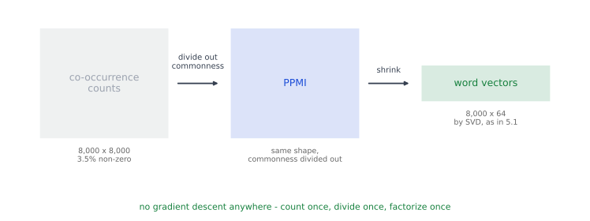

# 같이 나온 횟수가 뜻을 만든다 — 동시 출현 · PPMI · SVD

<div class="leadbox" markdown>

**들어가는 이야기** — 사전을 한 번도 안 보고 뜻을 얻는다: 유유상종

[앞 쪽](01_not_a_number.md)이 만든 표에는 **아무 수나** 들어 있었다. 표를 뜻있게 만들려면 **무엇을 기준으로 채울지** 정해야 한다.

이 장이 쓰는 기준은 하나뿐이고, 놀랍도록 단순하다 — 「둘레에 같이 나오는 단어끼리 가깝게.」 사전도, 품사도, 정답표도 쓰지 않는다. 가진 것은 영화평뿐이다.

그 기준을 따르는 가장 곧은 길은 **세는 것**이다. 어느 단어가 어느 단어 곁에 몇 번 나왔는지를 표에 적고, 그 표를 줄인다. 경사 하강법도 로스도 없고 **몇 초**면 끝난다. 그렇게 얻은 벡터로 가까운 단어를 뽑으면 이렇다.

```
terrible    awful, acting, horrible, bad, laughable, inept
funny       hilarious, amusing, comedy, scary, entertaining, it's
```

**사전을 한 번도 보지 않고 「끔찍한」의 동의어들이 모였다.** 이것이 분포 가설 — 단어의 뜻은 그 단어가 **어울려 다니는 무리**에 있다는 생각 — 이 실제로 통한다는 증거다. 옛말로는 유유상종이다. 다만 끼리끼리 모이는 기준이 정말 「뜻」인지는 [다음 쪽](03_context.md)에서 따진다.

그런데 곧이곧대로 세면 안 된다. 횟수 그대로 쓰면 `the`의 이웃이 `of, and, to, is, in, a` 가 된다 — 흔한 단어끼리 붙을 뿐이다. 이 쪽이 그것을 걷어 내는 법을 보고, 끝에 물음 하나를 남긴다 — **이 표를 만들지 않고도 같은 데 닿을 수 있는가.**

</div>

---

## 1. 코드

```python
"""같이 나온 횟수가 뜻을 만든다 — 세기만 해도 단어 벡터가 나온다.

앞 쪽이 만든 표에는 아무 수나 들어 있었다. 뜻있게 채우려면 기준이 있어야
하고, 이 장의 기준은 하나다 — 「둘레에 같이 나오는 단어끼리 가깝게.」
그 기준을 따르는 가장 곧은 길이 같이 나온 횟수를 세는 것이다.

  (가) 같이 나온 횟수를 센다            -> 단어 동시 출현 행렬 (V x V)
  (나) 흔한 단어 탓을 걷어 낸다          -> PPMI
  (다) 그 표를 낮은 차원으로 줄인다       -> SVD (5.1절의 PCA 와 같은 수법)

그리고 다음 쪽이 지을 배우는 길(Skip-gram + 네거티브 샘플링)을 미리 줄여
돌려 「같은 자로」 견준다 — 같은 단어의 이웃 목록이 얼마나 겹치는가.
두 길은 뿌리가 같다 — 둘 다 같은 단어 동시 출현 행렬을 본다.

자료는 IMDB 영화평 6,000편이고 어휘는 8,000이다. 다음 쪽도 같은 것을 쓴다.
실행: 이 쪽의 코드를 파일로 갈무리해 저장소 뿌리에서 돌린다.
"""
import re
import time
from collections import Counter
from pathlib import Path

import numpy as np
import scipy.sparse as sp
import scipy.sparse.linalg as sla
import torch
import torch.nn as nn
import torch.nn.functional as F

SEED, VOCAB, DIM, WINDOW = 42, 8000, 64, 4
STEPS, BATCH, NEG, LR = 6000, 1024, 5, 3e-3
ROOT = Path("./data/aclImdb")
TOKEN = re.compile(r"[a-z']+")
# 「CPU 로 돌린다.」 이 쪽은 두 길의 이웃 목록이 얼마나 겹치는지를 세는데,
# MPS 는 비트 단위로 되풀이되지 않아 그 수가 돌릴 때마다 달라진다. 모델이
# 작아 CPU 로도 몇 분이면 끝나므로, 되풀이되는 쪽을 골랐다.
device = torch.device("cpu")
torch.set_num_threads(4)


def load_tokens(n_docs=6000):
    out = []
    for name in ("pos", "neg"):
        for f in sorted((ROOT / "train" / name).glob("*.txt"))[: n_docs // 2]:
            out += TOKEN.findall(f.read_text(encoding="utf-8")
                                 .replace("<br />", " ").lower())
    return out


toks = load_tokens()
counts = Counter(toks)
words = [w for w, _ in counts.most_common(VOCAB)]
stoi = {w: i for i, w in enumerate(words)}
ids = torch.tensor([stoi[w] for w in toks if w in stoi], dtype=torch.long)


# === 세는 길 ===============================================================
def cooccurrence():
    """창 안에 같이 나온 횟수를 V x V 표에 쌓는다."""
    C = torch.zeros(VOCAB, VOCAB)
    for off in range(1, WINDOW + 1):
        a, b = ids[:-off], ids[off:]
        C.index_put_((a, b), torch.ones(len(a)), accumulate=True)
        C.index_put_((b, a), torch.ones(len(a)), accumulate=True)
    return C


def ppmi(C):
    """PPMI = max(0, log( P(a,b) / (P(a) P(b)) )).

    같이 나온 횟수를 그대로 쓰면 the 가 모든 단어와 가까워진다. 각자가
    혼자 나오는 빈도로 나누어, 「혼자 흔한 탓」을 걷어 낸 몫만 남긴다.
    """
    total = C.sum()
    pa = C.sum(1, keepdim=True) / total
    pb = C.sum(0, keepdim=True) / total
    pab = C / total
    return (pab / (pa * pb + 1e-12) + 1e-12).log().clamp_min(0)


# === 배우는 길 (다음 쪽의 것을 미리 줄여 옮겼다) ===========================
class SkipGram(nn.Module):
    def __init__(self, v, d):
        super().__init__()
        self.mid, self.ctx = nn.Embedding(v, d), nn.Embedding(v, d)
        nn.init.normal_(self.mid.weight, std=0.1)
        nn.init.zeros_(self.ctx.weight)


def train_skipgram():
    freq = torch.tensor([counts[w] for w in words], dtype=torch.float)
    p = freq ** 0.75; p /= p.sum()
    torch.manual_seed(SEED)
    m = SkipGram(VOCAB, DIM).to(device)
    opt = torch.optim.Adam(m.parameters(), lr=LR)
    g = torch.Generator().manual_seed(SEED)
    for _ in range(STEPS):
        c = torch.randint(WINDOW, len(ids) - WINDOW, (BATCH,), generator=g)
        off = torch.randint(1, WINDOW + 1, (BATCH,), generator=g)
        off *= torch.where(torch.rand(BATCH, generator=g) < 0.5, -1, 1)
        cc, oo = ids[c].to(device), ids[c + off].to(device)
        v = m.mid(cc)
        pos = (v * m.ctx(oo)).sum(-1)
        ni = torch.multinomial(p, BATCH * NEG, True, generator=g).to(device)
        ng = torch.bmm(m.ctx(ni).view(BATCH, NEG, -1), v.unsqueeze(-1)).squeeze(-1)
        loss = -(F.logsigmoid(pos).mean() + F.logsigmoid(-ng).sum(1).mean())
        opt.zero_grad(); loss.backward(); opt.step()
    return m.mid.weight.detach().cpu()


def neighbours(W, w, k=6):
    Wn = F.normalize(W, dim=1)
    s = Wn @ Wn[stoi[w]]
    s[stoi[w]] = -2
    return [words[i] for i in s.topk(k).indices.tolist()]


if __name__ == "__main__":
    probe = ["good", "terrible", "movie", "she", "funny"]

    t = time.perf_counter()
    C = cooccurrence()
    M = ppmi(C)
    # 위에서 DIM 개 특잇값만 구한다. PPMI 는 97% 가 0 이라 희소 행렬로 넘긴다.
    # svds 는 Lanczos 반복이다 — 행렬을 분해하지 않고 행렬-벡터 곱만 되풀이해
    # 크릴로프 공간을 키운다. 곱하는 일만 하므로 희소성이 그대로 속도가 된다.
    # 수렴하면 답이 정확하므로 시작 벡터(random_state)에 기대지 않는다.
    #
    # 다른 길 둘 (4절의 표가 견준다):
    #   (가) 직접 분해 — torch.linalg.eigh(M) 로 8,000개를 다 구해 앞 DIM 개를
    #        자른다. 정확하지만 n^3 이라 40초 남짓 걸리고, 행렬이 밀집으로
    #        메모리에 올라가야 한다. 어휘가 커지면 가장 먼저 무너진다.
    #   (나) 무작위 부분공간 반복 — torch.svd_lowrank(M, q, niter).
    #        난수 q 열을 A·Aᵀ 로 niter 번 곱하는 거듭제곱법이다. 이 행렬은
    #        64·65번째 특잇값이 0.2% 차이라 q=DIM 으로는 수렴이 아주 느리다.
    #        q 를 DIM 보다 넉넉히(오버샘플링) 잡고 앞 DIM 열만 쓴다:
    #            U, S, _ = torch.svd_lowrank(M, q=2 * DIM, niter=20)
    #            W_count = U[:, :DIM] * S[:DIM].sqrt()
    #        행렬을 훑는 횟수가 적어, 디스크·여러 기계에 나뉜 큰 행렬에 맞다.
    A = sp.csr_matrix(M.numpy().astype(np.float64))
    U, S, _ = sla.svds(A, k=DIM, random_state=SEED)
    order = np.argsort(-S)                       # svds 는 작은 것부터 돌려준다
    W_count = torch.from_numpy(U[:, order] * np.sqrt(S[order])).float()
    t_count = time.perf_counter() - t

    nz = (C > 0).float().mean()
    print(f"  단어 동시 출현 행렬 {VOCAB}x{VOCAB} = {VOCAB * VOCAB:,}칸 — "
          f"0 이 아닌 칸이 {nz * 100:.1f}%, 0 인 칸이 {(1 - nz) * 100:.1f}%")
    print(f"  the 와 가장 많이 같이 나온 단어 (횟수 그대로):")
    row = C[stoi["the"]].clone(); row[stoi["the"]] = -1
    print("    " + ", ".join(words[i] for i in row.topk(6).indices.tolist()))
    print(f"  the 와 가장 많이 같이 나온 단어 (PPMI 로 고친 뒤):")
    row = M[stoi["the"]].clone(); row[stoi["the"]] = -1
    print("    " + ", ".join(words[i] for i in row.topk(6).indices.tolist()))

    # PMI 를 동시 출현 확률로 무게를 주어 더하면 상호정보량이 된다.
    # PPMI 행렬의 칸 하나하나가 그 합의 낱낱 항이다
    total = C.sum()
    pab = C / total
    pmi_full = (pab / ((C.sum(1, keepdim=True) / total)
                       * (C.sum(0, keepdim=True) / total) + 1e-12) + 1e-12).log()
    mi = float((pab * pmi_full).sum())
    print(f"\n  상호정보량 I = sum_ab P(a,b) PMI(a,b) = {mi:.4f} nat")
    print(f"    (PPMI 는 그 합의 낱낱 항 가운데 양수만 남긴 것이다)")
    print(f"    견줄 자리: 단어 하나의 엔트로피 H = "
          f"{float(-(lambda q: (q * (q + 1e-12).log()).sum())(C.sum(1) / total)):.4f} nat")

    t = time.perf_counter()
    W_learn = train_skipgram()
    t_learn = time.perf_counter() - t

    print(f"\n  {'단어':<10s}{'세어서 만든 것':<46s}{'배워서 만든 것'}")
    agree = []
    for w in probe:
        a, b = neighbours(W_count, w), neighbours(W_learn, w)
        agree.append(len(set(a) & set(b)))
        print(f"  {w:<10s}{', '.join(a):<46s}{', '.join(b)}")

    print(f"\n  이웃 여섯 가운데 두 길이 함께 고른 수")
    for w, n in zip(probe, agree):
        print(f"    {w:<10s} {n}/6")
    print(f"    평균 {sum(agree) / len(agree):.1f}/6 — "
          f"우연이라면 {6 * 6 / VOCAB:.4f}/6 이다")

    print(f"\n  드는 시간")
    print(f"    세기  {t_count:7.1f}초   (한 번 세고 한 번 쪼갠다)")
    print(f"    배우기 {t_learn:7.1f}초   ({STEPS:,}스텝)")
```

**출력:**

```
  단어 동시 출현 행렬 8000x8000 = 64,000,000칸 — 0 이 아닌 칸이 3.5%, 0 인 칸이 96.5%
  the 와 가장 많이 같이 나온 단어 (횟수 그대로):
    of, and, to, is, in, a
  the 와 가장 많이 같이 나온 단어 (PPMI 로 고친 뒤):
    ocean, omen, rest, workings, iceberg, denominator

  상호정보량 I = sum_ab P(a,b) PMI(a,b) = 0.6449 nat
    (PPMI 는 그 합의 낱낱 항 가운데 양수만 남긴 것이다)
    견줄 자리: 단어 하나의 엔트로피 H = 6.5549 nat

  단어        세어서 만든 것                                      배워서 만든 것
  good      great, also, very, pretty, really, but        decent, great, solid, fine, nice, classical
  terrible  awful, acting, horrible, bad, laughable, ineptawful, bad, horrible, pitiful, chuckle, laughable
  movie     this, it, thing, film, really, if             film, drivel, thing, btw, preposterous, stinker
  she       her, he, when, him, she's, herself            her, she's, husband, he, phillip, marie
  funny     hilarious, amusing, comedy, scary, entertaining, it'skinda, scary, quite, amusing, damn, appealing

  이웃 여섯 가운데 두 길이 함께 고른 수
    good       1/6
    terrible   4/6
    movie      2/6
    she        3/6
    funny      2/6
    평균 2.4/6 — 우연이라면 0.0045/6 이다

  드는 시간
    세기      2.5초   (한 번 세고 한 번 쪼갠다)
    배우기     9.4초   (6,000스텝)
```

---

## 2. 그냥 세면 `the`가 모든 것과 가까워진다

세는 길의 첫걸음은 **단어 동시 출현 행렬**이다 — 단어-단어 크기의 표이고, 칸 하나가 「이 둘이 몇 번 같이 나왔는가」다. 어휘가 8,000이니 $8{,}000 \times 8{,}000$짜리로 만든다. 「같이 나왔다」는 **창** 안에 들었다는 뜻이다 — 어느 단어의 앞뒤 네 칸이고, 코드의 `WINDOW = 4` 가 그 창 크기다. 창 안에 든 쌍마다 1을 더한다. 영화평 6,000편으로 채우면 **0이 아닌 칸이 3.5%**다.

어휘 8,000은 **빈도로** 고른다 — 영화평 6,000편에 나온 단어 43,508가지를 많이 나온 순서로 세워 앞의 8,000개를 쓴다(코드의 `counts.most_common(VOCAB)`). 그 8,000개가 전체 토큰의 **93.6%**를 덮는다. 나머지 35,000여 가지는 다 합쳐도 6.4%이고, 그 가운데 17,920가지는 딱 한 번 나온 단어다. 한 번 나온 단어는 같이 나온 횟수도 한두 번뿐이라 표의 칸을 믿을 만하게 채우지 못한다. 그래서 흔한 단어만 남긴다. 다만 문턱이 **10번** 근처에 걸려 있다는 점은 알아 둘 것. 8,000번째 단어 `pocket`이 10번 나왔는데, 10번 나온 단어가 544개이고 그 가운데 27개만 어휘에 들었다. 같은 횟수끼리는 **먼저 나온 단어가** 들어간다 — `Counter.most_common` 이 동점을 처음 본 순서대로 세우기 때문이다.

??? note "「앞뒤 네 칸」을 정확히 말하면 — 두 가지가 다르다"

    **하나 — 창이 영화평 경계를 넘는다.** 코드는 영화평 6,000편의 토큰을 **한 줄로 이어 붙인 뒤** 창을 댄다. 그래서 어느 영화평의 끝 단어가 다음 영화평의 첫 단어와 쌍이 된다. 경계 하나에 그런 쌍이 많아야 10개($4+3+2+1$)이고, 같은 자료로 따로 세면 쌍 517만 8천 개 가운데 **5만 9,990개, 1.2%**다.

    이것을 **정칙화**처럼 읽고 싶어질 수 있다. 서로 상관없는 두 영화평에서 온 쌍은 독립에 가깝고, 독립인 쌍의 PMI 는 0이니, 섞으면 PPMI 가 0 쪽으로 당겨지지 않겠느냐는 것이다. 재어 보면 **반만 맞다.** 원래 0이 아니던 칸에서는 PPMI 가 평균 0.0066 내려간다 — 0 쪽으로 당겨지기는 한다. 그런데 경계 쌍이 **새로 채운 칸이 22,749개**이고, 그 칸들의 PPMI 평균은 **1.86**으로 나머지 칸의 평균(1.73)보다 높다. 대부분 한 번뿐인 우연한 쌍인데, 드문 단어끼리 한 번 만나면 $P(a)P(b)$ 가 작아 PMI 가 크게 나오기 때문이다. 고르게 당기는 정칙화가 아니라 **잡음이 섞인 것**에 가깝다.

    그래도 결과에는 거의 안 닿는다. 경계 쌍을 빼고 다시 세어 같은 수법으로 줄이면 `terrible` 의 이웃 여섯은 그대로이며, 어휘에서 무작위로 고른 500단어의 이웃 여섯 가운데 평균 **4.95개**가 겹친다. 바로잡으려면 영화평마다 따로 창을 대면 된다.

    **둘 — 「네 칸」은 원문이 아니라 어휘 안에서 센다.** 코드는 어휘 밖 단어를 창을 대기 **전에** 지운다(`if w in stoi`). 그러면 원문에서 다섯 칸 넘게 떨어진 두 단어도 그 사이의 드문 단어가 빠지면 창 안에 든다. 같은 영화평 안의 쌍 가운데 **6.1%**가 그렇고, 가장 먼 것은 원문에서 19칸 떨어져 있었다. 창이 희귀어를 건너뛰어 조금 넓어지는 셈이다.

그 표를 그대로 쓰면 어떻게 되는가. `the`와 가장 많이 같이 나온 단어를 뽑아 보면

```
of, and, to, is, in, a
```

**전부 기능어다.** `the`가 `of`와 자주 나온 것이 둘 사이에 무슨 관계가 있어서가 아니라, **둘 다 그냥 아주 흔하기 때문**이다. 횟수는 「같이 나왔다」와 「각자 흔하다」를 구분하지 못한다.


**두 자가 서로 다른 줄을 세운다.** 붉은 점들은 오른쪽 끝에 있는데 세로로는 바닥에 깔려 있다 — **수만 번 같이 나왔지만 기대보다 자주 붙은 것은 아니다.** 초록 점들은 그 반대다. `iceberg`는 `the` 옆에 겨우 스물몇 번 나왔는데도, **나올 때마다 `the`를 달고 나오기 때문에** PPMI 가 1을 넘는다.

### PPMI — 혼자 흔한 탓을 걷어 낸다

고치는 법은 **각자 혼자 나오는 빈도로 나누는 것**이다. 그 자가 **PPMI** 다 —
Positive Pointwise Mutual Information, 곧 양의 점별 상호정보량의 줄임말이다.
뒤에서부터 읽으면 이름이 그대로 식이 된다.

| | 뜻 | 식에서 |
|---|---|---|
| Mutual Information | 두 단어가 서로에 대해 알려 주는 정도 | $\log \dfrac{P(a,b)}{P(a)\,P(b)}$ |
| Pointwise | 모든 쌍에 걸친 평균이 아니라 **쌍 $(a, b)$ 하나**의 값 | 합 $\sum_{a,b}$ 이 없다 |
| Positive | 음수를 0으로 자른다 | $\max(0, \cdot)$ |

$$
\mathrm{PMI}(a, b) \;=\; \log \frac{P(a, b)}{P(a)\,P(b)},
\qquad
\mathrm{PPMI}(a, b) \;=\; \max\bigl(0,\; \mathrm{PMI}(a, b)\bigr)
\;=\; \max\left(0,\; \log \frac{P(a, b)}{P(a)\,P(b)}\right)
$$

세 확률은 모두 단어 동시 출현 행렬에서 센다. $(a, b)$ 칸의 횟수를 $n(a, b)$ 라 하면

$$
P(a, b) = \frac{n(a, b)}{\sum_{a', b'} n(a', b')},
\qquad
P(a) = \sum_{b'} P(a, b'),
\qquad
P(b) = \sum_{a'} P(a', b)
$$

이다.

분자는 「실제로 같이 나온 비율」, 분모는 「서로 상관없다면 같이 나왔을 비율」이다. 둘의 비가 1보다 크면 **기대보다 자주 붙어 다닌다**는 뜻이고, 로그를 씌워 그 몫만 남긴다. 음수를 0으로 자르는 것이 앞의 **P**(positive)다.

같은 `the`를 PPMI로 다시 뽑으면

```
ocean, omen, rest, workings, iceberg, denominator
```

**완전히 달라졌다.** `the ocean`, `the rest`, `the iceberg` — **거의 언제나 `the`를 달고 나오는 단어들**이다. `of`는 흔해서 높았을 뿐이고, `iceberg`는 드문데도 나올 때마다 `the`와 함께 나온다.

!!! note "PMI 는 상호정보량의 낱낱 항이다"
    PPMI 의 **P** 를 떼고 보면 PMI 이고, 그것을 동시 출현 확률로 무게를 주어 모두 더하면 **상호정보량**이 된다.

    $$
    I(A; B) \;=\; \sum_{a, b} P(a, b)\, \underbrace{\log \frac{P(a,b)}{P(a)P(b)}}_{\mathrm{PMI}(a,b)}
    $$

    곧 **PPMI 행렬의 칸 하나하나가 그 합의 항**이고, 우리는 그 가운데 양수만 남겨 표로 쓰는 것이다. 재어 보면 이 말뭉치에서 $I = 0.6449$ nat 이다. 단어 하나의 엔트로피가 6.5549 nat 이니, **둘레 단어 하나를 알면 가운데 단어의 불확실함이 10% 남짓 줄어든다**는 뜻이다.

    적어 보이지만 그 10%가 이 장이 가진 전부다. 임베딩이 담는 것은 **단어 사이에 흐르는 그 정보**다.

    같은 양이 [5.2절](../ch05/latent_generative/index.md)에도 나온다. 거기서 VAE 의 KL 항을 쪼개면 $I_q(X; Z)$ 가 나오는데, **잠재 표현이 입력 정보를 얼마나 싣는지**를 재는 바로 이 상호정보량이다. 여기서는 그것을 **재료로 쓰고**, 거기서는 **값으로 치른다.**

### 다음 쪽은 같은 행렬을 만들지 않고 분해한다

이 쪽은 PMI 행렬을 **손으로 만들어** 분해할 참이다 — 큰 행렬 하나를 작은 행렬 둘의
곱으로 적는 일이다. [다음 쪽](03_context.md)의 Skip-gram 과 네거티브 샘플링은 **그 표를
만들지 않고도** 같은 자리에 닿는다. 그 쪽이 재어 보이는데, 경사 하강법으로 배운 내적이
$\mathrm{PMI} - \log k$ 에 앉는다($k$ 는 그 쪽이 쓰는 틀린 짝의 개수다).

| | PMI 행렬을 | 분해하는 법 |
|---|---|---|
| 이 쪽 — PPMI + SVD | **만들어서 들고 있는다** | 특잇값 분해로 명시적으로 |
| [다음 쪽](03_context.md) — Skip-gram + 네거티브 샘플링 | **만들지 않는다** | 경사 하강법이 암묵적으로 |

그러니 둘은 **더 나은 것과 덜한 것이 아니라 같은 목표의 두 길**이다. 뒤에 오는
[GloVe](04_glove.md)는 **표는 만들고 분해는 경사 하강법으로** 하여 그 사이에 앉고, [fastText](06_fasttext.md)는 아예
다른 축이다 — 목적은 그대로 두고 **무엇이 벡터를 받는가**만 바꾼다.

### 그다음은 5.1절과 같은 수법이다

PPMI 행렬은 여전히 $8{,}000 \times 8{,}000$이다. 단어 하나에 수 8,000개를 주는 셈이라 너무 크다. **낮은 차원으로 줄여야 한다.**

줄이는 수법은 [5.1절](../ch05/dimreduction/01_pca.md)에서 이미 걸었다. 거기서는 784차원 그림을 64차원으로 줄였고, 여기서는 8,000차원 줄을 64차원으로 줄인다. 같은 특잇값 분해다.



**세 걸음 어디에도 경사 하강법이 없다.** 한 번 세고, 한 번 나누고, 한 번 쪼갠다. 쪼개는 일에도 반복은 든다 — 코드의 `svds` 는 행렬-벡터 곱을 760번쯤 되풀이해 답에 다가간다(4절). 그러나 그것은 정해진 답으로 수렴하는 수치 계산이지, 로스를 내려가는 학습이 아니다. [다음 쪽](03_context.md)이 짝 맞히기를 백만 번 넘게 되풀이하는 자리를 이 길은 그냥 지나간다.

**이 길이 GloVe의 뼈대다.** GloVe는 PPMI 대신 동시 출현 횟수의 로그를 맞추고 흔한 쌍의 무게를 줄이는 등 더 손을 보았지만, 「세고 → 고치고 → 줄인다」는 줄거리는 같다. [6.2절](04_glove.md)이 그 식을 세우고 같은 말뭉치로 직접 돌려, 세 길이 같은 표를 보고도 어디서 갈라지는지를 잰다.

---

## 3. 두 길이 2.4/6만 겹친다

세지 않고 **배워서** 같은 데 닿는 길이 있다. [다음 쪽](03_context.md)의 Skip-gram 과 네거티브 샘플링이고, 위 프로그램의 `train_skipgram()` 이 그것을 미리 줄여 옮긴 것이다 — 가운데 단어로 둘레 단어를 맞히는 짝 맞히기를 6,000스텝 되풀이한다. 어떻게 도는지는 다음 쪽이 풀고, 여기서는 **결과만** 가져와 같은 자로 견준다.

| 단어 | 세어서 만든 것 | 배워서 만든 것 |
|---|---|---|
| `terrible` | awful, acting, horrible, bad, laughable, inept | awful, bad, horrible, pitiful, chuckle, laughable |
| `funny` | hilarious, amusing, comedy, scary, entertaining, it's | kinda, scary, quite, amusing, damn, appealing |

**둘 다 그럴듯하다.** 그런데 **똑같지는 않다.** 이웃 여섯 가운데 두 길이 함께 고른 수를 세면 이렇다.

| 단어 | 함께 고른 이웃 |
|---|---|
| `terrible` | **4/6** |
| `she` | 3/6 |
| `movie` | 2/6 |
| `funny` | 2/6 |
| `good` | **1/6** |
| 평균 | **2.4/6** |

우연히 겹칠 확률은 $6 \times 6 / 8{,}000 = 0.0045$개다. **2.4는 우연이 아니다** — 두 길이 분명 같은 것을 보고 있다. 그런데 절반 넘게 다르게 고른다.

갈리는 자리를 보면 까닭이 짐작된다.

```
세어서  good  ->  great, also, very, pretty, really, but
배워서  good  ->  decent, great, solid, fine, nice, classical
```

**세어서 만든 쪽에 `also`·`very`·`really`·`but`이 들어 있다.** 기능어와 정도 부사다. PPMI로 `the`는 걷어 냈지만 `good` 곁에 진짜로 자주 붙는 `very`까지 걷어 내지는 못한다 — 그 둘은 실제로 서로를 끌어당기기 때문이다.

배워서 만든 쪽은 그런 것이 덜하다. 배우는 길은 맞는 짝을 당기는 한편 **틀린 짝**을 뽑아 밀어내는데 — 이것이 네거티브 샘플링이고 다음 쪽 4절이 푼다 — 그 틀린 짝으로 **흔한 단어가 자주 뽑히기** 때문이다. `very`는 틀린 짝으로 계속 나오므로 모든 단어와 멀어지는 압력을 받는다. 세는 길에는 그런 장치가 없다.

!!! note "어느 쪽이 좋은지 이 쪽은 말하지 않는다"
    이웃 목록은 **눈으로 보는 자**다. 「`good`의 이웃으로 `decent`가 `but`보다 낫다」는 느낌은 있어도 수가 아니다.

    제대로 가리려면 **쓸 곳에서 재야** 한다. [7.3절](../imdb/03_embedding.md)이 IMDB 분류에서 임베딩을 재는데, 거기에 두 길의 표를 각각 얹어 정확도를 견주면 답이 나온다. 이 쪽은 그 실험을 하지 않았다 — 연습문제 3이 그것을 설계하게 한다.

---

## 4. 서너 배 빠른데 왜 배우는가

| | 시간 |
|---|---|
| 세기 (한 번 세고 한 번 쪼갠다) | **2.5초** |
| 배우기 (6,000스텝) | **9.4초** |

세는 길이 압도적으로 싸다. 그런데도 Word2Vec 쪽이 더 널리 쓰인 까닭이 있다.

**하나 — 표가 통째로 메모리에 올라가야 한다.** 어휘 8,000에서 $8{,}000^2 \times 4$바이트로 **244 MB**다. 어휘를 50만으로 키우면 **931 기가바이트**가 된다. 배우는 길은 한 번에 배치 하나만 보므로 그런 일이 없다.

**둘 — 자료가 늘면 처음부터 다시 세야 한다.** 배우는 길은 새 자료로 이어서 학습하면 된다.

**셋 — 이 쪽의 2.5초는 어휘가 8,000이라서다.** 줄이는 일의 비용이 어휘 크기를 따라 는다. 다만 **어떻게 줄이느냐**에 따라 느는 꼴이 아주 다르다.

### 줄이는 길은 셋이다 — 그리고 둘은 반복법이다

위에서 64개 특잇값만 구하면 된다. 그 길이 셋 있다. 같은 PPMI 행렬로 재면 이렇다. 마지막 칸은 정확한 답과 이웃 여섯이 몇 개 겹치는지를 어휘에서 무작위로 고른 500단어로 잰 것이다.

| 길 | 하는 일 | 걸린 시간 | 정확한 답과 겹침 |
|---|---|---|---|
| 직접 분해 `torch.linalg.eigh` | 8,000개를 **다** 구해 앞 64개를 자른다 | 40초 남짓 | 6/6 (정의상) |
| 무작위 부분공간 반복 `svd_lowrank`, `q=64, niter=7` | 난수 64열에 $AA^\top$ 를 일곱 번 곱한다 | 0.3초 | **3.0/6** |
| 같은 것, `q=128, niter=20` | 열을 넉넉히 잡고(오버샘플링) 앞 64열만 쓴다 | 1.2초 | 5.9/6 |
| **Lanczos `svds`, 희소 행렬** (이 쪽) | 행렬-벡터 곱을 되풀이해 크릴로프 공간을 키운다 | 2초 안팎 | 6/6 |

**직접 분해는 어휘가 커지면 가장 먼저 무너진다.** 메모리가 $n^2$, 계산이 $n^3$ 이라 어휘 50만이면 시작도 못 한다. 나머지 둘은 **행렬을 곱하기만** 하므로 행렬이 희소하면 그 희소성이 그대로 속도가 된다. PPMI 는 음수를 0으로 자르므로 어휘가 커져도 희소하게 남는다.

**둘째 줄이 함정이다.** 거듭제곱법은 64번째 방향을 한 바퀴마다 대략 $(\sigma_{65}/\sigma_{64})^2$ 배씩 바로잡는데, 이 행렬은 $\sigma_{64} = 91.57$, $\sigma_{65} = 91.42$ 로 그 비가 0.997이다. 일곱 바퀴로는 거의 나아가지 못해, 이웃 목록의 절반이 정확한 답과 다르다. 씨앗을 박으면 매번 **같은** 틀린 답이 나오므로 되풀이된다는 것만으로는 이것이 안 보인다. 열을 128개로 넉넉히 잡으면 비가 $\sigma_{129}/\sigma_{64}$ 로 벌어져 스무 바퀴면 충분해진다.

**그러면 둘 가운데 무엇을 쓰는가 — 행렬을 몇 번 훑느냐가 가른다.** 이 쪽의 `svds` 는 행렬-벡터 곱을 **762번** 했다. 벡터 하나씩 차례로다. 무작위 반복은 `q=128, niter=20` 에서 행렬을 **42번**만 훑되 한 번에 128열씩 곱한다. 행렬이 메모리에 올라가면 762번은 아무 일도 아니어서 Lanczos 가 낫다 — 정확하고 씨앗에 기대지 않는다. 행렬이 디스크에 있거나 여러 기계에 나뉘어 한 번 훑는 일이 비싸지면 무작위 반복이 낫다. `sklearn` 의 `TruncatedSVD` 가 무작위 반복을 기본으로 두는 까닭이다(`n_iter=5`, 오버샘플링 10). 그때는 위의 함정을 오버샘플링으로 막아야 한다.

그보다 더 커지면 표를 들고 있는 일 자체가 버거워져, 위의 첫째·둘째 까닭이 앞에 선다.

!!! note "이 쪽은 CPU 로 돈다"
    [다음 쪽](03_context.md)은 GPU(MPS)를 쓰는데 이 쪽은 CPU 로 고정했다. 까닭이 둘이다.

    **되풀이되어야 해서다.** 이 쪽이 세는 「두 길이 함께 고른 이웃의 수」는 벡터가 조금만 달라져도 바뀐다. MPS 는 비트 단위로 되풀이되지 않아 돌릴 때마다 평균이 0.2씩 오갔다. CPU 로 옮기니 두 번 돌려 **완전히 같은 출력**이 나온다.

    **그리고 더 빨랐다.** 같은 학습이 MPS 에서 41.2초였는데 CPU 에서는 그 절반도 안 걸린다. 배치가 작고 어휘가 작아 GPU 에 보내고 받는 값이 계산보다 컸던 것이다. **큰 모델이 늘 빠른 것은 아니다.**

    세는 쪽은 처음부터 씨앗이 필요 없다. `svds` 는 수렴하면 정확한 답을 내므로 시작 벡터가 무엇이든 같은 이웃이 나온다.

곧 **작고 고정된 말뭉치에서는 세는 길이 낫고, 크고 자라는 말뭉치에서는 배우는 길이 낫다.** [다음 쪽](03_context.md)이 그 배우는 길을 처음부터 짓는다. 그리고 GloVe는 둘 사이를 노린 것이다 — 세기는 하되 0이 아닌 칸만 보고, 줄이는 일을 특잇값 분해 대신 경사 하강법으로 한다.

---

## 연습문제

<div class="drillbox" markdown>

**연습문제 1.** <span class="diff easy" title="쉬움"></span> PPMI에서 음수를 0으로 자르는 까닭은 무엇인가. 자르지 않으면 무엇이 달라지는가.

</div>

??? success "풀이"

    음수는 **기대보다 덜 같이 나왔다**는 뜻이다. 그런데 그 정보는 믿기 어렵다 — 어휘가 8,000이면 쌍이 6,400만 개인데 표의 96.5%가 0이다. 한 번도 같이 안 나온 쌍은 $\log 0 = -\infty$가 되고, 한두 번 나온 쌍의 음숫값도 자료가 모자라 생긴 것인지 정말 서로 피하는 것인지 가릴 수 없다.

    자르지 않으면 그 **믿을 수 없는 음수들이 표의 대부분을 차지**해, 특잇값 분해가 그 잡음을 맞추는 데 차원을 써 버린다.

    자르면 표가 더 성겨지는 대신 남는 값이 모두 「기대보다 자주 붙어 다닌다」는 뜻이 된다.

<div class="drillbox" markdown>

**연습문제 2.** <span class="diff med" title="중간"></span> 2절은 `the`의 이웃이 PPMI 뒤에 `ocean, omen, iceberg`로 바뀌는 것을 보였다. 이 목록이 **좋은 결과인지** 따지라.

</div>

??? success "풀이"

    **묻는 것에 따라 다르다.**

    「`the`와 뜻이 닮은 단어」을 바란 것이라면 **나쁜 결과**다. `iceberg`는 `the`와 아무 뜻도 공유하지 않는다.

    그러나 PPMI가 재는 것은 뜻의 닮음이 아니라 **붙어 다니는 정도**다. 그 자로 보면 정확하다 — `iceberg`는 영어에서 거의 언제나 한정사를 달고 나오고, 영화평에서는 `the iceberg`(타이타닉 이야기)로 나온다.

    그러니 이 목록이 말해 주는 것은 **`the`에게는 「이웃 단어」이라는 물음 자체가 잘 맞지 않는다**는 사실이다. 기능어는 뜻이 아니라 **문법적 자리**로 일하므로, 분포로 재는 벡터가 담을 것이 적다. 3절에서 세는 길에 기능어가 섞여 들어오는 것도 같은 이야기의 다른 쪽이다.

<div class="drillbox" markdown>

**연습문제 3.** <span class="diff hard" title="어려움"></span> 3절은 두 길 가운데 어느 쪽이 나은지 말하지 않았다. **쓸 곳에서 재는** 실험을 설계하라. 무엇을 고정하고 무엇만 바꿔야 하는가.

</div>

??? success "풀이"

    **설계** — [7.3절](../imdb/03_embedding.md)의 모델을 그대로 쓰되 단어 임베딩 표의 **시작값만** 바꾼다.

    | 표 | 어디서 왔나 |
    |---|---|
    | (가) 난수 | 지금 7.3절이 하는 것 |
    | (나) 세어서 만든 것 | 이 쪽의 `W_count` |
    | (다) 배워서 만든 것 | 이 쪽의 `W_learn` |

    **고정할 것** — 모델 구조, 어휘, 차원 64, 학습 규약(5 에포크·Adam·배치 100), 그리고 **임베딩을 얼릴지 말지**. 얼린 쪽과 미세 조정한 쪽을 따로 재면 여섯 칸이 된다.

    **주의** — 이 쪽의 두 표는 어휘가 8,000이고 영화평 6,000편으로 만든 것인데 7.3절은 어휘 20,000에 25,000편을 쓴다. **같은 조건으로 다시 만들어야** 견줄 수 있다. 그러지 않으면 「세는 길이 나쁘다」가 아니라 「자료를 덜 보았다」를 재게 된다.

    **미리 적는 판정** — [7.3절](../imdb/03_frozen.md)이 GloVe로 같은 실험을 했고 거기서 **얼린 것과 아닌 것의 부호가 뒤집혔다.** 그러니 이 실험도 얼림 여부에 따라 답이 달라질 가능성이 크고, 「(나)가 (다)보다 낫다」 같은 한 줄 결론이 나오지 않을 것으로 본다. 그 또한 적을 값어치가 있는 결과다.
