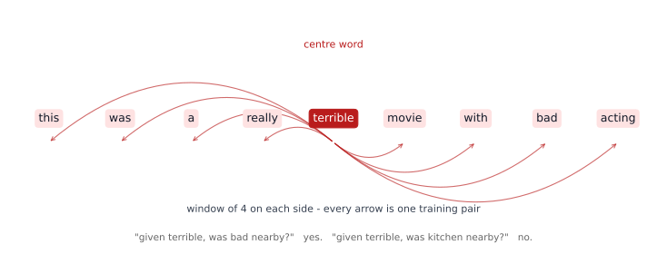
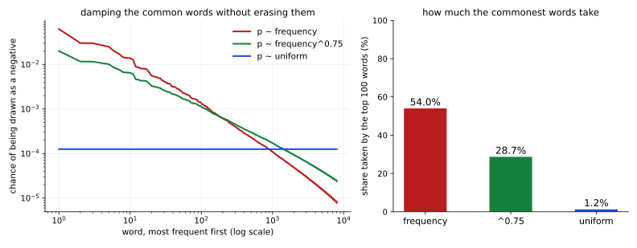
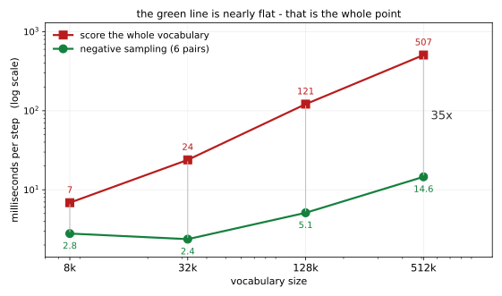

# 주위 단어가 뜻을 만든다 — Skip-gram 과 네거티브 샘플링

<div class="leadbox" markdown>

**들어가는 이야기** — 표를 만들지 않고도 같은 데 닿는다

[앞 쪽](02_counting.md)은 8,000 × 8,000 칸짜리 단어 동시 출현 행렬을 세어 만들고, PPMI(Positive Pointwise Mutual Information, 양의 점별 상호정보량)로 고치고, 특잇값 분해로 줄였다. 뜻이 통하는 벡터가 나왔다. 그런데 그 표는 어휘 8,000에서 244 MB이고, 어휘를 50만으로 키우면 931 기가바이트다.

이 쪽은 **그 표를 한 번도 만들지 않는다.** 단어 임베딩 표에 아무 수나 넣고 시작한다. 그 상태에서 `terrible`과 가까운 단어를 뽑으면 이렇다.

```
terrible    queen, massive, max, almighty, article, boy's
```

아무 뜻이 없다. 여기서 하는 일은 하나뿐이다 — 영화평에서 가까이 나온 두 단어를 뽑아 「이 둘은 짝이다」를 맞히게 하고, 틀린 만큼 경사 하강법으로 표를 조금 고친다. 기준은 앞 쪽과 같다. 「주위에 같이 나오는 단어끼리 가깝게.」

그 짝 맞히기를 백만 번 넘게 되풀이한 뒤 같은 단어를 다시 뽑으면 이렇다.

```
terrible    awful, bad, horrible, pitiful, chuckle, laughable
good        decent, great, solid, fine, nice, classical
movie       film, drivel, thing, btw, preposterous, stinker
she         her, she's, husband, he, phillip, marie
```

**세지도 않았고 행렬도 없는데 「끔찍한」의 동의어들이 모였다.** 앞 쪽이 세어서 얻은 `awful`·`bad`·`horrible`이 여기에도 있다. 표를 만들지 않았는데 왜 같은 데 닿는가 — 이 쪽이 그 까닭을 식으로 보인다.

그런데 셋째 줄을 보라. `movie`의 이웃에 `drivel`(쓰레기 같은 글)과 `stinker`(망작)가 있다. 영화평에서는 **영화를 욕하는 말이 영화라는 말 곁에 자주 나오기** 때문이다. 배운 것은 「뜻」이 아니라 **「이 말뭉치에서 어울려 다니는 것」**이다.

</div>

---

## 1. 코드

```python
"""주위 단어가 뜻을 만든다 — Skip-gram 과 네거티브 샘플링.

앞 쪽은 단어 동시 출현 행렬을 세어 만들고 분해했다. 이 쪽은 그 행렬을
만들지 않는다. 기준은 같다 — 「주위에 같이 나오는 단어끼리 가깝게.」

단어의 뜻을 사전에서 가져오지 않는다. 정답표도 없다. 가진 것은 영화평
6,000편뿐이고, 거기서 가까이 나온 단어 짝을 뽑아 맞히기만 되풀이한다.

두 가지를 잰다.
  (가) 그 기준 하나로 배운 벡터가 정말 뜻을 담는가 — 이웃 단어를 뽑아 본다
  (나) 네거티브 샘플링이 왜 필요한가 — 어휘 전부를 놓는 소프트맥스와 시간을 견준다

자료는 7장과 같은 IMDB 영화평이다.
실행: 이 쪽의 코드를 파일로 갈무리해 저장소 뿌리에서 돌린다.
"""
import math
import random
import re
import time
from collections import Counter
from pathlib import Path

import torch
import torch.nn as nn
import torch.nn.functional as F

SEED, VOCAB, DIM, WINDOW = 42, 8000, 64, 4
STEPS, BATCH, NEG, LR = 6000, 1024, 5, 3e-3
ROOT = Path("./data/aclImdb")
TOKEN = re.compile(r"[a-z']+")
device = torch.device("mps" if torch.backends.mps.is_available() else "cpu")


def sync():
    """MPS 는 비동기다. 동기화하지 않으면 큐에 넣는 시간만 재게 된다."""
    if device.type == "mps":
        torch.mps.synchronize()


def load_tokens(n_docs=6000):
    out = []
    for name in ("pos", "neg"):
        for f in sorted((ROOT / "train" / name).glob("*.txt"))[: n_docs // 2]:
            out += TOKEN.findall(f.read_text(encoding="utf-8")
                                 .replace("<br />", " ").lower())
    return out


toks = load_tokens()
counts = Counter(toks)
words = [w for w, _ in counts.most_common(VOCAB)]
stoi = {w: i for i, w in enumerate(words)}
ids = torch.tensor([stoi[w] for w in toks if w in stoi], dtype=torch.long)

# 네거티브를 뽑는 분포 — 빈도의 0.75 제곱. 흔한 단어를 조금 눌러 준다
freq = torch.tensor([counts[w] for w in words], dtype=torch.float)
neg_p = (freq ** 0.75)
neg_p /= neg_p.sum()
# NCE 가 로짓에서 빼는 항. 네거티브 샘플링은 이것을 지운 것이다
LOGKP = (math.log(NEG) + neg_p.log()).to(device)


def pairs(g):
    """가운데 단어와 그 주위 단어 한 쌍씩."""
    c = torch.randint(WINDOW, len(ids) - WINDOW, (BATCH,), generator=g)
    off = torch.randint(1, WINDOW + 1, (BATCH,), generator=g)
    off *= torch.where(torch.rand(BATCH, generator=g) < 0.5, -1, 1)
    return ids[c].to(device), ids[c + off].to(device)


class SkipGram(nn.Module):
    """가운데 단어로 주위 단어를 맞힌다. 표를 둘 둔다 — 가운데용과 주위용."""

    def __init__(self, v, d):
        super().__init__()
        self.mid = nn.Embedding(v, d)
        self.ctx = nn.Embedding(v, d)
        nn.init.normal_(self.mid.weight, std=0.1)
        nn.init.zeros_(self.ctx.weight)

    def full_loss(self, c, o):
        """어휘 전부를 놓고 소프트맥스 — 바른 길이지만 비싸다."""
        return F.cross_entropy(self.mid(c) @ self.ctx.weight.T, o)

    def nce_loss(self, c, o, g):
        """NCE — 네거티브 샘플링과 로짓 하나만 다르다. log k·P_n(w) 를 뺀다."""
        v = self.mid(c)
        pos = (v * self.ctx(o)).sum(-1) - LOGKP[o]
        ni = torch.multinomial(neg_p, c.size(0) * NEG, True,
                               generator=g).to(device)
        neg = torch.bmm(self.ctx(ni).view(c.size(0), NEG, -1),
                        v.unsqueeze(-1)).squeeze(-1) - LOGKP[ni].view(-1, NEG)
        return -(F.logsigmoid(pos).mean() + F.logsigmoid(-neg).sum(1).mean())

    def neg_loss(self, c, o, g):
        """맞는 짝 하나와 틀린 짝 NEG 개만 본다 — 네거티브 샘플링."""
        v = self.mid(c)                                   # (B, d)
        pos = (v * self.ctx(o)).sum(-1)                   # (B,)
        neg_ids = torch.multinomial(neg_p, c.size(0) * NEG, True,
                                    generator=g).to(device)
        neg = torch.bmm(self.ctx(neg_ids).view(c.size(0), NEG, -1),
                        v.unsqueeze(-1)).squeeze(-1)      # (B, NEG)
        return -(F.logsigmoid(pos).mean() + F.logsigmoid(-neg).sum(1).mean())


def train(kind):
    torch.manual_seed(SEED)
    m = SkipGram(VOCAB, DIM).to(device)
    opt = torch.optim.Adam(m.parameters(), lr=LR)
    g = torch.Generator().manual_seed(SEED)
    sync(); t0 = time.perf_counter()
    for _ in range(STEPS):
        c, o = pairs(g)
        loss = (m.full_loss(c, o) if kind == "full" else
                m.nce_loss(c, o, g) if kind == "nce" else m.neg_loss(c, o, g))
        opt.zero_grad(); loss.backward(); opt.step()
    sync()
    return m.eval(), (time.perf_counter() - t0) / STEPS * 1000


@torch.no_grad()
def neighbours(m, w, k=6):
    W = F.normalize(m.mid.weight, dim=1)
    s = W @ W[stoi[w]]
    s[stoi[w]] = -2
    return [words[i] for i in s.topk(k).indices.tolist()]


if __name__ == "__main__":
    print(f"  영화평 6,000편에서 단어 {len(ids):,}개, 어휘 {VOCAB:,}개")
    print(f"  윈도 크기 {WINDOW}, 차원 {DIM}, {STEPS:,}스텝\n")

    probe = ["good", "terrible", "movie", "she", "funny"]

    torch.manual_seed(SEED)
    raw = SkipGram(VOCAB, DIM)
    print("  배우기 전 — 아무 수나 들어 있는 표")
    for w in probe[:3]:
        print(f"    {w:<10s} {', '.join(neighbours(raw, w))}")

    m_neg, t_neg = train("neg")
    print("\n  배운 뒤 — 네거티브 샘플링")
    for w in probe:
        print(f"    {w:<10s} {', '.join(neighbours(m_neg, w))}")

    m_full, t_full = train("full")
    print("\n  배운 뒤 — 어휘 전부를 놓고 소프트맥스")
    for w in probe:
        print(f"    {w:<10s} {', '.join(neighbours(m_full, w))}")

    print(f"\n  한 스텝에 드는 시간")
    print(f"    네거티브 {NEG}개   {t_neg:7.2f} ms")
    print(f"    어휘 전부    {t_full:7.2f} ms   ({t_full / t_neg:.1f}배)")
    print(f"    한 스텝에 점수를 매기는 짝의 수 — "
          f"{BATCH * (1 + NEG):,} 대 {BATCH * VOCAB:,}")

    # === 틀린 짝이 정말 틀렸는가 =========================================
    # 뽑은 네거티브를 말뭉치의 참 동시출현과 대조한다. 알고리즘은 이 대조를
    # 하지 않는다 — 하지 않는 것이 값싼 까닭이자, 배우는 것을 정하는 까닭이다.
    arr = ids.tolist()
    co = Counter()
    nb = [set() for _ in range(VOCAB)]
    for i, w in enumerate(arr):
        for d in range(1, WINDOW + 1):
            if i - d >= 0:
                co[(w, arr[i - d])] += 1
                nb[w].add(arr[i - d])
            if i + d < len(arr):
                co[(w, arr[i + d])] += 1
                nb[w].add(arr[i + d])

    gg = torch.Generator().manual_seed(SEED)
    seen = any_nb = in_win = 0
    for _ in range(200):
        c = torch.randint(WINDOW, len(ids) - WINDOW, (BATCH,), generator=gg)
        ni = torch.multinomial(neg_p, BATCH * NEG, True,
                               generator=gg).view(BATCH, NEG)
        for b in range(BATCH):
            mid_w = arr[c[b]]
            win = {arr[c[b] + d] for d in range(-WINDOW, WINDOW + 1) if d}
            for n in ni[b].tolist():
                seen += 1
                any_nb += n in nb[mid_w]
                in_win += n in win
    print(f"\n  뽑은 틀린 짝 {seen:,}개 가운데")
    print(f"    말뭉치 어딘가에서 실제로 이웃인 것 : "
          f"{any_nb:,} ({any_nb / seen * 100:.1f}%)")
    print(f"    바로 그 자리의 윈도 안에 있던 것   : "
          f"{in_win:,} ({in_win / seen * 100:.2f}%)")
    print(f"    한 단어의 참 이웃 가짓수 중앙값    : "
          f"{sorted(len(s) for s in nb)[VOCAB // 2]}")

    # === 지운 항 하나가 최적점을 어디로 옮기나 ===========================
    # NCE 의 로짓은  u·v - log k·P_n(w)  다. 네거티브 샘플링은 뒤 항을 지운
    # 것이고, 그래서 그 항만큼을 내적이 떠안는다 — 그 자리가 PMI 다.
    ctx_tot = Counter()
    for (w, _), n in co.items():
        ctx_tot[w] += n
    sel = [q for q, n in co.items() if n >= 30][:4000]
    log_p = torch.tensor([math.log(co[q] / ctx_tot[q[0]]) for q in sel])
    pmi_k = torch.tensor([math.log(co[q] / ctx_tot[q[0]]
                                   / neg_p[q[1]].item()) - math.log(NEG)
                          for q in sel])

    def fit(y, x):
        xc, yc = x - x.mean(), y - y.mean()
        r = (xc * yc).mean() / (x.std(unbiased=False) * y.std(unbiased=False))
        return r.item(), ((xc * yc).sum() / (xc ** 2).sum()).item()

    @torch.no_grad()
    def dots(m):
        return torch.tensor([(m.mid.weight[a].cpu() * m.ctx.weight[b].cpu())
                             .sum().item() for a, b in sel])

    m_nce, _ = train("nce")
    print(f"\n  배운 내적이 무엇을 좇는가 ({len(sel):,}짝, k={NEG})")
    print(f"    {'':28s}{'PMI - log k':>22s}{'log p(o|c)':>22s}")
    for tag, mm in (("네거티브 샘플링 (항 지움)", m_neg), ("NCE (항 있음)", m_nce)):
        d = dots(mm)
        r1, s1 = fit(d, pmi_k); r2, s2 = fit(d, log_p)
        print(f"    {tag:24s}  r={r1:+.4f} 기울기={s1:5.3f}"
              f"   r={r2:+.4f} 기울기={s2:5.3f}")
    print("    저마다 제 예측을 좇는다 — 기울기가 1에 가까운 칸이 그것이다")

    # === 어휘를 키우면 언제부터 벌어지는가 ================================
    # 트레인은 하지 않고 로스 한 번의 앞·뒤 계산만 잰다.
    # 「뽑는 일은 시간 재기 밖에 둔다」 — torch.multinomial 은 어휘 크기에
    # 비례해 비싸서, 그대로 두면 「점수 매기는 비용」이 아니라 「뽑는 비용」
    # 을 재게 된다. 실제 구현은 별칭 표(alias table)로 O(1) 에 뽑는다.
    print(f"\n  어휘를 키우면 (점수 매기는 비용만. 뽑는 일은 뺐다)")
    print(f"    {'어휘':>9}{'네거티브':>11}{'전부':>10}{'몇 배':>9}")
    for v in (8_000, 32_000, 128_000, 512_000):
        torch.manual_seed(SEED)
        mm = SkipGram(v, DIM).to(device)
        pp = torch.ones(v) / v
        c = torch.randint(0, v, (BATCH,), generator=torch.Generator()
                          .manual_seed(SEED)).to(device)
        o = torch.randint(0, v, (BATCH,), generator=torch.Generator()
                          .manual_seed(SEED + 1)).to(device)
        gg = torch.Generator().manual_seed(SEED)
        ni = torch.multinomial(pp, BATCH * NEG, True,
                               generator=gg).to(device)   # 미리 뽑아 둔다

        def step(full):
            mm.zero_grad()
            if full:
                loss = mm.full_loss(c, o)
            else:
                vv = mm.mid(c)
                pos = (vv * mm.ctx(o)).sum(-1)
                ng = torch.bmm(mm.ctx(ni).view(BATCH, NEG, -1),
                               vv.unsqueeze(-1)).squeeze(-1)
                loss = -(F.logsigmoid(pos).mean()
                         + F.logsigmoid(-ng).sum(1).mean())
            loss.backward()

        def clock(full, n=10):
            step(full); sync(); t = time.perf_counter()
            for _ in range(n): step(full)
            sync()
            return (time.perf_counter() - t) / n * 1000

        a, b = clock(False), clock(True)
        print(f"    {v:9,}{a:10.2f}ms{b:9.2f}ms{b / a:8.1f}배")
```

**출력:**

```
  영화평 6,000편에서 단어 1,294,455개, 어휘 8,000개
  윈도 크기 4, 차원 64, 6,000스텝

  배우기 전 — 아무 수나 들어 있는 표
    good       relentlessly, done, shadow, hear, jo, taboo
    terrible   queen, massive, max, almighty, article, boy's
    movie      chikatilo, inventive, seas, repeatedly, pad, griffith

  배운 뒤 — 네거티브 샘플링
    good       decent, great, solid, fine, nice, classical
    terrible   awful, bad, horrible, pitiful, chuckle, laughable
    movie      film, drivel, thing, btw, preposterous, stinker
    she        her, she's, husband, he, phillip, marie
    funny      kinda, scary, quite, amusing, damn, appealing

  배운 뒤 — 어휘 전부를 놓고 소프트맥스
    good       decent, great, darn, nice, smart, passable
    terrible   lousy, horrible, amateurish, inept, passable, unfunny
    movie      film, turd, flick, misfire, otherwise, stinker
    she        her, she's, patty, he, rejects, sanjay
    funny      scary, childish, darn, quite, preachy, paced

  한 스텝에 드는 시간
    네거티브 5개      6.93 ms
    어휘 전부      12.37 ms   (1.8배)
    한 스텝에 점수를 매기는 짝의 수 — 6,144 대 8,192,000


  뽑은 틀린 짝 1,024,000개 가운데
    말뭉치 어딘가에서 실제로 이웃인 것 : 697,026 (68.1%)
    바로 그 자리의 윈도 안에 있던 것   : 30,048 (2.93%)
    한 단어의 참 이웃 가짓수 중앙값    : 130

  배운 내적이 무엇을 좇는가 (4,000짝, k=5)
                                           PMI - log k            log p(o|c)
    네거티브 샘플링 (항 지움)           r=+0.8983 기울기=0.811   r=+0.7710 기울기=0.280
    NCE (항 있음)                r=+0.6195 기울기=1.558   r=+0.9752 기울기=0.986
    저마다 제 예측을 좇는다 — 기울기가 1에 가까운 칸이 그것이다

  어휘를 키우면 (점수 매기는 비용만. 뽑는 일은 뺐다)
           어휘       네거티브        전부      몇 배
        8,000      2.79ms     6.86ms     2.5배
       32,000      2.37ms    23.90ms    10.1배
      128,000      5.11ms   121.27ms    23.7배
      512,000     14.58ms   507.30ms    34.8배
```

---

## 2. 하는 일은 「다음 단어 맞히기」가 아니다

이 쪽의 모델이 푸는 문제를 정확히 적으면 이렇다 — **가운데 단어를 주고 그 주위에 무엇이 있는지 맞혀라.**

```
… the acting was  [terrible]  and the plot made no sense …
                   가운데        주위 ←→ 주위
```

윈도 크기가 4이니 `terrible` 앞뒤 네 칸 안에서 아무거나 하나를 뽑아 짝으로 삼는다. 이 짝 맞히기를 **백만 번 넘게** 되풀이한다.



**화살표 하나가 트레인 짝 하나다.** 가운데 단어는 그대로 두고 주위에서 하나씩 바꿔 가며 「이 둘이 가까이 나왔는가」를 묻는다.

맞히는 데 쓰는 것은 두 표다. 가운데용 $\mathbf{v}$와 주위용 $\mathbf{u}$를 따로 두고, 둘의 내적이 클수록 「같이 나올 법하다」로 읽는다. 가운데용 $\mathbf{v}$ 가 **단어 임베딩**(word embedding)이고 주위용 $\mathbf{u}$ 가 **문맥 임베딩**(context embedding)이다 — [앞 쪽](02_counting.md)의 $W$ 와 $\tilde W$ 에 그대로 대응한다. 트레인이 끝나면 단어 벡터로 남겨 쓰는 것은 $\mathbf{v}$ 쪽이다(코드의 `mid`). 표를 둘 두는 까닭은 **단어가 제 자신의 주위에 잘 나오지 않기** 때문이다 — 하나로 두면 모든 단어가 자기와 가까워지려는 압력을 받는다.

**단어마다 얼굴이 둘이라고 보면 쉽다.** 단어 임베딩 $\mathbf{v}_a$ 는 「내가 **가운데**에 섰다」는 얼굴로, 주위에 어떤 단어가 오기를 기대하는지를 담는다. 문맥 임베딩 $\mathbf{u}_a$ 는 「나는 **주위 단어로 나설** 채비가 되어 있다」는 얼굴로, 남의 주위에 섰을 때 내가 어떤 단어인지를 담는다. 짝 $(c, o)$ 하나에서 $c$ 는 단어 얼굴 $\mathbf{v}_c$ 를, $o$ 는 문맥 얼굴 $\mathbf{u}_o$ 를 내밀고, 그 내적이 「이 둘이 같이 나올 법한가」를 잰다. 어느 단어든 두 얼굴을 다 가지고 역할에 맞는 쪽을 꺼내 쓴다. 문맥 얼굴이 예비나 보조인 것은 아니다 — 윈도가 좌우로 대칭이라 $(c{=}a,\, o{=}b)$ 가 뽑힐 확률과 $(c{=}b,\, o{=}a)$ 가 뽑힐 확률이 같으므로, 단어가 가운데에 서는 횟수와 주위에 서는 횟수는 평균으로 같다. 코드의 `pairs` 는 짝을 무작위로 뽑으므로 한 번 돌린 횟수까지 똑같지는 않다.

**글자가 앞 쪽과 거꾸로다.** 앞 쪽의 특잇값 분해 $M = U\Sigma V^{\top}$ 에서는 $U$ 쪽이 단어 임베딩이고 $V$ 쪽이 문맥 임베딩이었다. 여기서는 소문자 $\mathbf{v}$ 가 단어, $\mathbf{u}$ 가 문맥이다. 둘 다 저마다의 관례를 따른 것이라 어느 한쪽을 맞출 수 없으니, **글자가 아니라 가운데냐 주위냐로 읽는다.**

!!! note "이 쪽이 쓰는 것은 Skip-gram 이다"
    가운데로 주위를 맞히는 쪽을 **Skip-gram**, 주위로 가운데를 맞히는 쪽을 **CBOW**라 한다. 둘은 같은 생각을 방향만 바꾼 것이다.

    가운데 단어를 $c$, 윈도 크기를 $m$(이 쪽은 4), 윈도 안의 주위 단어를 $o_1, \dots, o_{2m}$, 어휘를 $V$ 라 하자. 글자는 영어 머리글자다 — $c$ 는 **center word**(가운데 단어), $o$ 는 **outside word**(주위 단어)다. $o$ 는 가운데 단어의 **바깥이되 윈도 안**에 있는 단어이고, Skip-gram 이 맞히려는 것이 바로 이것이다. **Skip-gram** 은 주위 단어 $o$ 하나하나를 따로 맞힌다.

    $$
    p(o \mid c) \;=\; \frac{\exp(\mathbf{u}_o^{\top}\mathbf{v}_c)}{\displaystyle\sum_{w \in V} \exp(\mathbf{u}_w^{\top}\mathbf{v}_c)}
    $$

    $\mathbf{v}_c$ 는 가운데 단어 $c$ 를 가운데용 표에서 꺼낸 임베딩이고, $\mathbf{u}_o$ 는 주위 단어 $o$ 를 주위용 표에서 꺼낸 임베딩이다. 위의 영화평에서 $c = \texttt{terrible}$, $o = \texttt{acting}$ 이라면 $p(o \mid c)$ 는 「가운데에 `terrible` 이 있을 때 그 주위에 `acting` 이 나올 확률」을 모델이 얼마로 보느냐다.

    코드의 `full_loss` 가 이 식의 $-\log$ 다. **CBOW** 는 Continuous Bag-of-Words 의 줄임말이다.

    | | 뜻 |
    |---|---|
    | Bag-of-Words | 주위 단어들을 **순서 없이** 한 자루에 담는다 — 평균을 내므로 어순이 사라진다 |
    | Continuous | 그 자루에 든 것이 횟수가 아니라 **연속값 임베딩 벡터**다 |

    식으로는 주위 단어의 벡터를 평균 내고, 그 평균 하나로 가운데 단어를 맞힌다.

    $$
    \bar{\mathbf{u}} \;=\; \frac{1}{2m} \sum_{j=1}^{2m} \mathbf{u}_{o_j},
    \qquad
    p(c \mid o_1, \dots, o_{2m}) \;=\; \frac{\exp(\mathbf{v}_c^{\top}\bar{\mathbf{u}})}{\displaystyle\sum_{w \in V} \exp(\mathbf{v}_w^{\top}\bar{\mathbf{u}})}
    $$

    윈도 하나에서 Skip-gram 은 맞힐 문제가 $2m$ 개 나오고 CBOW 는 하나 나온다. CBOW는 주위 여럿을 평균 내 가운데 하나를 맞히므로 **흔한 단어에 유리**하고 빠르다. Skip-gram은 짝마다 따로 맞히므로 **드문 단어에 유리**하고 느리다. 이 쪽이 Skip-gram을 쓴 것은 드문 단어의 이웃까지 보고 싶어서다.

!!! note "Word2Vec 은 모델 하나가 아니라 묶음의 이름이다"
    **Word2Vec** 은 Mikolov 등이 2013년에 낸 두 논문과 그 공개 도구를 함께 가리키는 이름이다. 고를 것이 둘이고 저마다 두 갈래다.

    | 고를 것 | 갈래 | 하는 일 |
    |---|---|---|
    | 모델 구조 | Skip-gram | 가운데로 주위를 맞힌다 |
    | | CBOW | 주위의 평균으로 가운데를 맞힌다 |
    | 소프트맥스를 싸게 하는 법 | 네거티브 샘플링 | 맞는 짝 하나와 틀린 짝 $k$ 개를 가른다 |
    | | 계층적 소프트맥스 | 어휘를 이진 트리로 엮어 $\log_2 \lvert V \rvert$ 번쯤만 가른다 |

    조합은 넷이다. 그 가운데 **Skip-gram + 네거티브 샘플링**을 줄여 **SGNS** 라 부르고, 흔히 「Word2Vec」이라 하면 이것을 가리킨다. 이 쪽이 짓는 것이 SGNS 의 뼈대다 — Skip-gram, 네거티브 샘플링, 그리고 다음 절의 0.75 제곱 잡음 분포.

    원래 도구에는 장치가 둘 더 있고, **이 쪽의 프로그램에는 둘 다 없다.**

    | 장치 | 하는 일 | 이 쪽 |
    |---|---|---|
    | 흔한 단어 서브샘플링 | `the` 같은 단어를 트레인 표본에서 확률적으로 버린다 | 모든 토큰을 그대로 쓴다 |
    | 동적 윈도 | 윈도 크기를 자리마다 $1 \sim m$ 에서 무작위로 줄여 가까운 단어를 더 자주 뽑는다 | 거리 $1 \sim 4$ 를 같은 확률로 뽑는다 |

    _확인한 곳 — T. Mikolov, K. Chen, G. Corrado, J. Dean, "Efficient Estimation of Word Representations in Vector Space", *ICLR Workshop 2013* (arXiv:1301.3781) — CBOW 와 Skip-gram; T. Mikolov 외, *NIPS 2013* (arXiv:1310.4546) — 네거티브 샘플링과 서브샘플링_

!!! note "Skip-gram 에서 어텐션으로 — 무엇이 남고 무엇이 바뀌나"
    가운데 단어의 단어 임베딩 $\mathbf{v}_c$ 를 **쿼리**로, 주위 단어의 문맥 임베딩 $\mathbf{u}_o$ 를 **키**로 읽으면 Skip-gram 의 점수 $\mathbf{u}_o^{\top}\mathbf{v}_c$ 는 어텐션의 쿼리·키 내적과 같은 형태다. 점수를 매기는 데까지는 모양도 같다. 쿼리 하나와 키 하나의 내적은 두 쪽 다 수 하나이고, 키 여럿과 견주면 점수 벡터, 쿼리 여럿이면 점수 행렬이 된다. 코드의 `full_loss` 가 `self.mid(c) @ self.ctx.weight.T` 로 $(B, \lvert V \rvert)$ 점수 행렬을 만들고 행마다 소프트맥스를 거는 것은 어텐션의 다음 식에서 괄호 안과 같은 일이다.

    $$
    \mathrm{Attention}(Q, K, V) \;=\; \mathrm{softmax}\!\left(\frac{QK^{\top}}{\sqrt{d_k}}\right) V
    $$

    어텐션은 점수 $QK^{\top}$ 를 $\sqrt{d_k}$ 로 나누고, 행마다 소프트맥스를 걸어 합이 1인 무게로 바꾼 뒤, 그 무게로 밸류 $V$ 를 섞는다. Skip-gram 에서 여기로 가는 길에 바뀌는 것은 이렇다.

    | | Skip-gram | 어텐션 |
    |---|---|---|
    | 키 | 어휘 전체 $\lvert V \rvert$ 개의 고정된 표 | 그 문장의 토큰 $n$ 개 |
    | 범위 | 앞뒤 4칸 윈도 — 어느 짝을 정답으로 삼을지를 정한다 | 문장 전체 — 길이 $n$ 에 따라 바뀐다 |
    | 무게 | 윈도 안이면 똑같이, 밖이면 0. **거리**만 본다 | 소프트맥스로 토큰마다 다르게. **내용**(내적)이 정한다 |
    | 소프트맥스가 만드는 것 | **예측 분포** 「주위에 무엇이 나올까」 — 이것이 출력이다 | **섞는 무게** 「누구를 얼마나 참고할까」 |
    | 밸류 | 없다 | 무게로 밸류를 섞어 토큰마다 새 벡터를 낸다 |
    | 순서 | 윈도 안에서는 보지 않는다 | 내적만으로는 모르므로 위치 인코딩을 더한다 |

    소프트맥스는 Skip-gram 도 쓴다. 새로 들어온 것이 아니라 **맡는 일**이 바뀐 것이다. 그리고 위치 인코딩은 범위를 문장 전체로 넓힌 대가다 — 윈도가 있을 때는 「4칸 안」이라는 것 자체가 거리 정보였다. 「윈도 크기가 바뀐다」보다 「**윈도를 데이터가 정한다**」가 정확하다. `terrible` 이 쿼리일 때 어텐션은 열 칸 떨어진 `acting` 에 무게를 크게 주고 바로 옆의 `the` 에는 거의 안 줄 수 있지만, 이 쪽의 `pairs` 는 1~4칸 안이면 둘을 같은 확률로 뽑는다.

    **가장 큰 차이는 밸류를 섞은 결과다.** Skip-gram 의 단어 임베딩은 단어마다 하나로 고정되어 `bank` 가 강둑이든 은행이든 같은 $\mathbf{v}_{\text{bank}}$ 다([한 단어에 벡터 하나](07_what_it_holds.md)가 이 한계를 잰다). 어텐션의 출력은 주위 토큰의 밸류를 섞은 것이라 같은 `bank` 도 문장마다 다른 벡터가 된다. 쿼리·키·밸류도 표에서 꺼내지 않는다. 같은 토큰 표현 $\mathbf{x}$ 에 투영 셋을 곱해 $W_Q\mathbf{x}$, $W_K\mathbf{x}$, $W_V\mathbf{x}$ 로 계산한다. 단어마다 둘이던 얼굴이 셋이 되고, 표가 아니라 행렬이 그 얼굴을 만든다. 여기에 멀티헤드와 레이어 쌓기, 잔차 연결을 얹은 것이 [셀프 어텐션](../imdb/05_attention.md)과 [트랜스포머](../imdb/06_transformer.md) 쪽이다.

    글자 하나를 조심한다. 어텐션의 밸류 행렬 $V$ 는 이 쪽의 어휘 $V$ 와도, 단어 임베딩 $\mathbf{v}$ 와도 글자만 같다.

---

## 3. 배운 것과 배우지 않은 것

| 단어 | 이웃 여섯 |
|---|---|
| `good` | decent, great, solid, fine, nice, classical |
| `terrible` | awful, bad, horrible, pitiful, chuckle, laughable |
| `movie` | film, drivel, thing, btw, preposterous, stinker |
| `she` | her, she's, husband, he, phillip, marie |
| `funny` | kinda, scary, quite, amusing, damn, appealing |

**첫 두 줄은 거의 동의어다.** 사전 없이 얻은 것치고 놀랍다.

**그런데 넷째 줄과 다섯째 줄을 조심해서 읽어야 한다.**

`she`의 이웃에 **`he`**가 있다. 뜻으로는 반대인데 왜 가까운가 — **같은 자리에 들어가기 때문**이다. 「\_\_\_ said」, 「\_\_\_ was」의 빈칸에 둘 다 들어간다. 분포 가설이 재는 것은 **뜻의 같음이 아니라 쓰임의 같음**이고, 둘은 자주 겹치지만 늘 그렇지는 않다. 유유상종의 「유」는 뜻이 아니라 쓰임이다.

`funny`의 이웃에 **`scary`**가 있는 것도 같은 까닭이다. 「a funny movie」와 「a scary movie」는 같은 자리에 같은 형태로 들어간다.

그러니 이 벡터로 **반의어를 가려낼 수 없다.** 좋고 나쁨을 가르는 일([7장](../imdb/index.md))에 이 표를 그냥 얹으면 `good`과 `bad`가 가까이 놓여 있을 수 있다. 그것이 [7.3절](../imdb/03_embedding.md)이 임베딩을 **과제에 맞춰 다시 배우는** 까닭이다.

---

## 4. 네거티브 샘플링 — 틀린 짝 몇 개만 본다

짝 맞히기를 바르게 풀려면 어휘 전부를 놓고 소프트맥스를 걸어야 한다. 「이 가운데 주위 단어일 확률」을 8,000개 모두에 매기는 것이다. **배치 하나에 점수를 8,192,000번 매긴다.**

네거티브 샘플링은 그 문제를 바꾼다. 어휘 전부 대신 **맞는 짝 하나와 틀린 짝 다섯 개**만 놓고 「맞는가 아닌가」를 묻는다. 배치 하나에 **6,144번**이다. 1,333분의 1이다.

$$
-\log \sigma(\mathbf{u}_o^{\top}\mathbf{v}_c)
\;-\; \sum_{i=1}^{5} \log \sigma(-\mathbf{u}_{n_i}^{\top}\mathbf{v}_c)
$$

!!! note "이 식은 이진 교차 엔트로피다"
    새 로스처럼 보이지만 [3.2절](../ch03/linear_softmax/04_cross_entropy.md)에서 이미 본 것이다. $\sigma$는 시그모이드이고 $-\log \sigma(z)$는 **정답이 1일 때의 이진 교차 엔트로피**, $-\log \sigma(-z)$는 **정답이 0일 때의 그것**이다.

    $\sigma(\mathbf{u}^{\top}\mathbf{v})$를 **「이 짝이 맞다」는 확률**로 읽으면 둘째 항의 마이너스가 어디서 오는지 보인다. 틀린 짝에서 커야 하는 것은 그 확률이 아니라 **「아니다」의 확률** $1 - \sigma(z)$인데, 시그모이드는

    $$
    \sigma(-z) \;=\; 1 - \sigma(z)
    $$

    를 만족한다. 그러니 $-\log \sigma(-z)$는 $-\log\bigl(1 - \sigma(z)\bigr)$를 짧게 적은 것일 뿐이고, **두 항 모두 「그 짝에 매긴 옳은 쪽 확률의 $-\log$」**다.

    **부호를 괄호 안에 넣지 않고 $+\sum \log \sigma(z)$로 적으면 안 된다.** 밀어 주는 방향은 같아 보이지만 로스가 **아래로 막혀 있지 않다.**

    | $z$ | $-\log \sigma(-z)$ | $+\log \sigma(z)$ |
    |---|---|---|
    | $0$ | 0.693 | $-0.693$ |
    | $-5$ | 0.007 | $-5.007$ |
    | $-20$ | 0.000 | $-20.000$ |

    왼쪽은 틀린 짝을 충분히 부정하고 나면 **0에 닿아 할 일이 끝난다.** 오른쪽은 끝이 없어서, 옵티마이저가 맞는 짝을 배우는 대신 $\mathbf{u}_{n}^{\top}\mathbf{v}_c$를 $-\infty$로 밀기만 해도 로스가 계속 내려간다.

    곧 네거티브 샘플링이 한 일은 로스를 새로 지은 것이 아니라 **문제를 바꾼 것**이다.

    | | 묻는 것 | 답의 가짓수 |
    |---|---|---|
    | 어휘 전부 | 「주위 단어는 8,000개 가운데 **어느 것**인가」 | 8,000 |
    | 네거티브 샘플링 | 「이 짝은 **맞는가 아닌가**」 ×6 | 2 |

    **여럿 가운데 고르기를 예/아니오 여섯 번으로 바꾼 것**이고, 그래서 소프트맥스가 사라졌다. 분모에 어휘 전부를 더하는 일이 없어지니 비용이 어휘와 무관해진다 — 아래 표가 그것을 수로 보인다.

틀린 짝은 아무렇게나 뽑지 않고 **빈도의 0.75 제곱**에 비례해 뽑는다. 단어 $w$ 가 자료에 나온 횟수를 $f(w)$, 어휘를 $V$ 라 하면 위 식의 틀린 단어 $n_1, \dots, n_5$ 는 저마다 다음 분포에서 따로 뽑힌다.

$$
n_i \sim P_n,
\qquad
P_n(w) \;=\; \frac{f(w)^{0.75}}{\displaystyle\sum_{w' \in V} f(w')^{0.75}}
$$

이 $P_n$ 을 **잡음 분포**라 부른다. 가운데 단어 $c$ 가 식에 없다는 점을 눈여겨본다 — 어느 짝에든 같은 분포를 쓴다. 코드의 `neg_p` 가 이것이고, `torch.multinomial(neg_p, …)` 이 거기서 뽑는다.

횟수 $f(w)$ 대신 유니그램 확률 $U(w) = f(w)/N$ 을 넣어도 같은 분포다($N = \sum_{w'} f(w')$ 는 전체 토큰 수). $N^{-0.75}$ 이 분자와 분모에서 함께 지워지기 때문이다.

$$
\frac{\bigl(f(w)/N\bigr)^{0.75}}{\displaystyle\sum_{w' \in V} \bigl(f(w')/N\bigr)^{0.75}}
\;=\; \frac{N^{-0.75}\, f(w)^{0.75}}{N^{-0.75} \displaystyle\sum_{w' \in V} f(w')^{0.75}}
\;=\; P_n(w)
$$

지수가 하는 일은 두 단어의 비에서 바로 보인다.

$$
\frac{P_n(a)}{P_n(b)} \;=\; \left(\frac{f(a)}{f(b)}\right)^{0.75},
\qquad
\frac{f(a)}{f(b)} = 16 \;\Longrightarrow\; \frac{P_n(a)}{P_n(b)} = 16^{0.75} = 8
$$

열여섯 배 흔한 단어가 여덟 배만 자주 뽑힌다. 지수가 1이면 빈도 그대로이고($16$배), 0이면 고르게 뽑는 것이다($1$배). 그냥 빈도대로 뽑으면 `the`만 계속 나오고, 고르게 뽑으면 아무도 안 쓰는 단어만 나온다. 0.75는 그 사이의 값인데, **유도한 수가 아니라 해 보고 고른 수**다 — 논문은 여러 지수를 해 보니 빈도 그대로나 균등보다 눈에 띄게 나았다고만 적는다. 이 지수가 단순한 손잡이가 아니라 모델이 배우는 목표 자체를 바꾼다는 것은 아래 「어디서 온 식인가 — NCE 와의 관계」에서 다룬다.

「그 사이」가 어느 만큼인지 재어 보면 이렇다.



**가장 흔한 100단어가 가져가는 몫**으로 보면 분명하다. 빈도 그대로면 그 100개가 **54.0%**를 먹는다 — 틀린 짝의 절반이 `the`·`a`·`of` 같은 것이 된다. 고르게 뽑으면 **1.2%**로 떨어지는데, 이번에는 아무도 안 쓰는 단어만 나와 배울 것이 없다. 0.75 제곱은 **28.7%**로 그 사이에 앉는다.

### 틀린 짝이 정말 틀렸는가

뽑은 단어가 **사실은 그 가운데 단어의 참 이웃**일 수 있다. 알고리즘은 그것을
확인하지 않는다. 얼마나 자주 일어나는지 재면 이렇다.

```
뽑은 틀린 짝 1,024,000개 가운데
  말뭉치 어딘가에서 실제로 이웃인 것 : 697,026 (68.1%)
  바로 그 자리의 윈도 안에 있던 것   : 30,048 (2.93%)
  한 단어의 참 이웃 가짓수 중앙값    : 130
```

**열에 일곱**이 말뭉치 어딘가에서는 진짜로 곁에 나오는 단어이고, **백에 셋**은
바로 그 자리의 윈도 안에 있던 단어다. 같은 배치에서 맞는 짝으로 뽑혔을 수도
있는 단어에 「아니다」를 가르치고 있는 것이다.

고치지 않는 까닭이 둘이다. 하나는 값이고, **다른 하나가 더 중요하다.**

**값 — 고치면 싼 까닭이 사라진다.** 확인하려면 가운데 단어마다 참 이웃 집합을
들고 조회해야 하는데, 그 집합이 이 말뭉치에서 중앙값 130개이고 흔한 단어는
수천이다. 네거티브 샘플링이 번 것은 「분모에 어휘 전부를 더하지 않는 것」인데,
그 조회가 바로 그 비용을 도로 불러들인다.

**더 중요한 것 — 그 「틀림」이 배우는 것을 정한다.** 어떤 짝에 걸리는 힘을
둘로 나누어 보라.

| | 세기 |
|---|---|
| **당기는** 힘 (맞는 짝으로 뽑힐 때) | 그 짝이 **실제로 함께 나온 횟수** |
| **미는** 힘 (틀린 짝으로 뽑힐 때) | $k \times$ 그 단어가 **그냥 흔한 정도** |

둘이 비기는 자리는 두 세기의 **비**, 곧 **「같이 나온 정도 ÷ 우연히 같이 나올
정도」**다. 그것이 [앞 쪽](02_counting.md)이 세어서 만든 **PMI**(Pointwise Mutual
Information, 점별 상호정보량)다. 그 쪽의 $(a, b)$ 를 여기의 주위 단어 $w$ 와 가운데
단어 $c$ 로 바꿔 적으면 이렇다.

$$
\mathrm{PMI}(w, c) \;=\; \log \frac{p(w, c)}{p(w)\,p(c)}
\;=\; \log \frac{p(w \mid c)}{p(w)}
$$

분자는 둘이 실제로 같이 나온 비율, 분모는 서로 상관없다면 같이 나왔을 비율이다.
둘째 등호는 $p(w, c) = p(w \mid c)\,p(c)$ 를 넣은 것이고, 아래 NCE 의 식이 이 형태를
쓴다. 앞 쪽은 여기서 음수를 0으로 자른 **PPMI** 를 표에 넣었다.

**앞 쪽은 이 양을 세어서 표에 적었고, 이 쪽은 당기고 미는 힘이 비기는 자리로
그 양에 닿는다.** 그러니 `the`가 틀린 짝으로 자꾸 뽑히는 것은 흠이
아니라, **`the`가 모두와 붙어 다닌다는 사실을 상쇄하는 장치**다.

### 비기는 자리를 식으로 적으면 — 왜 log k 만큼 밀리는가

위에서는 「당기는 힘과 미는 힘이 비기는 자리가 PMI 다」라고 말로만 했다. 실제로는
정확히 PMI 가 아니라 **PMI $-\log k$** 다. 여기서 $k$ 는 **맞는 짝 하나마다 뽑는 틀린
짝의 개수**이고, 이 쪽 코드의 `NEG = 5` 가 그것이다. 그러니 $\log k = \log 5 \approx 1.61$ 이다.
이 $-\log k$ 가 어디서 나오는지 한 걸음씩 따라가 본다. 필요한 것은 미분 한 번이다
(Levy 와 Goldberg 가 2014년에 이렇게 보였다).

**걸음 1 — 기호.** 가운데 단어를 $c$, 주위 단어를 $w$ 라 한다. 말뭉치 전체에서 센 수 셋을
쓴다.

| 기호 | 뜻 |
|---|---|
| $\#(w, c)$ | $w$ 가 $c$ 의 윈도 안에 실제로 나온 횟수 — 앞 쪽의 단어 동시 출현 행렬의 한 칸 |
| $\#(c)$ | $c$ 가 가운데 단어 노릇을 한 횟수 — 그 행의 합 |
| $P_n(w)$ | 틀린 짝을 뽑는 잡음 분포에서 $w$ 가 뽑힐 확률 (빈도의 0.75 제곱) |

그리고 내적을 짧게 $x_{wc} = \mathbf{u}_w^{\top}\mathbf{v}_c$ 로 적는다. 트레인이 정하는 것은
결국 이 수 하나하나다.

**걸음 2 — 로스를 칸별로 모은다.** 위 4절의 로스는 짝 하나에 대한 것이다. 말뭉치 전체를
한 번 훑었다고 치고, 그 로스를 **같은 $(w, c)$ 칸끼리** 모아 본다. 칸 $(w, c)$ 가 로스에
등장하는 길은 둘뿐이다.

- **맞는 짝으로** — $w$ 가 실제로 $c$ 곁에 나올 때마다 $-\log\sigma(x_{wc})$ 가 한 번
  붙는다. 그런 일이 $\#(w, c)$ 번 있다.
- **틀린 짝으로** — $c$ 가 가운데 단어가 될 때마다 틀린 짝을 $k$ 개 뽑는데, 그 하나하나가
  $w$ 일 확률이 $P_n(w)$ 다. 그러니 $w$ 가 $c$ 의 틀린 짝으로 뽑히는 횟수는 평균
  $k \cdot \#(c) \cdot P_n(w)$ 번이고, 그때마다 $-\log\sigma(-x_{wc})$ 가 붙는다.

두 횟수를 $A$ 와 $B$ 로 부르면 칸 $(w, c)$ 몫의 로스는 이렇다.

$$
\ell(x) \;=\; -\,A \log \sigma(x) \;-\; B \log \sigma(-x),
\qquad
A = \#(w, c), \quad B = k\,\#(c)\,P_n(w)
$$

$A$ 가 당기는 힘의 세기이고 $B$ 가 미는 힘의 세기다. 앞의 표에서 「실제로 함께 나온 횟수」와
「$k \times$ 그냥 흔한 정도」라고 적었던 두 칸이 바로 이 둘이다.

**걸음 3 — 칸마다 따로 푼다고 가정한다.** 칸마다 $x_{wc}$ 를 마음대로 정할 수 있다고
치자. 그러면 칸 하나의 $\ell(x)$ 만 최소로 만들면 된다. (이 가정이 실제로는 맞지 않는다는
것은 걸음 7에서 다시 본다.)

**걸음 4 — 미분해서 0으로 둔다.** 시그모이드에는 미분이 깔끔하게 나오는 성질이 둘 있다.

$$
\frac{d}{dx}\log\sigma(x) = 1 - \sigma(x),
\qquad
\frac{d}{dx}\log\sigma(-x) = -\,\sigma(x)
$$

이것을 넣으면

$$
\ell'(x) \;=\; -A\bigl(1 - \sigma(x)\bigr) + B\,\sigma(x)
$$

이고, 이것이 0이 되는 자리에서

$$
\begin{aligned}
A\bigl(1 - \sigma(x)\bigr) &= B\,\sigma(x) \\
\frac{\sigma(x)}{1 - \sigma(x)} &= \frac{A}{B} \\
e^{x} &= \frac{A}{B} \\
x^{\ast} &= \log \frac{A}{B}
\end{aligned}
$$

셋째 줄은 $\sigma(x) = \dfrac{1}{1 + e^{-x}}$ 에서 $\dfrac{\sigma(x)}{1 - \sigma(x)} = e^{x}$ 가
되는 것을 쓴 것이다. 곧 **최적의 내적은 「당기는 횟수 ÷ 미는 횟수」의 로그**다.

**걸음 5 — $A$ 와 $B$ 를 다시 넣는다.**

$$
\begin{aligned}
x^{\ast}
&= \log \frac{\#(w, c)}{k\,\#(c)\,P_n(w)} \\
&= \log \frac{\#(w, c) / \#(c)}{P_n(w)} \;-\; \log k \\
&= \log \frac{p(w \mid c)}{P_n(w)} \;-\; \log k
\end{aligned}
$$

둘째 줄은 분모의 $k$ 를 떼어 로그 밖으로 뺀 것이고, 셋째 줄은 $\#(w, c)/\#(c)$ 가
「$c$ 가 가운데일 때 주위에 $w$ 가 나올 확률」 $p(w \mid c)$ 라는 것을 쓴 것이다.
$P_n(w)$ 가 그냥 빈도 $p(w)$ 라면 첫째 항은 위에서 본 $\log \dfrac{p(w \mid c)}{p(w)}$, 곧
**PMI** 그대로다. 그래서

$$
x^{\ast} \;=\; \mathrm{PMI}(w, c) \;-\; \log k
$$

가 나온다. **$\log k$ 는 $B$ 에 곱해진 $k$ 가 로그를 지나 빼기로 바뀐 것**일 뿐이다.

<div class="exbox" markdown>

**보기 1.** <span class="diff easy" title="쉬움"></span> 수를 넣어 본다. $k = 5$ 이고,
가운데 단어 $c$ 가 1,000번 나왔고, 그 곁에 $w$ 가 10번 나왔으며, 잡음 분포에서 $w$ 가
뽑힐 확률이 $P_n(w) = 0.001$ 이라 하자.

- 당기는 횟수 $A = 10$
- 미는 횟수 $B = 5 \times 1000 \times 0.001 = 5$
- 최적의 내적 $x^{\ast} = \log(10 / 5) = \log 2 = 0.693$

PMI 로 따로 셈해도 같다. $p(w \mid c) = 10/1000 = 0.01$ 이니
$\mathrm{PMI} = \log(0.01 / 0.001) = \log 10 = 2.303$ 이고, 여기서
$\log 5 = 1.609$ 를 빼면 $0.693$ 이다.

$x$ 를 바꿔 가며 $\ell(x)$ 와 기울기 $\ell'(x)$ 를 재면 정말 $0.693$ 에서 바닥이다.

| $x$ | $\ell(x)$ | $\ell'(x)$ | $\sigma(x)$ |
|---|---|---|---|
| $-1$ | 14.699 | $-5.966$ | 0.269 |
| $0$ | 10.397 | $-2.500$ | 0.500 |
| $\mathbf{0.693}$ | $\mathbf{9.548}$ | $\mathbf{0.000}$ | $\mathbf{0.667}$ |
| $1.5$ | 10.521 | $+2.264$ | 0.818 |
| $3$ | 15.729 | $+4.289$ | 0.953 |

바닥에서 $\sigma(x^{\ast}) = 0.667 = \dfrac{10}{10 + 5}$ 이다. 이 칸이 로스에 나온 15번
가운데 10번이 진짜 짝이었으니, **시그모이드는 「이 짝이 진짜일 확률」을 정확히 그 비율로
맞춘 것**이다.

</div>

**걸음 6 — $k$ 가 무슨 뜻인가.** 보기의 마지막 줄이 열쇠다. 최적점에서

$$
\sigma(x^{\ast}) \;=\; \frac{A}{A + B}
$$

이다. 곧 $\sigma(x)$ 는 「이 칸이 로스에 나타났을 때 그것이 진짜 짝이었을 비율」이다.

이제 **서로 아무 상관 없는 두 단어**를 생각해 보자. 상관이 없으면 $w$ 가 $c$ 곁에 나오는
비율이 그냥 흔한 정도와 같으니 $p(w \mid c) = P_n(w)$, 곧 PMI 가 0이다. 그런 칸은 진짜
짝으로 한 번 나올 때 틀린 짝으로는 $k$ 번 나온다 — 틀린 짝을 진짜보다 $k$ 배 많이
뽑으니까. 그래서

$$
\sigma(x^{\ast}) = \frac{1}{1 + k} = \frac{1}{6},
\qquad
x^{\ast} = \log\frac{1}{k} = -\log 5 = -1.609
$$

이다. **「끌리지도 밀리지도 않는」 두 단어의 내적이 0이 아니라 $-\log k$ 에 앉는다.**
기준선 자체가 $\log k$ 만큼 내려가 있는 것이다. $k$ 를 10으로 늘리면 기준선이
$-\log 10 = -2.303$ 으로 더 내려가고, 모든 칸의 최적 내적이 똑같이 $\log 2 = 0.693$ 만큼
더 내려간다. 순서는 바뀌지 않고 판 전체가 아래로 밀릴 뿐이다.

한 번도 같이 안 나온 쌍은 $A = 0$ 이라 $x^{\ast} = \log 0 = -\infty$ 다 — 밀기만 하고
당기지는 않으니 끝없이 밀린다. 앞 쪽이 PMI 행렬을 그대로 분해하지 못하고 PPMI 로 잘라야
했던 바로 그 $-\infty$ 다. 이 쪽은 행렬을 만들지 않으므로 그 칸이 문제가 되지 않는다.
그런 쌍은 틀린 짝으로 뽑힐 때만, 그것도 가끔씩만 로스에 들어온다.

**걸음 7 — 실제로는 왜 딱 맞지 않는가.** 걸음 3의 가정이 맞지 않는다.

- **칸이 자유롭지 않다.** $x_{wc}$ 는 마음대로 정하는 수가 아니라 64차원 벡터 둘의
  내적이다. 8,000 × 8,000 칸을 64차원 벡터 16,000개로 맞추려니 모든 칸을 제 최적점에
  둘 수가 없다. 그래서 트레인은 칸들 사이에서 **타협**하고, 그 타협에서 무게가 큰 칸 —
  $A + B$ 가 큰 칸, 곧 자주 나온 쌍 — 이 더 잘 맞춰진다. 아래 출력에서 상관이 1이 아니라
  0.898이고 기울기가 1이 아니라 0.811인 것이 그 때문이다.
- **트레인이 끝까지 가지 않는다.** 6,000스텝은 최적점까지 가기에 짧다. $-\infty$ 로 가야
  할 칸들도 유한한 값에서 멈춘다.
- **분모가 빈도가 아니다.** 이 쪽의 $P_n$ 은 빈도의 0.75 제곱이므로, 여기서 말하는 PMI 는
  분모에 그 $P_n(w)$ 를 넣은 것이다. 코드도 그렇게 셈한다(`/ neg_p[...]` 와
  `- math.log(NEG)`).

그래서 정확한 진술은 「네거티브 샘플링의 내적은 **칸마다 따로 풀 수 있다면**
$\mathrm{PMI} - \log k$ 에 앉는다」이고, 실제 64차원 트레인은 그 자리를 **가중치를 주어
근사**한다. 그래도 상관 0.898 이면 이 식이 트레인이 좇는 표적을 잘 말해 준다.

!!! note "세는 길로 이것을 흉내 낼 수 있다 — SPPMI"
    같은 논문은 이 결과를 거꾸로 써서, 세는 길에서 $\mathrm{PMI} - \log k$ 를 직접 만들어
    분해하자고 했다. 앞 쪽처럼 음수를 0으로 자르면

    $$
    \mathrm{SPPMI}(w, c) \;=\; \max\bigl(0,\ \mathrm{PMI}(w, c) - \log k\bigr)
    $$

    이고, Shifted PPMI 의 줄임말이다. 앞 쪽의 PPMI 는 이것의 $k = 1$ 인 경우다
    ($\log 1 = 0$). $k$ 가 커질수록 문턱이 올라가 **PMI 가 $\log k$ 를 넘는 칸만** 남는다.
    [앞 쪽](02_counting.md)의 마지막 표가 SPPMI 를 돌려 보았는데, 배운 벡터와 이웃이
    겹치는 정도가 PPMI 보다 오히려 줄었다.

### 어디서 온 식인가 — NCE 와의 관계

지금까지는 균형점을 힘으로 말했다. 식으로 적으면 **어디서 왔는지**와 **무엇을
버렸는지**가 같이 보인다.

바탕에 있는 것은 **NCE**다 — Noise-Contrastive Estimation, 곧 잡음 대조 추정의
줄임말이다. 이름의 세 단어가 그대로 하는 일이다.

| | 뜻 |
|---|---|
| Noise | 잡음 분포 $P_n$ 에서 뽑은 가짜 표본을 섞는다 |
| Contrastive | 자료에서 온 표본과 그 가짜 표본을 견주어 가르게 한다 |
| Estimation | 그 가르기를 풀면 원래 확률 모형 $p(w \mid c)$ 의 파라메터가 추정된다 |

요점은 **소프트맥스의 분모를 셈하지 않고도 확률 모형을 배울 수 있다**는 것이다.
Gutmann 과 Hyvärinen 이 2010년에 내놓았고, Mnih 와 Teh 가 2012년에 언어 모델에
썼다.

NCE 는 「이 표본이 자료에서 왔는가 잡음에서 왔는가」를 가르는 분류기이고, 자료
표본 하나에 잡음 표본 $k$ 개를 섞을 때 그 사후 확률은 이렇게 적힌다.

$$
P(\text{자료} \mid w, c)
= \frac{p(w \mid c)}{p(w \mid c) + k\,P_n(w)}
= \sigma\!\Bigl(\log p(w \mid c) - \log k P_n(w)\Bigr)
$$

그러니 **NCE 의 로짓에는 $-\log k P_n(w)$ 가 들어 있어야 한다.** 네거티브
샘플링은 그 항을 **지운 것**이고, 둘의 차이는 거기서 끝이다.

| | 로짓 | 내적이 닿는 곳 |
|---|---|---|
| **NCE** | $\mathbf{u}^{\top}\mathbf{v} - \log k P_n(w)$ | $\log p(w \mid c)$ — **소프트맥스 그대로** |
| **네거티브 샘플링** | $\mathbf{u}^{\top}\mathbf{v}$ | $\log \dfrac{p(w \mid c)}{P_n(w)} - \log k$ = **PMI** $- \log k$ |

둘 다 **최적 로짓은 같다** — $\log p(w\mid c) - \log k P_n(w)$ 다. 다른 것은 그
가운데 얼마를 $\mathbf{u}^{\top}\mathbf{v}$ 가 떠안느냐뿐이다. NCE 는 $\log k P_n$
을 로짓이 직접 들고 있으니 내적에는 $\log p(w\mid c)$ 만 남고, 네거티브 샘플링은
그 항을 지웠으니 **내적이 그것까지 떠안아** PMI $-\log k$ 가 된다.

로짓 한 항만 바꾸어 둘을 다 트레인해 보면 그대로 갈린다.

```
배운 내적이 무엇을 좇는가 (4,000짝, k=5)
                                         PMI - log k            log p(o|c)
  네거티브 샘플링 (항 지움)           r=+0.8983 기울기=0.811   r=+0.7710 기울기=0.280
  NCE (항 있음)                r=+0.6195 기울기=1.558   r=+0.9752 기울기=0.986
  저마다 제 예측을 좇는다 — 기울기가 1에 가까운 칸이 그것이다
```

**저마다 제 예측을 좇는다.** 기울기가 1에 가까운 칸을 보라 — 네거티브 샘플링은
PMI $-\log k$ 쪽에서 0.811이고 $\log p(o\mid c)$ 쪽에서는 0.280이다. NCE 는 거꾸로
$\log p(o\mid c)$ 쪽에서 0.986이다.

이 관계 하나가 세 가지를 한꺼번에 설명한다.

**왜 싼가.** 지운 항에 들어 있는 것이 $P_n(w)$ 의 **확률값**이다. 그래서 네거티브
샘플링은 잡음 분포에서 **뽑기만** 하면 되고 확률을 셈할 일이 없다. NCE 는 표본과
확률값을 둘 다 쓴다.

**왜 소프트맥스의 근사가 아닌가.** 지운 그 항이 **소프트맥스로 수렴하게 해 주던
항**이다. 논문도 NCE 는 소프트맥스의 로그 확률을 근사하지만 네거티브 샘플링은
그 성질을 버렸다고 적고, **벡터만 좋으면 되니 중요하지 않다**고 넘어간다. 그러니
「네거티브를 늘리면 소프트맥스에 다가간다」는 생각은 NCE 에서는 맞고 여기서는
**틀리다.** 이 쪽의 출력에서 두 길이 비슷하되 **같지 않은** 이웃을 내놓는 것도
그 때문이다.

**PMI 행렬을 만들지 않았는데 그것을 분해한 셈이다.** [앞 쪽](02_counting.md)은 같은
표를 **손으로 만들어** 분해했다 — 세고, PPMI로 고치고, 특잇값 분해로 줄였다. 두 길이
같은 데 닿는 까닭이 여기 있다. 하나는 명시적이고 하나는 암묵적인 **같은
분해**다. 다만 같은 벡터가 나오지는 않는다 — 표적이 $\log k$ 만큼 밀려 있고 음수를
자르지 않으며 칸마다 무게가 다르다. 앞 쪽 3절이 잰 대로 두 길의 이웃은 여섯 가운데
평균 2.4개만 겹친다.

**왜 $P_n$ 이 목적에 남는가.** 지운 항이 $\log P_n(w)$ 이므로 **$P_n$ 을 무엇으로
두느냐가 최적점에 그대로 남는다.** 그래서 0.75 제곱은 취향이 아니라 **무엇을
「우연」으로 칠 것인가**를 정한다. 지수 1이면 완전한 PMI, 0이면 우연 보정이 아예
없다. 0.75는 그 사이의 한 점이다.

!!! note "$k$ 와 0.75 는 유도된 수가 아니다"
    둘 다 **해 보고 고른 수**다. 논문은 $k$ 를 작은 자료에 5~20, 큰 자료에 2~5가
    쓸 만하다고 적고, 0.75 에 대해서는 여러 후보를 해 보니 빈도 그대로나 균등보다
    눈에 띄게 나았다고만 적는다. 어느 쪽도 증명이 아니다.

    그런데 위 표가 **그 탐색이 무엇을 뒤지고 있었는지**는 알려 준다. $k$ 는
    최적점을 $-\log k$ 만큼 통째로 내리고, 지수는 무엇을 우연으로 칠지를 정한다.
    그러니 둘은 **빠르기 손잡이가 아니라 목적 손잡이**이고, 경험으로 고른 값이라는
    사실이 오히려 그 점을 분명히 한다 — 고를 수 있다는 것은 바뀐다는 뜻이다.

    _확인한 곳 — T. Mikolov 외, *NIPS 2013* (arXiv:1310.4546) 4절·2.2절;
    O. Levy, Y. Goldberg, "Neural Word Embedding as Implicit Matrix
    Factorization", *NIPS 2014*; M. Gutmann, A. Hyvärinen, "Noise-contrastive
    estimation: A new estimation principle for unnormalized statistical
    models", *AISTATS 2010*; A. Mnih, Y. W. Teh, "A fast and simple algorithm
    for training neural probabilistic language models", *ICML 2012*_

### 그런데 어휘 8,000에서는 1.8배뿐이다

| 한 스텝 | 시간 |
|---|---|
| 네거티브 5개 | 6.93 ms |
| 어휘 전부 | 12.37 ms (**1.8배**) |

**짝은 1,333배 적게 세는데 시간은 1.8배밖에 안 줄었다.** 기대와 다르다.

까닭은 GPU 가 **큰 행렬 곱을 아주 잘하기 때문**이다. $1024 \times 64$와 $64 \times 8000$을 곱하는 일은 GPU에게 한입거리다. 반면 네거티브 쪽은 뽑고 모으고 다시 묶는 잔일이 많다.

그러면 네거티브 샘플링은 쓸모가 없는가. 어휘를 키워 보면 답이 나온다.

| 어휘 | 네거티브 | 어휘 전부 | 몇 배 |
|---|---|---|---|
| 8,000 | 2.79 ms | 6.86 ms | 2.5배 |
| 32,000 | 2.37 ms | 23.90 ms | 10.1배 |
| 128,000 | 5.11 ms | 121.27 ms | 23.7배 |
| 512,000 | **14.58 ms** | **507.30 ms** | **34.8배** |



**초록 선이 거의 평평하다.** 어휘가 64배 커지는 동안 2.79에서 14.58로 다섯 배 남짓 늘었을 뿐이다. 네거티브 샘플링의 비용은 **어휘 크기와 거의 무관**하다 — 언제나 여섯 짝만 보기 때문이다.

오른쪽 칸은 어휘를 따라 곧게 늘어 507 ms에 이른다. **그것이 이 수법이 있는 까닭이고**, 이 쪽의 어휘 8,000에서는 그 값어치가 아직 작게 보일 뿐이다.

!!! warning "이 시간을 재면서 두 번 틀렸다"
    처음에는 뽑는 일을 시간 재기 **안에** 두었다. `torch.multinomial`은 어휘 크기에 비례해 비싸서, 「점수 매기는 비용」이 아니라 「뽑는 비용」을 재고 있었다. 그 탓에 어휘 128,000까지 네거티브 쪽이 **지는** 표가 나왔다. 뽑는 일을 밖으로 빼서 고쳤다(실제 구현은 별칭 표로 $O(1)$에 뽑는다).

    그다음에는 **MPS가 비동기**라는 것을 잊었다. 동기화하지 않고 `perf_counter`로 재면 **큐에 넣는 시간만** 재게 된다. 그러면 어휘 512,000의 소프트맥스가 1 ms 남짓으로 보인다. `torch.mps.synchronize()`를 넣어 고쳤고, 코드의 `sync()`가 그것이다.

    시간을 재는 일은 정확도를 재는 일보다 틀리기 쉽다. **자릿수가 이상하면 자를 먼저 의심할 것.**

_확인한 곳 — T. Mikolov, I. Sutskever, K. Chen, G. Corrado, J. Dean, "Distributed Representations of Words and Phrases and their Compositionality", *NIPS 2013* (arXiv:1310.4546). 네거티브 개수는 그 글이 「작은 자료에서는 5~20, 큰 자료에서는 2~5」라 적었고, 0.75 제곱은 「여러 선택을 살펴본 결과 단순 빈도와 균등분포보다 뚜렷이 나았다」는 경험적 선택이다. 본문에서 「주위」라 푼 것은 context, 「가운데」는 center word 다._

---

## 연습문제

<div class="drillbox" markdown>

**연습문제 1.** <span class="diff easy" title="쉬움"></span> 3절은 `she`의 이웃에 `he`가 있는 것을 「쓰임이 같아서」로 설명했다. 같은 설명이 들어맞는 쌍을 출력에서 둘 더 찾으라.

</div>

??? success "풀이"

    **`funny` → `scary`** 가 가장 또렷하다. 뜻은 반대에 가깝지만 「a \_\_\_ movie」, 「really \_\_\_」처럼 같은 자리에 들어간다.

    **`good` → `classical`** 도 그렇다. 동의어가 아니라 「\_\_\_ music」, 「a \_\_\_ piece」 같은 자리를 나눠 쓰는 꾸밈말이다.

    어휘 전부로 배운 쪽에서는 **`terrible` → `passable`**이 눈에 띈다. passable 은 「그럭저럭 봐 줄 만한」이라 terrible 의 반대쪽인데, 영화평에서 둘 다 평가를 내리는 자리에 선다.

<div class="drillbox" markdown>

**연습문제 2.** <span class="diff med" title="중간"></span> 윈도 크기를 4에서 1이나 10으로 바꾸면 이웃 목록이 어떻게 달라질지 예상하고, 확인하는 실험을 설계하라.

</div>

??? success "풀이"

    **예상** — 윈도가 좁으면(1) 바로 옆에 붙는 단어만 보므로 **문법적으로 바꿔 쓸 수 있는** 단어가 모인다(`she`·`he`, `good`·`great` 같은 같은 품사·같은 자리). 윈도가 넓으면(10) 같은 **이야깃거리**에 나오는 단어가 모인다(`terrible`·`refund`·`walked out` 같은 주제 묶음).

    **설계** — `WINDOW`만 1, 4, 10으로 바꾸어 세 벌 트레인하고 같은 다섯 단어의 이웃을 나란히 적는다. 다른 것은 모두 고정한다.

    **읽는 법** — 「어느 쪽이 좋은가」를 묻지 않는 것이 중요하다. 좋고 나쁨은 **쓸 곳**이 정한다. 품사 태깅이라면 좁은 윈도가, 문서 주제 분류라면 넓은 윈도가 알맞다. [7.3절](../imdb/03_embedding.md)처럼 감정을 가르는 일이라면 둘 다 재어 보아야 안다.

<div class="drillbox" markdown>

**연습문제 3.** <span class="diff hard" title="어려움"></span> 4절의 표에서 네거티브 쪽 시간이 2.79 → 2.37 → 5.11 → 14.58로 **단조 증가가 아니다.** 어휘가 8,000에서 32,000으로 커졌는데 시간이 줄었다. 왜 그럴 수 있는지 셋을 들고, 가리는 방법을 적으라.

</div>

??? success "풀이"

    **(가) 잰 횟수가 적다.** 열 번 돌린 평균이고 스프레드를 재지 않았다. 0.4 ms 차이는 그 흔들림 안일 수 있다. [7장](../imdb/04_lstm.md)이 거듭 말하는 그것이다.

    **(나) 첫 번째가 손해를 본다.** 표의 첫 줄(8,000)이 프로그램에서 가장 먼저 도는 설정이라, 메모리 할당자가 데워지지 않았고 커널도 처음 올라간다. `step(full)`을 한 번 돌려 두기는 했지만 한 번으로는 모자랄 수 있다.

    **(다) 네거티브 쪽 비용이 어휘와 무관하다.** 이것이 요점이다. 보는 짝의 수가 $1024 \times 6$으로 고정이므로 어휘가 커져도 **늘 까닭이 없다.** 그러니 8,000과 32,000의 차이는 신호가 아니라 잡음으로 보는 것이 맞다.

    **가리는 법** — 각 어휘에서 열 번이 아니라 쉰 번 재고 **최솟값**을 적는다(시간 재기에서는 평균보다 최솟값이 잡음에 강하다). 그리고 어휘 순서를 뒤집어 한 번 더 돌려, 첫 줄이 여전히 느리면 (나)가 맞는 것이다.
