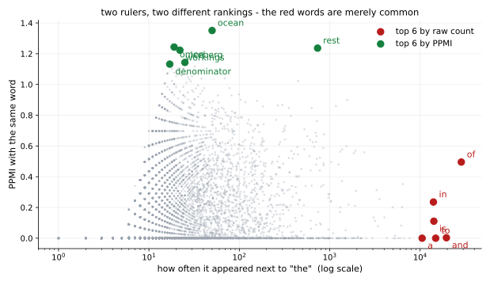
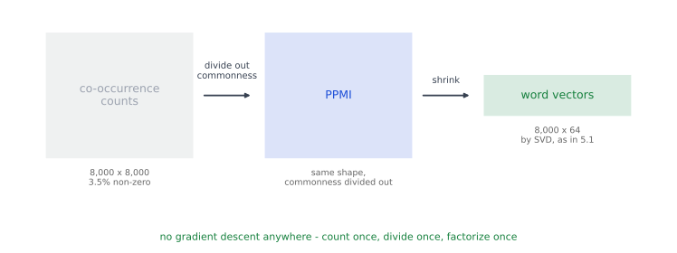

# 같이 나온 횟수가 뜻을 만든다 — 동시 출현 · PPMI · SVD

<div class="leadbox" markdown>

**들어가는 이야기** — 배우지 않고 세기만 해도 되는가

[앞 쪽](02_context.md)은 짝 맞히기를 **백만 번 넘게** 되풀이해 표를 배웠다.

그런데 기준이 「둘레에 같이 나오는 단어끼리 가깝게」 하나뿐이라면, 물어볼 것이 있다 — **굳이 배울 것 없이 같이 나온 횟수를 세기만 하면 안 되는가?**

된다. 세어 보니 **0.7초**다. 배우는 데는 14.6초가 걸렸으니 **스무 배 남짓 빠르다.**

| 단어 | 세어서 만든 것 | 배워서 만든 것 |
|---|---|---|
| `terrible` | awful, acting, inept, bad, horrible, laughable | awful, bad, horrible, pitiful, chuckle, laughable |
| `funny` | hilarious, amusing, too, unintentionally, scary, comedy | kinda, scary, quite, amusing, damn, appealing |

**둘 다 그럴듯하다.** 세기만 한 쪽에도 awful·horrible·bad가, hilarious·amusing이 들어 있다.

그런데 **똑같지는 않다.** 이웃 여섯 가운데 두 길이 함께 고른 것이 평균 **2.2개**다. 우연이라면 0.0045개일 테니 분명 같은 것을 보고 있는데, 3분의 2는 다르게 고른다.

같은 가설에서 출발해 같은 자료를 보았는데 왜 답이 갈리는가. 이 쪽이 그것을 본다.

</div>

---

## 1. 코드

```python
"""같이 나온 횟수가 뜻을 만든다 — 배우지 않고 세기만 해도 되는가.

앞 쪽은 짝 맞히기를 백만 번 넘게 되풀이해 표를 배웠다. 그런데 기준이
「둘레에 같이 나오는 단어끼리 가깝게」뿐이라면, 굳이 배울 것 없이
「같이 나온 횟수를 세기만 해도」 되지 않을까.

된다. 그것이 세어서 만드는 길이고, 이 쪽은 그 길을 끝까지 걸어 앞 쪽과
견준다. 두 길은 뿌리가 같다 — 둘 다 같은 단어 동시 출현 행렬을 본다.

  (가) 같이 나온 횟수를 센다            -> 단어 동시 출현 행렬 (V x V)
  (나) 흔한 단어 탓을 걷어 낸다          -> PPMI
  (다) 그 표를 낮은 차원으로 줄인다       -> SVD (5.1절의 PCA 와 같은 수법)

그리고 「같은 자로」 견준다 — 같은 단어의 이웃 목록이 얼마나 겹치는가.

자료는 앞 쪽과 같은 IMDB 영화평 6,000편이고 어휘도 같다.
실행: 이 쪽의 코드를 파일로 갈무리해 저장소 뿌리에서 돌린다.
"""
import re
import time
from collections import Counter
from pathlib import Path

import torch
import torch.nn as nn
import torch.nn.functional as F

SEED, VOCAB, DIM, WINDOW = 42, 8000, 64, 4
STEPS, BATCH, NEG, LR = 6000, 1024, 5, 3e-3
ROOT = Path("./data/aclImdb")
TOKEN = re.compile(r"[a-z']+")
# 「CPU 로 돌린다.」 이 쪽은 두 길의 이웃 목록이 얼마나 겹치는지를 세는데,
# MPS 는 비트 단위로 되풀이되지 않아 그 수가 돌릴 때마다 달라진다. 모델이
# 작아 CPU 로도 몇 분이면 끝나므로, 되풀이되는 쪽을 골랐다.
device = torch.device("cpu")
torch.set_num_threads(4)


def load_tokens(n_docs=6000):
    out = []
    for name in ("pos", "neg"):
        for f in sorted((ROOT / "train" / name).glob("*.txt"))[: n_docs // 2]:
            out += TOKEN.findall(f.read_text(encoding="utf-8")
                                 .replace("<br />", " ").lower())
    return out


toks = load_tokens()
counts = Counter(toks)
words = [w for w, _ in counts.most_common(VOCAB)]
stoi = {w: i for i, w in enumerate(words)}
ids = torch.tensor([stoi[w] for w in toks if w in stoi], dtype=torch.long)


# === 세는 길 ===============================================================
def cooccurrence():
    """창 안에 같이 나온 횟수를 V x V 표에 쌓는다."""
    C = torch.zeros(VOCAB, VOCAB)
    for off in range(1, WINDOW + 1):
        a, b = ids[:-off], ids[off:]
        C.index_put_((a, b), torch.ones(len(a)), accumulate=True)
        C.index_put_((b, a), torch.ones(len(a)), accumulate=True)
    return C


def ppmi(C):
    """PPMI = max(0, log( P(a,b) / (P(a) P(b)) )).

    같이 나온 횟수를 그대로 쓰면 the 가 모든 단어와 가까워진다. 각자가
    혼자 나오는 빈도로 나누어, 「혼자 흔한 탓」을 걷어 낸 몫만 남긴다.
    """
    total = C.sum()
    pa = C.sum(1, keepdim=True) / total
    pb = C.sum(0, keepdim=True) / total
    pab = C / total
    return (pab / (pa * pb + 1e-12) + 1e-12).log().clamp_min(0)


# === 배우는 길 (앞 쪽과 같은 것) ============================================
class SkipGram(nn.Module):
    def __init__(self, v, d):
        super().__init__()
        self.mid, self.ctx = nn.Embedding(v, d), nn.Embedding(v, d)
        nn.init.normal_(self.mid.weight, std=0.1)
        nn.init.zeros_(self.ctx.weight)


def train_skipgram():
    freq = torch.tensor([counts[w] for w in words], dtype=torch.float)
    p = freq ** 0.75; p /= p.sum()
    torch.manual_seed(SEED)
    m = SkipGram(VOCAB, DIM).to(device)
    opt = torch.optim.Adam(m.parameters(), lr=LR)
    g = torch.Generator().manual_seed(SEED)
    for _ in range(STEPS):
        c = torch.randint(WINDOW, len(ids) - WINDOW, (BATCH,), generator=g)
        off = torch.randint(1, WINDOW + 1, (BATCH,), generator=g)
        off *= torch.where(torch.rand(BATCH, generator=g) < 0.5, -1, 1)
        cc, oo = ids[c].to(device), ids[c + off].to(device)
        v = m.mid(cc)
        pos = (v * m.ctx(oo)).sum(-1)
        ni = torch.multinomial(p, BATCH * NEG, True, generator=g).to(device)
        ng = torch.bmm(m.ctx(ni).view(BATCH, NEG, -1), v.unsqueeze(-1)).squeeze(-1)
        loss = -(F.logsigmoid(pos).mean() + F.logsigmoid(-ng).sum(1).mean())
        opt.zero_grad(); loss.backward(); opt.step()
    return m.mid.weight.detach().cpu()


def neighbours(W, w, k=6):
    Wn = F.normalize(W, dim=1)
    s = Wn @ Wn[stoi[w]]
    s[stoi[w]] = -2
    return [words[i] for i in s.topk(k).indices.tolist()]


if __name__ == "__main__":
    probe = ["good", "terrible", "movie", "she", "funny"]

    t = time.perf_counter()
    C = cooccurrence()
    M = ppmi(C)
    # svd_lowrank 는 무작위 사영을 쓴다 — 씨앗을 박지 않으면 돌릴 때마다
    # 이웃 목록이 달라진다
    torch.manual_seed(SEED)
    U, S, _ = torch.svd_lowrank(M, q=DIM, niter=7)
    W_count = U * S.sqrt()
    t_count = time.perf_counter() - t

    nz = (C > 0).float().mean()
    print(f"  단어 동시 출현 행렬 {VOCAB}x{VOCAB} = {VOCAB * VOCAB:,}칸 — "
          f"0 이 아닌 칸이 {nz * 100:.1f}%, 0 인 칸이 {(1 - nz) * 100:.1f}%")
    print(f"  the 와 가장 많이 같이 나온 단어 (횟수 그대로):")
    row = C[stoi["the"]].clone(); row[stoi["the"]] = -1
    print("    " + ", ".join(words[i] for i in row.topk(6).indices.tolist()))
    print(f"  the 와 가장 많이 같이 나온 단어 (PPMI 로 고친 뒤):")
    row = M[stoi["the"]].clone(); row[stoi["the"]] = -1
    print("    " + ", ".join(words[i] for i in row.topk(6).indices.tolist()))

    # PMI 를 동시 출현 확률로 무게를 주어 더하면 상호정보량이 된다.
    # PPMI 행렬의 칸 하나하나가 그 합의 낱낱 항이다
    total = C.sum()
    pab = C / total
    pmi_full = (pab / ((C.sum(1, keepdim=True) / total)
                       * (C.sum(0, keepdim=True) / total) + 1e-12) + 1e-12).log()
    mi = float((pab * pmi_full).sum())
    print(f"\n  상호정보량 I = sum_ab P(a,b) PMI(a,b) = {mi:.4f} nat")
    print(f"    (PPMI 는 그 합의 낱낱 항 가운데 양수만 남긴 것이다)")
    print(f"    견줄 자리: 단어 하나의 엔트로피 H = "
          f"{float(-(lambda q: (q * (q + 1e-12).log()).sum())(C.sum(1) / total)):.4f} nat")

    t = time.perf_counter()
    W_learn = train_skipgram()
    t_learn = time.perf_counter() - t

    print(f"\n  {'단어':<10s}{'세어서 만든 것':<46s}{'배워서 만든 것'}")
    agree = []
    for w in probe:
        a, b = neighbours(W_count, w), neighbours(W_learn, w)
        agree.append(len(set(a) & set(b)))
        print(f"  {w:<10s}{', '.join(a):<46s}{', '.join(b)}")

    print(f"\n  이웃 여섯 가운데 두 길이 함께 고른 수")
    for w, n in zip(probe, agree):
        print(f"    {w:<10s} {n}/6")
    print(f"    평균 {sum(agree) / len(agree):.1f}/6 — "
          f"우연이라면 {6 * 6 / VOCAB:.4f}/6 이다")

    print(f"\n  드는 시간")
    print(f"    세기  {t_count:7.1f}초   (한 번 세고 한 번 쪼갠다)")
    print(f"    배우기 {t_learn:7.1f}초   ({STEPS:,}스텝)")
```

**출력:**

```
  단어 동시 출현 행렬 8000x8000 = 64,000,000칸 — 0 이 아닌 칸이 3.5%, 0 인 칸이 96.5%
  the 와 가장 많이 같이 나온 단어 (횟수 그대로):
    of, and, to, is, in, a
  the 와 가장 많이 같이 나온 단어 (PPMI 로 고친 뒤):
    ocean, omen, rest, workings, iceberg, denominator

  상호정보량 I = sum_ab P(a,b) PMI(a,b) = 0.6449 nat
    (PPMI 는 그 합의 낱낱 항 가운데 양수만 남긴 것이다)
    견줄 자리: 단어 하나의 엔트로피 H = 6.5549 nat

  단어        세어서 만든 것                                      배워서 만든 것
  good      great, also, really, but, very, well          decent, great, solid, fine, nice, classical
  terrible  awful, acting, inept, bad, horrible, laughableawful, bad, horrible, pitiful, chuckle, laughable
  movie     this, it, really, thing, it's, film           film, drivel, thing, btw, preposterous, stinker
  she       her, he, when, him, woman, his                her, she's, husband, he, phillip, marie
  funny     hilarious, amusing, too, unintentionally, scary, comedykinda, scary, quite, amusing, damn, appealing

  이웃 여섯 가운데 두 길이 함께 고른 수
    good       1/6
    terrible   4/6
    movie      2/6
    she        2/6
    funny      2/6
    평균 2.2/6 — 우연이라면 0.0045/6 이다

  드는 시간
    세기      0.7초   (한 번 세고 한 번 쪼갠다)
    배우기    14.6초   (6,000스텝)
```

---

## 2. 그냥 세면 `the`가 모든 것과 가까워진다

세는 길의 첫걸음은 **단어 동시 출현 행렬**이다 — 단어 × 단어 크기의 표이고, 칸 하나가 「이 둘이 몇 번 같이 나왔는가」다. 어휘가 8,000이니 $8{,}000 \times 8{,}000$짜리로 만들고, 창 안에 같이 나온 쌍마다 1을 더한다. 영화평 6,000편으로 채우면 **0이 아닌 칸이 3.5%**다.

그 표를 그대로 쓰면 어떻게 되는가. `the`와 가장 많이 같이 나온 단어를 뽑아 보면

```
of, and, to, is, in, a
```

**전부 기능어다.** `the`가 `of`와 자주 나온 것이 둘 사이에 무슨 관계가 있어서가 아니라, **둘 다 그냥 아주 흔하기 때문**이다. 횟수는 「같이 나왔다」와 「각자 흔하다」를 구분하지 못한다.



**두 자가 서로 다른 줄을 세운다.** 붉은 점들은 오른쪽 끝에 있는데 세로로는 바닥에 깔려 있다 — **수만 번 같이 나왔지만 기대보다 자주 붙은 것은 아니다.** 초록 점들은 그 반대다. `iceberg`는 `the` 옆에 겨우 스물몇 번 나왔는데도, **나올 때마다 `the`를 달고 나오기 때문에** PPMI 가 1을 넘는다.

### PPMI — 혼자 흔한 탓을 걷어 낸다

고치는 법은 **각자 혼자 나오는 빈도로 나누는 것**이다.

$$
\mathrm{PPMI}(a, b) \;=\; \max\left(0,\; \log \frac{P(a, b)}{P(a)\,P(b)}\right)
$$

분자는 「실제로 같이 나온 비율」, 분모는 「서로 상관없다면 같이 나왔을 비율」이다. 둘의 비가 1보다 크면 **기대보다 자주 붙어 다닌다**는 뜻이고, 로그를 씌워 그 몫만 남긴다. 음수를 0으로 자르는 것이 앞의 **P**(positive)다.

같은 `the`를 PPMI로 다시 뽑으면

```
ocean, omen, rest, workings, iceberg, denominator
```

**완전히 달라졌다.** `the ocean`, `the rest`, `the iceberg` — **거의 언제나 `the`를 달고 나오는 단어들**이다. `of`는 흔해서 높았을 뿐이고, `iceberg`는 드문데도 나올 때마다 `the`와 함께 나온다.

!!! note "PMI 는 상호정보량의 낱낱 항이다"
    PPMI 의 **P** 를 떼고 보면 PMI 이고, 그것을 동시 출현 확률로 무게를 주어 모두 더하면 **상호정보량**이 된다.

    $$
    I(A; B) \;=\; \sum_{a, b} P(a, b)\, \underbrace{\log \frac{P(a,b)}{P(a)P(b)}}_{\mathrm{PMI}(a,b)}
    $$

    곧 **PPMI 행렬의 칸 하나하나가 그 합의 항**이고, 우리는 그 가운데 양수만 남겨 표로 쓰는 것이다. 재어 보면 이 말뭉치에서 $I = 0.6449$ nat 이다. 단어 하나의 엔트로피가 6.5549 nat 이니, **둘레 단어 하나를 알면 가운데 단어의 불확실함이 10% 남짓 줄어든다**는 뜻이다.

    적어 보이지만 그 10%가 이 장이 가진 전부다. 임베딩이 담는 것은 **단어 사이에 흐르는 그 정보**다.

    같은 양이 [5.2절](../ch05/latent_generative/index.md)에도 나온다. 거기서 VAE 의 KL 항을 쪼개면 $I_q(X; Z)$ 가 나오는데, **잠재 표현이 입력 정보를 얼마나 싣는지**를 재는 바로 이 상호정보량이다. 여기서는 그것을 **재료로 쓰고**, 거기서는 **값으로 치른다.**

### 앞 쪽과 이 쪽은 같은 행렬을 분해한다

여기서 둘이 만난다. 이 쪽은 PMI 행렬을 **손으로 만들어** 분해할 참인데, [앞 쪽](02_context.md)의
네거티브 샘플링은 **그 표를 만들지 않고도** 같은 자리에 닿는다. 그 쪽이 재어 보인 대로,
배운 내적이 $\mathrm{PMI} - \log k$ 에 앉는다.

| | PMI 행렬을 | 분해하는 법 |
|---|---|---|
| [앞 쪽](02_context.md) — 네거티브 샘플링 | **만들지 않는다** | 경사 하강법이 암묵적으로 |
| 이 쪽 — PPMI + SVD | **만들어서 들고 있는다** | 특잇값 분해로 명시적으로 |

그러니 둘은 **더 나은 것과 덜한 것이 아니라 같은 목표의 두 길**이다. 뒤에 오는
[GloVe](04_glove.md)는 **표는 만들고 분해는 경사 하강법으로** 하여 그 사이에 앉고, [fastText](06_fasttext.md)는 아예
다른 축이다 — 목적은 그대로 두고 **무엇이 벡터를 받는가**만 바꾼다.

### 그다음은 5.1절과 같은 수법이다

PPMI 행렬은 여전히 $8{,}000 \times 8{,}000$이다. 단어 하나에 수 8,000개를 주는 셈이라 너무 크다. **낮은 차원으로 줄여야 한다.**

줄이는 수법은 [5.1절](../ch05/dimreduction/01_pca.md)에서 이미 걸었다. 거기서는 784차원 그림을 64차원으로 줄였고, 여기서는 8,000차원 줄을 64차원으로 줄인다. 같은 특잇값 분해다.



**세 걸음 어디에도 경사 하강법이 없다.** 한 번 세고, 한 번 나누고, 한 번 쪼갠다. [앞 쪽](02_context.md)이 백만 번 넘게 되풀이한 자리를 이 길은 그냥 지나간다.

**이 길이 GloVe의 뼈대다.** GloVe는 PPMI 대신 동시 출현 횟수의 로그를 맞추고 흔한 쌍의 무게를 줄이는 등 더 손을 보았지만, 「세고 → 고치고 → 줄인다」는 줄거리는 같다. [바로 다음 쪽](04_glove.md)이 그 식을 세우고 같은 말뭉치로 직접 돌려, 세 길이 같은 표를 보고도 어디서 갈라지는지를 잰다.

---

## 3. 두 길이 2.2/6만 겹친다

| 단어 | 함께 고른 이웃 |
|---|---|
| `terrible` | **4/6** |
| `movie` | 2/6 |
| `she` | 2/6 |
| `funny` | 2/6 |
| `good` | **1/6** |
| 평균 | **2.2/6** |

우연히 겹칠 확률은 $6 \times 6 / 8{,}000 = 0.0045$개다. **2.2는 우연이 아니다** — 두 길이 분명 같은 것을 보고 있다. 그런데 3분의 2는 다르게 고른다.

갈리는 자리를 보면 까닭이 짐작된다.

```
세어서  good  ->  great, also, really, but, very, well
배워서  good  ->  decent, great, solid, fine, nice, classical
```

**세어서 만든 쪽에 `also`·`but`·`very`·`well`이 들어 있다.** 기능어다. PPMI로 `the`는 걷어 냈지만 `good` 곁에 진짜로 자주 붙는 `very`까지 걷어 내지는 못한다 — 그 둘은 실제로 서로를 끌어당기기 때문이다.

배워서 만든 쪽은 그런 것이 덜하다. 네거티브 샘플링이 **흔한 단어를 틀린 짝으로 자주 뽑기** 때문이다. `very`는 네거티브로 계속 나오므로 모든 단어와 멀어지는 압력을 받는다. 세는 길에는 그런 장치가 없다.

!!! note "어느 쪽이 좋은지 이 쪽은 말하지 않는다"
    이웃 목록은 **눈으로 보는 자**다. 「`good`의 이웃으로 `decent`가 `but`보다 낫다」는 느낌은 있어도 수가 아니다.

    제대로 가리려면 **쓸 곳에서 재야** 한다. [7.3절](../imdb/03_embedding.md)이 IMDB 분류에서 임베딩을 재는데, 거기에 두 길의 표를 각각 얹어 정확도를 견주면 답이 나온다. 이 쪽은 그 실험을 하지 않았다 — 연습문제 3이 그것을 설계하게 한다.

---

## 4. 스무 배 남짓 빠른데 왜 배우는가

| | 시간 |
|---|---|
| 세기 (한 번 세고 한 번 쪼갠다) | **0.7초** |
| 배우기 (6,000스텝) | **14.6초** |

세는 길이 압도적으로 싸다. 그런데도 Word2Vec 쪽이 더 널리 쓰인 까닭이 있다.

**하나 — 표가 통째로 메모리에 올라가야 한다.** 어휘 8,000에서 $8{,}000^2 \times 4$바이트로 **244 MB**다. 어휘를 50만으로 키우면 **909 기가바이트**가 된다. 배우는 길은 한 번에 배치 하나만 보므로 그런 일이 없다.

**둘 — 자료가 늘면 처음부터 다시 세야 한다.** 배우는 길은 새 자료로 이어서 학습하면 된다.

**셋 — 이 쪽의 0.7초는 어휘가 8,000이라서다.** 특잇값 분해의 비용이 어휘 크기를 따라 빠르게 는다.

!!! note "이 쪽은 CPU 로 돈다"
    [앞 쪽](02_context.md)은 GPU(MPS)를 썼는데 이 쪽은 CPU 로 고정했다. 까닭이 둘이다.

    **되풀이되어야 해서다.** 이 쪽이 세는 「두 길이 함께 고른 이웃의 수」는 벡터가 조금만 달라져도 바뀐다. MPS 는 비트 단위로 되풀이되지 않아 돌릴 때마다 2.0/6 과 2.2/6 을 오갔다. CPU 로 옮기니 두 번 돌려 **완전히 같은 출력**이 나온다.

    **그리고 더 빨랐다.** 같은 학습이 MPS 에서 41.2초, CPU 에서 14.6초였다. 배치가 작고 어휘가 작아 GPU 에 보내고 받는 값이 계산보다 컸던 것이다. **큰 모델이 늘 빠른 것은 아니다.**

    `torch.svd_lowrank` 에 씨앗을 박은 것도 같은 까닭이다. 그 함수는 무작위 사영을 쓰므로 씨앗이 없으면 세는 쪽이 흔들린다 — 처음에 그것 때문에 두 회차가 갈렸다.

곧 **작고 고정된 말뭉치에서는 세는 길이 낫고, 크고 자라는 말뭉치에서는 배우는 길이 낫다.** 그리고 GloVe는 그 사이를 노린 것이다 — 세기는 하되 0이 아닌 칸만 보고, 줄이는 일을 특잇값 분해 대신 경사 하강법으로 한다.

---

## 연습문제

<div class="drillbox" markdown>

**연습문제 1.** <span class="diff easy" title="쉬움"></span> PPMI에서 음수를 0으로 자르는 까닭은 무엇인가. 자르지 않으면 무엇이 달라지는가.

</div>

??? success "풀이"

    음수는 **기대보다 덜 같이 나왔다**는 뜻이다. 그런데 그 정보는 믿기 어렵다 — 어휘가 8,000이면 쌍이 6,400만 개인데 표의 96.5%가 0이다. 한 번도 같이 안 나온 쌍은 $\log 0 = -\infty$가 되고, 한두 번 나온 쌍의 음숫값도 자료가 모자라 생긴 것인지 정말 서로 피하는 것인지 가릴 수 없다.

    자르지 않으면 그 **믿을 수 없는 음수들이 표의 대부분을 차지**해, 특잇값 분해가 그 잡음을 맞추는 데 차원을 써 버린다.

    자르면 표가 더 성겨지는 대신 남는 값이 모두 「기대보다 자주 붙어 다닌다」는 뜻이 된다.

<div class="drillbox" markdown>

**연습문제 2.** <span class="diff med" title="중간"></span> 2절은 `the`의 이웃이 PPMI 뒤에 `ocean, omen, iceberg`로 바뀌는 것을 보였다. 이 목록이 **좋은 결과인지** 따지라.

</div>

??? success "풀이"

    **묻는 것에 따라 다르다.**

    「`the`와 뜻이 닮은 단어」을 바란 것이라면 **나쁜 결과**다. `iceberg`는 `the`와 아무 뜻도 공유하지 않는다.

    그러나 PPMI가 재는 것은 뜻의 닮음이 아니라 **붙어 다니는 정도**다. 그 자로 보면 정확하다 — `iceberg`는 영어에서 거의 언제나 한정사를 달고 나오고, 영화평에서는 `the iceberg`(타이타닉 이야기)로 나온다.

    그러니 이 목록이 말해 주는 것은 **`the`에게는 「이웃 단어」이라는 물음 자체가 잘 맞지 않는다**는 사실이다. 기능어는 뜻이 아니라 **문법적 자리**로 일하므로, 분포로 재는 벡터가 담을 것이 적다. 3절에서 세는 길에 기능어가 섞여 들어오는 것도 같은 이야기의 다른 쪽이다.

<div class="drillbox" markdown>

**연습문제 3.** <span class="diff hard" title="어려움"></span> 3절은 두 길 가운데 어느 쪽이 나은지 말하지 않았다. **쓸 곳에서 재는** 실험을 설계하라. 무엇을 고정하고 무엇만 바꿔야 하는가.

</div>

??? success "풀이"

    **설계** — [7.3절](../imdb/03_embedding.md)의 모델을 그대로 쓰되 단어 임베딩 표의 **시작값만** 바꾼다.

    | 표 | 어디서 왔나 |
    |---|---|
    | (가) 난수 | 지금 7.3절이 하는 것 |
    | (나) 세어서 만든 것 | 이 쪽의 `W_count` |
    | (다) 배워서 만든 것 | 이 쪽의 `W_learn` |

    **고정할 것** — 모델 구조, 어휘, 차원 64, 학습 규약(5 에포크·Adam·배치 100), 그리고 **임베딩을 얼릴지 말지**. 얼린 쪽과 미세 조정한 쪽을 따로 재면 여섯 칸이 된다.

    **주의** — 이 쪽의 두 표는 어휘가 8,000이고 영화평 6,000편으로 만든 것인데 7.3절은 어휘 20,000에 25,000편을 쓴다. **같은 조건으로 다시 만들어야** 견줄 수 있다. 그러지 않으면 「세는 길이 나쁘다」가 아니라 「자료를 덜 보았다」를 재게 된다.

    **미리 적는 판정** — [7.3절](../imdb/03_frozen.md)이 GloVe로 같은 실험을 했고 거기서 **얼린 것과 아닌 것의 부호가 뒤집혔다.** 그러니 이 실험도 얼림 여부에 따라 답이 달라질 가능성이 크고, 「(나)가 (다)보다 낫다」 같은 한 줄 결론이 나오지 않을 것으로 본다. 그 또한 적을 값어치가 있는 결과다.
