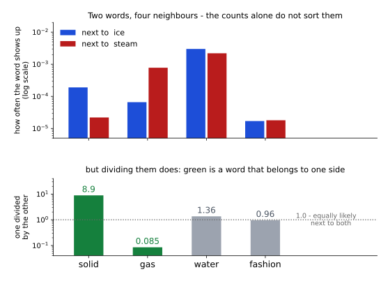
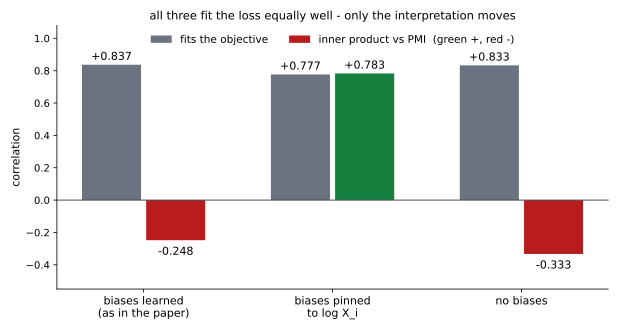

# GloVe 트레인 방법 — 세는 길과 배우는 길이 만나는 자리

<div class="leadbox" markdown>

**들어가는 이야기** — 같은 장부를 보고 셋이 서로 다른 답을 냈다

앞의 두 쪽은 낱말에 수를 붙이는 길을 둘 보였다. 하나는 **동시 출현 행렬** — 누가 누구 옆에 몇 번 나왔는가를 적은 장부 — 를 **그냥 세어서** 풀었고, 하나는 맞히기를 백만 번 되풀이해 **배웠다.**

이 쪽은 셋째 길인 **GloVe**를 깐다. 이 길은 앞의 둘을 한 자리에서 한다 — **먼저 세고, 그 동시 출현 행렬를 맞춘다.**

셋 다 같은 장부를 본다. 그러니 셋이 같은 데 닿아야 할 것 같다. 그런데 같은 말뭉치로 셋을 다 만들어 이웃 여섯을 뽑아 보면, **둘이 함께 고른 이웃이 여섯 가운데 둘 남짓**이다.

그리고 셋째 길에는 더 이상한 일이 하나 있다. 종이에서 식을 따라가면 「이 수는 저 수가 되어야 한다」가 깔끔하게 나오는데, **정말로 만들어서 재어 보면 되지 않는다.** 그런데도 나온 물건은 멀쩡히 쓸 만하다.

식이 약속한 것과 손에 쥔 것이 다를 때, 무엇을 믿어야 하는가.

</div>

[6.1절의 Skip-gram 쪽](02_context.md)은 짝 맞히기를 되풀이해 **배웠고**, [6.1절의 세는 길 쪽](03_counting.md)은 동시 출현을 **세었다**. 그 쪽은 두 길이 「뿌리가 같다 — 둘 다 같은 동시 출현 행렬를 본다」고 적고 닫았다.

GloVe는 그 말을 끝까지 밀어붙인 방법이다. 먼저 표를 세고(6.1의 세는 길처럼), 그 표를 경사 하강법으로 맞춘다(6.1의 배우는 길처럼).

<div class="storybox" markdown>

**그림으로 보는 AI 1.** 얼음과 김 — 횟수 둘을 나누면 보이는 것

GloVe를 만든 사람들이 논문을 여는 자리에 둔 것은 식이 아니라 **표 한 장**이다. 낱말 둘을 고른다 — `ice`(얼음)와 `steam`(김). 그리고 다른 낱말 넷이 그 둘 **옆에** 얼마나 자주 나오는지를 60억 낱말에서 센다.



위 칸만 보면 고를 수가 없다. `water`는 둘 다 옆에 자주 나오고 `fashion`은 둘 다 드물다. 둘을 가르는 것처럼 보이는 것은 `solid`와 `gas`인데, 막대 높이만으로는 「얼마나 갈리는지」가 눈에 안 들어온다.

아래 칸이 그 일을 한다. **두 횟수를 나누기만 하면** 된다. `solid`는 8.9라 얼음 쪽으로 한참 기울고, `gas`는 0.085라 김 쪽으로 기운다. 그런데 `water`는 1.36, `fashion`은 0.96으로 **둘 다 1 언저리**다. 양쪽에 다 붙는 낱말과 양쪽에 다 안 붙는 낱말이, 나누고 나면 **똑같이 「쓸모없음」으로 모인다.**

그러니까 낱말의 성격을 말해 주는 것은 **몇 번 나왔나가 아니라 어느 쪽에 몇 배 더 나왔나**다. 이 쪽의 방법은 이 생각 하나를 식으로 옮긴 것이다.

**다만 이것이 말해 주지 않는 것이 있다.** 이 표는 낱말 둘과 이웃 넷, 곧 **사람이 미리 골라 둔** 여섯 낱말의 이야기다. 수만 개 낱말을 놓고 「무엇과 무엇을 견줄지」는 아무도 골라 주지 않는다. 그 고르는 일을 없애는 것이 뒤에 나올 식이 하는 일이다.

_확인한 곳 — Pennington, Socher, Manning, 「GloVe: Global Vectors for Word Representation」, EMNLP 2014, Table 1. 수는 그 표에 실린 그대로이며, 「옆에 나오는 빈도」는 논문의 동시 출현 확률 $P(k \mid \text{ice})$ 다. 말뭉치는 Wikipedia 2014 + Gigaword 5, 60억 낱말._

</div>

---

## 1. 식은 어디서 왔는가

위 상자의 생각을 그대로 적으면 이렇다. 낱말 $i$, $j$ 를 견주는데 세 번째 낱말 $k$ 를 자로 쓴다.

$$F(w_i, w_j, \tilde w_k) = \frac{P_{ik}}{P_{jk}}$$

논문은 여기서 네 걸음을 걸어 식을 줄인다. 벡터 차를 쓰고($w_i - w_j$), 내적을 취하고, 두 벡터 집합의 역할이 바뀌어도 같아야 한다는 조건을 걸면 식 (6)이 나온다.

$$w_i^\top \tilde w_k = \log(P_{ik}) = \log(X_{ik}) - \log(X_i)$$

여기서 $X_{ik}$ 는 $i$ 옆에 $k$ 가 나온 횟수, $X_i = \sum_k X_{ik}$ 는 그 줄의 합이다.

**마지막 걸음이 이 쪽의 요점이 된다.** 오른쪽의 $\log(X_i)$ 는 $k$ 와 무관하므로, 논문은 이것을 $i$ 의 **바이어스 $b_i$ 로 흡수시킨다.** 그리고 대칭을 되살리려 $\tilde b_k$ 를 하나 더 붙인다.

$$w_i^\top \tilde w_k + b_i + \tilde b_k = \log(X_{ik}) \tag{7}$$

이것을 최소제곱으로 풀되, 칸마다 무게를 달리 준 것이 GloVe다.

$$J = \sum_{i,j=1}^{V} f(X_{ij})\left(w_i^\top \tilde w_j + b_i + \tilde b_j - \log X_{ij}\right)^2 \tag{8}$$

$$f(x) = \begin{cases} (x / x_{\max})^{\alpha} & x < x_{\max} \\ 1 & \text{그 밖} \end{cases} \tag{9}$$

논문은 모든 실험에서 $x_{\max} = 100$, $\alpha = 3/4$ 를 쓰고, AdaGrad로 0이 아닌 칸을 무작위로 뽑아 가며 줄인다.

!!! note "무게 $f$ 가 있는 까닭"
    논문이 $f$ 에 건 조건은 셋이다. $f(0) = 0$ 이어야 하고(안 나온 짝은 아예 안 본다), 드문 짝이 **과대평가되지 않도록** 증가 함수여야 하며, 흔한 짝이 **과대평가되지 않도록** 큰 $x$ 에서 작아야 한다.

    셋째가 $x_{\max}$ 로 자르는 까닭이다. 아무 무게도 주지 않으면 0이 아닌 칸의 로그 잔차를 고르게 맞추게 되고, 반대로 횟수에 비례하는 무게를 주면 `the` 가 낀 짝이 모든 것을 먹는다. $f$ 는 그 **둘 사이**를 고른 것이다.

---

## 2. 3/4 제곱이 이 장에 두 번째로 나온다

$\alpha = 3/4$ 를 보고 [6.1절의 Skip-gram 쪽](02_context.md)을 떠올렸다면 맞다. 그 쪽의 네거티브 샘플링은 낱말을 **빈도의 3/4 제곱**에 비례해 뽑았다.

| | 3/4 제곱이 쓰인 자리 |
|---|---|
| [6.1 Skip-gram](02_context.md) | 틀린 짝을 **뽑는 분포**를 $f^{3/4}$ 로 둔다 |
| 6.2 GloVe | 로스에 주는 **무게**를 $(X_{ij}/x_{\max})^{3/4}$ 로 둔다 |

자리는 다르다. 하나는 무엇을 보여 줄지 고르는 데 쓰고, 하나는 본 것을 얼마나 믿을지 정하는 데 쓴다. **하는 일은 같다 — 흔한 것의 힘을 눌러 준다.**

그리고 이것은 우연의 일치가 아니라 **논문이 스스로 적어 둔 것**이다. 3/4 를 고른 데에는 경험적 근거밖에 없다고 밝히면서, 「word2vec에서도 비슷한 분수 거듭제곱이 가장 좋았다는 것이 흥미롭다」고 덧붙인다.

---

## 3. 코드

```python
"""GloVe 트레인 방법 — 세는 길과 배우는 길이 만나는 자리.

6.1 의 Skip-gram 은 짝 맞히기를 되풀이해 「배웠고」, 같은 절의 세는 길은
동시 출현을 「세었다」.
GloVe 는 둘을 한 자리에서 한다 — 먼저 세고(6.1 의 세는 길처럼), 그 표를
경사 하강법으로 맞춘다(6.1 의 배우는 길처럼).

맞추는 식은 Pennington 외 (2014) 의 식 (8) 이다.

  J = sum_ij f(X_ij) ( w_i . w~_j + b_i + b~_j - log X_ij )^2
  f(x) = (x/x_max)^alpha  if x < x_max  else  1          (식 9)

재는 것 다섯.
  (가) 세 길의 이웃이 얼마나 겹치는가 — 같은 표를 읽고 같은 데 닿는가
  (나) 바이어스가 정말 log X_i 를 빨아들이는가 (식 7 이 기대하는 것)
  (다) 그래서 내적이 PMI 가 되는가 — 6.1 의 세는 길이 분해한 바로 그 표다
  (라) 무게 f 를 떼면 무엇이 달라지는가
  (마) 드는 시간

(다)가 이 쪽의 요점이다. 식을 따라가면 되어야 하는데, 재어 보면 안 된다.

어휘 8,000 · 창 4 · 차원 64 를 6.1 의 두 길과 똑같이 두어 세 길을 맞댈 수
있게 했다. CPU 로 돌린다 — 이웃 목록을 세는 쪽이라 되풀이되어야 한다.
실행: 이 쪽의 코드를 파일로 갈무리해 저장소 뿌리에서 돌린다.
"""
import re
import time
from collections import Counter
from pathlib import Path

import torch
import torch.nn as nn
import torch.nn.functional as F

SEED, VOCAB, DIM, WINDOW = 42, 8000, 64, 4
STEPS, BATCH, NEG, LR = 6000, 1024, 5, 3e-3            # 6.1 의 설정
X_MAX, ALPHA, G_LR, G_ITER, G_BATCH = 100.0, 0.75, 0.05, 50, 100_000
ROOT = Path("./data/aclImdb")
TOKEN = re.compile(r"[a-z']+")
torch.set_num_threads(4)


def load_tokens(n_docs=6000):
    out = []
    for name in ("pos", "neg"):
        for f in sorted((ROOT / "train" / name).glob("*.txt"))[: n_docs // 2]:
            out += TOKEN.findall(f.read_text(encoding="utf-8")
                                 .replace("<br />", " ").lower())
    return out


toks = load_tokens()
counts = Counter(toks)
words = [w for w, _ in counts.most_common(VOCAB)]
stoi = {w: i for i, w in enumerate(words)}
ids = torch.tensor([stoi[w] for w in toks if w in stoi], dtype=torch.long)


# === 세기 ==================================================================
def cooccurrence(decay):
    """창 안에 같이 나온 횟수를 쌓는다.

    decay=True 면 d 칸 떨어진 짝에 1/d 만 준다 - GloVe 논문 4.2 절의 방식.
    decay=False 면 창 안을 고르게 센다 - 6.1 의 세는 길이 쓴 방식.
    """
    C = torch.zeros(VOCAB, VOCAB)
    for off in range(1, WINDOW + 1):
        a, b = ids[:-off], ids[off:]
        v = torch.full((len(a),), 1.0 / off if decay else 1.0)
        C.index_put_((a, b), v, accumulate=True)
        C.index_put_((b, a), v, accumulate=True)
    return C


def ppmi(C):
    total = C.sum()
    pa = C.sum(1, keepdim=True) / total
    pb = C.sum(0, keepdim=True) / total
    return ((C / total) / (pa * pb + 1e-12) + 1e-12).log().clamp_min(0)


# === GloVe =================================================================
def train_glove(C, bias_mode="learn", weighted=True, iters=G_ITER):
    """0 이 아닌 칸만 모아 AdaGrad 로 식 (8) 을 줄인다.

    bias_mode 가 이 쪽의 실험 손잡이다.
      learn  - 논문 그대로, 바이어스도 배운다
      fixed  - 바이어스를 log X_i 의 절반씩으로 못 박는다
      none   - 바이어스를 아예 두지 않는다
    """
    I, J = C.nonzero(as_tuple=True)
    X = C[I, J]
    logX = X.log()
    f = (X / X_MAX).clamp(max=1.0) ** ALPHA if weighted else torch.ones_like(X)
    half = 0.5 * C.sum(1).log()

    torch.manual_seed(SEED)
    w, wt = nn.Embedding(VOCAB, DIM), nn.Embedding(VOCAB, DIM)
    for e in (w, wt):
        nn.init.uniform_(e.weight, -0.5 / DIM, 0.5 / DIM)
    ps = [w.weight, wt.weight]
    if bias_mode == "learn":
        b, bt = nn.Embedding(VOCAB, 1), nn.Embedding(VOCAB, 1)
        nn.init.zeros_(b.weight); nn.init.zeros_(bt.weight)
        ps += [b.weight, bt.weight]
        bias = lambda i, j: b(i).squeeze(-1) + bt(j).squeeze(-1)
    elif bias_mode == "fixed":
        bias = lambda i, j: half[i] + half[j]
    else:
        bias = lambda i, j: torch.zeros(len(i))

    opt = torch.optim.Adagrad(ps, lr=G_LR)
    g = torch.Generator().manual_seed(SEED)
    n = len(I)
    for _ in range(iters):
        perm = torch.randperm(n, generator=g)
        for s in range(0, n, G_BATCH):
            k = perm[s:s + G_BATCH]
            pred = (w(I[k]) * wt(J[k])).sum(-1) + bias(I[k], J[k])
            loss = (f[k] * (pred - logX[k]) ** 2).mean()
            opt.zero_grad(); loss.backward(); opt.step()

    learned_b = (b.weight + bt.weight).squeeze(-1).detach() \
        if bias_mode == "learn" else None
    # 논문 4.2 절: "the sum W + W~ as our word vectors"
    return ((w.weight + wt.weight).detach(), w.weight.detach(),
            wt.weight.detach(), bias, learned_b)


# === Skip-gram (6.1 과 같은 것) =============================================
def train_skipgram():
    freq = torch.tensor([counts[w] for w in words], dtype=torch.float)
    p = freq ** 0.75; p /= p.sum()
    torch.manual_seed(SEED)
    mid, ctx = nn.Embedding(VOCAB, DIM), nn.Embedding(VOCAB, DIM)
    nn.init.normal_(mid.weight, std=0.1); nn.init.zeros_(ctx.weight)
    opt = torch.optim.Adam([mid.weight, ctx.weight], lr=LR)
    g = torch.Generator().manual_seed(SEED)
    for _ in range(STEPS):
        c = torch.randint(WINDOW, len(ids) - WINDOW, (BATCH,), generator=g)
        off = torch.randint(1, WINDOW + 1, (BATCH,), generator=g)
        off *= torch.where(torch.rand(BATCH, generator=g) < 0.5, -1, 1)
        v = mid(ids[c])
        pos = (v * ctx(ids[c + off])).sum(-1)
        ni = torch.multinomial(p, BATCH * NEG, True, generator=g)
        ng = torch.bmm(ctx(ni).view(BATCH, NEG, -1), v.unsqueeze(-1)).squeeze(-1)
        loss = -(F.logsigmoid(pos).mean() + F.logsigmoid(-ng).sum(1).mean())
        opt.zero_grad(); loss.backward(); opt.step()
    return mid.weight.detach()


# === 자 =====================================================================
def neighbours(W, word, k=6):
    Wn = F.normalize(W, dim=1)
    s = Wn @ Wn[stoi[word]]
    s[stoi[word]] = -2
    return [words[i] for i in s.topk(k).indices.tolist()]


def corr(a, b):
    a, b = a - a.mean(), b - b.mean()
    return float((a * b).sum() / (a.norm() * b.norm() + 1e-12))


# 흔한 낱말이 이웃을 먹는지 재려면 probe 다섯으로는 칸이 30개뿐이라
# 모자란다. 빈도 200~1200 등 사이에서 100 낱말을 고루 뽑아 600칸으로 센다.
WIDE = words[200:1200:10]


def frequent_share(W, top=20, probe=None):
    """이웃 자리 가운데 「가장 흔한 낱말 top 개」가 차지한 몫."""
    common = set(words[:top])
    slots = [n for p in (probe or WIDE) for n in neighbours(W, p)]
    return 100.0 * sum(n in common for n in slots) / len(slots)


if __name__ == "__main__":
    probe = ["good", "terrible", "movie", "she", "funny"]

    # === 표를 센다 =========================================================
    t = time.perf_counter()
    C = cooccurrence(decay=True)
    t_count = time.perf_counter() - t
    I, J = C.nonzero(as_tuple=True)
    X = C[I, J]
    fw = (X / X_MAX).clamp(max=1.0) ** ALPHA
    print(f"  동시 출현 행렬 {VOCAB}x{VOCAB} - 0 이 아닌 칸 {len(I):,}개 "
          f"({100 * len(I) / VOCAB ** 2:.1f}%)")
    print(f"  GloVe 논문처럼 d 칸 떨어진 짝에 1/d 만 준다")
    print(f"  무게 f 의 중앙값 {fw.median():.4f} - 칸의 "
          f"{100 * (fw > 0.5).float().mean():.1f}% 만 f > 0.5 다\n")

    # === 세 길을 깐다 ======================================================
    t = time.perf_counter()
    W_glove, Wa, Wb, bias_fn, learned_b = train_glove(C)
    t_glove = time.perf_counter() - t

    C_flat = cooccurrence(decay=False)
    t = time.perf_counter()
    torch.manual_seed(SEED)
    U, S, _ = torch.svd_lowrank(ppmi(C_flat), q=DIM, niter=7)
    W_count = U * S.sqrt()
    t_svd = time.perf_counter() - t

    t = time.perf_counter()
    W_learn = train_skipgram()
    t_sg = time.perf_counter() - t

    # === (가) 세 길의 이웃 =================================================
    print("  이웃 여섯")
    for word in probe:
        print(f"    {word}")
        for tag, W in (("세기 (PPMI+SVD)", W_count),
                       ("배우기 (Skip-gram)", W_learn),
                       ("GloVe", W_glove)):
            print(f"      {tag:<19s} {', '.join(neighbours(W, word))}")

    print("\n  이웃 여섯 가운데 두 길이 함께 고른 수")
    for na, A, nb, B in (("세기", W_count, "배우기", W_learn),
                         ("세기", W_count, "GloVe", W_glove),
                         ("배우기", W_learn, "GloVe", W_glove)):
        k = [len(set(neighbours(A, p)) & set(neighbours(B, p))) for p in probe]
        print(f"    {na:<6s}- {nb:<8s} "
              + "  ".join(f"{p}:{v}" for p, v in zip(probe, k))
              + f"   평균 {sum(k) / len(k):.1f}/6")
    print(f"    우연이라면 {6 * 6 / VOCAB:.4f}/6 이다")

    # === (나)(다) 바이어스를 어떻게 두느냐에 따라 =========================
    keep = torch.randperm(len(I),
                          generator=torch.Generator().manual_seed(1))[:300_000]
    Is, Js = I[keep], J[keep]
    Xi, tot = C.sum(1), C.sum()
    pmi = ((C[Is, Js] / tot) / ((Xi[Is] / tot) * (Xi[Js] / tot))).log()
    logX_s = C[Is, Js].log()

    print(f"\n  식 (7) 은 b_i 가 log X_i 를 빨아들이기를 기대한다")
    print(f"    배운 b_i + b~_i 와 log X_i 의 상관  "
          f"{corr(learned_b, Xi.log()):+.4f}")

    print(f"\n  그러면 내적이 PMI 가 되는가 - 바이어스를 세 가지로 두고 본다")
    print(f"    {'바이어스':<22s}{'맞춤 corr':>10s}{'내적-PMI corr':>15s}"
          f"{'  good 의 이웃 셋'}")
    for mode, tag in (("learn", "배운다 (논문 그대로)"),
                      ("fixed", "log X_i 로 못 박는다"),
                      ("none", "두지 않는다")):
        if mode == "learn":
            Wg, wa, wb, bfn = W_glove, Wa, Wb, bias_fn
        else:
            Wg, wa, wb, bfn, _ = train_glove(C, bias_mode=mode)
        inner = (wa[Is] * wb[Js]).sum(-1)
        fit = inner + bfn(Is, Js)
        print(f"    {tag:<22s}{corr(fit, logX_s):>+10.3f}"
              f"{corr(inner, pmi):>+15.3f}   "
              f"{', '.join(neighbours(Wg, 'good', 3))}")

    # === (라) 무게 f 를 떼면 ==============================================
    W_flat, fa, fb, fbias, _ = train_glove(C, weighted=False)
    inner_f = (fa[Is] * fb[Js]).sum(-1)
    print(f"\n  무게 f 를 떼면 (f = 1)")
    print(f"    {'':<10s}{'맞춤 corr':>10s}{'내적-PMI':>12s}"
          f"{'흔한 20 낱말이 먹은 이웃 자리':>28s}")
    print(f"    {'f 그대로':<10s}"
          f"{corr((Wa[Is] * Wb[Js]).sum(-1) + bias_fn(Is, Js), logX_s):>+10.3f}"
          f"{corr((Wa[Is] * Wb[Js]).sum(-1), pmi):>+12.3f}"
          f"{frequent_share(W_glove):>26.1f}%")
    print(f"    {'f = 1':<10s}{corr(inner_f + fbias(Is, Js), logX_s):>+10.3f}"
          f"{corr(inner_f, pmi):>+12.3f}{frequent_share(W_flat):>26.1f}%")
    for word in ("good", "movie"):
        print(f"      {word:<8s} f=1 일 때  {', '.join(neighbours(W_flat, word))}")

    print(f"\n  세 길에서 흔한 20 낱말이 먹은 이웃 자리 "
          f"(낱말 {len(WIDE)}개 x 이웃 6 = {6 * len(WIDE)}칸)")
    for tag, W in (("세기 (PPMI+SVD)", W_count), ("배우기 (Skip-gram)", W_learn),
                   ("GloVe", W_glove)):
        print(f"    {tag:<19s}{frequent_share(W):>8.1f}%")

    # === (마) 시간 ========================================================
    print(f"\n  드는 시간")
    print(f"    세기             {t_count:7.1f}초")
    print(f"    PPMI + SVD       {t_svd:7.1f}초")
    print(f"    Skip-gram        {t_sg:7.1f}초   ({STEPS:,}스텝)")
    print(f"    GloVe            {t_glove:7.1f}초   ({G_ITER}바퀴)")
```

**출력:**

```
  동시 출현 행렬 8000x8000 - 0 이 아닌 칸 2,252,835개 (3.5%)
  GloVe 논문처럼 d 칸 떨어진 짝에 1/d 만 준다
  무게 f 의 중앙값 0.0188 - 칸의 0.7% 만 f > 0.5 다

  이웃 여섯
    good
      세기 (PPMI+SVD)       great, also, really, but, very, well
      배우기 (Skip-gram)     decent, great, solid, fine, nice, classical
      GloVe               great, bad, some, nice, pretty, but
    terrible
      세기 (PPMI+SVD)       awful, acting, inept, bad, horrible, laughable
      배우기 (Skip-gram)     awful, bad, horrible, pitiful, chuckle, laughable
      GloVe               horrible, acting, script, writing, dialogue, bad
    movie
      세기 (PPMI+SVD)       this, it, really, thing, it's, film
      배우기 (Skip-gram)     film, drivel, thing, btw, preposterous, stinker
      GloVe               this, film, it, but, i, just
    she
      세기 (PPMI+SVD)       her, he, when, him, woman, his
      배우기 (Skip-gram)     her, she's, husband, he, phillip, marie
      GloVe               he, her, she's, when, does, him
    funny
      세기 (PPMI+SVD)       hilarious, amusing, too, unintentionally, scary, comedy
      배우기 (Skip-gram)     kinda, scary, quite, amusing, damn, appealing
      GloVe               quite, very, it's, interesting, pretty, good

  이웃 여섯 가운데 두 길이 함께 고른 수
    세기    - 배우기      good:1  terrible:4  movie:2  she:2  funny:2   평균 2.2/6
    세기    - GloVe    good:2  terrible:3  movie:3  she:4  funny:0   평균 2.4/6
    배우기   - GloVe    good:2  terrible:2  movie:1  she:3  funny:1   평균 1.8/6
    우연이라면 0.0045/6 이다

  식 (7) 은 b_i 가 log X_i 를 빨아들이기를 기대한다
    배운 b_i + b~_i 와 log X_i 의 상관  +0.6990

  그러면 내적이 PMI 가 되는가 - 바이어스를 세 가지로 두고 본다
    바이어스                     맞춤 corr    내적-PMI corr  good 의 이웃 셋
    배운다 (논문 그대로)              +0.837         -0.248   great, bad, some
    log X_i 로 못 박는다           +0.777         +0.783   great, bad, there
    두지 않는다                    +0.833         -0.333   great, bad, nice

  무게 f 를 떼면 (f = 1)
                 맞춤 corr      내적-PMI          흔한 20 낱말이 먹은 이웃 자리
    f 그대로         +0.837      -0.248                       2.5%
    f = 1         +0.889      -0.127                       1.8%
      good     f=1 일 때  great, very, pretty, work, cast, though
      movie    f=1 일 때  this, film, fact, only, it, made

  세 길에서 흔한 20 낱말이 먹은 이웃 자리 (낱말 100개 x 이웃 6 = 600칸)
    세기 (PPMI+SVD)           1.2%
    배우기 (Skip-gram)         0.0%
    GloVe                   2.5%

  드는 시간
    세기                 0.1초
    PPMI + SVD           0.7초
    Skip-gram           20.4초   (6,000스텝)
    GloVe               31.7초   (50바퀴)
```

!!! warning "이 쪽의 GloVe는 논문의 GloVe가 아니다"
    맞춘 식은 같지만 규모가 전혀 다르다. 논문은 **60억 낱말**에 어휘 40만, 창 10, 300차원으로 돌렸고, 이 쪽은 **영화평 6,000편**에 어휘 8,000, 창 4, 64차원이다. 창을 4로 둔 것은 좋아서가 아니라 [6.1절의 Skip-gram 쪽](02_context.md)·[6.1절의 세는 길 쪽](03_counting.md)과 맞대려고 맞춘 것이다.

    그러니 아래에서 이웃 목록이 신통치 않은 것을 **방법의 성적으로 읽으면 안 된다.** [바로 다음 쪽](05_pretrained.md)이 같은 방법을 1,000배 자료로 돌린 것을 가져와 연다.

---

## 4. 세 길이 같은 장부를 보고 다른 데 닿는다

| 두 길이 함께 고른 이웃 | 평균 |
|---|---|
| 세기 — 배우기 | 2.2/6 |
| 세기 — GloVe | 2.4/6 |
| 배우기 — GloVe | **1.8/6** |

우연이라면 0.0045/6이니 **셋이 서로 아주 멀지는 않다.** 500배쯤 겹친다. 그런데 **여섯 가운데 넷은 서로 다르다.**

눈으로 봐도 갈린다. `terrible` 에서 세기와 배우기는 둘 다 `awful, bad, horrible` 로 **뜻이 비슷한 낱말**을 모으는데, GloVe는 `horrible, acting, script, writing, dialogue` 로 **같은 문장에 함께 나오는 낱말**을 모은다. 「끔찍한 연기」, 「끔찍한 각본」이 영화평에 자주 붙어 다니기 때문이다.

이것이 [6.1절의 세는 길 쪽](03_counting.md)이 열어 둔 물음에 붙는 답 하나다. 그 쪽은 두 길이 「같은 표를 본다」고 적었다. 맞다. **그런데 같은 표를 보는 것과 같은 답을 내는 것은 다르다.** 무엇을 맞출지, 어느 칸에 무게를 줄지, 거리를 어떻게 잴지가 모두 다르면 결과도 다르다.

---

## 5. 식이 약속한 것과 잰 것이 다르다

여기가 이 쪽의 요점이다.

식 (7)을 다시 본다. $w_i^\top \tilde w_j = \log X_{ij} - b_i - \tilde b_j$ 인데, 논문의 유도대로 $b_i$ 가 $\log X_i$ 를, $\tilde b_j$ 가 $\log X_j$ 를 빨아들였다면

$$w_i^\top \tilde w_j \;\approx\; \log X_{ij} - \log X_i - \log X_j \;=\; \mathrm{PMI}(i, j) - \log\textstyle\sum X$$

**곧 내적이 PMI가 되어야 한다** — [6.1절의 세는 길 쪽](03_counting.md)이 SVD로 분해한 바로 그 양이다. 세 길이 같은 표에 닿는다는 이야기가 여기서 닫히는 것처럼 보인다.

재어 보았다.

| 바이어스를 | 식 (8)을 얼마나 잘 맞추나 | 내적과 PMI의 상관 |
|---|---|---|
| **배운다** (논문 그대로) | +0.837 | **−0.248** |
| $\log X_i$ 로 **못 박는다** | +0.777 | **+0.783** |
| 아예 **두지 않는다** | +0.833 | −0.333 |



**회색 막대는 가만히 있고 색 막대만 뒤집힌다.** 논문 그대로 두면 상관이 음수다. 그런데 바이어스를 $\log X_i$ 로 손수 못 박으면 +0.783으로 올라간다. 유도는 맞다 — **못 박았을 때만 맞다.**

까닭은 식 (8)을 보면 보인다. 로스가 묶는 것은 $w_i^\top \tilde w_j + b_i + \tilde b_j$ **라는 합 하나**다. 그 합을 내적과 바이어스로 **어떻게 쪼개든 로스는 똑같다.** 그러니 경사 하강법에게는 쪼개는 방식을 고를 까닭이 없고, 실제로 배운 바이어스와 $\log X_i$ 의 상관은 **+0.699**에 그친다. 나머지는 벡터 쪽으로 흘러 들어갔다.

**표의 가운데 열이 그 증거다.** 세 가지 모두 식을 비슷하게 잘 맞춘다(+0.78 ~ +0.84). 목적 함수는 셋을 **구별하지 못한다.**

!!! note "그런데 쓸모는 셋 다 같다"
    출력의 마지막 열을 보면 `good` 의 이웃 셋이 세 경우 모두 `great, bad` 로 시작한다. **PMI 해석이 성립하든 안 하든 벡터는 똑같이 쓸 만하다.**

    그러니 「GloVe의 내적은 PMI다」는 **유도가 어디서 왔는지를 설명하는 말**이지, 학습이 끝난 벡터가 지닌 성질이 아니다. 논문도 그렇게 적지는 않았다 — $\log X_i$ 를 바이어스로 **흡수시킨다**는 것은 식을 세우는 걸음이지, 풀고 나면 그렇게 된다는 주장이 아니다.

    이 간격은 이 책에서 처음이 아니다. [5.2절의 VAE 쪽](../ch05/latent_generative/01_vae.md)에서도 좌표마다 사후가 사전과 맞는데 표본은 진짜에 못 미쳤다. **식이 묶는 것과 묶지 않는 것을 갈라 보는 일**은 늘 해야 한다.

---

## 6. 무게 $f$ 는 더 잘 맞추려고 있는 것이 아니다

$f$ 를 떼고 모든 칸을 똑같이 두면 어떻게 되는가.

| | 식을 얼마나 잘 맞추나 | 내적과 PMI | 흔한 20 낱말이 먹은 이웃 자리 |
|---|---|---|---|
| $f$ 그대로 | +0.837 | −0.248 | 2.5% |
| $f = 1$ | **+0.889** | −0.127 | 1.8% |

**$f$ 를 떼니까 더 잘 맞춘다.** 당연하다 — 모든 칸을 고르게 맞추라고 했으니 고른 잣대로 재면 이기는 것이 맞다.

**그러니 $f$ 는 더 잘 맞추려고 있는 것이 아니다.** 어느 칸을 맞출 값어치가 있는지를 정하려고 있다. 0이 아닌 칸 225만 개 가운데 $f > 0.5$ 인 칸은 **0.7%**뿐이고, 중앙값은 **0.0188**이다. 곧 GloVe는 **표의 99%를 거의 안 보고** 나머지에 힘을 쏟는다. 한 번밖에 같이 안 나온 짝은 믿을 것이 못 되기 때문이다.

흔한 낱말 쪽은 차이가 작다. 2.5%와 1.8%는 600칸 가운데 15칸과 11칸이라 **이 수로는 판정하지 않는 것이 옳다.**

눈에 띄는 것은 오히려 다른 데 있다. 같은 자로 세 길을 재면 **GloVe가 가장 많이 먹힌다.**

| 흔한 20 낱말이 먹은 이웃 자리 (600칸) | |
|---|---|
| [배우기 (Skip-gram)](02_context.md) | **0.0%** |
| [세기 (PPMI+SVD)](03_counting.md) | 1.2% |
| GloVe | **2.5%** |

6.1 의 네거티브 샘플링은 흔한 낱말을 **뽑는 자리에서** 눌렀고, 같은 절의 PPMI는 **나누어서** 걷어 냈다. GloVe의 $f$ 는 그 둘보다 무른 손이다. 이 작은 말뭉치에서는 그 차이가 보인다.

!!! note "논문이 PPMI를 두고 적어 둔 것"
    GloVe 논문은 각주에서 PPMI 같은 변환을 **시험해 보았다고** 밝힌다. 그러면서 PPMI는 $X$ 의 희소성을 깨뜨려 큰 어휘에서는 쓸 수 없고, 작은 어휘에서는 유사도 과제에 잘 듣지만 **유추 과제에서는 매우 나쁘다**고 적는다.

    곧 6.1 의 세는 길과 이 쪽의 길은 **어느 쪽이 낫다**가 아니라 **어디까지 키울 수 있나**에서 갈린다. 8,000 어휘에서는 둘 다 돌지만, 40만 어휘에서는 한쪽만 돈다.

---

## 7. 이 쪽이 남기는 것

| | 무엇을 하나 | 흔한 낱말을 어떻게 누르나 | 시간 |
|---|---|---|---|
| [6.1 Skip-gram](02_context.md) | 짝을 맞히기를 되풀이해 **배운다** | 뽑는 분포를 $f^{3/4}$ 로 | 20.4초 |
| [6.1 세기](03_counting.md) | 표를 **세고 분해한다** | 주변 확률로 나눈다 (PMI) | 0.8초 |
| 6.2 GloVe | **세고 나서 맞춘다** | 로스 무게를 $(X/100)^{3/4}$ 로 | 31.8초 |

셋 다 같은 동시 출현 행렬를 읽는다. 그런데 **이웃 여섯 가운데 둘 남짓만 겹친다.** 같은 재료에서 같은 물건이 나오지 않는다.

그리고 이 쪽이 하나 더 보탠다. **유도를 믿고 「내적은 PMI다」라고 적었다면 틀렸을 것이다.** 재어 보니 상관이 음수였고, 손으로 못 박아야 비로소 +0.783이 되었다. 식이 묶는 것은 합이지 쪼개는 방식이 아니다.

[다음 쪽](05_pretrained.md)은 같은 GloVe를 **60억 낱말**로 돌려 놓은 것을 내려받아 연다. 우리가 6,000편으로 만든 것과 같은 방법, 같은 식인데 자료만 1,000배다. 그러고 나서 [6.4절](07_what_it_holds.md)이 둘을 맞대어 **무엇이 고쳐지고 무엇이 안 고쳐지는지**를 가른다.

---

## 연습문제

<div class="drillbox" markdown>

**연습문제 1.** <span class="diff easy" title="쉬움"></span> 이 쪽의 동시 출현 행렬는 0이 아닌 칸이 3.5%다. 무게 $f$ 가 0.5를 넘는 칸은 그 가운데 0.7%다. 8,000×8,000 표에서 **GloVe가 실질적으로 보는 칸**은 몇 개인가.

</div>

??? success "풀이"

    0이 아닌 칸이 2,252,835개이고 그 가운데 $f > 0.5$ 인 칸이 0.7%이므로 약 **15,800개**다.

    전체 칸 $8{,}000^2 = 64{,}000{,}000$ 에 견주면 **0.025%**다. 표의 1만분의 2.5만 제대로 보고 64차원 벡터 8,000개를 정한다는 뜻이다.

    다만 $f$ 가 0.5 아래인 칸도 0은 아니므로 **아예 안 본다는 말은 아니다.** 무게가 작을 뿐이고, 수가 많아 합치면 영향이 남는다. 「실질적으로 본다」를 어디서 자르느냐에 따라 답이 달라지는 물음이다.

<div class="drillbox" markdown>

**연습문제 2.** <span class="diff med" title="중간"></span> 식 (8)에서 바이어스를 $b_i$ 하나만 두고 $\tilde b_j$ 를 없애면 무엇이 깨지는가. 논문이 $\tilde b_j$ 를 붙인 까닭을 식 (7)을 보고 말하라.

</div>

??? success "풀이"

    **대칭이 깨진다.**

    동시 출현 행렬 $X$ 는 대칭이다($X_{ij} = X_{ji}$). 그러니 모델도 $i$ 와 $j$ 를 바꾸었을 때 같은 값을 내야 한다. $w_i^\top \tilde w_j$ 는 벡터 집합 둘을 함께 바꾸면($w \leftrightarrow \tilde w$) 보존되지만, $b_i$ 만 있으면

    $$w_i^\top \tilde w_j + b_i \neq w_j^\top \tilde w_i + b_j$$

    가 되어 왼쪽과 오른쪽이 다르다. $\tilde b_j$ 를 붙이면 양쪽 모두 $b_i + \tilde b_j$ 와 $b_j + \tilde b_i$ 가 되어, 두 집합을 함께 바꾸는 연산 아래 식이 같은 형태로 남는다.

    논문의 걸음도 그 순서다 — 식 (6)의 $\log(X_i)$ 를 $b_i$ 로 흡수시키니 대칭이 깨졌고, 「대칭을 되살리려 $\tilde b_k$ 를 하나 더 붙인다」고 적는다.

<div class="drillbox" markdown>

**연습문제 3.** <span class="diff hard" title="어려움"></span> 5절은 「로스가 묶는 것은 합 하나뿐이라 쪼개는 방식이 정해지지 않는다」고 했다. 그렇다면 **임의의** 쪼개기가 다 가능한가. 벡터가 64차원이라는 사실이 여기에 어떤 제약을 거는지 말하라.

</div>

??? success "풀이"

    **임의는 아니다.** 제약이 둘 있다.

    쪼개기를 바꾼다는 것은 어떤 $c_i$, $d_j$ 를 골라

    $$b_i \to b_i + c_i, \qquad \tilde b_j \to \tilde b_j + d_j, \qquad w_i^\top \tilde w_j \to w_i^\top \tilde w_j - c_i - d_j$$

    로 옮기는 것이다. 합은 그대로이니 로스도 그대로다. 그런데 **마지막 줄이 되려면 행렬 $[-c_i - d_j]_{ij}$ 가 $W \tilde W^\top$ 형태로 표현될 수 있어야 한다.**

    그 행렬은 열벡터 $-c$ 와 1벡터, 1벡터와 행벡터 $-d$ 로 만든 것이라 **계수가 2**다. 64차원 벡터가 만드는 행렬의 계수는 최대 64이므로, 2를 더 얹을 자리는 넉넉히 있다. 곧 **차원이 2 이상이면 이 재배치가 실제로 가능하다.**

    제약은 다른 데서 온다. 쪼개기를 옮기면 내적이 바뀌고, 내적이 바뀌면 **벡터 사이의 코사인 거리도 바뀐다.** 그런데 이 쪽이 잰 바로는 세 경우의 이웃 목록이 거의 같았다. 로스가 자유롭게 두는 방향과 이웃 목록이 실제로 움직이는 방향이 일치하지 않는다는 뜻이고, 어느 쪼개기가 나올지는 **초기값과 AdaGrad의 경로**가 정한다.

    그러니 정확히 말하면 「쪼개기가 정해지지 않는다」가 아니라 **「로스가 정해 주지 않는다」**이다. 실제로 나오는 쪼개기는 하나뿐이고, 그것을 고른 것은 식이 아니라 최적화 과정이다.
