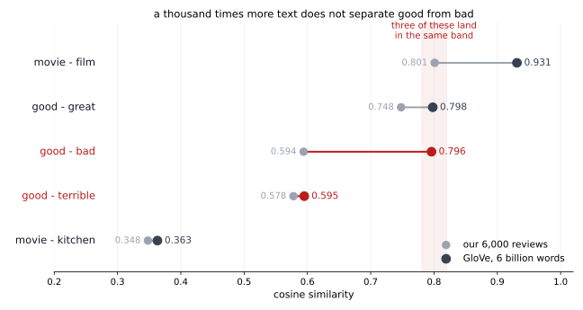

# 6.6 단어 벡터의 장점과 단점

<div class="leadbox" markdown>

**들어가는 이야기** — `bank`는 강둑인가 은행인가

앞의 두 쪽이 벡터를 만들었다. 잘 만들어졌다 — 「남자에 대한 여자는 그에 대한 무엇인가」를 물으면 **`she`**가 나오고, 「좋음에 대한 더 좋음은 나쁨에 대한 무엇인가」를 물으면 **`worse`**가 나온다. 사전을 한 번도 보지 않고서다.

그런데 이 쪽은 **못 담은 것**을 본다. 그 가운데 하나가 다음 장으로 이어진다.

`bank`를 생각해 보자. 강둑이기도 하고 은행이기도 하다. 그런데 **표에는 그 낱말의 줄이 하나뿐이다.** 두 뜻을 어떻게 나눠 담는가?

못 나눠 담는다. 재어 보면 이렇다.

```
bank - money   +0.443      은행 쪽
bank - river   +0.533      강둑 쪽
```

**둘 다 어중간하다.** 두 뜻을 함께 담은 것이 아니라 **말뭉치에서 흔한 쪽으로 끌려간 하나**다. 그리고 그 「흔한 쪽」은 자료가 바뀌면 바뀐다 — 영화평이 아니라 금융 기사로 배웠다면 반대로 쏠렸을 것이다.

이것이 이 방식의 **타고난 한계**다. 낱말마다 벡터가 **하나**이고, 그 하나는 **문장을 보지 않는다.** 「강둑에 앉았다」의 `bank`와 「은행에 갔다」의 `bank`가 글자 그대로 같은 수를 받는다.

[8장](../transformer/index.md)이 그것을 고친다. 거기서는 낱말의 벡터가 **그 문장 안에서 둘레를 보고 정해진다.**

</div>

---

## 1. 코드

```python
"""6.6 단어 벡터의 장점과 단점 — 한 낱말에 벡터 하나.

앞의 두 쪽이 벡터를 만들었다. 이 쪽은 그 벡터가 「무엇을 담았고 무엇을
못 담았는지」를 재고, 못 담은 것 하나가 8장으로 이어진다.

재는 것 셋.
  (가) 유추가 되는가 — king - man + woman = ? 로 널리 알려진 그것
  (나) 닮음이 뜻의 닮음인가 — good 과 bad 가 얼마나 가까운가
  (다) 「한 낱말에 벡터가 하나뿐이라는 것」 — 뜻이 여럿인 낱말은 어떻게 되는가

(다)가 이 쪽의 요점이다. bank 는 강둑이기도 하고 은행이기도 한데 표에는
줄이 하나뿐이다. 그 하나가 무엇이 되는지 이웃으로 본다.

CPU 로 돌린다 — 앞 쪽과 같은 까닭이다(되풀이되어야 한다).
실행: 이 쪽의 코드를 파일로 갈무리해 저장소 뿌리에서 돌린다.
"""
import re
from collections import Counter
from pathlib import Path

import torch
import torch.nn as nn
import torch.nn.functional as F

SEED, VOCAB, DIM, WINDOW = 42, 8000, 64, 4
STEPS, BATCH, NEG, LR = 6000, 1024, 5, 3e-3
ROOT = Path("./data/aclImdb")
TOKEN = re.compile(r"[a-z']+")
device = torch.device("cpu")
torch.set_num_threads(4)


def load_tokens(n_docs=6000):
    out = []
    for name in ("pos", "neg"):
        for f in sorted((ROOT / "train" / name).glob("*.txt"))[: n_docs // 2]:
            out += TOKEN.findall(f.read_text(encoding="utf-8")
                                 .replace("<br />", " ").lower())
    return out


toks = load_tokens()
counts = Counter(toks)
words = [w for w, _ in counts.most_common(VOCAB)]
stoi = {w: i for i, w in enumerate(words)}
ids = torch.tensor([stoi[w] for w in toks if w in stoi], dtype=torch.long)


class SkipGram(nn.Module):
    def __init__(self, v, d):
        super().__init__()
        self.mid, self.ctx = nn.Embedding(v, d), nn.Embedding(v, d)
        nn.init.normal_(self.mid.weight, std=0.1)
        nn.init.zeros_(self.ctx.weight)


def train():
    freq = torch.tensor([counts[w] for w in words], dtype=torch.float)
    p = freq ** 0.75; p /= p.sum()
    torch.manual_seed(SEED)
    m = SkipGram(VOCAB, DIM)
    opt = torch.optim.Adam(m.parameters(), lr=LR)
    g = torch.Generator().manual_seed(SEED)
    for _ in range(STEPS):
        c = torch.randint(WINDOW, len(ids) - WINDOW, (BATCH,), generator=g)
        off = torch.randint(1, WINDOW + 1, (BATCH,), generator=g)
        off *= torch.where(torch.rand(BATCH, generator=g) < 0.5, -1, 1)
        cc, oo = ids[c], ids[c + off]
        v = m.mid(cc)
        pos = (v * m.ctx(oo)).sum(-1)
        ni = torch.multinomial(p, BATCH * NEG, True, generator=g)
        ng = torch.bmm(m.ctx(ni).view(BATCH, NEG, -1), v.unsqueeze(-1)).squeeze(-1)
        loss = -(F.logsigmoid(pos).mean() + F.logsigmoid(-ng).sum(1).mean())
        opt.zero_grad(); loss.backward(); opt.step()
    return F.normalize(m.mid.weight.detach(), dim=1)


W = train()
sim = lambda a, b: float(W[stoi[a]] @ W[stoi[b]])


def near(vec, drop, k=5):
    s = W @ F.normalize(vec, dim=0)
    for w in drop:
        s[stoi[w]] = -2
    return [words[i] for i in s.topk(k).indices.tolist()]


if __name__ == "__main__":
    # === 1. 유추 =========================================================
    print("  유추 — a 에 대한 b 는 c 에 대한 무엇인가")
    tri = [("man", "woman", "he"), ("man", "woman", "his"),
           ("good", "better", "bad"), ("actor", "actress", "man"),
           ("one", "two", "first")]
    for a, b, c in tri:
        v = W[stoi[b]] - W[stoi[a]] + W[stoi[c]]
        print(f"    {a:8s}: {b:8s} = {c:8s}: {', '.join(near(v, (a, b, c), 3))}")

    # === 2. 닮음이 뜻의 닮음인가 ==========================================
    print("\n  닮음 점수 — 1 에 가까울수록 가깝다")
    for a, b in [("good", "great"), ("good", "bad"), ("good", "terrible"),
                 ("he", "she"), ("movie", "film"), ("movie", "kitchen")]:
        if a in stoi and b in stoi:
            print(f"    {a:8s} {b:10s} {sim(a, b):+.3f}")
        else:
            print(f"    {a:8s} {b:10s}  (어휘 {VOCAB:,}개 안에 없다)")
    print("    good 과 bad 가 good 과 great 만큼 가깝다면, 이 벡터로는")
    print("    좋고 나쁨을 가를 수 없다는 뜻이다")

    # === 3. 한 낱말에 벡터 하나 ==========================================
    print("\n  뜻이 여럿인 낱말 — 표에는 줄이 하나뿐이다")
    for w in ("bank", "star", "shot", "play", "right"):
        if w in stoi:
            print(f"    {w:8s} {', '.join(near(W[stoi[w]], (w,), 6))}")

    # === 4. 그 하나가 어느 쪽으로 쏠리는가 =================================
    print("\n  bank 는 어느 쪽에 더 가까운가")
    for probe, tag in [("money", "은행 쪽"), ("river", "강둑 쪽")]:
        if probe in stoi:
            print(f"    bank - {probe:8s} {sim('bank', probe):+.3f}   {tag}")
    print("\n  star 는 어느 쪽에 더 가까운가")
    for probe, tag in [("actor", "연예인 쪽"), ("sky", "별 쪽")]:
        if probe in stoi:
            print(f"    star - {probe:8s} {sim('star', probe):+.3f}   {tag}")
    print("\n  말뭉치가 영화평이라 한쪽으로 쏠린다. 벡터 하나가")
    print("  두 뜻을 함께 담는 것이 아니라 「흔한 쪽이 이긴다.」")
```

**출력:**

```
  유추 — a 에 대한 b 는 c 에 대한 무엇인가
    man     : woman    = he      : she, him, marry
    man     : woman    = his     : her, agrees, engagement
    good    : better   = bad     : worse, se, either
    actor   : actress  = man     : girl, phillip, woman
    one     : two      = first   : fifteen, five, three

  닮음 점수 — 1 에 가까울수록 가깝다
    good     great      +0.748
    good     bad        +0.594
    good     terrible   +0.578
    he       she        +0.660
    movie    film       +0.801
    movie    kitchen    +0.348
    good 과 bad 가 good 과 great 만큼 가깝다면, 이 벡터로는
    좋고 나쁨을 가를 수 없다는 뜻이다

  뜻이 여럿인 낱말 — 표에는 줄이 하나뿐이다
    bank     sent, robbers, responsibility, fighters, jail, government
    star     classic, romero, superhero, wilder, invented, toby
    shot     layers, absent, cover, stills, nacho, opening
    play     cyborg, approached, reed, bunker, caruso, surviving
    right    damage, finally, throwing, gage, guessing, smiling

  bank 는 어느 쪽에 더 가까운가
    bank - money    +0.443   은행 쪽
    bank - river    +0.533   강둑 쪽

  star 는 어느 쪽에 더 가까운가
    star - actor    +0.500   연예인 쪽
    star - sky      +0.353   별 쪽

  말뭉치가 영화평이라 한쪽으로 쏠린다. 벡터 하나가
  두 뜻을 함께 담는 것이 아니라 「흔한 쪽이 이긴다.」
```

---

## 2. 담은 것 — 유추가 된다

| 물음 | 답 |
|---|---|
| man : woman = he : ? | **she**, him, marry |
| man : woman = his : ? | **her**, agrees, engagement |
| good : better = bad : ? | **worse**, se, either |
| one : two = first : ? | fifteen, **five**, three |
| actor : actress = man : ? | girl, phillip, **woman** |

**첫째가 1등으로 맞는 것이 셋이다.** 벡터를 빼고 더하는 것만으로 성별 바꾸기, 비교급 만들기, 수사 고르기가 된다.

왜 되는가. 「남성형 → 여성형」이라는 바꿈이 벡터 공간에서 **거의 같은 방향의 이동**으로 나타나기 때문이다. $\mathbf{w}_{\text{woman}} - \mathbf{w}_{\text{man}}$이 그 이동이고, 그것을 `he`에 더하면 `she` 자리에 떨어진다.

!!! warning "유추가 되는 것을 과하게 읽지 말 것"
    넷째 줄을 보라. `first`에 대한 답으로 **fifteen**이 1등이다. 「one:two = first:second」를 바랐다면 틀린 것이다. 다섯째 줄도 `woman`이 3등이다.

    그리고 벡터를 더하고 빼는 것이 **뜻의 셈**이라는 보장은 어디에도 없다. 되는 쌍이 눈에 띄어 널리 알려졌을 뿐, 아무 쌍이나 되는 것이 아니다. 이 쪽의 다섯 가운데 둘이 1등을 못 맞혔다는 것 자체가 그 증거다.

---

## 3. 못 담은 것 (1) — 반대말이 가깝다

| 쌍 | 닮음 |
|---|---|
| good — great | **+0.748** |
| he — she | +0.660 |
| good — **bad** | **+0.594** |
| good — **terrible** | +0.578 |
| movie — film | +0.801 |
| movie — kitchen | +0.348 |

**`good`과 `bad`가 0.594다.** `good`과 `great`의 0.748에 크게 뒤지지 않고, 아무 상관 없는 `movie`–`kitchen`의 0.348보다 훨씬 높다.

[6.2절](02_context.md)이 말한 그대로다. 분포 가설이 재는 것은 **쓰임의 같음**이고, `good`과 `bad`는 「a \_\_\_ movie」, 「really \_\_\_」의 같은 자리에 들어간다. **반대말은 가장 바꿔 쓰기 쉬운 말이기도 하다.**

그래서 이 벡터를 [7장](../imdb/index.md)의 감정 분류에 그냥 얹으면 안 된다. 좋고 나쁨을 갈라야 하는데 그 둘이 가까이 놓여 있기 때문이다. [7.3절](../imdb/03_embedding.md)이 임베딩을 **과제에 맞춰 다시 배우는** 까닭이 여기 있다.

---

## 4. 못 담은 것 (2) — 한 낱말에 벡터 하나

뜻이 여럿인 낱말의 이웃을 뽑아 보면 이렇다.

| 낱말 | 이웃 여섯 |
|---|---|
| `bank` | sent, robbers, responsibility, fighters, jail, government |
| `star` | classic, romero, superhero, wilder, invented, toby |
| `shot` | layers, absent, cover, stills, nacho, opening |
| `play` | cyborg, approached, reed, bunker, caruso, surviving |

**`bank`의 이웃에 `robbers`와 `jail`이 있다.** 영화평에 「은행 강도」가 자주 나오기 때문이다. 강둑의 `bank`도 아니고 금융기관의 `bank`도 아닌, **「은행 강도 영화」의 `bank`**가 되었다.

`star`는 더 또렷하다.

```
star - actor   +0.500      연예인 쪽
star - sky     +0.353      별 쪽
```

**연예인 쪽이 이겼다.** 영화평이니 당연하다.

`bank`는 반대다.

```
bank - money   +0.443      은행 쪽
bank - river   +0.533      강둑 쪽
```

**강둑 쪽이 조금 높다.** 짐작과 다르고, 왜 그런지 이 쪽은 모른다. 영화 줄거리에 강가 장면이 많아서일 수도 있고, `money`가 너무 흔해 모든 낱말과 어중간하게 가까워서일 수도 있다.

**중요한 것은 둘 다 0.5 언저리라는 점이다.** 두 뜻을 또렷이 담았다면 한쪽이 높고 한쪽이 낮아야 하는데 그렇지 않다. **벡터 하나가 두 뜻 사이 어딘가에 끼어 있다.**

### 이것이 타고난 한계다

더 오래 학습한다고, 차원을 늘린다고 고쳐지지 않는다. **낱말 하나에 줄이 하나**인 한 그렇다.

$$
\text{「강둑에 앉았다」의 bank} \;=\; \text{「은행에 갔다」의 bank}
$$

두 문장에서 글자 그대로 **같은 64개 수**를 꺼내 쓴다. 문장을 보지 않기 때문이다.

---

## 5. 60억 낱말을 읽은 벡터와 맞대 본다

이 쪽이 잰 것은 **영화평 6,000편**으로 만든 벡터다. [앞 쪽](05_pretrained.md)은 같은 자를 **60억 낱말**로 만든 GloVe에 댔다. 천 배 차이가 무엇을 고치고 무엇을 못 고치는지 여기서 한자리에 놓는다.

| | 영화평 6,000편 (이 쪽) | 위키백과·뉴스 60억 낱말 ([6.5절](05_pretrained.md)) |
|---|---|---|
| 유추 다섯 가운데 1등으로 맞은 수 | 3 | **4** |
| `king` : `queen` 같은 물음 | 어휘에 없어 **못 물어본다** | **된다** |
| `bank`의 이웃 | 은행 강도 영화 쪽 | **금융기관 쪽** |
| `good` — `great` | +0.748 | +0.798 |
| `good` — **`bad`** | +0.594 | **+0.796** |



**선이 길수록 자료를 키워 달라진 것이다.** 그런데 가장 긴 선이 하필 **`good`–`bad`**다 — 가장 갈라 놓아야 할 쌍이 가장 많이 붙었다.

**위 세 줄은 자료를 키워서 고쳐진다.** 어휘가 넓어지니 물어볼 수 있는 것이 늘고, 말뭉치가 치우치지 않으니 `bank`가 제자리를 찾는다. **「더 읽으면 나아진다」가 맞는 자리다.**

**마지막 줄은 반대로 간다.** `good`과 `bad`의 거리가 0.594에서 **0.796으로 더 붙었다.** 같은 표에서 `good`–`great`가 0.798이니 **둘 사이가 0.002**다. 천 배 많이 읽은 쪽이 반대말을 **더** 못 가린다.

까닭은 3절에 이미 적혀 있다. 분포 가설이 재는 것은 **쓰임의 같음**이고, 많이 읽을수록 `good`과 `bad`가 같은 자리에 들어가는 보기를 **더 많이** 본다. **자료를 늘리면 늘릴수록 분명해지는 결론**이지 자료가 모자라 생긴 흠이 아니다.

이것이 이 쪽의 장단점을 가르는 선이다. **어휘·치우침은 자료로 고친다. 한 낱말에 벡터 하나라는 것과 반대말이 가깝다는 것은 자료로 안 고친다.**

---

## 6. 그래서 다음 장으로 간다

[7장](../imdb/index.md)은 이 벡터를 받아 글을 가른다. 거기서 **단어 벡터를 그냥 평균 낸 것이 그 장의 꼭대기**가 되는데, 그 사실이 이 쪽의 한계와 맞물린다 — 평균을 내면 순서도 문맥도 사라지지만, **벡터가 애초에 문맥을 담고 있지 않으니 잃을 것이 적다.**

[8장](../transformer/index.md)이 그 자리를 고친다. 거기서 낱말의 벡터는 **표에서 꺼내는 것이 아니라 그 문장 안에서 만들어진다.** 어텐션이 둘레를 보고 같은 `bank`를 문장마다 다르게 적는다.

이 장이 만든 표는 버려지지 않는다. **8장의 첫 줄이 여전히 임베딩 조회**다. 달라지는 것은 그 뒤에 무엇을 얹느냐다.

---

## 연습문제

<div class="drillbox" markdown>

**연습문제 1.** <span class="diff easy" title="쉬움"></span> 3절은 `good`과 `bad`가 0.594로 가깝다고 했다. 이것이 **반드시 나쁜 것인지** 따지라. 이 성질이 쓸모 있는 과제를 하나 들라.

</div>

??? success "풀이"

    감정을 가르는 일에는 나쁘다. 그러나 **나쁘기만 한 것은 아니다.**

    `good`과 `bad`가 가깝다는 것은 **둘 다 「영화를 평가하는 말」**이라는 정보를 담고 있다는 뜻이다. 품사 태깅, 구문 분석, 빈칸 채우기처럼 **자리를 맞히는 과제**에서는 바로 그 성질이 필요하다 — `a ___ movie`의 빈칸에 들어갈 후보를 좁히는 데 `good`과 `bad`가 함께 떠오르는 것이 옳다.

    또 기계 번역에서도 쓸모가 있다. 모르는 낱말을 만났을 때 「적어도 이 자리에 들어가는 종류의 말」이라는 것을 아는 편이 아무것도 모르는 것보다 낫다.

    곧 **자가 나쁜 것이 아니라 자와 과제가 어긋난 것**이다. 이 책이 되풀이하는 이야기다.

<div class="drillbox" markdown>

**연습문제 2.** <span class="diff med" title="중간"></span> 4절은 `bank`가 `money`(0.443)보다 `river`(0.533)에 가깝다는 뜻밖의 결과를 얻고 「까닭을 모른다」고 적었다. 그 까닭을 가리는 실험을 설계하라.

</div>

??? success "풀이"

    짐작이 둘 있었다. **(가) 영화 줄거리에 강가 장면이 많아서**, **(나) `money`가 너무 흔해 모든 낱말과 어중간해서.**

    **(나)를 먼저 지운다.** 싸다. `money`와 아무 상관 없는 낱말 여럿의 닮음을 재어 평균을 낸다. 그 평균이 0.44 언저리로 높으면 `money`는 원래 누구와도 그만큼 가까운 낱말이고, 0.44는 `bank`와의 특별한 관계가 아니다.

    **(가)는 세어서 본다.** 동시 출현 표([6.3절](03_counting.md)의 `C`)에서 `bank`가 `river`·`water`·`side`와 같이 나온 횟수와 `money`·`robbery`·`account`와 같이 나온 횟수를 직접 센다. 벡터를 거치지 않고 원자료를 보는 것이다.

    원자료에서도 강 쪽이 많으면 (가)가 맞고, 원자료는 은행 쪽인데 벡터만 강 쪽이면 **벡터를 만드는 과정에서 생긴 일**이다 — 그때는 창 크기나 네거티브 샘플링을 의심해야 한다.

<div class="drillbox" markdown>

**연습문제 3.** <span class="diff hard" title="어려움"></span> 4절은 「낱말 하나에 줄이 하나」가 타고난 한계라고 했다. **8장을 기다리지 않고** 이 틀 안에서 그 한계를 누그러뜨릴 길을 하나 설계하고, 그 길이 왜 완전한 답이 못 되는지 적으라.

</div>

??? success "풀이"

    **고전적인 길은 낱말을 미리 쪼개는 것이다.** 같은 글자열이라도 둘레가 다르면 다른 낱말로 친다. 예를 들어 `bank`가 나올 때마다 창 안의 낱말들을 모아 군집화하고, 군집마다 `bank_1`·`bank_2`로 번호를 붙여 서로 다른 줄을 준다. 그러고 나서 평소대로 학습한다.

    **되기는 된다.** 군집이 깨끗하게 갈리면 `bank_1`은 강둑, `bank_2`는 은행 쪽으로 자리 잡는다.

    **완전한 답이 못 되는 까닭 셋.**

    1. **몇 개로 쪼갤지 미리 정해야 한다.** 낱말마다 뜻의 수가 다른데 그것을 알 길이 없다. 너무 많이 쪼개면 자료가 흩어져 어느 줄도 제대로 못 배우고, 적게 쪼개면 원래 문제가 남는다.
    2. **쪼개는 일 자체가 벡터를 필요로 한다.** 둘레를 군집화하려면 둘레 낱말의 벡터가 있어야 하는데, 그 벡터는 아직 쪼개지 않은 것이다. 닭과 달걀이다.
    3. **쓸 때도 골라야 한다.** 새 문장에서 `bank`를 만나면 1번인지 2번인지 정해야 하고, 그 판정이 틀리면 아예 엉뚱한 벡터를 쓴다.

    8장의 길은 이 셋을 모두 비켜 간다. **쪼개 두지 않고, 쓸 때마다 그 문장에서 만든다.** 뜻의 개수를 미리 정할 필요도, 고를 필요도 없다.
