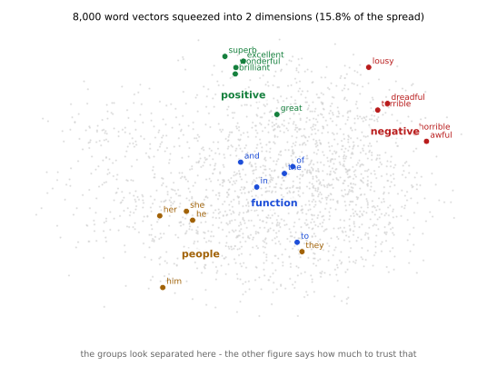
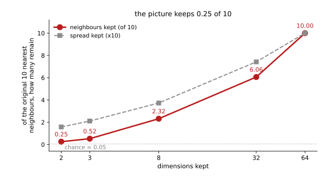

# 6.7 그림으로 보면 — 그리고 그림이 잃는 것

<div class="leadbox" markdown>

**들어가는 이야기** — 그럴듯한 그림이 2.5%만 지킨다

64개짜리 벡터는 그릴 수 없다. 2차원으로 줄여야 눈에 보이는데, 줄이면 잃는다. **얼마나 잃는가?**

먼저 그림부터 보자. 낱말 8,000개를 2차원에 흩뿌리고 네 묶음에만 색을 주었다.



**갈려 보인다.** 좋은 뜻 형용사가 위에, 나쁜 뜻이 오른쪽에, 기능어가 가운데에, 대명사가 왼쪽 아래에 모인다. 이런 그림을 보면 「벡터가 뜻을 잘 담았구나」 하고 믿게 된다.

**그 믿음이 얼마나 값진지 재어 보자.** 원래 64차원에서 가장 가까웠던 이웃 열 개 가운데, 2차원에서도 이웃 열 개에 남는 것이 몇이나 되는가.



**0.25개다.** 열 가운데 하나도 못 지킨다. 우연히 겹칠 값이 0.05이니 **아무것도 아닌 것보다 다섯 배 나을 뿐**이다.

위 그림에서 가까워 보이는 두 낱말은 **거의 언제나 원래 가깝지 않다.** 보기 좋은 군집은 보기 좋을 뿐이다.

</div>

---

## 1. 코드

```python
"""6.7 그림으로 보면 — 그리고 그림이 잃는 것.

64차원 벡터는 그릴 수 없다. 2차원으로 줄여야 보이는데, 줄이면 잃는다.
이 쪽은 「무엇을 얼마나 잃는지」를 재고 나서 그림을 본다.

재는 것 둘.
  (가) 2차원이 원래 퍼짐의 몇 %를 담는가 (PCA 의 설명 분산)
  (나) 그림에서 이웃인 것이 원래도 이웃인가 — 64차원의 이웃 열 가운데
       2차원에서도 이웃 열에 남는 수를 센다

(나)가 요점이다. 그림이 그럴듯해 보이는 것과 가까움이 지켜진 것은 다르다.

벡터는 [6.2절](02_context.md)과 같은 Skip-gram 으로 만든다. CPU 로 돌려
되풀이되게 한다.
실행: 이 쪽의 코드를 파일로 갈무리해 저장소 뿌리에서 돌린다.
"""
import re
from collections import Counter
from pathlib import Path

import torch
import torch.nn as nn
import torch.nn.functional as F

SEED, VOCAB, DIM, WINDOW = 42, 8000, 64, 4
STEPS, BATCH, NEG, LR = 6000, 1024, 5, 3e-3
ROOT = Path("./data/aclImdb")
TOKEN = re.compile(r"[a-z']+")
torch.set_num_threads(4)


def load_tokens(n_docs=6000):
    out = []
    for name in ("pos", "neg"):
        for f in sorted((ROOT / "train" / name).glob("*.txt"))[: n_docs // 2]:
            out += TOKEN.findall(f.read_text(encoding="utf-8")
                                 .replace("<br />", " ").lower())
    return out


toks = load_tokens()
counts = Counter(toks)
words = [w for w, _ in counts.most_common(VOCAB)]
stoi = {w: i for i, w in enumerate(words)}
ids = torch.tensor([stoi[w] for w in toks if w in stoi], dtype=torch.long)


class SkipGram(nn.Module):
    def __init__(self, v, d):
        super().__init__()
        self.mid, self.ctx = nn.Embedding(v, d), nn.Embedding(v, d)
        nn.init.normal_(self.mid.weight, std=0.1)
        nn.init.zeros_(self.ctx.weight)


def train():
    freq = torch.tensor([counts[w] for w in words], dtype=torch.float)
    p = freq ** 0.75; p /= p.sum()
    torch.manual_seed(SEED)
    m = SkipGram(VOCAB, DIM)
    opt = torch.optim.Adam(m.parameters(), lr=LR)
    g = torch.Generator().manual_seed(SEED)
    for _ in range(STEPS):
        c = torch.randint(WINDOW, len(ids) - WINDOW, (BATCH,), generator=g)
        off = torch.randint(1, WINDOW + 1, (BATCH,), generator=g)
        off *= torch.where(torch.rand(BATCH, generator=g) < 0.5, -1, 1)
        cc, oo = ids[c], ids[c + off]
        v = m.mid(cc)
        pos = (v * m.ctx(oo)).sum(-1)
        ni = torch.multinomial(p, BATCH * NEG, True, generator=g)
        ng = torch.bmm(m.ctx(ni).view(BATCH, NEG, -1), v.unsqueeze(-1)).squeeze(-1)
        loss = -(F.logsigmoid(pos).mean() + F.logsigmoid(-ng).sum(1).mean())
        opt.zero_grad(); loss.backward(); opt.step()
    return F.normalize(m.mid.weight.detach(), dim=1)


def pca(X, k):
    """가운데를 0 으로 옮기고 주성분 k 개로 사영한다. 설명 분산도 돌려준다."""
    Xc = X - X.mean(0, keepdim=True)
    # 공분산의 고유분해 대신 특잇값 분해 — 5.1절과 같은 수법이다
    U, S, V = torch.linalg.svd(Xc, full_matrices=False)
    var = S ** 2 / (len(X) - 1)
    return Xc @ V[:k].T, float(var[:k].sum() / var.sum())


def keep_rate(A, B, k=10, n=2000):
    """A 에서의 이웃 k 개 가운데 B 에서도 이웃 k 개에 남는 비율.

    「둘 다 같은 꼴로 다듬어 넣어야 한다.」 처음에는 A 를 다듬지 않고
    B 만 가운데를 옮겨 넣었더니, 차원을 하나도 줄이지 않은 k=64 에서도
    8.05/10 이 나왔다. 줄여서 잃은 것이 아니라 「가운데를 옮겨서」 달라진
    것이었다. 여기서는 둘 다 가운데를 옮긴 것으로 받는다.
    """
    a = F.normalize(A[:n], dim=1)
    b = F.normalize(B[:n], dim=1)
    ta = (a @ a.T).fill_diagonal_(-2).topk(k).indices
    tb = (b @ b.T).fill_diagonal_(-2).topk(k).indices
    keep = sum(len(set(ta[i].tolist()) & set(tb[i].tolist())) for i in range(n))
    return keep / (n * k)


if __name__ == "__main__":
    W = train()
    print(f"  낱말 {VOCAB:,}개, 차원 {DIM}\n")

    base, _ = pca(W, DIM)          # 차원을 줄이지 않은 것 — 견줄 자리
    print(f"  {'남긴 차원':>10}{'설명 분산':>12}{'이웃 10 가운데 남는 수':>24}")
    for k in (2, 3, 8, 32, 64):
        P, ev = pca(W, k)
        print(f"  {k:10d}{ev * 100:11.1f}%{keep_rate(base, P) * 10:18.2f}/10")

    print("\n  흔한 낱말 2,000개로 쟀다. 우연이라면 10/2000 = 0.05/10 이다")

    # 그림에 쓸 낱말 묶음 — 그림 코드가 같은 것을 쓴다
    P2, ev2 = pca(W, 2)
    groups = {
        "positive": ["great", "excellent", "wonderful", "brilliant", "superb"],
        "negative": ["awful", "terrible", "horrible", "dreadful", "lousy"],
        "function": ["the", "of", "and", "to", "in"],
        "people":   ["he", "she", "him", "her", "they"],
    }
    print("\n  2차원에서 묶음끼리 얼마나 떨어져 있나 (가운뎃점 사이 거리)")
    cen = {g: P2[[stoi[w] for w in ws if w in stoi]].mean(0)
           for g, ws in groups.items()}
    gs = list(cen)
    for i in range(len(gs)):
        for j in range(i + 1, len(gs)):
            d = float((cen[gs[i]] - cen[gs[j]]).norm())
            print(f"    {gs[i]:>9s} - {gs[j]:<9s} {d:.3f}")
    spread = float(P2.std(0).mean())
    print(f"    견줄 자리: 2차원 전체의 퍼짐 {spread:.3f}")
```

**출력:**

```
  낱말 8,000개, 차원 64

       남긴 차원       설명 분산          이웃 10 가운데 남는 수
           2       15.8%              0.25/10
           3       21.1%              0.52/10
           8       37.3%              2.32/10
          32       74.2%              6.06/10
          64      100.0%             10.00/10

  흔한 낱말 2,000개로 쟀다. 우연이라면 10/2000 = 0.05/10 이다

  2차원에서 묶음끼리 얼마나 떨어져 있나 (가운뎃점 사이 거리)
     positive - negative  0.451
     positive - function  0.478
     positive - people    0.695
     negative - function  0.463
     negative - people    0.760
     function - people    0.297
    견줄 자리: 2차원 전체의 퍼짐 0.228
```

---

## 2. 차원을 줄이면 무엇이 얼마나 사라지는가

| 남긴 차원 | 설명 분산 | 이웃 10 가운데 남는 수 |
|---|---|---|
| **2** | 15.8% | **0.25** |
| 3 | 21.1% | 0.52 |
| 8 | 37.3% | 2.32 |
| 32 | 74.2% | 6.06 |
| 64 | 100.0% | 10.00 |

**두 칸이 같은 속도로 내려가지 않는다.** 2차원이 퍼짐의 15.8%를 담는데 이웃은 2.5%만 지킨다. **여섯 배 더 가파르게 무너진다.**

까닭을 짚어 보면 이렇다. 설명 분산은 **점들이 전체적으로 얼마나 흩어져 있는지**를 재고, 이웃 유지율은 **누가 누구 곁에 있는지**를 잰다. 큰 방향 둘만 남기면 전체 모양은 어렴풋이 남지만, **가까운 것들끼리의 차이는 그 둘과 직각인 방향에 들어 있어** 통째로 사라진다.

[5.1절](../ch05/dimreduction/01_pca.md)이 그림에서 이미 본 것과 같은 이야기다. 거기서 PCA-2는 설명 분산이 적지 않았는데도 **열 숫자가 한 덩어리로 뭉개졌다**(심판이 35.66%밖에 못 읽었다). 같은 수법이 낱말에서도 같은 값을 치른다.

---

## 3. 그러면 그림의 묶음은 가짜인가

아니다. **묶음은 진짜인데, 그림이 보증하는 것이 묶음까지뿐**이다.

출력의 마지막 토막이 그것을 센다. 네 묶음의 가운뎃점 사이 거리다.

| 두 묶음 | 2차원에서의 거리 |
|---|---|
| negative — people | **0.760** |
| positive — people | 0.695 |
| positive — function | 0.478 |
| negative — function | 0.463 |
| **positive — negative** | **0.451** |
| function — people | **0.297** |
| (견줄 자리) 2차원 전체의 퍼짐 | 0.228 |

**가장 가까운 두 묶음이 `function`과 `people`**이다. 둘 다 기능어에 가까우니 그럴 만하다.

그런데 **`positive`와 `negative`가 그다음으로 가깝다**(0.451). 좋은 뜻과 나쁜 뜻이 **`positive`와 기능어 사이보다 더 가깝다.** 그림에서는 위와 오른쪽으로 갈려 보이는데, 거리로 재면 그렇게 멀지 않다.

[6.6절](06_what_it_holds.md)이 수로 보인 그것이다 — `good`과 `bad`의 닮음이 0.594였다. **그림이 그 사실을 숨기지는 않았지만, 눈으로는 「갈렸다」로 읽힌다.**

!!! note "그래서 이런 그림을 어떻게 써야 하는가"
    **쓸 데가 없는 것이 아니다.** 큰 덩어리가 몇이나 있는지, 어느 묶음이 아예 동떨어져 있는지는 보인다. 학습이 아주 잘못되었을 때(모든 점이 한 덩어리이거나 몇 점만 멀리 튀는 것) 그것도 한눈에 보인다.

    **쓰면 안 되는 자리가 분명하다.** 「이 두 낱말이 가깝다」, 「이 묶음이 저 묶음보다 멀다」를 **그림에서 읽어 내면 안 된다.** 그런 것은 원래 차원에서 수로 재야 한다 — 이 쪽이 3절에서 한 것처럼.

    한 줄로 줄이면 이렇다. **그림은 물음을 만드는 데 쓰고, 답은 수로 낸다.**

---

## 4. 재면서 틀린 자리

이 쪽을 처음 돌렸을 때 **차원을 하나도 줄이지 않은 64에서 8.05/10**이 나왔다. 줄이지 않았는데 둘이 왜 다른가.

**견주는 두 쪽을 같은 꼴로 다듬지 않았기 때문**이다. 원래 벡터는 그대로 쓰고 사영한 쪽만 가운데를 0으로 옮겨 넣었다. 가운데를 옮기면 코사인 닮음이 달라지므로, 차원을 안 줄여도 이웃이 바뀐다.

**그 1.95가 「줄여서 잃은 것」으로 보였을 뻔했다.** 둘 다 가운데를 옮긴 것으로 받아 고쳤고, 그러자 64에서 정확히 10.00이 나온다. 코드의 `keep_rate` 독스트링에 그대로 적어 두었다.

재는 자를 만들 때 **「아무것도 안 바꿨을 때 무엇이 나와야 하는지」를 먼저 정해 두는 것**이 이래서 값지다. 여기서는 10.00이었고, 그것이 안 나와서 자를 의심할 수 있었다.

---

## 연습문제

<div class="drillbox" markdown>

**연습문제 1.** <span class="diff easy" title="쉬움"></span> 2절은 2차원이 퍼짐의 15.8%를 담는데 이웃은 2.5%만 지킨다고 했다. 두 수가 왜 다른지 한 문장으로 적으라.

</div>

??? success "풀이"

    설명 분산은 **점들이 전체적으로 얼마나 흩어졌는지**를 재고 이웃 유지율은 **누가 누구 곁에 있는지**를 재는데, 가까운 점들을 가르는 차이는 큰 방향이 아니라 **버려진 작은 방향들**에 들어 있기 때문이다.

    달리 말하면 설명 분산은 **멀리 있는 것들** 덕에 크게 나오고, 이웃 유지율은 **가까이 있는 것들**만 본다. 둘이 보는 것이 다르다.

<div class="drillbox" markdown>

**연습문제 2.** <span class="diff med" title="중간"></span> 이 쪽은 PCA 로만 줄였다. t-SNE 나 UMAP 처럼 **가까움을 지키려고 만든** 방법을 쓰면 이웃 유지율이 올라갈 것이다. 그렇다면 3절의 경고가 사라지는가?

</div>

??? success "풀이"

    **유지율은 올라간다.** 그 방법들은 애초에 「가까운 것을 가깝게」를 목표로 삼으므로 PCA 의 0.25 보다 훨씬 높게 나온다.

    **그래도 경고는 남고, 오히려 새 경고가 는다.**

    첫째, 그 방법들은 **가까움을 지키는 대신 거리를 버린다.** 두 군집이 그림에서 멀리 떨어져 있어도 원래 멀다는 뜻이 아니고, 군집의 크기도 뜻이 없다. 그러니 3절이 한 「묶음 사이 거리 재기」를 **그 그림 위에서 하면 더 틀린다.**

    둘째, 손잡이가 많다. t-SNE 의 perplexity 를 바꾸면 그림이 통째로 달라지고, 없던 군집이 생기기도 한다. **그림을 여러 손잡이로 그려 보고 늘 나오는 것만 믿어야** 한다.

    곧 「그림은 물음을 만드는 데 쓰고 답은 수로 낸다」는 규칙은 그대로다. 바뀌는 것은 **어떤 물음을 만들 수 있는가**뿐이다.

<div class="drillbox" markdown>

**연습문제 3.** <span class="diff hard" title="어려움"></span> 4절의 사고를 일반화하라. **재는 자를 새로 만들 때 반드시 해 두어야 할 확인**이 무엇인지 적고, 이 책의 다른 자에 그것을 적용해 보라.

</div>

??? success "풀이"

    **「아무 일도 일어나지 않았을 때 자가 무엇을 내놓아야 하는지」를 먼저 정하고 확인하는 것**이다. 자가 그 값을 안 내놓으면 자가 잘못된 것이지 대상이 잘못된 것이 아니다.

    이 쪽에서는 「차원을 안 줄이면 10.00」이었고, 8.05 가 나와서 자를 의심할 수 있었다.

    다른 자에 적용하면 이렇다.

    | 자 | 아무 일도 없을 때 나와야 하는 값 |
    |---|---|
    | [클래스 안 다양함](../ch05/index.md) | 진짜 자료를 그대로 넣으면 **1.00** |
    | [고름](../ch05/index.md) | 열 가지를 고르게 만들면 **1.00** |
    | 이 쪽의 유지율 | 차원을 안 줄이면 **10.00** |
    | [7장의 정확도](../imdb/index.md) | 아무렇게나 찍으면 **50%** |

    5.3절이 실제로 그 확인을 한다 — 새로 만든 다양함 자에 **진짜 데이터를 그대로 넣어 1.00 이 나오는지** 보고 나서 쓴다. 그 절의 제목이 「만들자마자 이 자를 속여 본다」이다.
