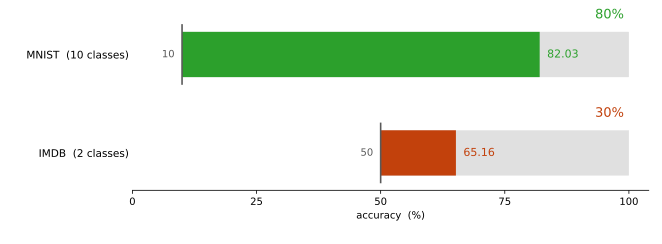

# 단어 세기와 최근접 중심

<div class="leadbox" markdown>

**들어가는 이야기** — 순서를 통째로 버리고 세기만 한다

평 한 편을 분류기에 넣으려면 수의 벡터로 바꿔야 한다. 가장 거친 방법이 **Bag-of-Words**(BoW)다 — 평을 단어를 쏟아 담은 주머니로 보고, **어느 단어가 몇 번 나왔는지만 세고 순서는 버린다.** 「이 영화는 좋지 않다」와 「않다 좋지 이 영화는」이 같은 벡터가 된다.

그러고는 3장의 첫 칸과 똑같이 한다 — 좋은 평들을 평균 내고 나쁜 평들을 평균 낸 뒤, 새 평이 어느 쪽에 가까운지 본다. **최근접 중심 분류기**(nearest centroid classifier)다. 트레인이랄 것이 없다. 평균뿐이다.



**65.16%다.** 동전 던지기가 50%이니 번 것은 15.16%포인트다.

그냥 보면 「반보다는 낫다」지만, 3장과 나란히 놓으면 다르게 읽힌다. 거기서 같은 방법이 숫자 그림에 82.03%를 냈는데 우연이 10%였으니 **남은 자리의 80%를 먹은 것**이다. 여기서는 50%에서 출발해 **30%밖에 먹지 못했다.**

같은 방법, 전혀 다른 성적이다. 까닭은 **버린 것이 다르기** 때문이다. 그림에서 픽셀 순서를 섞는 것은 좌표에 붙인 이름을 바꾸는 일에 지나지 않지만, 글에서 단어 순서를 섞는 것은 **뜻을 바꾸는 일**이다.

그러니 이 칸이 낮은 것은 실패가 아니라 **이 장이 오를 자리가 그만큼 남았다는 뜻**이다. 그리고 바로 다음 쪽이 **피처를 하나도 바꾸지 않고** 그 가운데 상당 부분을 가져간다.

</div>

[3장 1단계](../ch03/mnist/01_template_learning.md)는 숫자마다 그림을 평균 내어 템플릿 열 장을 만들고, 새 그림을 가장 가까운 템플릿의 숫자로 분류했다. 경사 하강법 없이 데이터에서 클래스 평균을 추정했다.

이 절은 **똑같은 규칙을 텍스트에 건다.** 좋게 본 평을 모두 평균 내고, 나쁘게 본 평을 모두 평균 내어 중심 둘을 만든다. 새 평은 가까운 쪽으로 분류한다.

바뀌는 것은 무엇을 세느냐뿐이다. 픽셀 대신 **단어**를 센다.

---

## 1. 텍스트는 그림과 두 가지가 다르다

**길이가 제각각이다.** MNIST는 언제나 28×28이라 벡터의 길이가 784로 고정이었다. 영화평은 짧은 것이 열 단어, 긴 것이 2,462 단어다.

그래서 평을 그대로 벡터로 쓸 수 없다. 길이가 고정된 벡터를 얻으려면 **칸을 단어로 정해야 한다.** 트레인 평 25,000편에 나온 단어 85,680가지를 많이 나온 순서로 세워 앞의 **20,000개**를 어휘로 삼고(코드의 `VOCAB_SIZE`), 칸 하나에 단어 하나를 둔다. 어휘 밖 단어는 버린다. 그러면 평이 열 단어이든 2,462 단어이든 벡터의 길이는 20,000이다.

칸에 무엇을 넣는지도 갈린다. 「나왔으면 1, 안 나왔으면 0」으로 적는 **이진 Bag-of-Words**도 흔히 쓰지만, 이 쪽은 **비율**을 넣는다 — 상대 빈도(term frequency)다. 단어마다 그 평에 나온 횟수를 세고(`to_counts`), 그 평의 단어 수 $n$ 으로 나눈다(`normalize`). 여기서 $n$ 은 **어휘 밖 단어를 걸러 낸 뒤 남은 단어 수**다 — 같은 단어가 되풀이되면 그만큼 센다. 걸러 내는 기준은 그 평이 아니라 트레인 자료 전체라, 어느 평에 열 번 나온 단어라도 자료 전체에서 20,000등 안에 못 들면 빠진다.

$$
x_j \;=\; \frac{\text{단어 } j \text{ 가 그 평에 나온 횟수}}{n}
$$

걸러 낸 뒤 남은 단어가 100개인 평에 `great` 가 두 번 나왔다면 `great` 칸은 $2/100 = 0.02$ 이고, 한 번도 안 나온 단어의 칸은 0이다. 칸은 모두 0 이상이고 한 평의 칸을 다 더하면 1이다 — 벡터 하나가 **그 평 안의 단어 분포**다. 분모가 평의 원래 길이가 아니라 걸러 낸 뒤의 길이라는 점을 짚어 둔다.

나누지 않으면 긴 평일수록 벡터가 커진다. 같은 말을 두 번 되풀이한 평은 벡터가 두 배가 되어, 내용과 상관없이 두 중심 모두에서 멀어진다. 나누면 그 둘이 같은 벡터가 된다.

3장 1단계와 나란히 놓으면 무엇이 같고 무엇이 바뀌었는지 보인다.

| | [3장 1단계 — MNIST](../ch03/mnist/01_template_learning.md) | 이 쪽 — IMDB |
|---|---|---|
| 표본 하나 | 손글씨 숫자 그림 한 장 | 영화평 한 편 |
| 트레인 · 시험 | 60,000 · 10,000장 | 25,000 · 25,000편 |
| 정답 $y$ | 0~9, 열 가지 | 1(좋게 봄) 또는 0(나쁘게 봄), 두 가지 |
| 입력 $\mathbf{x}$ 의 길이 | 784 — 28×28 이라 처음부터 고정 | 20,000 — **어휘를 정해야** 고정된다 |
| 칸 하나의 뜻 | 그 자리 픽셀의 밝기 | 그 단어가 그 평에서 차지하는 비율 |
| 칸의 값 | 0~1 실수 | 0 이상, 한 평의 칸을 다 더하면 1 |
| 무엇으로 나누나 | 255 — **모든 그림에 같은 수** | 그 평의 단어 수 $n$ — **평마다 다른 수** |
| 중심 | 클래스마다 하나, 10개 | 클래스마다 하나, 2개 |
| 평균으로 못박은 수 | $10 \times 784 = 7{,}840$ | $2 \times 20{,}000 = 40{,}000$ |

나누는 수가 다르다는 것이 실제로 갈리는 자리다. 3장의 255는 모든 그림에 같은 수라 거리의 대소를 바꾸지 않았고 결과에도 닿지 않았다. 여기의 $n$ 은 평마다 달라서 평끼리의 거리를 실제로 바꾼다. 중심도 그 분포들을 평균한 것이라 역시 합이 1인 분포다. 새 평은 제 단어 분포가 좋은 평들의 분포와 나쁜 평들의 분포 가운데 어느 쪽에 더 가까운지로 분류된다.

**순서가 뜻을 바꾼다.** 픽셀을 뒤섞으면 그림이 망가지지만 사람은 무엇이 망가졌는지 안다. 단어를 뒤섞으면 "이 영화는 좋지 않다"가 "좋다, 이 영화는 않다"가 된다.

**이 절은 그 순서를 통째로 버린다.** 단어를 세기만 하므로 "좋지 않다"와 "않다 좋지"가 같은 벡터가 된다. Bag-of-Words 모델이 버리는 것이 이것이다. 사다리의 4단계 LSTM이 되찾을 것이 바로 이것이다.

---

## 2. 코드

```python
"""1단계: 단어를 세어 클래스마다 평균을 내고, 가까운 쪽으로 분류한다.

3장 1단계의 템플릿 학습을 텍스트에 그대로 옮긴 것이다. 거기서는 그림을
클래스마다 평균 내어 템플릿 열 장을 만들었고, 여기서는 영화평을 클래스마다
평균 내어 '좋은 평의 평균'과 '나쁜 평의 평균' 둘을 만든다.

트레인이 없다. 평균을 내고 가까운 쪽을 고를 뿐이다.
"""
import re, time
from collections import Counter
from pathlib import Path
import numpy as np

ROOT = Path("./data/aclImdb")   # 내려받아 풀어 둔 자리
VOCAB_SIZE = 20000

# =============================================================================
# 자료: 영화평을 읽어 단어 목록으로 바꾼다
# =============================================================================
TOKEN = re.compile(r"[a-z']+")          # 소문자 단어만. 숫자와 문장부호는 버린다

def tokenize(text):
    # HTML 줄바꿈이 원문에 그대로 남아 있다
    return TOKEN.findall(text.replace("<br />", " ").lower())

def load(split):
    """(단어 목록들, 정답)을 돌려준다. 1 = 좋게 봄, 0 = 나쁘게 봄."""
    docs, labels = [], []
    for label, name in ((1, "pos"), (0, "neg")):
        for f in sorted((ROOT/split/name).glob("*.txt")):
            docs.append(tokenize(f.read_text(encoding="utf-8")))
            labels.append(label)
    return docs, np.array(labels)

t0 = time.time()
train_docs, train_y = load("train")
test_docs,  test_y  = load("test")
print(f"자료 트레인 {len(train_docs):,}편  시험 {len(test_docs):,}편  ({time.time()-t0:.0f}s)")
print(f"평 하나의 단어 수: 가운뎃값 {int(np.median([len(d) for d in train_docs]))}  "
      f"가장 짧은 것 {min(len(d) for d in train_docs)}  가장 긴 것 {max(len(d) for d in train_docs)}")

# =============================================================================
# 단어 목록: 자주 나온 것 VOCAB_SIZE개만 남긴다
# =============================================================================
counts = Counter(w for d in train_docs for w in d)
vocab = [w for w, _ in counts.most_common(VOCAB_SIZE)]
index = {w: i for i, w in enumerate(vocab)}
print(f"단어 {len(counts):,}가지 가운데 {VOCAB_SIZE:,}개를 쓴다")


def to_counts(docs):
    """평 하나를 단어 세기 벡터로. (문서 수, VOCAB_SIZE)"""
    X = np.zeros((len(docs), VOCAB_SIZE), dtype=np.float32)
    for r, d in enumerate(docs):
        for w in d:
            j = index.get(w)
            if j is not None:
                X[r, j] += 1
    return X

Xtr, Xte = to_counts(train_docs), to_counts(test_docs)

# 평마다 길이가 다르므로 어휘 밖 단어를 걸러 낸 뒤 남은 단어 수로 나눈다. 안 그러면 '긴 평'이 무조건 멀어진다.
# 나눈 뒤에는 평 하나의 칸을 다 더하면 1이다 — 그 평 안의 단어 분포다.
# 3장에서는 그림 크기가 모두 같아 이 손질이 필요 없었다 — 텍스트의 첫 번째 차이다
def normalize(X):
    n = X.sum(1, keepdims=True)
    return X / np.maximum(n, 1)

Xtr_n, Xte_n = normalize(Xtr), normalize(Xte)

# =============================================================================
# 1단계: 클래스마다 평균 — 트레인이 없다
# =============================================================================
centroid_pos = Xtr_n[train_y == 1].mean(0)
centroid_neg = Xtr_n[train_y == 0].mean(0)

def classify(X):
    """가까운 중심을 고른다. 거리는 제곱 유클리드."""
    d_pos = ((X - centroid_pos) ** 2).sum(1)
    d_neg = ((X - centroid_neg) ** 2).sum(1)
    return (d_pos < d_neg).astype(int)

acc = 100.0 * (classify(Xte_n) == test_y).mean()
print(f"\n1단계 최근접 중심  시험 정확도 {acc:.2f}%")
print(f"파라메터 {2*VOCAB_SIZE:,} (트레인하지 않고 평균으로 못박은 값)")

# 어떤 단어가 두 중심을 가장 크게 갈라놓는가
diff = centroid_pos - centroid_neg
top_pos = np.argsort(diff)[-12:][::-1]
top_neg = np.argsort(diff)[:12]
print("\n좋은 쪽으로 미는 단어:", ", ".join(vocab[i] for i in top_pos))
print("나쁜 쪽으로 미는 단어:", ", ".join(vocab[i] for i in top_neg))
```

**출력:**

```
자료 트레인 25,000편  시험 25,000편  (21s)
평 하나의 단어 수: 가운뎃값 173  가장 짧은 것 10  가장 긴 것 2462
단어 85,680가지 가운데 20,000개를 쓴다

1단계 최근접 중심  시험 정확도 65.16%
파라메터 40,000 (트레인하지 않고 평균으로 못박은 값)

좋은 쪽으로 미는 단어: and, is, of, great, in, as, the, his, very, a, best, love
나쁜 쪽으로 미는 단어: bad, this, was, movie, to, no, just, even, not, i, worst, have
```

---

## 3. 65.16%

우연이 50%이므로 15.16%포인트를 번 계산이다.

[3장 1단계](../ch03/mnist/01_template_learning.md)의 82.03%와 나란히 놓으면 겉보기와 다른 것이 보인다.

| | 정확도 | 우연 | 우연 위로 번 몫 | 남은 자리의 몇 %인가 |
|---|---|---|---|---|
| [MNIST 템플릿](../ch03/mnist/01_template_learning.md) | 82.03% | 10% | +72.03 | **80%** |
| IMDB 최근접 중심 | 65.16% | 50% | +15.16 | **30%** |

**같은 규칙인데 텍스트에서는 훨씬 덜 번다.** 클래스가 둘뿐이라 우연이 50%로 높은 것도 있지만, 우연 위의 자리를 얼마나 먹었는지로 보아도 80% 대 30%다.

---

## 4. 왜 덜 버는가 — 단어 목록이 말해 준다

출력의 마지막 두 줄이 까닭을 드러낸다.

> 좋은 쪽으로 미는 단어: **and, is, of,** great, **in, as, the, his,** very, **a,** best, love
>
> 나쁜 쪽으로 미는 단어: bad, **this, was,** movie, **to,** no, **just, even, not, i,** worst, **have**

굵게 칠한 단어들은 뜻이 없는 단어가 아니라, 감성을 직접 드러내지 않는 단어다. `and`, `is`, `of`, `the`, `a`는 어느 평에나 나오는 단어다. 그런데 **중심을 가장 크게 갈라놓는 단어 열두 개 가운데 여덟 개를 차지한다** — 양쪽 목록이 다 그렇다.

까닭은 평균이 **자주 나오는 것에 끌려가기** 때문이다. `the`는 한 평에 열 번도 나오고 `excellent`는 나와야 한 번이다. 두 중심의 차이를 재면 `the`의 작은 빈도 차이가 `excellent`의 있고 없음보다 큰 값을 낸다.

3장에서 템플릿이 **평균 밝기**에 끌려갔던 것과 같은 일이다. 거기서도 숫자를 구별하는 것은 획의 모양인데 평균이 잡은 것은 밝기였다.

---

## 5. 그래서 다음 단계가 무엇을 고쳐야 하는가

`and`와 `excellent`를 **다르게 대접할 수 있어야 한다.** 평균은 그럴 수 없다. 모든 단어를 똑같이 세어 더할 뿐이다.

[다음 단계](02_linear.md)는 피처를 그대로 두고 **웨이트만 트레인한다.** 파라메터 수도 같다. 달라지는 것은 그 수를 평균으로 못박느냐 데이터에 맞추어 고르느냐뿐이다.

3장에서 같은 단계가 10.32%포인트를 벌었다.

---

## 연습문제

<div class="drillbox" markdown>

**연습문제 1.** <span class="diff easy" title="쉬움"></span>
이 절은 세기 벡터를 평의 단어 수로 나눈다. 나누지 않으면 무엇이 잘못되는가?

</div>

??? success "풀이"
    **평의 길이가 거리에 섞여, 분류기가 내용이 아니라 길이로 판정하게 된다.** 재어 보면 정확도가 65.16%에서 **54.54%**로 떨어진다. 위 코드 끝에 이어 붙인다.

    ```python
    def nearest(Atr, Ate):
        """중심 둘을 만들고 시험 평을 가까운 쪽으로 분류한다."""
        cp, cn = Atr[train_y == 1].mean(0), Atr[train_y == 0].mean(0)
        return (((Ate - cp) ** 2).sum(1) < ((Ate - cn) ** 2).sum(1)).astype(int)

    p_raw, p_norm = nearest(Xtr, Xte), nearest(Xtr_n, Xte_n)   # 나누지 않은 것, 나눈 것
    print(f"나누지 않으면 {100 * (p_raw == test_y).mean():.2f}%   나누면 {100 * (p_norm == test_y).mean():.2f}%")

    L = Xte.sum(1)                                   # 걸러 낸 뒤의 길이
    edges = np.quantile(L, [0, 0.25, 0.5, 0.75, 1.0])
    print("길이(단어)      나누지 않음: 정확도 / 긍정으로 찍은 몫     나눔: 정확도 / 긍정으로 찍은 몫")
    for a, b in zip(edges[:-1], edges[1:]):
        m = (L >= a) & (L <= b)
        print(f"{a:5.0f} ~ {b:5.0f}        {100 * (p_raw[m] == test_y[m]).mean():6.2f}% / {100 * p_raw[m].mean():5.1f}%"
              f"              {100 * (p_norm[m] == test_y[m]).mean():6.2f}% / {100 * p_norm[m].mean():5.1f}%")
    print(f"중심의 노름  긍정 {np.linalg.norm(Xtr[train_y == 1].mean(0)):.2f}   부정 {np.linalg.norm(Xtr[train_y == 0].mean(0)):.2f}")
    ```

    ```
    나누지 않으면 54.54%   나누면 65.16%
    길이(단어)      나누지 않음: 정확도 / 긍정으로 찍은 몫     나눔: 정확도 / 긍정으로 찍은 몫
        6 ~   122         47.88% /   0.3%               64.85% /  46.7%
      122 ~   166         53.96% /   4.9%               64.47% /  44.0%
      166 ~   265         61.44% /  37.7%               65.54% /  52.7%
      265 ~  2164         55.21% /  89.5%               65.94% /  64.1%
    중심의 노름  긍정 22.06   부정 20.95
    ```

    시험 평을 길이로 네 묶음으로 나눈 표다. **나누지 않으면 판정이 길이를 따라간다.** 가장 짧은 4분의 1은 0.3%만 긍정으로 분류되고, 가장 긴 4분의 1은 89.5%가 긍정으로 분류된다. 실제로는 어느 묶음이든 긍정이 절반 안팎이다.

    까닭은 마지막 줄에 있다. 세기 벡터는 평이 길수록 노름이 커서 원점에서 멀리 놓인다. 그런데 긍정 평이 평균으로 조금 더 길어 긍정 중심의 노름(22.06)이 부정 중심(20.95)보다 크다. 그래서 원점 가까이 놓이는 짧은 평은 내용과 상관없이 부정 중심에 더 가깝고, 멀리 놓이는 긴 평은 긍정 중심에 더 가깝다.

    **무너지는 곳은 긴 평이 아니라 짧은 평이다.** 정확도가 가장 낮은 묶음이 가장 짧은 쪽(47.88%)으로, 동전 던지기보다 못하다. 상대 빈도로 나누면 네 묶음이 64~66%로 고르게 맞는다 — 길이의 영향이 빠지고 단어 구성만 남는다.

---

<div class="drillbox" markdown>

**연습문제 2.** <span class="diff med" title="중간"></span>
자주 나오는 단어가 판정을 좌우하는 문제를 트레인 없이 고치는 방법이 있다. 무엇인가?

</div>

??? success "풀이"
    **단어마다 가중치를 달리 주면 된다.** 가장 널리 쓰이는 것이 **TF-IDF**(term frequency – inverse document frequency)다. TF 는 이 절이 이미 쓰는 상대 빈도이고, 거기에 IDF 라는 가중치를 곱한다.

    어떤 단어가 **몇 편의 평에 나타나는지**(문서 빈도)를 세어, 많은 평에 나타날수록 가중치를 낮춘다.

    $$
    w(\text{단어}) = \log \frac{\text{전체 평 수}}{\text{그 단어가 나온 평 수}}
    $$

    위 코드와 연습문제 1의 `nearest` 에 이어 붙여 잰다.

    ```python
    df = (Xtr > 0).sum(0)                            # 단어마다 몇 편의 평에 나왔는가
    idf = np.log(len(Xtr) / np.maximum(df, 1))
    p_tfidf = nearest(Xtr_n * idf, Xte_n * idf)
    print(f"TF-IDF + 최근접 중심  시험 정확도 {100 * (p_tfidf == test_y).mean():.2f}%")
    for w in ("the", "and", "movie", "bad", "excellent"):
        print(f"  {w:10} 나온 평 {df[index[w]]:6,}편   가중치 {idf[index[w]]:.3f}")
    ```

    ```
    TF-IDF + 최근접 중심  시험 정확도 84.04%
      the        나온 평 24,793편   가중치 0.008
      and        나온 평 24,164편   가중치 0.034
      movie      나온 평 15,235편   가중치 0.495
      bad        나온 평  5,887편   가중치 1.446
      excellent  나온 평  1,777편   가중치 2.644
    ```

    `the` 는 25,000편 가운데 24,793편에 나오므로 가중치가 0.008 로 거의 지워지고, `excellent` 는 1,777편에만 나오므로 2.644 가 남는다. 그것만으로 정확도가 65.16%에서 **84.04%**가 된다. 18.88%포인트다.

    문서 빈도도 데이터에서 센 값이지만 **라벨을 쓰지 않고** 경사 하강법도 없다. 트레인 집합을 한 번 세어 정하므로 「트레인이 없다」는 이 절의 규칙 안에 있다.

    **이 수가 다음 단계를 읽는 법을 바꾼다.** [2단계](02_linear.md)는 웨이트를 트레인해 78.80%를 얻는데, 가중치를 세어서 정한 84.04%가 그보다 높다. 그러니 2단계가 번 13.64%포인트를 「트레인이 벌었다」로 읽으면 안 된다. 번 것은 **흔한 단어의 웨이트를 낮춘 일**이고, 그 일은 트레인 없이도 — 이 규약의 5 에포크보다 더 잘 — 할 수 있다. 트레인이 다른 점은 그 웨이트를 손으로 정한 식이 아니라 라벨에 맞춰 정한다는 것이다.

---

<div class="drillbox" markdown>

**연습문제 3.** <span class="diff hard" title="어려움"></span>
본문은 자주 나오는 단어가 중심의 차이를 좌우한다고 말한다. 이것을 수로 만들어라.

두 중심의 차이 벡터 $\boldsymbol{\mu}_{+} - \boldsymbol{\mu}_{-}$에서, **가장 흔한 단어 $k$개가 제곱합의 몇 %를 차지하는지** $k = 10, 100, 1{,}000$에서 계산하라. (단어 목록이 빈도순으로 만들어졌으므로 앞의 $k$개가 곧 가장 흔한 $k$개다.) 그리고 가장 크게 보태는 단어 하나를 찾아라.

</div>

??? success "풀이"
    ```python
    sq = (centroid_pos - centroid_neg) ** 2      # 위 코드가 이미 만들어 둔 두 중심
    tot = sq.sum()
    for k in (10, 100, 1000, 5000):
        print(f"상위 {k:6,}개  {100 * sq[:k].sum() / tot:6.2f}%")

    top = np.argsort(-sq)[:10]
    for i in top:
        print(f"{vocab[i]:10} 빈도순위 {i:6,}  몫 {100 * sq[i] / tot:5.2f}%")
    ```

    ```
    상위     10개   41.28%
    상위    100개   80.22%
    상위  1,000개   97.89%
    상위  5,000개   99.76%
    and        빈도순위      1  몫 20.69%
    bad        빈도순위     73  몫  5.05%
    this       빈도순위      9  몫  4.24%
    is         빈도순위      5  몫  3.99%
    of         빈도순위      3  몫  3.42%
    was        빈도순위     11  몫  3.25%
    movie      빈도순위     15  몫  3.09%
    great      빈도순위     83  몫  2.72%
    to         빈도순위      4  몫  2.49%
    in         빈도순위      6  몫  2.24%
    ```

    **가장 흔한 열 개가 41%, 백 개가 80%를 차지한다.** 남은 19,000개가 함께 보태는 것이 2%를 조금 넘는다. 곧 이 분류기가 보는 것은 거의 전부 흔한 단어다.

    가장 크게 보태는 하나는 **`and`로 혼자 20.69%**다. 감성을 직접 나타내지 않는 단어 하나가 판정 신호의 5분의 1을 쥐고 있다. 가장 크게 보태는 열 개 가운데 감성을 드러내는 것은 `bad`(5.05%)와 `great`(2.72%) 둘뿐이다.

    까닭은 **길이로 나눈 뒤에도 빈도 차이가 크기로 남기** 때문이다. `and`는 한 평에 스무 번도 나오므로 좋은 평과 나쁜 평에서 비율이 1%만 달라도 절댓값으로는 큰 수가 된다. `excellent`는 나와야 한 번이니 있고 없음의 차이가 그보다 작다. 제곱합은 절댓값이 큰 쪽을 더 크게 세므로, 뜻이 아니라 **크기**가 이긴다.

    이것이 연습문제 2의 처방이 듣는 자리이기도 하다. TF-IDF는 흔한 단어의 가중치를 직접 깎는다. 그리고 [다음 단계](02_linear.md)가 하는 일도 결국 같다 — 피처는 그대로 두고 **`and`의 웨이트를 작게 배우는 것**이다. 13.64%포인트가 거기서 나온다.

    !!! note "제곱합으로 재는 것이 유일한 방법은 아니다"
        위 계산은 유클리드 거리(제곱합)를 기준으로 했다. 최근접 중심이 쓰는 거리가 그것이기 때문이다. 만약 코사인 거리를 쓴다면 길이가 정규화되어 몫이 달라진다. **"무엇이 신호를 쥐고 있는가"는 거리를 어떻게 재는지에 딸린 물음**이고, 그래서 분류기가 쓰는 거리와 같은 거리로 세어야 한다.

