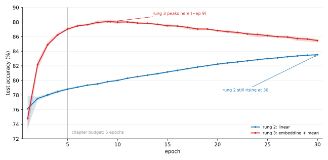

# 임베딩 — 단어를 벡터로

[스텝2](02_linear.md)은 단어마다 **수 하나**를 배웠다. `excellent`의 웨이트, `the`의 웨이트. 그것으로 78.80%를 얻었다.

이 절은 단어마다 **벡터**를 배운다. 64개의 수다. 그 벡터들을 평균내어 평 하나를 나타내고, 그 위에 선형 레이어를 얹는다.

**차례는 여전히 버린다.** 평균은 순서를 보지 않으므로 "좋지 않다"와 "않다 좋지"는 아직 같다. 바뀌는 것은 단어를 **어떻게 나타내는가**뿐이다.

---

## 1. 길이를 맞추는 일이 먼저다

[스텝2](02_linear.md)까지는 평을 세기 벡터로 바꾸었으므로 길이가 저절로 20,000으로 같았다. 이제는 단어를 차례대로 넣어야 하므로 길이가 제각각인 것이 문제가 된다.

흔한 방법이 **패딩과 길이 제한**다. 400칸으로 정하고, 짧으면 0으로 채우고 길면 뒤를 버린다.

값이 둘 든다. **평의 12.5%가 400칸을 다 채운다. 여기에는 정확히 400개인 문서와 초과분이 잘린 문서가 함께 포함된다.** 그리고 짧은 평에는 뜻 없는 0이 잔뜩 붙으므로, 평균을 낼 때 그 칸들을 빼야 한다. 코드의 `mask`가 하는 일이다.

---

## 2. 코드

```python
"""스텝3: 낱말을 배운 벡터로 바꾸고 평균낸다.

스텝2는 낱말마다 수 하나(웨이트)를 배웠다. 이 절은 낱말마다 **벡터**를 배운다.
그 벡터들을 평균내어 평 하나를 나타내고, 그 위에 선형 레이어를 얹는다.

차례는 여전히 버린다. 평균은 순서를 보지 않는다. 바뀌는 것은
'낱말을 어떻게 나타내는가'뿐이다.
"""
import re
from collections import Counter
from pathlib import Path

import numpy as np
import torch
import torch.nn as nn
import torch.optim as optim
from torch.utils.data import DataLoader, TensorDataset

ROOT = Path("./data/aclImdb")
VOCAB_SIZE, MAX_LEN, EMB_DIM = 20000, 400, 64
EPOCHS, BATCH, LR = 5, 100, 1e-3
PAD = 0

TOKEN = re.compile(r"[a-z']+")
def tokenize(t): return TOKEN.findall(t.replace("<br />"," ").lower())
def load(split):
    docs, labels = [], []
    for label, name in ((1,"pos"),(0,"neg")):
        for f in sorted((ROOT/split/name).glob("*.txt")):
            docs.append(tokenize(f.read_text(encoding="utf-8"))); labels.append(label)
    return docs, np.array(labels)

train_docs, train_y = load("train"); test_docs, test_y = load("test")
counts = Counter(w for d in train_docs for w in d)
# 0번은 채움(PAD)으로 비워 둔다
vocab = ["<pad>"] + [w for w,_ in counts.most_common(VOCAB_SIZE-1)]
index = {w:i for i,w in enumerate(vocab)}

def to_ids(docs):
    """평 하나를 길이 MAX_LEN의 번호 열로. 짧으면 0으로 채우고 길면 자른다."""
    X = np.zeros((len(docs), MAX_LEN), dtype=np.int64)
    for r,d in enumerate(docs):
        ids = [index[w] for w in d if w in index][:MAX_LEN]
        X[r,:len(ids)] = ids
    return X

Xtr = torch.from_numpy(to_ids(train_docs)); ytr = torch.from_numpy(train_y).long()
Xte = torch.from_numpy(to_ids(test_docs));  yte = torch.from_numpy(test_y).long()
lens = (Xtr != PAD).sum(1)
print(f"자료 학습 {len(train_docs):,}편  시험 {len(test_docs):,}편")
print(f"{MAX_LEN}칸으로 맞춘 뒤: 채움이 아닌 칸 가운뎃값 {int(lens.median())}, "
      f"{MAX_LEN}칸을 다 채운 평 {100.0*(lens==MAX_LEN).float().mean():.1f}%")

class MeanEmbedding(nn.Module):
    def __init__(self):
        super().__init__()
        self.emb = nn.Embedding(VOCAB_SIZE, EMB_DIM, padding_idx=PAD)
        self.fc = nn.Linear(EMB_DIM, 2)
    def forward(self, x):
        e = self.emb(x)                          # (B, MAX_LEN, EMB_DIM)
        mask = (x != PAD).unsqueeze(-1).float()  # 채움 칸은 평균에서 뺀다
        mean = (e*mask).sum(1) / mask.sum(1).clamp(min=1)
        return self.fc(mean)

def run(seed):
    torch.manual_seed(seed)
    m = MeanEmbedding()
    opt = optim.Adam(m.parameters(), lr=LR); crit = nn.CrossEntropyLoss()
    g = torch.Generator().manual_seed(seed)
    ld = DataLoader(TensorDataset(Xtr,ytr), batch_size=BATCH, shuffle=True, generator=g)
    for _ in range(EPOCHS):
        m.train()
        for xb,yb in ld:
            opt.zero_grad(); crit(m(xb),yb).backward(); opt.step()
    m.eval()
    with torch.no_grad():
        acc = 100.0*torch.cat([m(Xte[i:i+1000]).argmax(1) for i in range(0,len(Xte),1000)]
                              ).eq(yte).float().mean().item()
    return acc, sum(p.numel() for p in m.parameters()), m

accs=[]
for s in range(5):
    a, npar, m = run(s); accs.append(a)
    print(f"  씨앗 {s}  {a:.2f}%", flush=True)
print(f"\n스텝3 임베딩 + 평균  평균 {sum(accs)/len(accs):.2f}%  "
      f"스프레드 {max(accs)-min(accs):.2f} ({min(accs):.2f}~{max(accs):.2f})  파라메터 {npar:,}")

# 배운 벡터가 뜻을 담았는가 — 가까운 낱말을 본다
with torch.no_grad():
    E = m.emb.weight[1:]
    E = E/E.norm(dim=1, keepdim=True).clamp(min=1e-8)
    for w in ["great","bad","boring"]:
        i = index[w]-1
        sim = (E @ E[i]); sim[i] = -9
        print(f"  '{w}'과 가까운 낱말:", ", ".join(vocab[1+j] for j in sim.topk(6).indices))
```

**출력:**

```
자료 학습 25,000편  시험 25,000편
400칸으로 맞춘 뒤: 채움이 아닌 칸 가운뎃값 169, 400칸을 다 채운 평 12.5%
  씨앗 0  86.97%
  씨앗 1  86.96%
  씨앗 2  87.03%
  씨앗 3  87.26%
  씨앗 4  86.92%

스텝3 임베딩 + 평균  평균 87.03%  스프레드 0.34 (86.92~87.26)  파라메터 1,280,130
  'great'과 가까운 낱말: perfect, ages, best, enjoyed, rare, malone
  'bad'과 가까운 낱말: money, dull, worst, below, stars', clone
  'boring'과 가까운 낱말: effort, lacks, pills, clone, poor, annoying
```

---

## 3. 87.03%

| 스텝 | 정확도 | 남은 오차 | 지운 몫 | 파라메터 |
|---|---|---|---|---|
| [1 최근접 중심 분류기](01_counting.md) | 65.16% | 34.84% | — | 40,000 |
| [2 선형 학습](02_linear.md) | 78.80% | 21.20% | 39% | 40,002 |
| 3 임베딩 + 평균 | **87.03%** | 12.97% | **39%** | **1,280,130** |

**8.23%포인트를 벌었다.** 시드 스프레드가 0.34이므로 **그 이 기록에서 개선이 일관되었다는 것**은 의심할 여지가 없다. 그리고 두 스텝이 공교롭게도 남은 오차를 똑같이 39%씩 지운다.

다만 참인 것과 그 크기를 그대로 믿는 것은 다르다. 아래 4절과 5절이 이 8.23을 두 번 깎는다. 얼마가 **크기**의 몫이고 얼마가 **예산**의 몫인지를 따로 재면 남는 것이 훨씬 작다.

그런데 파라메터가 **32배**로 늘었다.

---

## 4. 표현이 번 것인가, 크기가 번 것인가

앞의 두 스텝은 파라메터가 같았으므로 이 물음이 없었다. 여기서는 물어야 한다. 임베딩 차원만 바꾸어 재어 보면 갈린다.

| 임베딩 차원 | 정확도 | 파라메터 |
|---|---|---|
| 1 | 71.16% | 20,004 |
| 4 | 80.05% | 80,010 |
| 16 | 84.56% | 320,034 |
| 64 | **86.96%** | 1,280,130 |

**크기를 따라 고르게 오른다.** 어느 차원에서 갑자기 좋아지는 임계 같은 것이 없다.

그리고 눈여겨볼 칸이 둘이다.

**차원 1의 정확도는 더 낮았다.** 그러나 이진 분류는 두 로짓의 차이 하나로 결정되므로, 평균 임베딩과 선형 레이어만 있는 모델은 차원 1로도 임의의 단어별 선형 감성 점수를 표현할 수 있다. 낮은 점수를 표현력 부족만으로 설명할 수는 없다. 분해된 파라메터의 최적화, 학습 기간과 입력 전처리 차이도 고려해야 한다.

**차원 4는 스텝2를 겨우 넘는다**(80.05% 대 78.80%). 파라메터가 두 배인데 1.25%포인트다.

평균 임베딩 뒤에 선형 레이어만 두면 전체 로짓은 단어 빈도에 대한 선형 함수다. 임베딩 행렬을 $E$, 분류 웨이트를 $W$라 하면 유효 단어 웨이트는 $EW^\top$이다. 이진 판정에는 차원 1도 충분하므로, 차원 증가와 정확도의 관계를 새로운 비선형 표현력이나 의미 학습만의 효과로 해석할 수 없다. 이 코드에서는 어휘 한 칸을 PAD에 쓰고 알려진 단어 400개까지 남기므로 스텝2와 입력도 완전히 같지는 않다.

---

## 5. 규약이 이 스텝 편이었는가

앞 꼭지가 8.23%포인트 가운데 얼마가 **크기**의 몫인지를 물었다. 물어야 할 것이 하나 더 있다. **예산**의 몫이다.

이 장은 학습하는 다섯 스텝을 모두 5 에포크로 잰다. 하나의 규약으로 재야 나란히 놓을 수 있기 때문이다. 그런데 **5 에포크가 두 스텝에게 똑같이 공평한가?**

스텝2와 스텝3을 30 에포크까지 늘려 에포크마다 재어 보았다.



| 에포크 | 스텝2 | 스텝3 | 차이 |
|---|---|---|---|
| **5** (이 장의 규약) | 78.80% | **87.03%** | **+8.23** |
| 10 | 80.00% | 87.99% | +7.99 |
| 20 | 82.23% | 86.83% | +4.60 |
| 30 | 83.53% | 85.46% | **+1.93** |

**차이가 8.23에서 1.93으로 줄어든다.**

두 곡선이 서로 다르게 움직이기 때문이다.

- **스텝3은 9에포크 언저리에서 꼭대기(88.08%)를 찍고 내려온다.** 그 뒤로는 과적합이다.
- **스텝2는 30에포크까지 계속 오른다.** 아직 꼭대기에 닿지도 않았다.

그러므로 **5 에포크는 스텝3에게 거의 가장 좋은 자리이고 스텝2에게는 한참 이른 자리다.** 하필 둘의 차이가 가장 크게 벌어지는 곳에서 잰 계산이다.

!!! warning "그렇다고 규약이 틀린 것은 아니다"
    스텝마다 제 나름의 예산을 주면 비교가 무너진다. "스텝3이 스텝2를 이겼다"가 "스텝3에 준 예산이 스텝2에 준 예산을 이겼다"와 뒤섞이기 때문이다. **하나의 규약으로 재는 것이 옳다.**

    다만 그 규약이 **어느 쪽에 유리한지는 재어 보아야 알 수 있고**, 여기서는 스텝3 쪽이었다. 그것을 적어 두지 않으면 8.23이라는 수가 실제보다 크게 읽힌다.

    이 장의 표는 그대로 5 에포크 값을 싣는다. 다섯 스텝을 같은 자로 재기 위해서다. 다만 **관측된 개선 폭은 비교 시점에 따라 1.93·4.55·8.23%포인트로 달라진다**라고 읽는 편이 실제에 가깝다.

### 그래서 이 스텝이 실제로 번 것은 얼마인가

재는 자리마다 답이 다르다.

| 어떻게 재는가 | 스텝3이 번 몫 |
|---|---|
| 5 에포크에서 (이 장의 규약) | +8.23 |
| 30 에포크에서 | +1.93 |
| 저마다 가장 좋았던 자리에서 (88.08 대 83.53) | +4.55 |

셋 다 참인 측정이고 셋 다 다른 물음의 답이다. **"이 생각이 얼마를 버는가"에는 하나의 수가 없다.**

마지막 줄은 기록된 각 시험 곡선의 최고점을 비교한 값이다. 그러나 시험 점수로 에포크를 고르면 선택 바이어스가 생긴다. 최종 비교에서는 검증 집합으로 각 모델의 학습 기간을 고른 뒤, 별도 시험 집합에서 한 번 평가해야 한다. 고정 에포크 비교와 검증으로 조정한 비교는 서로 다른 질문에 답한다.

[4장](../ch04/index.md)이 "점을 늘리는 것과 곡선을 보는 것은 다른 일이다"라고 적었다. 여기서 그 말이 **스텝 사이의 비교**에까지 걸린다. 곡선을 보지 않으면 규약이 누구 편인지 알 수 없다.

---

## 6. 배운 벡터가 뜻을 담았는가

출력의 마지막 세 줄이 그 물음에 답한다.

> `great`과 가까운 단어: **perfect**, ages, **best**, **enjoyed**, rare, malone
>
> `bad`과 가까운 단어: money, **dull**, **worst**, below, stars', clone
>
> `boring`과 가까운 단어: effort, **lacks**, pills, clone, **poor**, **annoying**

굵게 칠한 것은 그럴듯하다. `great`—`perfect`—`best`, `boring`—`lacks`—`poor`—`annoying`은 뜻이 닿는다.

**나머지는 그렇지 않다.** `ages`, `malone`, `pills`, `clone`, `stars'`가 왜 거기 있는지 설명하기 어렵다. `malone`은 사람 이름이다.

!!! warning "이 단어들은 시드 하나의 것이다"
    위 목록은 마지막으로 학습한 모델(시드 4)에서 뽑은 것이다. 시드 0으로 다시 학습하면
    `great` 곁에 `vivid, wonderfully, ideal, wonderful, replies, today`가 오고
    `boring` 곁에는 `mess, poorly, unfortunately, spare, ridiculous, sucks`가 온다.

    **어느 단어가 오는지는 시드마다 바뀐다.** 바뀌지 않는 것은 그 목록이
    '그럴듯한 것 반, 까닭을 알 수 없는 것 반'이라는 성질이다. 아래 논의는
    그 성질에 대한 것이지 특정 단어에 대한 것이 아니다.

까닭은 이 벡터들이 **뜻을 배운 것이 아니라 이 과제를 배웠기** 때문이다. 목표는 오직 좋게 보았는지 나쁘게 보았는지를 맞히는 것이므로, 어떤 배우 이름이 나쁜 평에 자주 나왔다면 그 이름이 `bad` 쪽으로 끌려간다. 뜻이 닮아서가 아니라 **같은 클래스의 평에 함께 나와서**다.

!!! note "word2vec 같은 것과 다르다"
    단어 벡터라 하면 흔히 "왕 − 남자 + 여자 = 여왕" 같은 것을 떠올린다. 그런 벡터는 **훨씬 많은 글**에서 **단어 스스로를 맞히는 일**로 배운 것이다.

    여기의 벡터는 영화평 25,000편에서 **감정 하나**를 맞히는 일로 배웠다. 감성 분류에 유용한 방향이 강조되며, 다른 의미 관계가 얼마나 남았는지는 이 예시만으로 확정할 수 없다. 같은 이름을 쓰지만 같은 것이 아니다.

---

## 7. 아직 차례를 모른다

87.03%는 좋은 값이지만 이 모델도 [스텝2](02_linear.md)과 같은 벽 앞에 있다. **평균은 순서를 보지 않는다.**

"훌륭하다고 말하고 싶지만 지루했다"와 "지루하다고 말하고 싶지만 훌륭했다"는 단어가 같으므로 벡터의 평균도 같다. 판정은 반대인데 모델이 보는 것은 하나다.

[스텝4 LSTM](04_lstm.md)이 이 벽을 다룬다.

---

## 연습문제

<div class="drillbox" markdown>

**연습문제 1.** <span class="diff med" title="중간"></span>
평의 12.5%가 400칸에서 잘린다. 잘린 뒷부분에 판정을 뒤집을 말이 있다면? `MAX_LEN`을 키우면 해결되는가?

</div>

??? success "연습문제 1 풀이"
    **키우면 잘림은 줄지만 값이 든다.** 800으로 두면 계산이 두 배가 되고, 평의 대부분은 400칸도 채우지 못하므로 그 계산의 대부분이 채움 칸에 쓰인다.

    그런데 이 절의 모델에서는 **잘림이 생각만큼 아프지 않다.** 평균을 내므로 단어 하나하나의 몫이 $1/n$로 작고, 400단어를 이미 읽었다면 뒤의 몇 단어가 평균을 크게 움직이지 못한다.

    **차례를 읽는 모델에서는 다르다.** 영화평은 마지막에 판정을 적는 일이 잦아("결론적으로 추천하지 않는다") 뒤를 자르면 가장 중요한 부분을 버릴 수 있다. 그래서 자를 때 **앞이 아니라 뒤를 남기는** 쪽이 나은 경우가 있다.

    확인하려면 `[:MAX_LEN]`을 `[-MAX_LEN:]`으로 바꾸어 재어 보면 된다. 이 절의 모델에서는 거의 안 바뀌고, LSTM에서는 달라질 수 있다.

---

<div class="drillbox" markdown>

**연습문제 2.** <span class="diff hard" title="어려움"></span>
본문은 이득의 상당 부분이 "모델이 커진 몫"이라고 했다. 그 둘을 더 깨끗하게 가르려면 어떤 실험을 해야 하는가?

</div>

??? success "연습문제 2 풀이"
    **스텝2 쪽의 크기를 키워 맞대어야 한다.** 지금 표는 임베딩 쪽만 크기를 바꾸었으므로, 크기가 같을 때 어느 표현이 나은지는 말하지 못한다.

    맞대는 방법이 둘 있다.

    **하나, 스텝2에 은닉 레이어를 넣는다.** 세기 벡터 20,000개를 받아 64칸으로 줄였다가 2로 보내면 파라메터가 약 128만 개로 스텝3과 거의 같아진다. 그러면 "같은 크기에서 세기냐 임베딩냐"를 물을 수 있다.

    **둘, 스텝3의 단어 목록을 줄인다.** 차원 64를 두고 단어를 5,000개로 줄이면 32만 개가 되어 중간 크기와 견줄 수 있다.

    둘 다 이 절이 하지 않은 실험이다. 그러므로 본문의 "상당 부분은 크기의 몫"은 **차원을 키우면 좋아진다는 사실까지만** 말한 것이고, 같은 크기에서 어느 쪽이 나은지는 재지 않았다. [4.4절](../ch04/02_depth.md)이 깊이와 필터 크기를 가를 때 쓴 방식이 여기에도 그대로 필요하다.

---

<div class="drillbox" markdown>

**연습문제 3.** <span class="diff easy" title="쉬움"></span>
스텝3의 파라메터 1,280,130개를 레이어별로 쪼개어라. 구조는 `nn.Embedding(20000, 64)`과 `nn.Linear(64, 2)`뿐이다. 그리고 **스텝2의 분류기(40,002개)와 스텝3의 분류기를 비교하여라.**

</div>

??? success "연습문제 3 풀이"
    ```python
    emb = 20000 * 64        # 임베딩 표
    clf = 64 * 2 + 2        # 그 위의 선형 분류기
    print(f"임베딩 {emb:,}  분류기 {clf}  합 {emb + clf:,}")
    print(f"임베딩이 차지하는 몫 {100 * emb / (emb + clf):.2f}%")
    print(f"스텝2 분류기 40,002 -> 스텝3 분류기 {clf}  = {40002 / clf:.0f}배 작아짐")
    ```

    ```
    임베딩 1,280,000  분류기 130  합 1,280,130
    임베딩이 차지하는 몫 99.99%
    스텝2 분류기 40,002 -> 스텝3 분류기 130  = 308배 작아짐
    ```

    **파라메터의 99.99%가 임베딩 표다.** 판정을 내리는 부분은 130개뿐이다.

    더 눈여겨볼 것은 스텝2과의 비교다. 전체는 32배로 **커졌는데** 분류기는 308배 **작아졌다.**

    | | 표현 | 분류기 | 분류기가 보는 차원 |
    |---|---|---|---|
    | [스텝2](02_linear.md) | 없음 (단어 세기 그대로) | 40,002 | 20,000 |
    | 스텝3 | 1,280,000 | **130** | **64** |

    곧 이 스텝이 한 일은 분류기를 키운 것이 아니라 **분류기가 풀기 쉬운 자리로 데이터를 옮긴 것**이다. 20,000차원에서 선을 긋던 일을 64차원에서 긋게 만들었고, 그 옮기는 법을 1,280,000개로 배웠다.

    이것이 이 장이 "**표현도 학습한다**"고 적은 뜻이다. 그리고 [4장 6절](../ch04/03_vgg16_transfer.md)이 VGG16을 두고 한 말과 같은 모양이다 — 거기서도 차원을 3,072에서 4,096으로 늘렸지만 그 위에 올린 것은 선형 분류기 하나였다. **좋은 표현은 분류기를 작게 만든다.**

    (연습문제 2가 묻는 "커진 몫"이 어디에 있는지도 이 쪽이 가리킨다. 커진 것은 임베딩 표이고, 분류기는 오히려 줄었다. 그러므로 "모델이 커져서 좋아졌다"를 재려면 **임베딩 표의 크기**를 움직여야 한다.)

