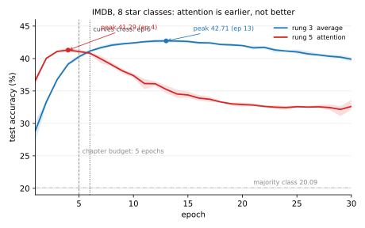

# 별점을 맞힌다 — 과제가 어려우면 달라지는가

[사전 학습 임베딩](03_frozen.md)은 임베딩 고정 여부와 상위 구조의 상호작용을 비교했다. 작은 데이터에서의 최적화와 모델 크기는 가능한 설명이지만 아직 분리되지 않았다. 이 페이지는 과제가 너무 쉬웠다는 다른 가설도 살펴본다.

**좋다/나쁘다를 가르는 일이 너무 쉬웠다는 것이다.** `terrible`이나 `perfect`가 있는지만 세어도 거의 풀리는 과제라면, 차례를 읽는 장치는 보탤 것이 없는 자리에 힘을 쓴 계산이 된다. 그렇다면 뒤집힘의 원인은 데이터의 크기가 아니라 **과제의 쉬움**이다.

같은 2만 5천 편의 리뷰로 여덟 등급 분류를 비교하면 과제 변화의 영향을 살펴볼 수 있다. 다만 결과가 같거나 달라졌다는 것만으로 원인을 과제 난이도 또는 모델 크기 하나로 확정할 수는 없다.

---

## 1. 여덟 클래스는 어디서 오는가

aclImdb는 파일 이름에 별점을 적어 둔다. `200_8.txt`는 200번 평이고 별 여덟이라는 뜻이다. 그러니 내려받을 것도 없이 클래스를 늘릴 수 있다.

다만 **다섯과 여섯이 없다.** 데이터를 만든 이들이 라벨 붙은 묶음에서 뺐기 때문이며, 그 까닭을 README가 적어 두었다.

> In the labeled train/test sets, a negative review has a score <= 4 out of 10, and a positive review has a score >= 7 out of 10. Thus reviews with more neutral ratings are not included in the train/test sets.

[데이터셋 설명](https://ai.stanford.edu/~amaas/data/sentiment/)에 따르면 라벨이 붙은 학습·시험 집합은 1~4점과 7~10점 리뷰만 포함하므로 여덟 클래스다. 비라벨 5만 편은 중립 점수만으로 구성된 집합이 아니며, 5점과 6점도 포함할 수 있다.

클래스가 고르지 않다는 점도 함께 적어야 한다.

| | 1★ | 2★ | 3★ | 4★ | 7★ | 8★ | 9★ | 10★ |
|---|---|---|---|---|---|---|---|---|
| 시험 편수 | **5,022** | 2,302 | 2,541 | 2,635 | 2,307 | 2,850 | 2,344 | 4,999 |

우연은 $100/8 = 12.5\%$지만, 가장 많은 1★을 늘 찍으면 **20.09%**가 된다. **넘어야 할 바닥은 20.09%다.** 우연이 아니다.

### 자를 하나 더 둔다

별점은 **순서가 있는** 레이블이다. 9★짜리 평을 10★으로 본 것과 1★으로 본 것은 똑같이 "틀림"이지만 같은 잘못이 아니다. 그래서 정확도와 함께 **MAE**를 잰다. 맞힌 별과 참 별의 차이를 별 단위로 평균한 값이다.

나머지는 6장 그대로다. 어휘 목록 2만, 길이 400, 임베딩 64차원, Adam $10^{-3}$, 배치 100, 5 에포크, 시드 다섯. **내놓는 클래스 수만 2에서 8로 바뀐다.**

---

## 2. 코드

여섯 스텝을 한 스크립트에 담았다. 스텝1·2는 단어 세기를, 스텝3~6은 단어 번호를 받으므로 데이터를 두 벌 만든다.

```python
"""여덟 클래스 별점 사다리. 같은 평 2만 5천 편, 어려운 일감.

6장의 사다리는 스텝3에서 멈춘다. 까닭 후보가 둘이었다.
  (가) 평 2만 5천 편에 견주어 128만 개짜리 임베딩이 너무 크다
  (나) 좋다/나쁘다가 낱말 세기로 거의 풀려서 엮을 것이 없다

자료 크기를 그대로 두고 일감만 어렵게 하면 (나)를 따로 잴 수 있다.
규약은 6장 그대로이고 내놓는 클래스 수만 8이다.
"""

import re
import time
from collections import Counter
from pathlib import Path

import numpy as np
import torch
import torch.nn as nn
import torch.optim as optim
from torch.utils.data import DataLoader, TensorDataset

ROOT = Path("./data/aclImdb")
VOCAB_SIZE, MAX_LEN, EMB_DIM, HIDDEN, HEADS = 20000, 400, 64, 64, 4
FF_DIM = 4 * EMB_DIM
EPOCHS, BATCH, LR, PAD = 5, 100, 1e-3, 0
SEEDS = range(5)

STARS = [1, 2, 3, 4, 7, 8, 9, 10]        # 5★, 6★은 라벨이 없다
N_CLASS = len(STARS)
S2I = {s: i for i, s in enumerate(STARS)}  # 별점 -> 0~7

torch.set_num_threads(1)          # 스레드 수가 바뀌면 더하는 차례가 바뀐다

TOKEN = re.compile(r"[a-z']+")


def tokenize(t):
    return TOKEN.findall(t.replace("<br />", " ").lower())


# === 자료: 파일 이름에서 별점을 읽는다 ======================================
def load(split):
    """'id_rating.txt'의 rating을 그대로 이름표로 쓴다."""
    docs, stars = [], []
    for pol in ("pos", "neg"):
        for f in sorted((ROOT / split / pol).glob("*.txt")):
            docs.append(tokenize(f.read_text(encoding="utf-8")))
            stars.append(int(f.stem.split("_")[1]))
    return docs, np.array([S2I[s] for s in stars])


train_docs, ytr_np = load("train")
test_docs, yte_np = load("test")
counts = Counter(w for d in train_docs for w in d)
vocab = ["<pad>"] + [w for w, _ in counts.most_common(VOCAB_SIZE - 1)]
index = {w: i for i, w in enumerate(vocab)}

maj = np.bincount(yte_np).max() / len(yte_np) * 100
print(f"자료 학습 {len(train_docs):,}편  시험 {len(test_docs):,}편  클래스 {N_CLASS}개")
print(f"  우연 {100/N_CLASS:.2f}%   가장 많은 클래스 {maj:.2f}%  <- 넘어야 할 바닥")
print("  클래스별 시험 편수 " +
      "  ".join(f"{STARS[i]}★:{c:,}" for i, c in enumerate(np.bincount(yte_np))),
      flush=True)


def to_counts(docs):
    """스텝1·2용. 낱말 세기를 줄 길이로 나눈다."""
    X = np.zeros((len(docs), VOCAB_SIZE), dtype=np.float32)
    for r, d in enumerate(docs):
        for w in d:
            j = index.get(w)
            if j is not None:
                X[r, j] += 1
    return X / np.maximum(X.sum(1, keepdims=True), 1)


def to_ids(docs):
    """스텝3~6용. 낱말 번호를 400칸에 담는다."""
    X = np.zeros((len(docs), MAX_LEN), dtype=np.int64)
    for r, d in enumerate(docs):
        ids = [index[w] for w in d if w in index][:MAX_LEN]
        X[r, :len(ids)] = ids
    return torch.from_numpy(X)


# === 순서가 있는 이름표라 자를 하나 더 둔다 =================================
def mae_stars(pred):
    """맞힌 별과 참 별의 차이. 9★을 10★으로 본 것과 1★으로 본 것을 가른다."""
    s = np.array(STARS)
    return float(np.abs(s[pred] - s[yte_np]).mean())


# === 스텝1: 최근접 중심 (학습이 없으므로 씨앗도 없다) =======================
def rung1(Ctr, Cte):
    cent = np.vstack([Ctr[ytr_np == c].mean(0) for c in range(N_CLASS)])
    # ||x-c||^2 = ||x||^2 - 2x·c + ||c||^2 로 편다. 그냥 빼면
    # (25000, 8, 20000)짜리 배열이 생겨 16GB를 먹는다.
    # ||x||^2은 클래스마다 같으므로 빼도 argmin이 바뀌지 않는다.
    d = (-2.0 * (Cte @ cent.T)) + (cent ** 2).sum(1)[None, :]
    return 100.0 * (d.argmin(1) == yte_np).mean()


# === 스텝2: 낱말 세기 위의 선형 학습 ========================================
def rung2(Ctr, Cte, seed):
    torch.manual_seed(seed)
    m = nn.Linear(VOCAB_SIZE, N_CLASS)
    opt = optim.Adam(m.parameters(), lr=LR)
    crit = nn.CrossEntropyLoss()
    g = torch.Generator().manual_seed(seed)
    ld = DataLoader(TensorDataset(torch.from_numpy(Ctr),
                                 torch.from_numpy(ytr_np).long()),
                    batch_size=BATCH, shuffle=True, generator=g)
    for _ in range(EPOCHS):
        m.train()
        for xb, yb in ld:
            opt.zero_grad(); crit(m(xb), yb).backward(); opt.step()
    m.eval()
    with torch.no_grad():
        p = m(torch.from_numpy(Cte)).argmax(1).numpy()
    return 100.0 * (p == yte_np).mean(), p


# === 스텝3~6: 6장 그대로, 내놓는 클래스만 8 ===================================
def safe_mask(pad):
    """줄 전체가 채움이면 어텐션의 softmax가 -inf만 보고 NaN을 낸다.

    한 자리를 열어 둔다. 스텝3의 clamp(min=1), 스텝4의 lengths.clamp(min=1)과
    같은 구실이다. IMDB에는 빈 줄이 없지만 다른 자료로 옮기면 터진다
    ([스텝5](05_attention.md)의 경고 참고).
    """
    m = pad.clone(); m[:, 0] = False
    return m


class MeanEmbedding(nn.Module):
    """스텝3. 낱말 벡터를 평균낸다 — 차례를 버린다."""

    def __init__(self):
        super().__init__()
        self.emb = nn.Embedding(VOCAB_SIZE, EMB_DIM, padding_idx=PAD)
        self.fc = nn.Linear(EMB_DIM, N_CLASS)

    def forward(self, x):
        e = self.emb(x)
        m = (x != PAD).unsqueeze(-1).float()      # 채움 칸은 평균에서 뺀다
        return self.fc((e * m).sum(1) / m.sum(1).clamp(min=1))


class LSTMClassifier(nn.Module):
    """스텝4. 왼쪽에서 오른쪽으로 한 칸씩 읽는다."""

    def __init__(self):
        super().__init__()
        self.emb = nn.Embedding(VOCAB_SIZE, EMB_DIM, padding_idx=PAD)
        self.lstm = nn.LSTM(EMB_DIM, HIDDEN, batch_first=True)
        self.fc = nn.Linear(HIDDEN, N_CLASS)

    def forward(self, x):
        e = self.emb(x)
        # 진짜 길이만큼만 읽는다. 안 그러면 짧은 평에서 0이 수백 칸 흘러
        # 기억을 씻어 낸다. 길이는 CPU에 있어야 한다.
        lengths = (x != PAD).sum(1).clamp(min=1).cpu()
        packed = nn.utils.rnn.pack_padded_sequence(e, lengths, batch_first=True,
                                                   enforce_sorted=False)
        _, (h, _) = self.lstm(packed)
        return self.fc(h[-1])


class AttentionClassifier(nn.Module):
    """스텝5. 모든 낱말이 서로를 곧장 본다."""

    def __init__(self):
        super().__init__()
        self.emb = nn.Embedding(VOCAB_SIZE, EMB_DIM, padding_idx=PAD)
        self.pos = nn.Parameter(torch.randn(1, MAX_LEN, EMB_DIM) * 0.02)
        self.attn = nn.MultiheadAttention(EMB_DIM, HEADS, batch_first=True)
        self.norm = nn.LayerNorm(EMB_DIM)
        self.fc = nn.Linear(EMB_DIM, N_CLASS)

    def forward(self, x):
        e = self.emb(x) + self.pos                # 자리를 알려 준다
        pad = (x == PAD)
        a, _ = self.attn(e, e, e, key_padding_mask=safe_mask(pad))
        h = self.norm(e + a)                      # 남은 이음
        m = (~pad).unsqueeze(-1).float()
        return self.fc((h * m).sum(1) / m.sum(1).clamp(min=1))   # 다시 평균이다


class TransformerClassifier(nn.Module):
    """스텝6. 어텐션 뒤에 피드포워드 클래스를 얹어 블록을 완성한다."""

    def __init__(self):
        super().__init__()
        self.emb = nn.Embedding(VOCAB_SIZE, EMB_DIM, padding_idx=PAD)
        self.pos = nn.Parameter(torch.randn(1, MAX_LEN, EMB_DIM) * 0.02)
        self.attn = nn.MultiheadAttention(EMB_DIM, HEADS, batch_first=True)
        self.n1 = nn.LayerNorm(EMB_DIM)
        self.ff = nn.Sequential(nn.Linear(EMB_DIM, FF_DIM), nn.ReLU(),
                                nn.Linear(FF_DIM, EMB_DIM))
        self.n2 = nn.LayerNorm(EMB_DIM)
        self.fc = nn.Linear(EMB_DIM, N_CLASS)

    def forward(self, x):
        h = self.emb(x) + self.pos
        pad = (x == PAD)
        a, _ = self.attn(h, h, h, key_padding_mask=safe_mask(pad))
        h = self.n1(h + a)                        # 여기까지가 스텝5
        h = self.n2(h + self.ff(h))               # 이 한 줄이 스텝6이다
        m = (~pad).unsqueeze(-1).float()
        return self.fc((h * m).sum(1) / m.sum(1).clamp(min=1))


DEEP = [("3 평균", MeanEmbedding), ("4 LSTM", LSTMClassifier),
        ("5 어텐션", AttentionClassifier), ("6 트랜스포머", TransformerClassifier)]


def train_deep(Model, seed, Xtr, ytr, Xte):
    torch.manual_seed(seed)
    m = Model()
    opt = optim.Adam(m.parameters(), lr=LR)
    crit = nn.CrossEntropyLoss()
    g = torch.Generator().manual_seed(seed)
    ld = DataLoader(TensorDataset(Xtr, ytr), batch_size=BATCH,
                    shuffle=True, generator=g)
    for _ in range(EPOCHS):
        m.train()
        for xb, yb in ld:
            loss = crit(m(xb), yb)
            # NaN은 터지지 않고 정확도를 조용히 바닥값으로 굳힌다. 막아 둔다.
            if not torch.isfinite(loss):
                raise RuntimeError("로스가 NaN이다")
            opt.zero_grad(); loss.backward(); opt.step()
    m.eval()
    with torch.no_grad():
        p = torch.cat([m(Xte[i:i + 500]).argmax(1)
                       for i in range(0, len(Xte), 500)]).numpy()
    return 100.0 * (p == yte_np).mean(), p


if __name__ == "__main__":
    # --- 스텝1·2: 낱말 세기 ------------------------------------------------
    print("\n=== 스텝1·2: 낱말 세기 ===", flush=True)
    Ctr, Cte = to_counts(train_docs), to_counts(test_docs)
    t0 = time.time()
    print(f"  1 최근접중심  {rung1(Ctr, Cte):.2f}%  ({time.time()-t0:.0f}초)", flush=True)
    for s in SEEDS:
        t0 = time.time()
        acc, p = rung2(Ctr, Cte, s)
        print(f"  2 선형  씨앗 {s}  {acc:.2f}%  MAE {mae_stars(p):.2f}★  "
              f"({time.time()-t0:.0f}초)", flush=True)
    del Ctr, Cte                       # 2GB짜리 둘이라 바로 버린다

    # --- 스텝3~6: 낱말 번호 ------------------------------------------------
    print("\n=== 스텝3~6 ===", flush=True)
    Xtr, Xte = to_ids(train_docs), to_ids(test_docs)
    ytr = torch.from_numpy(ytr_np).long()
    for name, Model in DEEP:
        accs = []
        for s in SEEDS:
            t0 = time.time()
            acc, p = train_deep(Model, s, Xtr, ytr, Xte)
            accs.append(acc)
            print(f"  {name}  씨앗 {s}  {acc:.2f}%  MAE {mae_stars(p):.2f}★  "
                  f"({time.time()-t0:.0f}초)", flush=True)
        print(f"  >> {name}  평균 {sum(accs)/5:.2f}%  "
              f"스프레드 {max(accs)-min(accs):.2f}\n", flush=True)
```

**출력:**

```
자료 학습 25,000편  시험 25,000편  클래스 8개
  우연 12.50%   가장 많은 클래스 20.09%  <- 넘어야 할 바닥
  클래스별 시험 편수 1★:5,022  2★:2,302  3★:2,541  4★:2,635  7★:2,307  8★:2,850  9★:2,344  10★:4,999

=== 스텝1·2: 낱말 세기 ===
  1 최근접중심  24.75%  (1초)
  2 선형  씨앗 0  30.79%  MAE 2.88★  (3초)
  2 선형  씨앗 1  29.24%  MAE 3.13★  (2초)
  2 선형  씨앗 2  30.56%  MAE 2.91★  (2초)
  2 선형  씨앗 3  30.27%  MAE 2.96★  (2초)
  2 선형  씨앗 4  30.20%  MAE 2.97★  (2초)

=== 스텝3~6 ===
  3 평균  씨앗 0  40.52%  MAE 1.69★  (6초)
  3 평균  씨앗 1  40.34%  MAE 1.69★  (6초)
  3 평균  씨앗 2  39.92%  MAE 1.74★  (6초)
  3 평균  씨앗 3  40.28%  MAE 1.71★  (6초)
  3 평균  씨앗 4  40.34%  MAE 1.71★  (6초)
  >> 3 평균  평균 40.28%  스프레드 0.59

  4 LSTM  씨앗 0  35.89%  MAE 1.82★  (1096초)
  4 LSTM  씨앗 1  35.10%  MAE 1.96★  (1191초)
  4 LSTM  씨앗 2  36.24%  MAE 1.91★  (1041초)
  4 LSTM  씨앗 3  36.38%  MAE 1.92★  (994초)
  4 LSTM  씨앗 4  35.60%  MAE 2.07★  (993초)
  >> 4 LSTM  평균 35.84%  스프레드 1.28

  5 어텐션  씨앗 0  41.22%  MAE 1.53★  (478초)
  5 어텐션  씨앗 1  41.34%  MAE 1.53★  (466초)
  5 어텐션  씨앗 2  40.91%  MAE 1.50★  (465초)
  5 어텐션  씨앗 3  40.80%  MAE 1.51★  (464초)
  5 어텐션  씨앗 4  41.12%  MAE 1.52★  (464초)
  >> 5 어텐션  평균 41.08%  스프레드 0.54

  6 트랜스포머  씨앗 0  41.41%  MAE 1.50★  (520초)
  6 트랜스포머  씨앗 1  41.52%  MAE 1.55★  (519초)
  6 트랜스포머  씨앗 2  41.18%  MAE 1.50★  (519초)
  6 트랜스포머  씨앗 3  41.22%  MAE 1.50★  (548초)
  6 트랜스포머  씨앗 4  41.34%  MAE 1.52★  (554초)
  >> 6 트랜스포머  평균 41.33%  스프레드 0.33
```

---

## 3. 사다리를 다시 오른다

| 스텝 | 정확도 | 스프레드 | MAE | 이진에서는 |
|---|---|---|---|---|
| 바닥 (가장 많은 클래스) | 20.09 | — | — | 50.00 |
| [1 최근접 중심 분류기](01_counting.md) | 24.75 | — | — | 65.16 |
| [2 선형 학습](02_linear.md) | 30.21 | 1.55 | 2.97★ | 78.80 |
| [3 평균](03_embedding.md) | **40.28** | 0.59 | 1.71★ | **87.03** |
| [4 LSTM](04_lstm.md) | 35.84 | 1.28 | 1.94★ | 81.51 |
| [5 어텐션](05_attention.md) | **41.08** | 0.54 | 1.52★ | 86.11 |
| [6 트랜스포머](06_transformer.md) | **41.33** | 0.33 | 1.51★ | 85.98 |

**첫눈에는 뒤집힘이 풀린 것처럼 보인다.** 어텐션이 평균을 0.80, 트랜스포머가 1.05 이긴다. 범위도 겹치지 않는다(39.92\~40.52 대 40.80\~41.34). MAE도 같은 쪽을 가리킨다.

그리고 스텝 사이가 훨씬 넓게 벌어졌다. 이진에서는 스텝3·5·6이 87.03, 86.11, 85.98로 1점 안에 몰려 있어 가릴 것이 거의 없었다. 여기서는 스텝2에서 스텝3으로 **10.07%포인트**를 오른다. 임베딩이 하는 일이 처음으로 크게 보인다.

**여기서 멈췄다면 "어려운 과제에서는 차례가 값을 한다"고 적었을 것이다.** 그런데 이 장은 예산을 의심하는 버릇이 있다.

---

## 4. 5 에포크가 공평한 자리인가

[장 개요](index.md)가 이진 과제에서 이미 겪은 일이다. 스텝3은 9에포크에서 꼭대기를 찍고 내려오는데 스텝2는 30에포크까지 올랐다. 그래서 5 에포크는 스텝3 편이었다.

같은 것을 여기서도 잰다. 스텝3과 스텝5를 30에포크까지 돌리며 **에포크마다** 시험 정확도를 재어 곡선으로 본다. 위 스크립트에서 바뀌는 것은 세 군데뿐이다.

```python
"""여덟 클래스 별점에서 스텝3과 스텝5의 30에포크 곡선.

위 스크립트에서 달라지는 것:
  1. EPOCHS = 30 (5가 아니라)
  2. 에포크마다 evaluate()를 불러 곡선을 모은다
  3. 씨앗 하나를 인자로 받아 한 벌만 돌린다 — 씨앗마다 따로 띄워
     나란히 돌릴 수 있다. 스레드가 하나씩이라 더하는 차례는 바뀌지 않으므로
     같이 돌려도 값이 달라지지 않는다.

모델과 자료 준비는 위와 같으므로 여기서는 달라지는 부분만 적는다.

    python imdb_stars_curve.py 0      # 씨앗 0
"""

import json
import sys

EPOCHS = 30                    # <- 5가 아니다


@torch.no_grad()
def evaluate(m):
    """에포크마다 부른다. 정확도와 MAE를 함께 돌려준다."""
    m.eval()
    p = torch.cat([m(Xte[i:i + 500]).argmax(1)
                   for i in range(0, len(Xte), 500)]).numpy()
    return float(100.0 * (p == yte_np).mean()), mae_stars(p)


def curve(Model, seed):
    """train_deep과 같지만 에포크마다 재어 곡선을 모은다."""
    torch.manual_seed(seed)
    m = Model()
    opt = optim.Adam(m.parameters(), lr=LR)
    crit = nn.CrossEntropyLoss()
    g = torch.Generator().manual_seed(seed)
    ld = DataLoader(TensorDataset(Xtr, ytr), batch_size=BATCH,
                    shuffle=True, generator=g)
    accs, maes = [], []
    for _ in range(EPOCHS):
        m.train()
        for xb, yb in ld:
            loss = crit(m(xb), yb)
            if not torch.isfinite(loss):
                raise RuntimeError("로스가 NaN이다")
            opt.zero_grad(); loss.backward(); opt.step()
        a, e = evaluate(m)         # <- 여기가 요점이다
        accs.append(a); maes.append(e)
    return accs, maes


if __name__ == "__main__":
    seed = int(sys.argv[1])
    res = {}
    for name, Model in (("3 평균", MeanEmbedding),
                        ("5 어텐션", AttentionClassifier)):
        t0 = time.time()
        accs, maes = curve(Model, seed)
        res[name] = {"acc": accs, "mae": maes}
        b = int(np.argmax(accs))
        print(f"  씨앗 {seed} {name}  5에포크 {accs[4]:.2f}%  "
              f"30에포크 {accs[-1]:.2f}%  꼭대기 {accs[b]:.2f}% ({b+1}에포크)  "
              f"({time.time()-t0:.0f}초)", flush=True)
    json.dump(res, open(f"curve_seed{seed}.json", "w"), indent=1)
```

**출력** (시드 다섯 벌을 나란히 돌린 것):

```
  씨앗 0 3 평균  5에포크 40.52%  30에포크 39.97%  꼭대기 42.77% (12에포크)  (133초)
  씨앗 1 3 평균  5에포크 40.34%  30에포크 39.54%  꼭대기 42.87% (14에포크)  (133초)
  씨앗 2 3 평균  5에포크 39.92%  30에포크 40.18%  꼭대기 42.52% (13에포크)  (133초)
  씨앗 3 3 평균  5에포크 40.28%  30에포크 39.85%  꼭대기 42.79% (14에포크)  (133초)
  씨앗 4 3 평균  5에포크 40.34%  30에포크 39.91%  꼭대기 42.97% (12에포크)  (132초)

  씨앗 0 5 어텐션  5에포크 41.22%  30에포크 33.61%  꼭대기 41.69% (4에포크)  (9502초)
  씨앗 1 5 어텐션  5에포크 41.34%  30에포크 32.40%  꼭대기 41.34% (5에포크)  (9489초)
  씨앗 2 5 어텐션  5에포크 40.91%  30에포크 32.12%  꼭대기 41.12% (4에포크)  (9499초)
  씨앗 3 5 어텐션  5에포크 40.80%  30에포크 32.46%  꼭대기 41.20% (4에포크)  (9505초)
  씨앗 4 5 어텐션  5에포크 41.12%  30에포크 32.50%  꼭대기 41.27% (4에포크)  (9497초)
```

곡선으로 그리면 이렇다.



에포크별 평균값을 표로 옮기면 이렇다.

| 에포크 | 3 평균 | 5 어텐션 | 차이 |
|---|---|---|---|
| 1 | 28.89 | 36.64 | **+7.75** |
| 3 | 36.75 | 41.09 | +4.34 |
| **5** (이 장의 규약) | 40.28 | 41.08 | **+0.80** |
| **6** | 41.15 | 40.82 | **−0.33** |
| 13 | 42.71 | 35.25 | −7.47 |
| 20 | 41.99 | 32.91 | **−9.08** |
| 30 | 39.89 | 32.62 | −7.27 |

**두 곡선이 6에포크에서 교차하고, 이 장의 규약은 그 바로 한 에포크 앞이다.**

그리고 재는 자리에 따라 같은 두 모델의 차이가 **+7.75에서 −9.09까지** 움직인다. 16.8%포인트짜리 폭이다. 부호도 크기도 **언제 멈추었느냐가 정한다.**

저마다 가장 좋은 자리끼리 견주면 이렇게 된다.

| | 꼭대기 | 그 자리 | 범위 |
|---|---|---|---|
| 3 평균 | **42.78** | 13에포크 | 42.52\~42.97 |
| 5 어텐션 | 41.32 | **4에포크** | 41.12\~41.69 |

**−1.46으로 뒤집힌다.** 범위가 42.52와 41.69로 겹치지 않으니 이것도 참인 차이다. 곧 3절의 +0.80은 **규약이 만든 값**이었다.

---

## 5. 어텐션은 더 나은 것이 아니라 더 이른 것이다

곡선의 모양이 설명을 준다.

**어텐션은 1에포크에서 이미 36.64%다.** 평균은 그때 28.89%로 한참 뒤에 있다. 7.75%포인트를 앞선 채 출발한다. 그러고는 4에포크에 꼭대기를 찍고 **무너진다.** 30에포크에서 32.62%이니 꼭대기에서 **8.70%포인트**를 잃었다.

평균은 느리게 오른다. 13에포크까지 꾸준히 올라 42.78%에 닿고, 그 뒤로도 30에포크까지 2.89%포인트만 잃는다.

곧 어텐션은 **빨리 맞추고 빨리 외운다.** 평 2만 5천 편에서 빨리 맞춘다는 것은 빨리 외운다는 뜻이기도 하다.

### 유연함이 문제인가 — 두 가지를 재어 보았다

"어텐션이 이 데이터에 비교하여 너무 유연하다"가 자연스러운 읽기다. 그렇다면 유연함을 줄이면 꼭대기가 올라야 한다. 두 가지로 줄여 보았다.

| | 파라메터 | 꼭대기 | 범위 | 꼭대기 자리 |
|---|---|---|---|---|
| 5 어텐션 (그대로) | 1,322,888 | 41.32 | 41.12\~41.69 | 4 |
| **+ 드롭아웃 0.3** | 1,322,888 | 41.51 | 41.28\~41.68 | 4\~5 |
| **− 자리 임베딩** | **1,297,288** | 41.40 | 41.21\~41.74 | 4\~5 |
| [3 평균](03_embedding.md) | 1,280,520 | **42.78** | 42.52\~42.97 | **13** |

**둘 다 아무것도 바꾸지 못한다.** 세 줄이 0.19 안에 몰려 있고 범위가 거의 겹친다. 꼭대기 자리도 4\~5에포크에서 움직이지 않으며, 20에포크에서 33% 언저리로 무너지는 것도 똑같다. 그리고 셋 다 평균의 42.78에 1.4쯤 못 미치는데, 평균의 범위는 셋 모두와 겹치지 않는다.

이 두 변경에서는 최고 시험 점수의 개선이 작았다. 그러나 드롭아웃 한 강도와 위치 임베딩 제거만으로 정칙화나 표현력 전체를 원인에서 배제할 수는 없다.

위치 임베딩을 뺀 모델의 최고 시험 점수도 비슷했다. 이 설정에서는 위치 임베딩의 이득이 확인되지 않았지만, 원래 모델이 순서를 전혀 사용하지 않았다고 증명한 것은 아니다. 위치 정보 없는 자기 어텐션도 문맥에 따른 비선형 결합을 하므로 단순 평균과 같은 함수가 아니다.

그렇다면 42.78과 41.40을 가르는 것은 **차례가 아니다.** 스텝3은 **고르게** 평균내고 스텝5는 **무게를 배워서** 평균낸다. 둘의 차이는 그 무게를 배우는 일 자체다.

!!! note "이 쪽이 얻은 읽기"
    **어느 단어를 볼지 고르는 일도 외울 수 있는 일이다.** 평 2만 5천 편에서는 문맥별 웨이트를 배우는 것보다 **고르게 평균내는 편이 낫다.** 고른 평균은 배울 것이 없으니 외울 것도 없다.

    드롭아웃 0.3의 효과가 작았던 원인은 이 결과만으로 분리되지 않는다. 드롭아웃은 엑티베이션의 크기를 흔들지만, 여기서 외우는 것은 크기가 아니라 **무게의 꼴**이다.

    다만 이것은 두 점(고른 평균, 배운 무게)으로 그은 읽기다. 무게를 조금만 배우게 하는 중간을 만들어 재면 더 단단해질 것이고, 이 책은 아직 그것을 하지 않았다.


!!! warning "하마터면 적을 뻔한 것"
    이 쪽을 5 에포크에서 끝냈다면 **"어려운 과제에서는 차례가 값을 한다"**고 적었을 것이다. 그리고 그 문장은 [앞 쪽들](03_frozen.md)의 결론과 어긋나므로, 장 전체를 고쳐 썼을 것이다.

    막은 것은 새로운 생각이 아니라 **이미 있던 버릇**이다. 이진 과제에서 한 번 데였기에 예산을 의심했고, [스텝4 6절](04_lstm.md)이 30에포크 곡선을 그리는 코드를 이미 갖고 있었다.

    **틀린 결론을 막는 것은 대개 새 수법이 아니라 지난번에 틀렸던 자리를 기억하는 일이다.**

---

## 6. 데이터 규모는 중요한 후보지만 원인은 아직 열려 있다

두 축을 따로 움직여 보았다.

| 데이터 | 과제 | 견준 두 스텝 | 차이 | 어떻게 쟀나 |
|---|---|---|---|---|
| IMDB 2만 5천 | 이진 | 3 평균 → 5 어텐션 | **−0.92** | 5에포크 |
| IMDB 2만 5천 | 여덟 클래스 | 3 평균 → 5 어텐션 | **−1.46** | 저마다 꼭대기 |
| **Yelp 2만 5천** | **다섯 클래스** | 3 평균 → 5 어텐션 | **−1.60** | 저마다 꼭대기 |
| Yelp 56만 | 이진 | 3 평균 → **4 LSTM** | **+1.85** | 5에포크 |

**과제를 어렵게 해도 뒤집힘은 풀리지 않는다.** 바닥에서 45%포인트나 떨어진, 단어 세기로는 30%밖에 못 가는 과제에서도 차례를 버린 평균이 이긴다.

**데이터가 다른 것이어도 마찬가지다.** 별 다섯 클래스 Yelp를 **같은 2만 5천 편**으로 잘라 재면 −1.60이다. 그리고 그쪽에서는 어텐션의 꼭대기가 **정확히 5에포크**에 있었다. 5에포크로 재면 어텐션이 +1.96으로 이기는 것처럼 보이고, 저마다 꼭대기로 재면 −1.60으로 뒤집힌다. **이 절이 방금 겪은 일이 다른 데이터에서 한 번 더 일어난 것이다.**

**큰 데이터의 한 비교에서는 순서가 달랐다.** 같은 이진 과제이라도 Yelp에서 56만 편을 주면 LSTM이 평균을 1.85 이긴다. 다만 이 줄만 **다른 스텝**을 견준 값이다. 앞의 세 줄은 스텝3과 스텝5(어텐션)을 견주는데, 56만 편에서 어텐션을 잰 값은 아직 없다 — 그때 돌린 것이 줄 전체가 채움일 때 NaN을 내는 [마스킹 버그](05_attention.md)에 걸렸고, 고친 뒤로 다시 재지 않았다. 그러므로 **바로 서는 줄 하나는 스텝 하나로만 받쳐져 있다.**

이 결과는 작은 데이터에서의 학습 조건과 모델 구조의 상호작용이 중요하다는 단서다. 그러나 Yelp의 큰 데이터 비교는 과제와 구조도 다르고, 일부는 최고 시험 점수·일부는 고정 에포크를 비교한다. 데이터 규모만의 인과 효과를 알아내려면 같은 데이터셋과 과제에서 표본 수를 단계적으로 바꿔야 한다.

!!! note "그래도 남은 것"
    이 쪽이 헛일은 아니다. 어려운 과제는 **스텝 사이를 벌려 놓았다.** 스텝2에서 스텝3으로 10.07%포인트를 오르고, MAE가 2.97★에서 1.71★로 줄어든다. 이진에서는 8.23%포인트였고 MAE라는 자는 아예 없었다.

    곧 어려운 과제가 고친 것은 **뒤집힘이 아니라 해상도**다. 사다리는 여전히 뒤집혀 있지만, 이제 스텝마다 무엇이 얼마를 버는지가 훨씬 또렷하게 보인다.

---

## 연습문제

<div class="drillbox" markdown>

**연습문제 1.** <span class="diff easy" title="쉬움"></span>
이 쪽은 우연(12.5%)이 아니라 가장 많은 클래스(20.09%)를 바닥으로 삼는다. 왜 그런가? 클래스가 고르다면 둘이 같아지는가?

</div>

??? success "연습문제 1 풀이"
    **아무것도 배우지 않고도 20.09%를 얻을 수 있기 때문이다.** 늘 1★이라고만 찍으면 된다. 그러므로 12.5%를 넘었다는 말은 자랑이 아니다. 20.09%를 넘어야 무언가를 배운 것이다.

    클래스가 고르면 둘이 같아진다. 클래스마다 $1/8$씩이면 가장 많은 클래스도 12.5%이므로 아무 클래스나 찍어도 12.5%다.

    이 데이터는 고르지 않다. 1★이 5,022편이고 9★이 2,344편이니 두 배가 넘게 차이 난다. **고르지 않은 데이터에서 정확도만 보면 속기 쉽다.** 큰 클래스만 잘 맞혀도 수가 오르기 때문이다. 이 쪽이 MAE를 함께 싣는 까닭의 절반이 여기에 있다.

---

<div class="drillbox" markdown>

**연습문제 2.** <span class="diff easy" title="쉬움"></span>
스텝2에서 스텝3으로 갈 때 정확도가 10.07%포인트 오르고 MAE가 2.97★에서 1.71★로 준다. 두 수가 같은 말을 하는가, 다른 말을 하는가?

</div>

??? success "연습문제 2 풀이"
    **비슷한 말이지만 같은 말은 아니다.**

    정확도는 **딱 맞혔는가**만 센다. 8★짜리 평을 7★으로 본 것과 1★으로 본 것이 똑같이 0점이다. MAE는 그 둘을 1★과 7★으로 구별한다.

    두 수가 함께 좋아졌으므로 스텝3은 **더 자주 맞히면서 틀릴 때도 덜 멀리 틀린다.** 만약 정확도만 오르고 MAE가 그대로였다면, 쉬운 평 몇 개를 더 맞혔을 뿐 어려운 평에서는 여전히 크게 빗나간다는 뜻이 된다.

    단어 세기에서 임베딩으로 갈 때 얻는 것이 무엇인지도 여기서 보인다. 단어 세기 모델도 `great`의 빈도와 클래스별 웨이트를 사용한다. 임베딩은 `great`과 `superb`와 `decent`가 **얼마나 센 말인지**를 벡터에 담을 수 있다. 별점을 맞히는 일에 필요한 것이 정확히 그것이라, MAE 쪽이 더 크게 좋아진다.

---

<div class="drillbox" markdown>

**연습문제 3.** <span class="diff med" title="중간"></span>
4절의 표에서 어텐션과 평균의 차이가 +7.75(1에포크)에서 −9.09(22에포크)까지 움직인다. 그렇다면 "저마다 가장 좋은 자리끼리 견준다"는 것이 언제나 옳은 규칙인가?

</div>

??? success "연습문제 3 풀이"
    **아니다. 그것도 하나의 조건이며, 값을 치른다.**

    가장 좋은 자리끼리 견주려면 **시험 데이터를 보고 멈출 자리를 골라야** 한다. 그런데 시험 데이터는 원래 한 번만 보는 것이다. 30에포크를 돌며 에포크마다 시험 정확도를 재고 가장 높은 것을 고르는 것은, 시험 데이터에 30번 맞춰 보는 일이다. 그렇게 고른 값은 **낙관적으로 치우친다.**

    제대로 하려면 학습 데이터에서 검증 묶음을 떼어 거기서 멈출 자리를 고르고, 시험은 마지막에 한 번만 보아야 한다. 이 책은 그 절차를 [9장](../ch09/index.md)에서 다룬다.

    −1.46은 관측된 시험 곡선의 최고점을 비교한 값이다. 두 모델에 같은 선택 방식을 적용해도 선택 바이어스의 크기는 곡선의 변동성과 후보 수에 따라 다를 수 있다. 따라서 개선량뿐 아니라 부호도 검증 기반 선택 후의 별도 시험 평가로 확인해야 한다.

    요점은 이렇다. **하나의 고정된 예산도 한쪽 편이고, 저마다의 꼭대기도 한쪽 편이다.** 어느 쪽도 중립이 아니므로, 어느 자로 쟀는지를 적는 수밖에 없다.

---

<div class="drillbox" markdown>

**연습문제 4.** <span class="diff hard" title="어려움"></span>
어텐션은 평균보다 파라메터가 3.3%(42,368개) 많을 뿐인데 꼭대기에서 8.70%포인트나 무너진다. 평균은 2.89%포인트만 잃는다. 3.3%가 그 차이를 만들 수 있는가?

</div>

??? success "연습문제 4 풀이"
    **파라메터의 수만으로는 설명되지 않는다.** 1,322,888과 1,280,520은 거의 같은 크기의 모델이다.

    두 가지를 나누어 보아야 한다.

    **하나, 무너지는 빠르기.** 어텐션은 1에포크에 36.64%다. 평균이 28.89%일 때다. 곧 어텐션은 같은 데이터를 **훨씬 빨리 맞춘다.** 빨리 맞추는 모델은 빨리 외우기도 한다. 이것은 파라메터의 수가 아니라 **최적화가 얼마나 잘 흐르는가**의 문제다. 어텐션은 단어에서 출력까지 거리가 1이라([스텝5](05_attention.md)) 그래디언트가 곧장 닿는다.

    **둘, 꼭대기의 높이.** 41.32와 42.78이다. 이쪽은 빠르기로 설명되지 않는다. 저마다 가장 좋은 자리를 주었는데도 어텐션이 낮다.

    둘째에 대한 후보는 **자리 임베딩**이었다. `self.pos`는 $400 \times 64 = 25{,}600$개로 어텐션이 평균 위에 더하는 42,368개의 60%이고, 400칸을 다 채우는 평이 드물어 뒤쪽 자리의 벡터는 몇 편 안 되는 평으로만 정해진다. **애초에 제대로 정해질 수 없는 파라메터**다.

    **재어 보니 아니었다.** 5절의 표대로 `self.pos`를 빼도 꼭대기가 41.32에서 41.40으로 움직일 뿐이고(범위가 겹친다), 드롭아웃을 걸어도 41.51이다. 셋 다 평균의 42.78에 1.4쯤 못 미친다.

    이 대조에서는 위치 임베딩 제거와 드롭아웃 0.3이 평균 모델과의 차이를 메우지 못했다. 문맥에 따른 가중 결합을 학습하는 방식이 영향을 주었을 가능성이 있지만, 이것도 최적화·정칙화·학습 기간을 더 비교해야 하는 가설이다.

    **후보를 재어서 지운 것도 결과다.** 만약 재지 않고 넘어갔다면 이 책은 "자리 임베딩이 범인일 것이다"라는 그럴듯한 문장을 남겼을 것이고, 그것은 틀린 문장이었다.
